# Streaming Events into a Fabric Eventhouse: Query Them with KQL, Then Time the Copy into OneLake

In [Part 1](/posts/fabriclakehouse/) I loaded a CSV into a Lakehouse. In [Part 2](/posts/fabriclakehouse2/) I linked a Dataverse table and timed how long a change took to arrive. In this post I try the third kind of data: a stream of events that never stops.

Fabric has a different engine for that, called an **Eventhouse**. I streamed events into one, queried them with KQL while they arrived, and then measured how long the same rows took to appear in the lake that the SQL endpoint reads.

I did not stream my sales orders. They are a batch, and a batch belongs in a Lakehouse. Instead I used the **Bicycles** sample source that Eventstream offers, which is a bike-share feed, not sales data.

## What an Eventhouse is

An Eventhouse is a Fabric item for events that carry a time stamp, such as logs, telemetry and sensor readings. It holds one or more KQL databases. You query it with KQL (Kusto Query Language), not T-SQL or Spark. It is the Kusto engine from Azure Data Explorer.

:::no-dumb-questions Where does an Eventhouse fit?
**Q: Why not just use the Lakehouse from Part 1?**
A: A Lakehouse table suits data that arrives in batches and changes slowly. An Eventhouse suits a feed that arrives all day and that you want to query within seconds. The Eventhouse engine indexes events by arrival time and holds recent data in a cache, which is why I could query rows seconds after they arrived.

**Q: What is Eventstream?**
A: It is the pipe in front of the Eventhouse. It takes events from a source, here a sample feed, and routes them to a destination, here a KQL table. It is a separate Fabric item.

**Q: Is there an open-source equivalent?**
A: Not an exact one, because Kusto is not open source. I did not try any of these, and this list is from my own knowledge. ClickHouse is the closest match for fast analytics over events. Apache Druid and Apache Pinot do similar work on streams. Elasticsearch or OpenSearch cover log and text search. TimescaleDB and InfluxDB cover time series. Apache Kafka is the counterpart of Eventstream, not of the database. None of them use KQL.
:::

## How this relates to my MQTT posts

In 2021 I wrote about MQTT in [Internet of Things (Part 1)](/posts/internetofthings1/) and [Internet of Things (Part 2)](/posts/internetofthings2/). I ran a Mosquitto broker in Docker, and also used a public test broker. An ESP8266 published messages to it, and in the second post a DHT11 sensor sent temperature readings. Node-RED published and subscribed too, and I turned an LED on by publishing `1` to a topic.

Those posts never stored the readings. The messages passed through the broker and I watched them in MQTT Explorer. That is the gap an Eventhouse fills, and it is the only link between the two sets of posts.

:::no-dumb-questions Mosquitto or Eventstream?
**Q: Does Eventstream replace the Mosquitto broker?**
A: No. They do different jobs. A broker delivers messages between devices and programs. Eventstream takes events into Fabric and routes them to a destination. A reading would travel from the sensor to the broker, and Eventstream would be one more subscriber.

**Q: Can Eventstream read from an MQTT broker?**
A: Microsoft's documentation says it has an MQTT source. It subscribes to one topic on a broker that it can reach over the internet, supports MQTT versions 3 and 5, and supports TLS. The documentation also lists Azure Event Grid and Azure IoT Operations as other ways in. I did not try the MQTT source. This post uses the Bicycles sample instead.

**Q: When is Mosquitto the better choice?**
A: When messages must go both ways, such as the LED command in my 2021 post. Microsoft's list of Eventstream destinations is a custom endpoint, an Eventhouse, a Lakehouse, a Spark notebook, a derived stream and Activator. None of them publishes a message back to a device or to an MQTT broker. Activator can run pipelines, notebooks, functions and Power Automate flows, and can send email or Teams messages, so you could write code that publishes to a broker, but nothing does it for you. I did not try that. A broker is also better on a local network with no internet, where low delay matters, or where you want a free tool with no capacity cost.

**Q: When is a destination in Fabric worth it?**
A: When the readings must sit beside other Fabric data, such as the sales tables from Parts 1 and 2, or when Power BI reports read them from there. For a few sensors at home that only I look at, a time-series database such as InfluxDB and a dashboard such as Grafana would do the job without Fabric. I have added a YouTube video about running Influx and Grafana in Docker on a Raspberry Pi to the references of both 2021 posts. I then built this post's pipeline with Mosquitto, Node-RED, InfluxDB and Grafana, using the same 120 stations, and I timed both. The results are in [The Fabric Part 3 Pipeline Again, with Mosquitto, Node-RED, InfluxDB and Grafana](/posts/internetofthings4/).
:::

## Create the Eventhouse and the stream

In my workspace I created an **Eventhouse** called `SalesEvents`. The name is a leftover from my plan to stream sales. Fabric created a KQL database of the same name inside it. I then created an **Eventstream** called `SalesStream`.

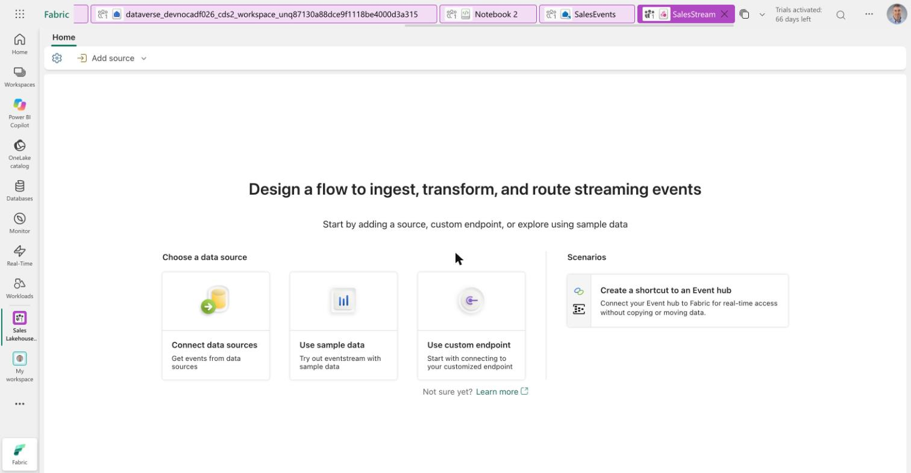
*A new Eventstream, offering a source, sample data or a custom endpoint*

I chose **Use sample data** and kept the default, **Bicycles**. This is a sample feed that Fabric generates itself, so I wrote none of it. It holds readings from bike-share stations: a street, a neighbourhood, a position, the number of bikes and the number of empty docks. The street names are London ones. I counted 120 stations, and each station repeats every 10 seconds or so. The feed keeps sending until you stop it.

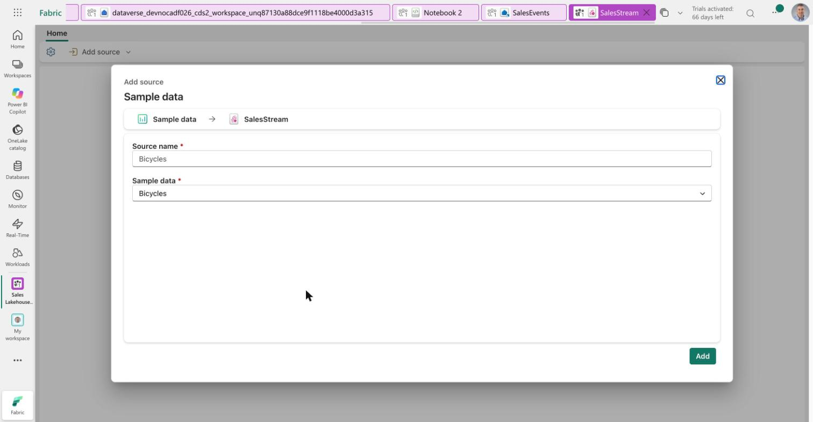
*The Add source dialog, with the Bicycles sample selected*

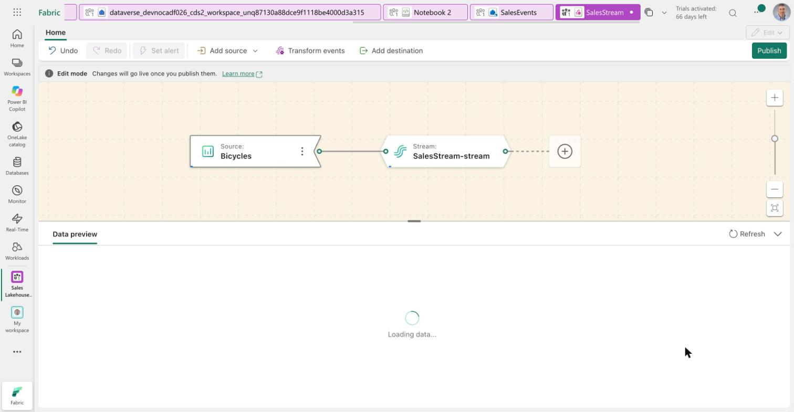
*The Bicycles source connected to the stream*

## Send the stream to the Eventhouse

I chose **Add destination**, then **Eventhouse**, picked **Direct ingestion**, and selected my `SalesEvents` Eventhouse and KQL database.

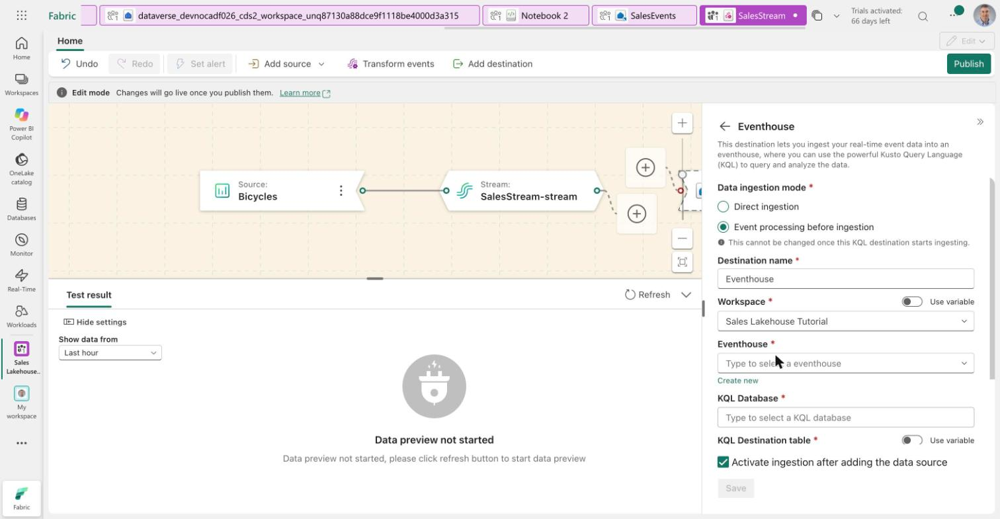
*The Eventhouse destination, before I filled it in*

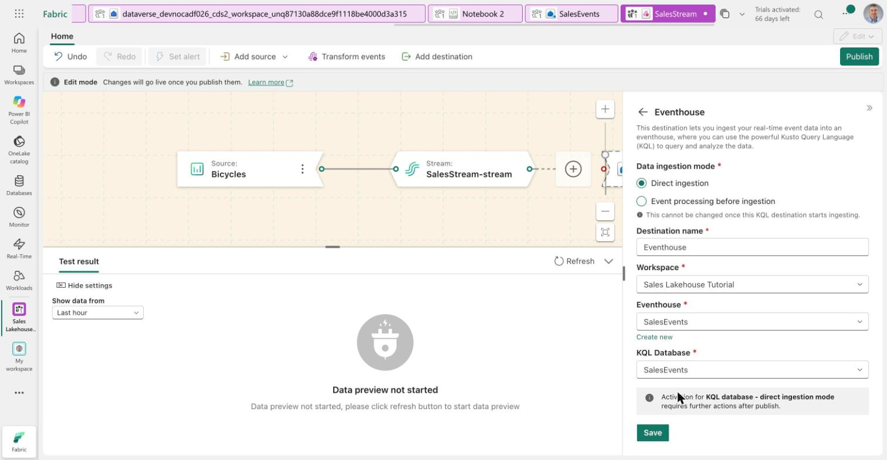
*The destination pointing at SalesEvents*

:::watch-it Publish refused the first time
I clicked **Publish** and got **Missing configuration**. The destination node had been added, but the stream was not connected to it.

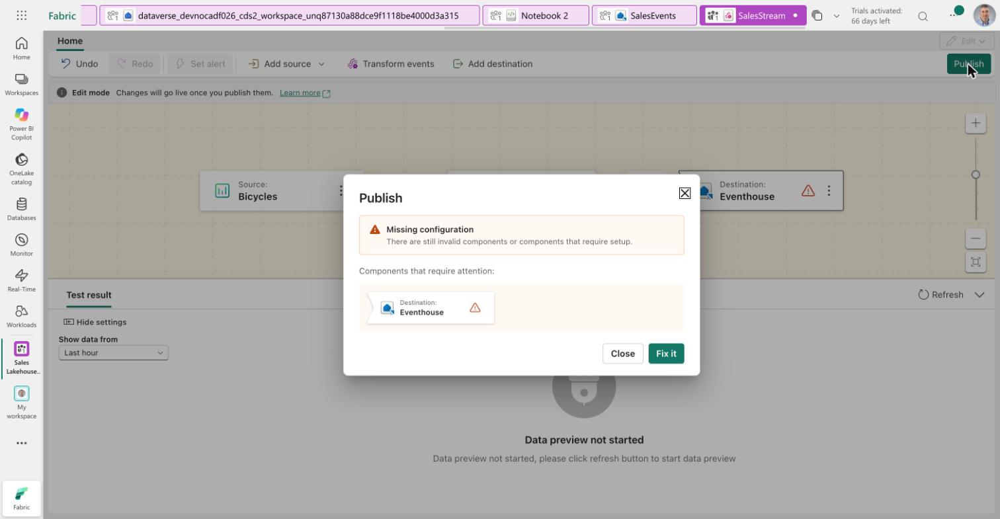
*The Publish dialog*

I dragged a line from the stream's output to the destination, and the warning disappeared.

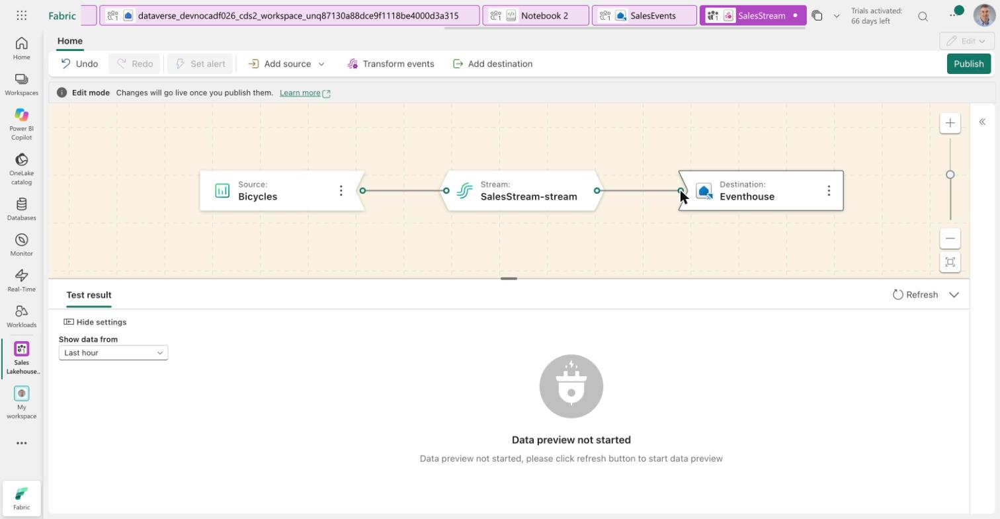
*The stream connected to the destination*
:::

I published again, and it succeeded.

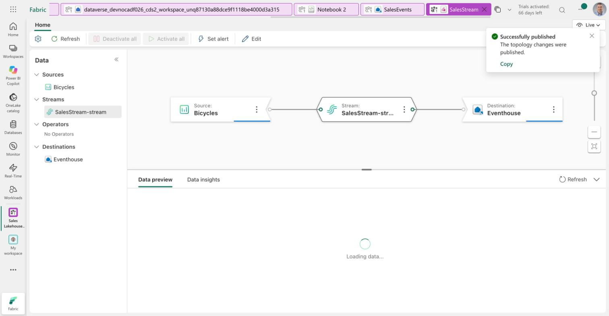
*Published at about 13:30*

Publishing was not enough. With direct ingestion the destination still said **KQL data stream was not configured**, and no table existed. I opened the destination's **Details** tab and clicked **Configure KQL data connection**.

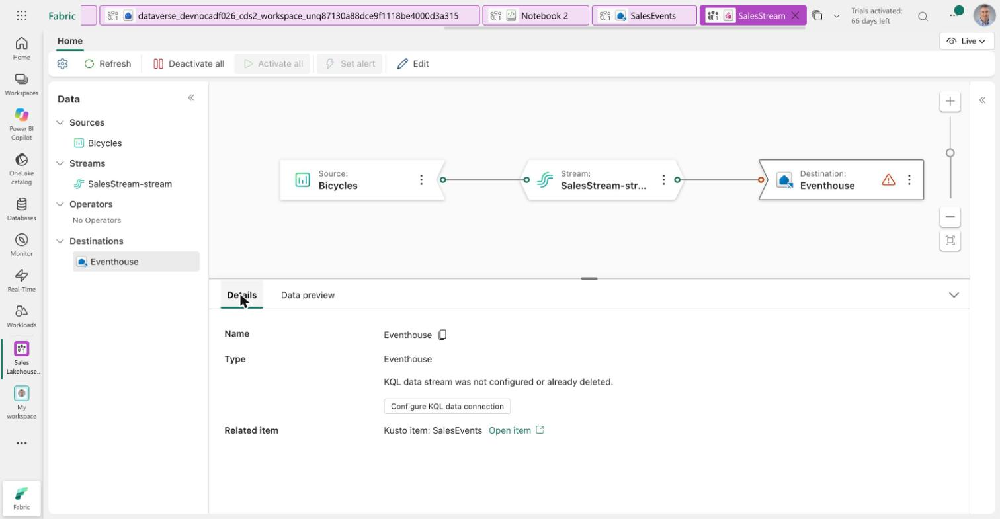
*The destination waiting for a table*

A **Get data** wizard opened. I chose **New table** and named it `BikeEvents`.

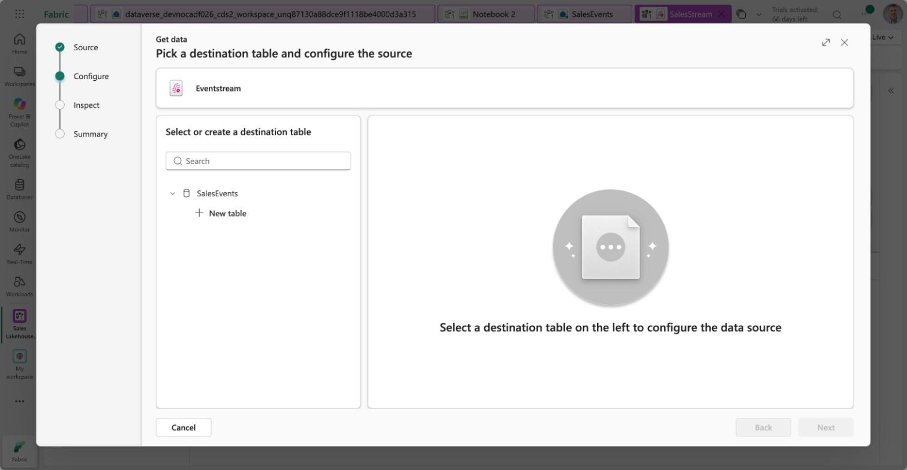
*Picking a destination table*

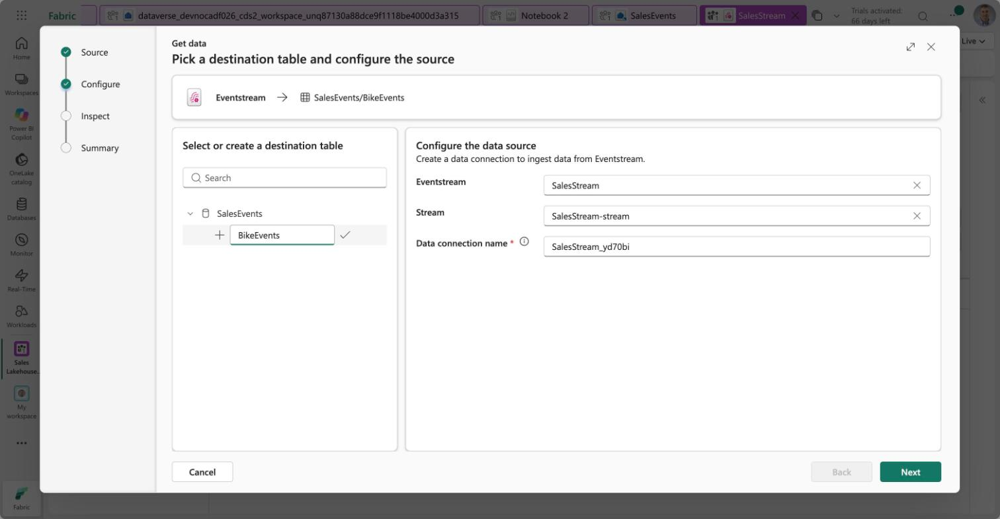
*The new table BikeEvents*

The wizard inspected a sample of 50 events. This is where I found out what the Bicycles feed contains: a station ID, street, neighbourhood, latitude, longitude, the number of bikes and the number of empty docks.

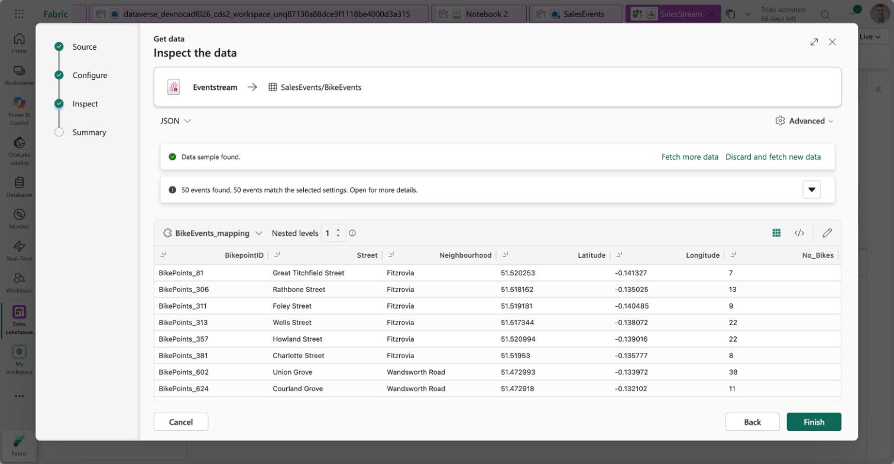
*The columns that the wizard found*

I clicked **Finish**, and it created the table, the column mapping and the data connection.

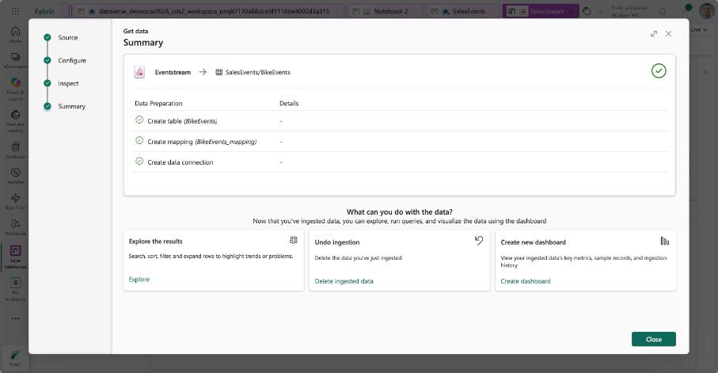
*The table, mapping and data connection were created*

## Query the events with KQL

Rows began to arrive at 13:32:07. I opened the database's query window and ran my first KQL query.

```kusto
BikeEvents
| summarize Rows=count(), Stations=dcount(BikepointID),
            FirstArrival=min(ingestion_time()), LastArrival=max(ingestion_time())
```

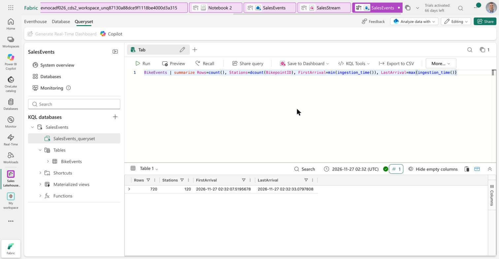
*720 rows from 120 stations, 26 seconds after the first arrival*

Rows arrived at roughly 12 a second, which was about all 120 stations every 10 seconds. The same station appeared again and again, so each row is a reading, not a new bike station.

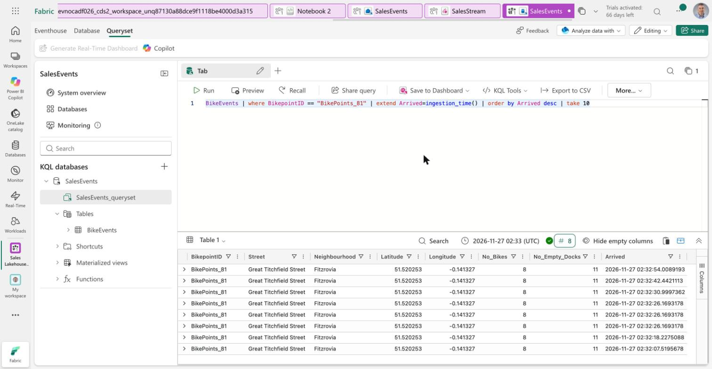
*One station, BikePoints_81, seen every 10 or 12 seconds*

`ingestion_time()` is the time a row reached the Eventhouse. I use it below to compare engines.

A second query counts rows per neighbourhood.

```kusto
BikeEvents
| summarize Rows=count(), Stations=dcount(BikepointID),
            FirstArrival=min(ingestion_time()), LastArrival=max(ingestion_time()),
            TotalBikes=sum(No_Bikes) by Neighbourhood
| top 8 by Rows desc
```

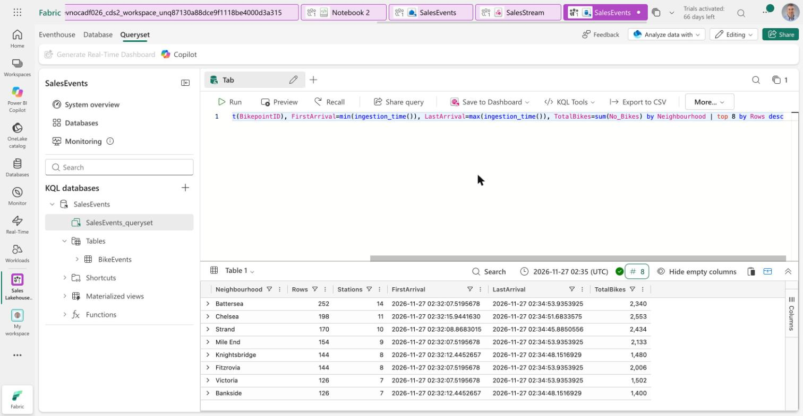
*Battersea had the most rows because it has the most stations*

To chart the current state, I took the latest reading for each station and added them up by neighbourhood.

```kusto
BikeEvents
| extend Arrived=ingestion_time()
| summarize arg_max(Arrived, No_Bikes) by BikepointID, Neighbourhood
| summarize Bikes=sum(No_Bikes) by Neighbourhood
| top 10 by Bikes
| render columnchart
```

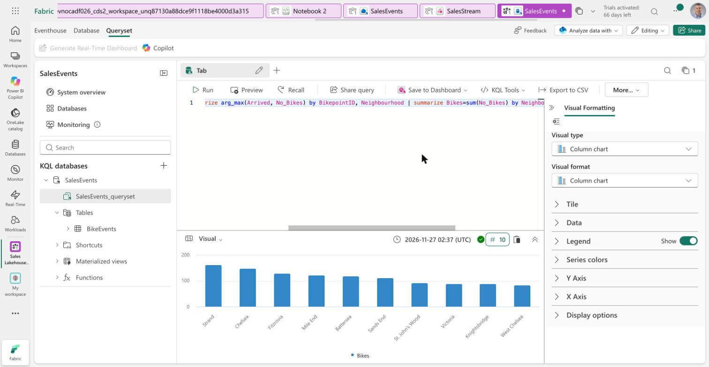
*Bikes available per neighbourhood, from each station's latest reading*

I turn this chart into a dashboard tile near the end of the post.

## Switch on OneLake availability

Parts 1 and 2 put data where the Lakehouse, the SQL endpoint and Power BI could all read it. An Eventhouse keeps its data in its own store, so to share it I opened the database and switched **OneLake availability** on, with **Apply to existing tables** ticked.

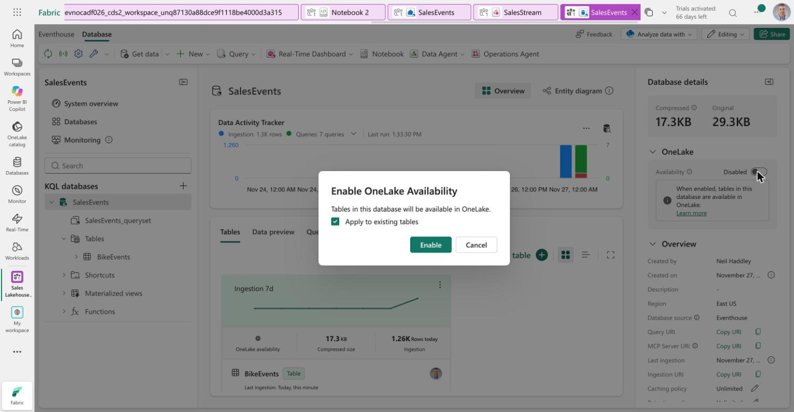
*The Enable OneLake Availability dialog*

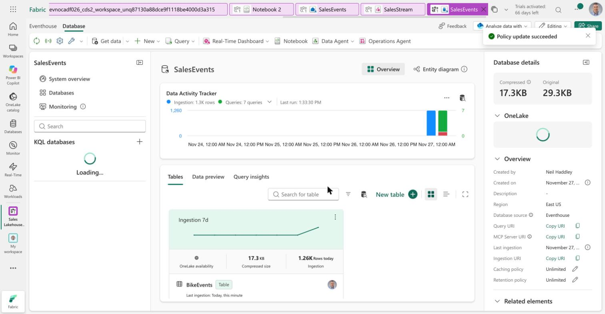
*Policy update succeeded at about 13:34*

Switching it on exposes the table as a Delta table in OneLake, so the other Fabric engines can read it. The documentation calls this a logical copy. Fabric writes it in batches. By default a batch waits until the files are big enough, or up to 3 hours, and the delay can be set to as little as 5 minutes.

A KQL command shows how the copy is going:

```kusto
.show database SalesEvents operations mirroring-statistics
```


*47% complete, with 56,107 bytes still to copy and a maximum latency of 1 minute 31 seconds*

## Read the same table with SQL

From **Analyze data with** I chose **SQL analytics endpoint**.

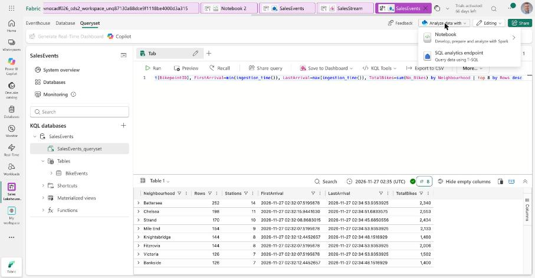
*The Analyze data with menu now offered the SQL analytics endpoint*

Fabric created a new item, also called `SalesEvents`, to hold that endpoint. The `BikeEvents` table appeared in its `dbo` schema.

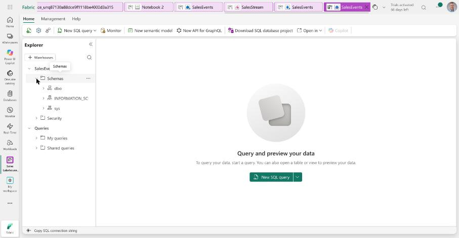
*The SQL analytics endpoint for the Eventhouse*

I ran a SQL count at 13:36:10.

```sql
SELECT COUNT(*) AS Rows_in_lake FROM dbo.BikeEvents
```

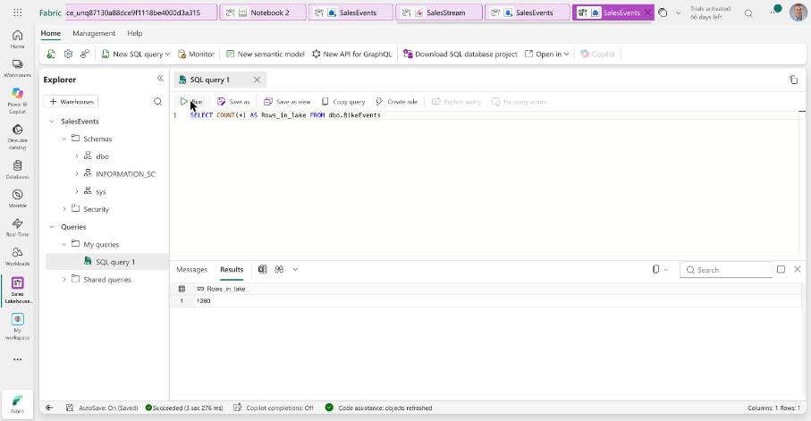
*1,280 rows in the lake at 13:36:10*

Then I ran the KQL count at 13:36:28.

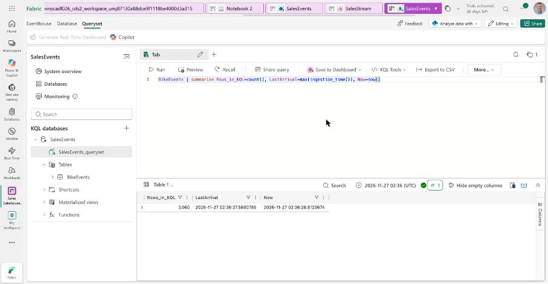
*3,060 rows in the Eventhouse at 13:36:28*

The Eventhouse was about 1,800 rows ahead of the lake after two minutes.

## Time the copy

The default delay is long, so at 13:36:48 I set the minimum of 5 minutes on the table with a KQL command.

```kusto
.alter-merge table BikeEvents policy mirroring dataformat=parquet with (IsEnabled=true, TargetLatencyInMinutes=5)
```

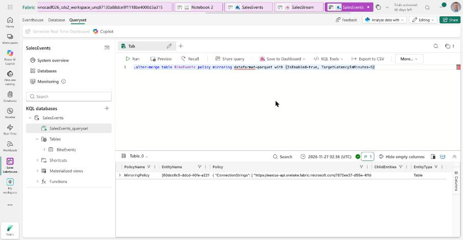
*The mirroring policy after I set TargetLatencyInMinutes to 5*

I then read both engines about once every few minutes. The KQL count is the live table. The SQL count is the table as the SQL analytics endpoint saw it.

| Time | Eventhouse (KQL) | SQL endpoint |
|---|---|---|
| 13:36 | 3,060 (13:36:28) | 1,280 (13:36:10) |
| 13:38 | not read | 2,480 (13:38:31) |
| 13:40 | 5,040 (13:39:48) | 3,060 (13:40:00) |
| 13:42 | 6,420 (13:42:03) | 3,060 (13:42:14) |
| 13:46 | 9,000 (13:46:22) | 3,060 (13:46:32) |
| 13:47, after I refreshed the endpoint | not read | 7,860 (13:47:06) |

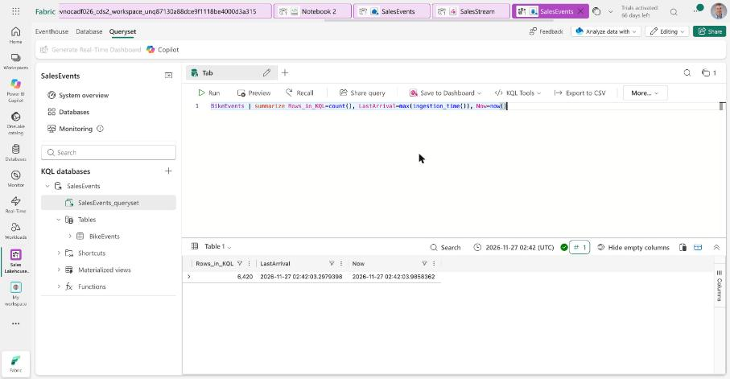
*13:42:03: 6,420 rows in the Eventhouse*


*13:42:14: the SQL endpoint still showed 3,060*


*13:46:22: 9,000 rows in the Eventhouse*

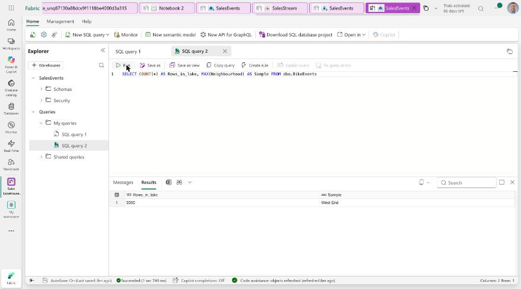
*13:46:32: the SQL endpoint still showed 3,060, as it had since 13:40*

The SQL endpoint stood at 3,060 for at least 6 minutes while the Eventhouse added about 4,000 rows. That is the same pattern as Part 2, and I wondered whether the lake itself was behind. I ran the mirroring statistics again.

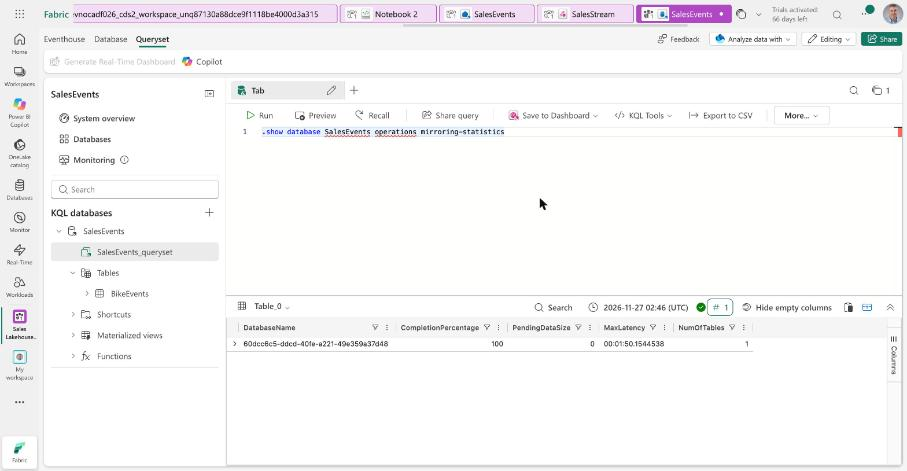
*13:46: 100% complete, nothing pending, and a maximum latency of 1 minute 50 seconds*

The Eventhouse said that the copy in OneLake was complete and that its newest data was under 2 minutes old. So I clicked the refresh icon on the SQL endpoint toolbar and ran the count again.

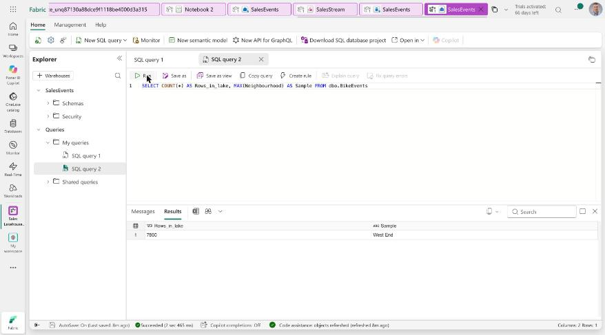
*13:47:06: 7,860 rows after the refresh*

The count jumped from 3,060 to 7,860. I did not read the Delta files directly, so I cannot prove where the gap sat. But the evidence points at the SQL endpoint, not the lake: the statistics reported nothing pending, and one refresh released about 4,800 rows. In Part 2 the SQL endpoint also lagged the Lakehouse by 16 to 18 minutes, and I could not tell what triggered the update. This time a refresh did.

:::watch-it A stale SQL count may not mean stale data
If the SQL analytics endpoint of an Eventhouse looks behind, check the mirroring statistics first. If they say 100% and nothing pending, try the refresh icon on the SQL endpoint toolbar before you decide that the lake is behind.
:::

## Build a Real-Time Dashboard

I had deactivated the stream at 13:47, so at 14:23 I clicked **Activate all** on the Eventstream and chose to start **Now**. Then I went back to the query window, ran the column chart query again, and chose **Save to Dashboard**, then **To a new Dashboard**.

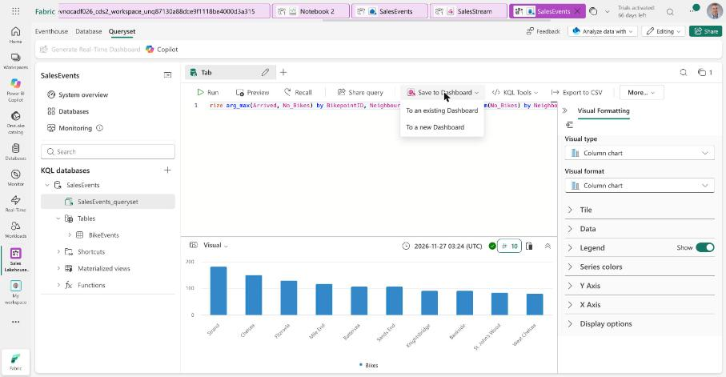
*Save to Dashboard offers an existing or a new dashboard*

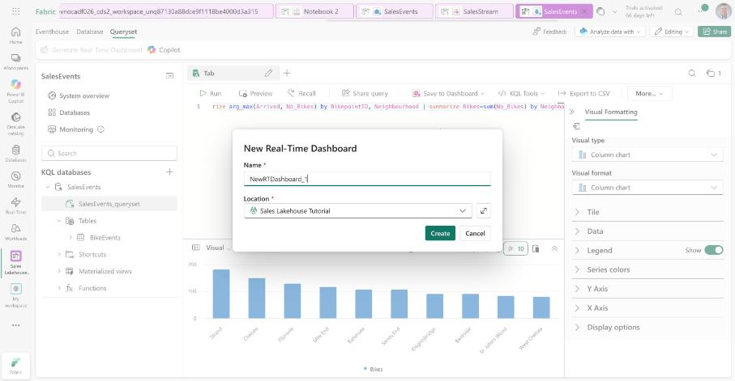
*I named the dashboard Bike Share Live*

The dashboard opened with the chart as its first tile.

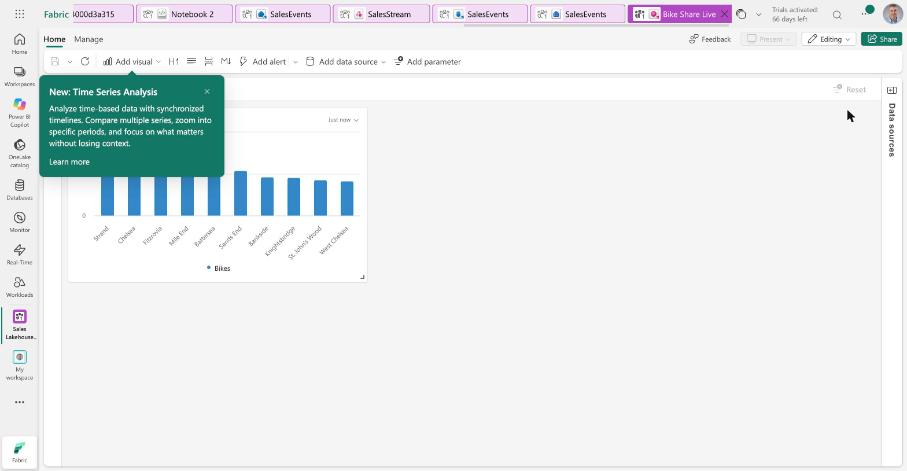
*The first tile, bikes per neighbourhood*

I added a second tile with **Add visual** and **Time chart**, using this query, and named it "Rows arriving per 10 seconds".

```kusto
BikeEvents
| summarize Rows=count() by Arrived=bin(ingestion_time(), 10s)
| render timechart
```

The tile editor reported **Done (0.435 s)** for 105 records, from a table that already held more than 9,000 rows.

On the **Manage** tab, **Refresh settings** already had **Live refresh** selected. It refreshes the tiles when new data is ingested, and a message warned me that it may use capacity.

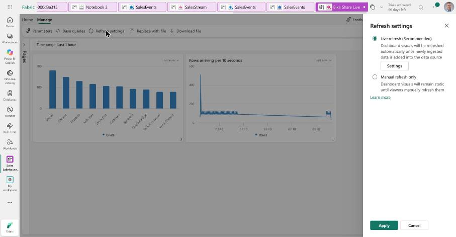
*Live refresh was already the recommended setting*

I saved the dashboard and switched it to **Viewing**. This is the dashboard at 14:27:02.


*14:27:02*

I touched nothing. This is the same dashboard at 14:27:36.

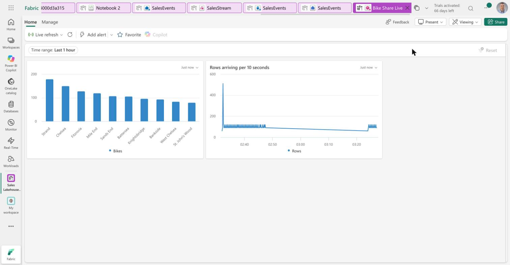
*14:27:36: the bars and the right-hand end of the line had moved*

:::watch-it The sloping line is a gap, not data
The time chart shows a long sloping line between about 02:50 and 03:23. That is the 35 minutes when I had the stream switched off, and the chart joins the points on either side. Also, the time axis is UTC. My local time is UTC+11, so 03:20 on the axis was 14:20 for me.
:::

## Stop the stream

The Bicycles sample sends events until you stop it, and it uses trial capacity while it does. After the dashboard screenshots I opened the Eventstream again and clicked **Deactivate all**. I had done the same at 13:47.

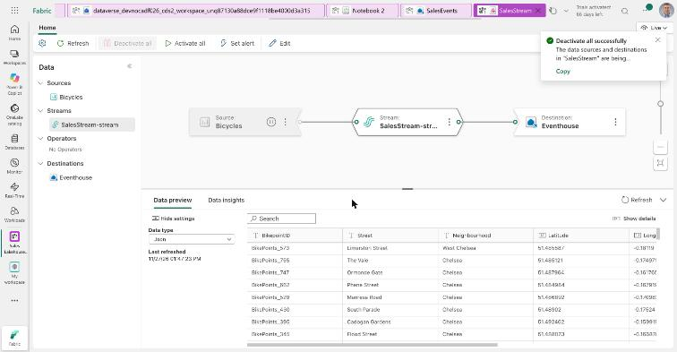
*Deactivate all successfully (the 13:47 screenshot)*

The Eventhouse, the Eventstream, the SQL analytics endpoint and the Bike Share Live dashboard remain in my workspace. The dashboard keeps Live refresh on, which refreshes its tiles when new data arrives. With the stream stopped, there is no new data to trigger it.

## What I learned

:::bullet-points What I learned
- An Eventhouse is for streams. I queried rows within seconds of their arrival, which I could not do with the Lakehouse in Part 1.
- The Bicycles sample is a bike-share feed, not sales data, and it repeats each station every 10 seconds or so. Count rows with care.
- With direct ingestion, publishing the Eventstream is not enough. I also had to configure the KQL data connection in the destination.
- The copy into OneLake is a batch, and the SQL endpoint is a further step behind it. The Eventhouse was ahead of the SQL endpoint at every reading, as the Dataverse link was in Part 2.
- When the SQL endpoint looks stale, check the mirroring statistics and refresh the endpoint. One refresh moved my count from 3,060 to 7,860.
- A Real-Time Dashboard is a few clicks from a KQL query. Live refresh is on by default, and my tiles moved within 34 seconds with no input from me.
- The Bicycles sample keeps running until you deactivate it.
- I rebuilt this pipeline with Mosquitto, Node-RED, InfluxDB and Grafana. It had the same shape, and its second copy lagged too. At about 10,000 rows, queries took a few milliseconds in both. I could not measure the Fabric message-to-row delay. The details are in [the companion post](/posts/internetofthings4/).
:::

## References

- [Eventhouse overview (Microsoft Learn)](https://learn.microsoft.com/fabric/real-time-intelligence/eventhouse)
- [Turn on OneLake availability for an eventhouse (Microsoft Learn)](https://learn.microsoft.com/fabric/real-time-intelligence/event-house-onelake-availability)
- [Kusto Query Language overview (Microsoft Learn)](https://learn.microsoft.com/kusto/query/)
- [Add MQTT source to an eventstream (Microsoft Learn)](https://learn.microsoft.com/fabric/real-time-intelligence/event-streams/add-source-mqtt)
- [The Fabric Part 3 Pipeline Again, with Mosquitto, Node-RED, InfluxDB and Grafana](/posts/internetofthings4/)
- [Internet of Things (Part 1)](/posts/internetofthings1/) and [Internet of Things (Part 2)](/posts/internetofthings2/)
