# A Fabric Data Agent over the AdventureWorks Lakehouse

In [Part 1](/posts/fabriclakehouse/) I built a Lakehouse, in [Part 2](/posts/fabriclakehouse2/) I linked Dataverse to Fabric, and in [Part 3](/posts/fabriclakehouse3/) I streamed events into an Eventhouse. In this part I follow Microsoft's [end-to-end tutorial for a Fabric data agent](https://learn.microsoft.com/fabric/data-science/data-agent-end-to-end-tutorial). A data agent lets someone ask a question in plain English and get an answer from tables in a Lakehouse.

I tried to do this on my free trial first, and it did not work. This post covers what I had to do to get a paid capacity, what I built, what went wrong, and how I checked the answers.

## The trial could not create a data agent

The New item list on my trial workspace offered a Data agent. When I named one and clicked Create, I got an error.


*The trial refused: "An admin needs to change the SKU type for your organization's Fabric capacity"*

Microsoft's tutorial says a data agent needs a paid F2 or higher capacity, or a Power BI Premium P1 or higher. That matches the error.

## Getting an F2 took longer than using it

An F2 is the smallest paid Fabric capacity. Azure bills it by the second while it runs, and I can delete it afterwards. Creating one for my Azure subscription took several attempts.

| Where I tried | What happened |
|---|---|
| West Europe | Refused: the region is not accepting new customers |
| North Europe | Refused: regional quota of 0 |
| East US | Refused: regional quota of 0 |
| My other two Azure subscriptions | Both disabled, and in a different tenant |
| A quota request for 2 capacity units in East US | Not approved: the portal told me to contact support |
| Sweden Central | Created in about 40 seconds |

The Quotas page in the Azure portal explained it. For Microsoft Fabric, many regions showed a limit of 16 capacity units for my subscription, and a few, including East US and North Europe, showed 0. I used Sweden Central, which had 16.

I did not choose Sweden Central for any reason of quality. I chose it because it was an EU region that already had quota. I did not check whether it offers every Fabric AI feature, but the data agent worked there.

## What the F2 cost

| | |
|---|---|
| Capacity created | 12:39:43 UTC |
| Capacity deleted | 13:14:41 UTC |
| Time it ran | about 35 minutes |
| List price in Sweden Central | $0.19 per capacity unit per hour |
| An F2 has | 2 capacity units, so about $0.38 an hour |
| Compute for this run | about $0.22 |

The $0.22 is my calculation from Microsoft's public price list, not a figure from my bill. Copilot and AI usage has its own meter in Azure's price list, and I have not read my Azure cost report yet, so the real figure may be higher.

## Create a workspace on the capacity

I created a new workspace, `Data Agent Tutorial`, and chose the Fabric workspace type. The capacity box already offered `fabdataagentsc - Sweden Central`.

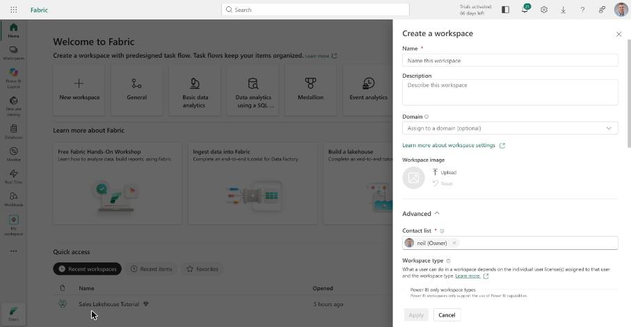
*I named the workspace*

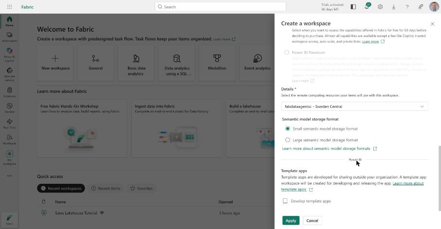
*The new F2 was listed as the capacity*

## Load the AdventureWorks sample

The tutorial loads the AdventureWorks sample with a notebook. I created a notebook and added a new Lakehouse called `AdventureWorksLH`.

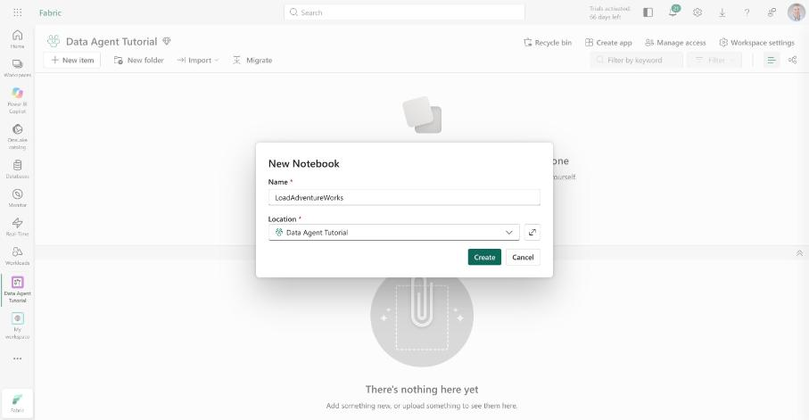
*I named the notebook LoadAdventureWorks*

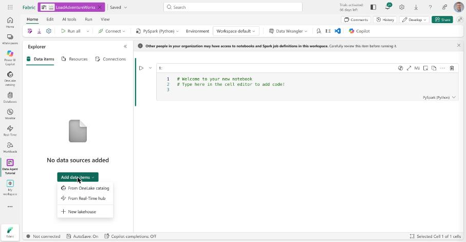
*I chose Add data items, then New lakehouse*

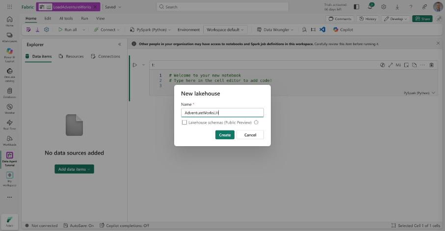
*I named the lakehouse AdventureWorksLH*

I pasted the tutorial's code into the cell. It downloads 28 tables from a Microsoft web address and saves each one as a Lakehouse table.

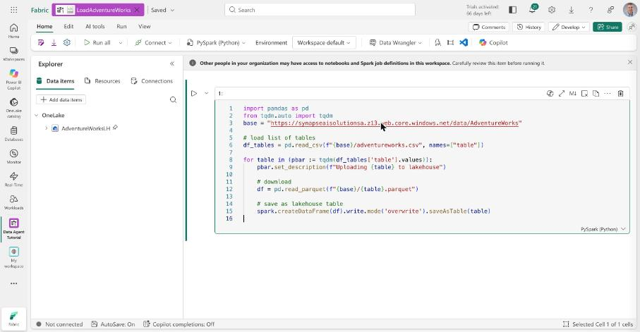
*The tutorial's loading code in the first cell*

This is the code I pasted:

```python
import pandas as pd
from tqdm.auto import tqdm
base = "https://synapseaisolutionsa.z13.web.core.windows.net/data/AdventureWorks"

# load list of tables
df_tables = pd.read_csv(f"{base}/adventureworks.csv", names=["table"])

for table in (pbar := tqdm(df_tables['table'].values)):
    pbar.set_description(f"Uploading {table} to lakehouse")

    # download
    df = pd.read_parquet(f"{base}/{table}.parquet")

    # save as lakehouse table
    spark.createDataFrame(df).write.mode('overwrite').saveAsTable(table)
```

I clicked Run all. The session started in 6 seconds, and the notebook showed progress of 1 table out of 28.

:::watch-it The notebook screen stopped updating
After about 15 minutes the notebook still showed table 1 of 28. I asked the Fabric API for the Lakehouse tables and it listed all 28. So the work was finished and the screen was stale. I stopped the Spark session, as the tutorial's own warning says to, because a running session keeps using capacity.
:::

I do not know exactly when the load finished, but all 28 tables were there by 13:01 UTC, about 19 minutes after I started it. That was more than half of the paid time.

## Create the data agent

On the F2, the Data agent item created without the error from the trial.

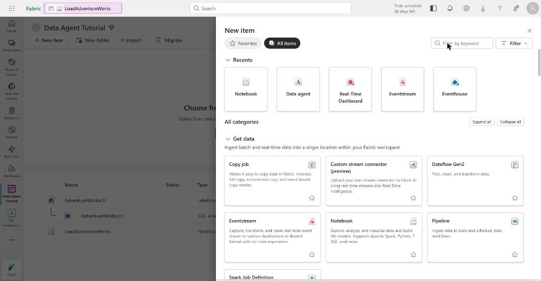
*The Data agent item was in my recent items*

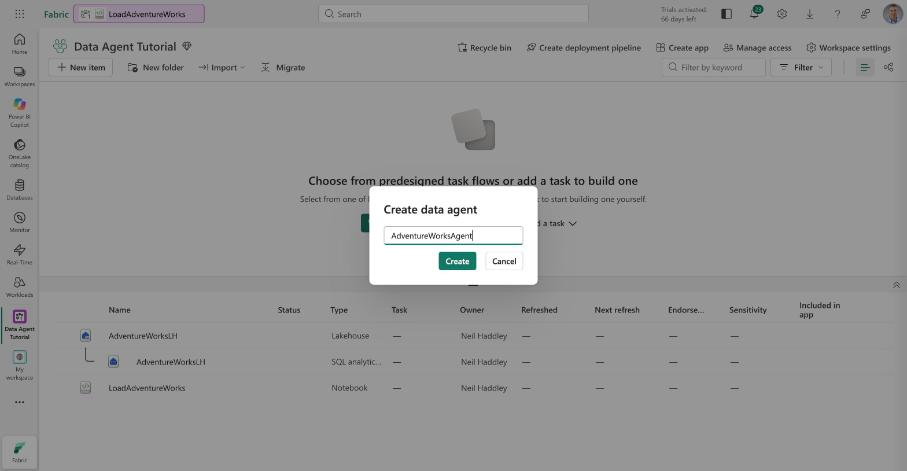
*I named it AdventureWorksAgent*

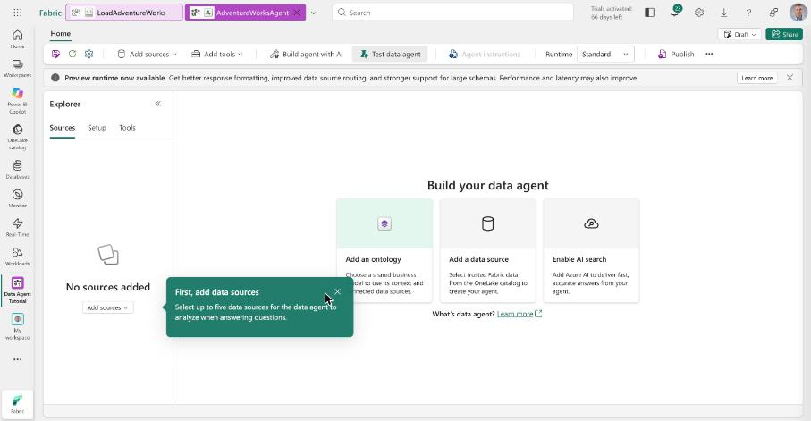
*The page offers an ontology, a data source or AI search*

I chose Add a data source and picked `AdventureWorksLH` from the OneLake catalog.

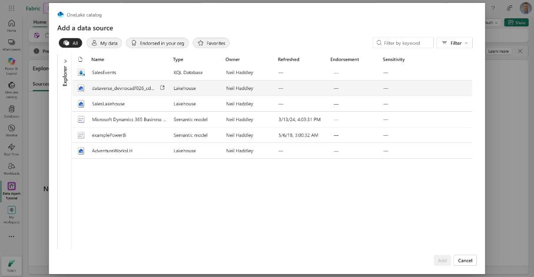
*The catalog lists items from all of my workspaces, not just this one*

:::watch-it I broke the page and fixed it
After I added the data source, the agent page sat on "Loading your data agent" and showed errors. One said "The data agent has not been published", though a new agent is not published and the page normally loads anyway. The page had loaded in a fresh tab earlier, so I tried to select the tutorial's tables by editing the agent's definition through the Fabric API. After that edit the page never loaded again. I restored the original definition and it loaded at once. I then ticked the tables in the page instead. I do not know why the page showed errors before my edit.
:::

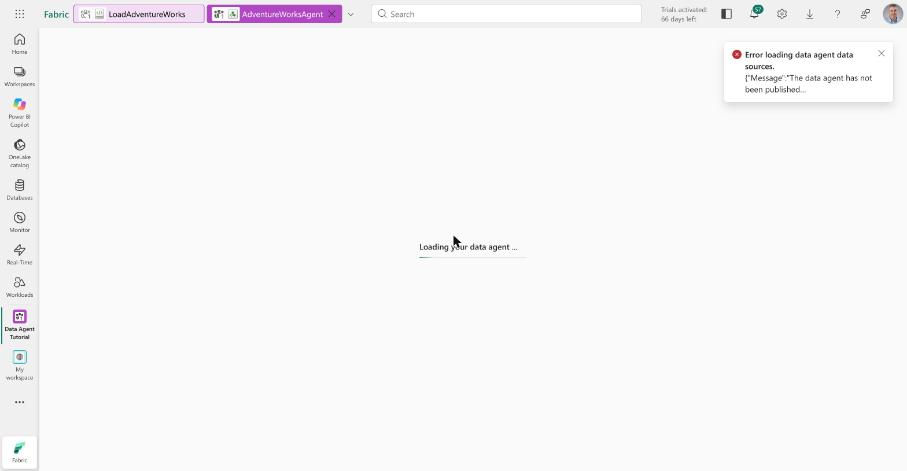
*One of the errors, shown while the page kept loading*

## Select the tables and add instructions

The tutorial selects ten tables. I ticked them in the explorer: `dimcustomer`, `dimdate`, `dimgeography`, `dimproduct`, `dimproductcategory`, `dimpromotion`, `dimreseller`, `dimsalesterritory`, `factinternetsales` and `factresellersales`.

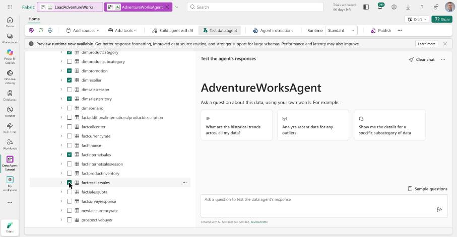
*The ten tutorial tables ticked*

I then pasted the tutorial's instructions into the Agent instructions pane. They say the data source contains information from three tables and name `dimcustomer`, `dimdate` and `dimgeography`.

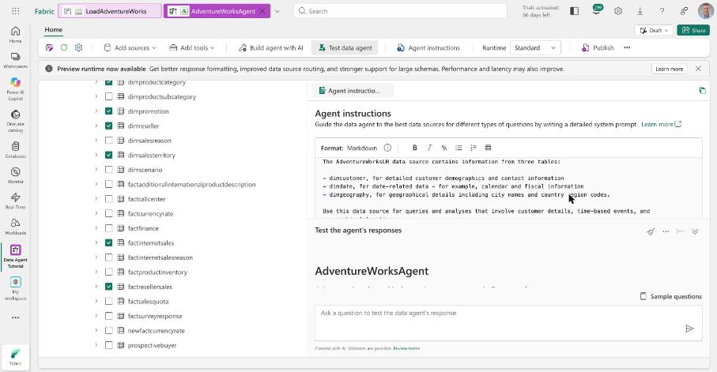
*The tutorial's instructions*

This is the text I pasted:

```text
The AdventureWorksLH data source contains information from three tables:

- dimcustomer, for detailed customer demographics and contact information
- dimdate, for date-related data - for example, calendar and fiscal information
- dimgeography, for geographical details including city names and country region codes.

Use this data source for queries and analyses that involve customer details, time-based events, and geographical locations.
```

I skipped the tutorial's step of adding two example queries, to save paid time. I did not publish the agent either.

## The first question: three refusals

I asked one of the tutorial's example-style questions: "What are the top 5 products with the highest list prices, and what are their categories?"

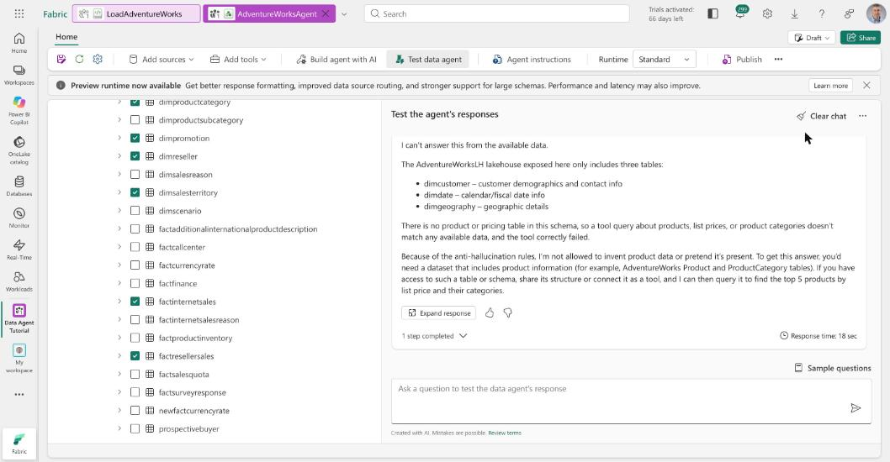
*The first answer, after 18 seconds: "I can't answer this from the available data"*

The agent said the Lakehouse included only three tables, the same three as in the instructions, and that there was no product table. That was wrong: `dimproduct` was ticked. I asked again and it refused again, this time saying it could not query product names, list prices or categories.

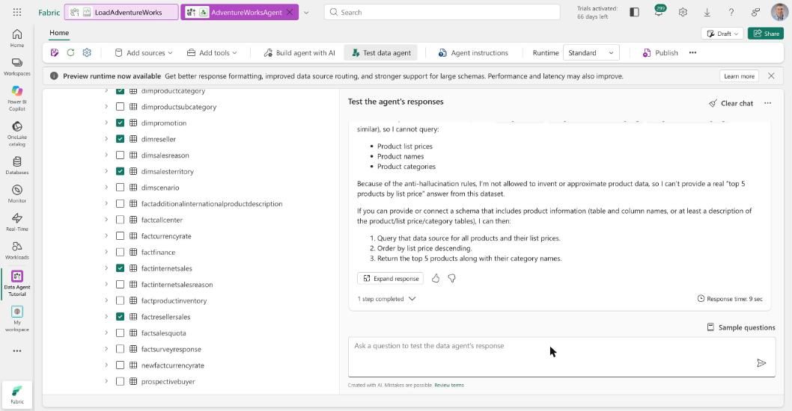
*The same question, answered with a refusal again after 9 seconds*

## A different question worked

I then asked: "What is the total sales amount in factinternetsales by sales territory country?" This one names a table. It answered after 24 seconds.

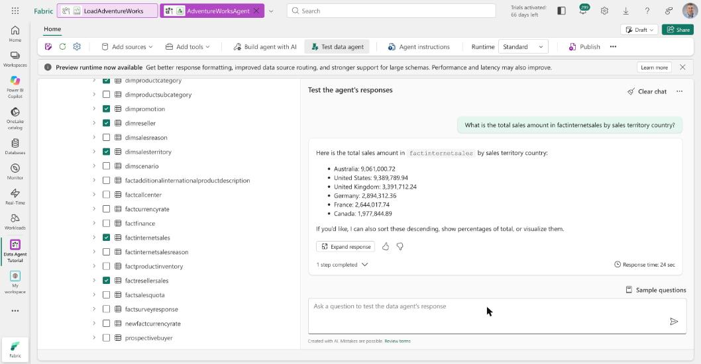
*Six countries with sales totals*

## Were the answers right?

I did not want to trust an agent without checking. I connected to the Lakehouse's SQL endpoint with `sqlcmd` and ran the same question as SQL.

```bash
sqlcmd -S <the SQL endpoint connection string> -d AdventureWorksLH \
  --authentication-method=ActiveDirectoryAzCli -W -Q "..."
```

The query:

```sql
SELECT t.SalesTerritoryCountry, SUM(f.SalesAmount) AS total
FROM dbo.factinternetsales f
JOIN dbo.dimsalesterritory t ON f.SalesTerritoryKey = t.SalesTerritoryKey
GROUP BY t.SalesTerritoryCountry
ORDER BY total DESC
```

| Country | Agent | My SQL |
|---|---|---|
| United States | 9,389,789.94 | 9,389,789.94 |
| Australia | 9,061,000.72 | 9,061,000.72 |
| United Kingdom | 3,391,712.24 | 3,391,712.24 |
| Germany | 2,894,312.36 | 2,894,312.36 |
| France | 2,644,017.74 | 2,644,017.74 |
| Canada | 1,977,844.89 | 1,977,844.89 |

All six matched to the cent.

## Fixing the product question

Two things looked wrong with my setup.

- **The instructions named only three tables**, but I had selected ten. The agent repeated the same three in its refusal.
- **The tutorial's table list has a gap.** `dimproduct` has a `ProductSubcategoryKey` and no category key. The only route from a product to its category goes through `dimproductsubcategory`, and the tutorial's list does not include it.

I ticked `dimproductsubcategory` and rewrote the instructions to describe all ten tables, with the join from product to subcategory to category.

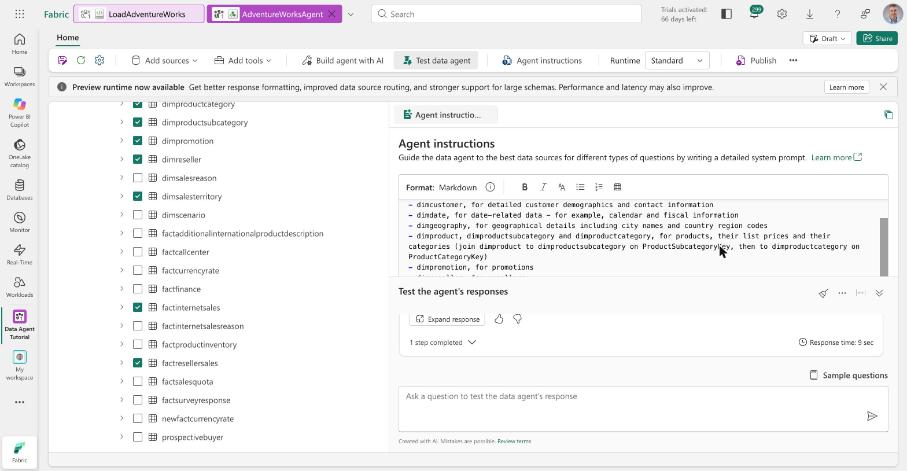
*My corrected instructions*

This is the corrected text:

```text
The AdventureWorksLH data source contains information from these tables:

- dimcustomer, for detailed customer demographics and contact information
- dimdate, for date-related data - for example, calendar and fiscal information
- dimgeography, for geographical details including city names and country region codes
- dimproduct, dimproductsubcategory and dimproductcategory, for products, their list prices and their categories (join dimproduct to dimproductsubcategory on ProductSubcategoryKey, then to dimproductcategory on ProductCategoryKey)
- dimpromotion, for promotions
- dimreseller, for resellers
- dimsalesterritory, for sales territories and countries
- factinternetsales and factresellersales, for internet and reseller sales amounts

Use this data source for queries and analyses that involve customers, products, prices, promotions, resellers, sales territories, time-based events, geographical locations and sales.
```

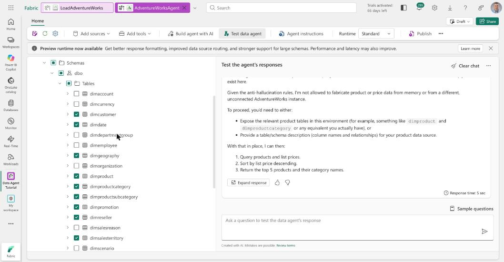
*Eleven tables ticked, including dimproductsubcategory*

I asked the question again in the same chat. It refused a third time, after only 5 seconds.

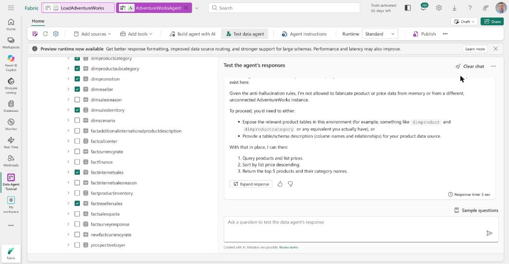
*A third refusal, with the corrected setup*

Then I clicked Refresh, cleared the chat and asked once more in a new chat. This time it answered after 9 seconds.

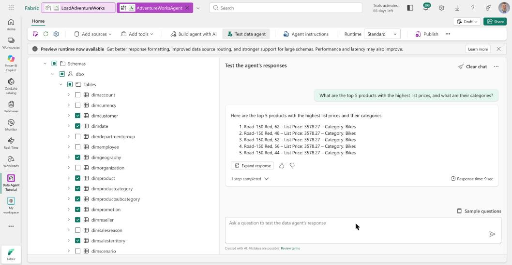
*Five products, all with list price 3,578.27 and category Bikes*

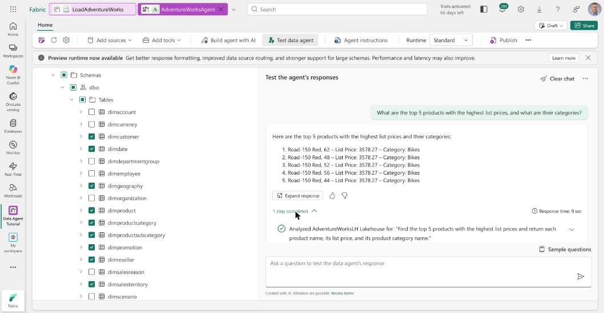
*The step that the agent reported, which asked the Lakehouse for the products and categories*

I checked it with this SQL:

```sql
SELECT TOP 5 p.EnglishProductName, p.ListPrice, c.EnglishProductCategoryName
FROM dbo.dimproduct p
JOIN dbo.dimproductsubcategory s ON p.ProductSubcategoryKey = s.ProductSubcategoryKey
JOIN dbo.dimproductcategory c ON s.ProductCategoryKey = c.ProductCategoryKey
ORDER BY p.ListPrice DESC
```

`TOP 5` cannot show whether a sixth product also has the highest price. This query would show it, because it returns every product at the highest list price. I wrote it after I had deleted the workspace, so I have not run it.

```sql
SELECT p.EnglishProductName, p.ListPrice, c.EnglishProductCategoryName
FROM dbo.dimproduct p
JOIN dbo.dimproductsubcategory s ON p.ProductSubcategoryKey = s.ProductSubcategoryKey
JOIN dbo.dimproductcategory c ON s.ProductCategoryKey = c.ProductCategoryKey
WHERE p.ListPrice = (SELECT MAX(ListPrice) FROM dbo.dimproduct)
ORDER BY p.EnglishProductName
```

My SQL check agreed: the five rows it returned all have the highest list price I saw, 3,578.27, and all are Road-150 Red bikes in the Bikes category. The agent listed the same five. I did not check whether a sixth product has the same price, so I cannot say the tie is exactly five.

:::watch-it I cannot say which change fixed it
I changed four things before the answer came: the instructions, the extra table, a refresh and a new chat. Microsoft's concept page warns that earlier chat history can influence later responses, and my third refusal came in a chat that already held two. I did not test the changes one at a time, so I cannot say which one mattered. A tie also makes "top 5" ambiguous: any five of the tied products would be a valid answer.
:::

## Tear down

The F2 was costing money while it sat idle, so I deleted things as soon as I had the screenshots.

1. I deleted the workspace, which held the notebook, the Lakehouse and the agent.
2. I deleted the Azure resource group that held the F2. It was called `rg-fabric-data-agent`, and the F2 inside it was `fabdataagentsc`.
3. I checked that no Fabric capacities were left in the subscription.

The agent is gone, so I cannot add to it. Redoing it would repeat the long table load.

## What I did not do

- **Publish the agent.** Publishing is how you share it, and how other tools such as Copilot Studio use it.
- **Add the tutorial's example queries.**
- **Call the agent from a notebook** through the MCP endpoint that the tutorial describes.
- **Connect it to Copilot Studio.** That could be a later post.
- **Compare it with anything else.** I measured nothing about accuracy beyond two questions, and one of them failed three times.

:::bullet-points What I learned
- The free trial could not create a data agent. An F2 capacity could, for about $0.22 of compute by Microsoft's list price.
- Getting the F2 was the hard part. My subscription had no Fabric quota in several regions, and the Quotas page showed which regions did.
- The tutorial's instructions named three tables while it selected ten, and its table list left out the table that links products to categories.
- The agent refused a question that its tables could answer, three times, and then answered correctly in a new chat. I cannot say why.
- The agent's answers matched my own SQL exactly where I checked them. Check an agent's answers instead of trusting them.
- A notebook screen can stop updating while the work carries on. Check with the API or the table list, then stop the session.
:::

## References

- [Fabric data agent example with the AdventureWorks dataset (Microsoft Learn)](https://learn.microsoft.com/fabric/data-science/data-agent-end-to-end-tutorial)
- [Fabric data agent concepts (Microsoft Learn)](https://learn.microsoft.com/fabric/data-science/concept-data-agent)
- [Create a Fabric data agent (Microsoft Learn)](https://learn.microsoft.com/fabric/data-science/how-to-create-data-agent)
- [Pause and resume your Fabric capacity (Microsoft Learn)](https://learn.microsoft.com/fabric/enterprise/pause-resume)
- [Azure Retail Prices API, used for the capacity-unit price](https://learn.microsoft.com/rest/api/cost-management/retail-prices/azure-retail-prices)
