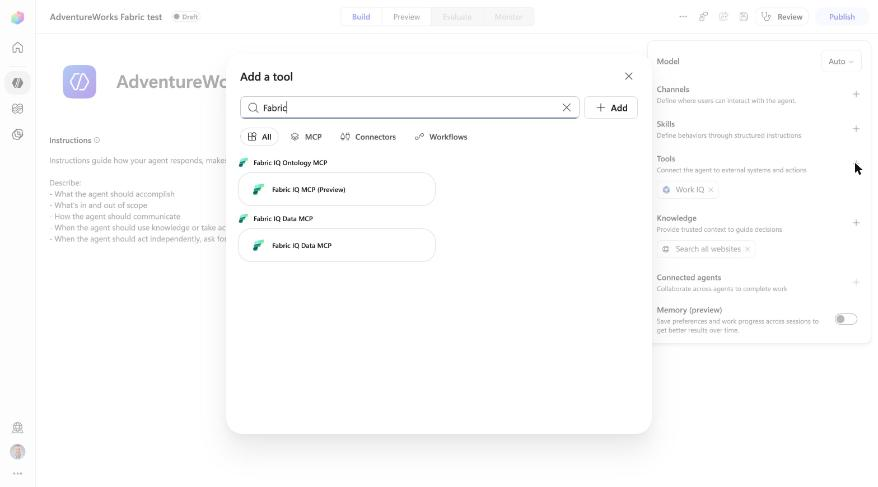
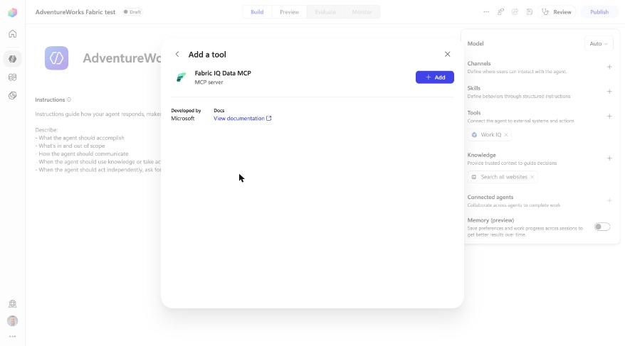
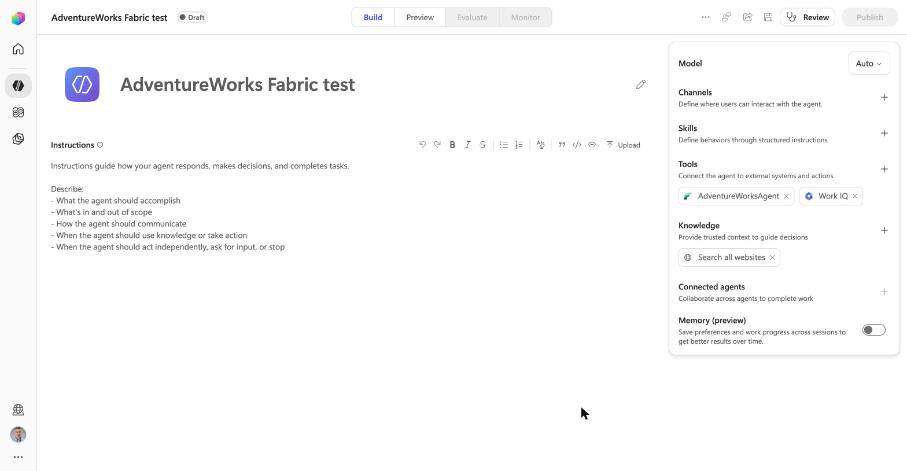
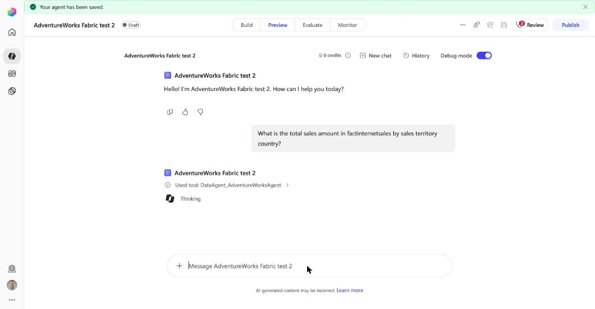
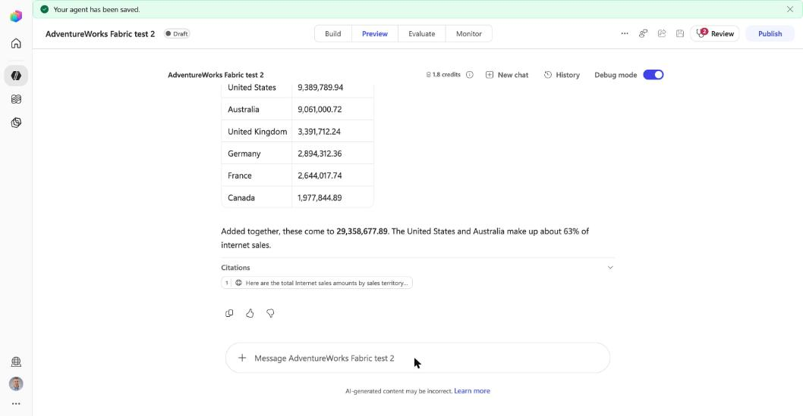
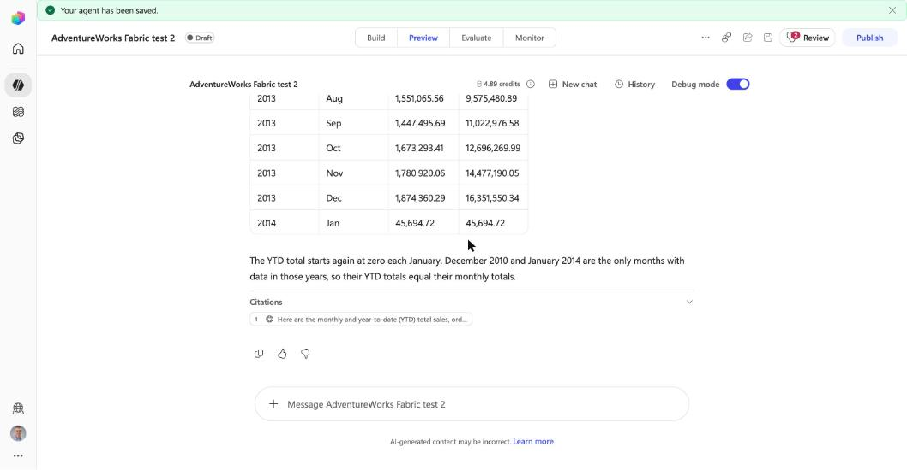

# Copilot Studio and the Fabric Data Agent

In [Part 4](/posts/fabriclakehouse4/) I built a Fabric data agent over the AdventureWorks Lakehouse, asked it Microsoft's own questions, published it and called it over MCP. In this part I connect that published agent to Copilot Studio, so that a Copilot agent asks the data agent the questions.

## Is this part of Microsoft's tutorial?

No. The [tutorial](https://learn.microsoft.com/fabric/data-science/data-agent-end-to-end-tutorial) ends with publishing and a notebook call. Copilot Studio has its own page: [Add a Fabric data agent as a tool in Microsoft Copilot Studio](https://learn.microsoft.com/fabric/data-science/data-agent-microsoft-copilot-studio-tool). It is a clear 11-step guide, and this post follows it.

## How and why Copilot calls a data agent

A Copilot Studio agent built on the GitHub Copilot harness reasons over its instructions, knowledge sources and tools, and decides which tool to call for each request. Microsoft's page says the Fabric data agent is added as a tool, and that the orchestrator "makes that decision based on the description you write for the data agent."

That sentence explains most of this post. The Copilot agent never sees the Lakehouse. It sees a tool with a name and a description, and the Fabric data agent behind it turns the question into SQL, runs it and returns the answer as a tool result.

So a question to Copilot goes through two models:

1. **Copilot Studio's model** reads my question, its instructions and the tool description, and decides to call the Fabric tool, passing a question.
2. **The Fabric data agent's model** reads that question with its own instructions, writes the SQL, runs it, and returns the answer.
3. **Copilot Studio's model** then writes the final reply.

Microsoft documents the consequences:

- **The description decides routing.** "A short or vague description makes it harder for the orchestrator to pick the right data agent."
- **Permissions are the Fabric agent's.** In User authentication mode each person needs at least read access to the Fabric data agent and to its data. In Maker mode everyone sees data through the maker's access.
- **Answers may leave Fabric's boundary.** A warning on the page says responses "might be sent outside the Fabric compliance boundary or geographic region" and are handled under Copilot Studio's terms.
- **It needs licences.** The prerequisites list a paid F2 or higher capacity, cross-geo AI settings, and a Microsoft 365 Copilot licence for each person who builds agents. I did not check whether my account has that licence.

There is an older route too: adding the Fabric agent from the Agents category as a connected agent. Microsoft's [older page](https://learn.microsoft.com/fabric/data-science/data-agent-microsoft-copilot-studio) says that route is only validated for Microsoft Teams and "isn't currently supported in Microsoft 365 Copilot". I used the newer tool route.

## Add the Fabric data agent as a tool

I created an agent in Copilot Studio and named it, then opened Tools, searched for Fabric and chose Fabric IQ Data MCP.


*A new agent in Copilot Studio*


*Searching for Fabric in Add a tool offers two Fabric IQ tools*


*Fabric IQ Data MCP*

The picker then lists the published data agents that I can use. Only published agents appear.


*The picker listed `AdventureWorksAgent`, the agent I published in Part 4*


*The Fabric tool, added to the agent*

Four settings decide whether the agent uses the tool.

1. **Write a detailed description for the tool.** Open the tool's entry and describe what it answers. The orchestrator routes on this text.
2. **Choose the authentication mode.** I kept User, the default.
3. **Write instructions that name the tool.**
4. **Select Save**, and wait for "Your agent has been saved". Microsoft's page says that without Save "the tools, descriptions, authentication modes, and instructions that you configured aren't applied".


*The tool's description, and User authentication*

This is the description I wrote for the tool:

```text
Answers questions about AdventureWorks sales, customers, products, prices, promotions, resellers and sales territories using the AdventureWorksLH lakehouse (internet and reseller sales, dates and geography, 2010 to 2014). Use it for sales totals, monthly and year-to-date trends, top products, and customer or zip code analysis.
```

And the instructions:

```text
You answer questions about AdventureWorks sales, customers, products, prices and territories. For every such question, call the AdventureWorksAgent tool with the user's question and report its answer. If the tool cannot answer, say so.
```

:::watch-it Remove tools the agent does not need
A new agent comes with the Work IQ tool, which asks Microsoft 365 Copilot questions about emails, meetings and files. With both tools present, my agent sometimes sent a Fabric question to Work IQ, and that call failed. I removed Work IQ, and the agent used the Fabric tool every time.
:::

:::watch-it Check the page after Save
The "saved" banner appears above the toolbar and pushes the page down. My next click landed on the wrong control and my typed question went into the instructions box. Look at the page before you type.
:::

## Ask Microsoft's questions

I opened the Preview tab and asked the question that I had used for the Fabric agent in Part 4:

```PROMPT
What is the total sales amount in factinternetsales by sales territory country?
```


*"Used tool: DataAgent_AdventureWorksAgent"*


*The six countries, with a citation. It cost 1.8 credits*

The figures match the Fabric agent's and my SQL: 9,389,789.94 for the United States, 9,061,000.72 for Australia and so on. Copilot added a total of 29,358,677.89 and a sentence that the United States and Australia make up about 63% of internet sales.

```PROMPT
Show the monthly total and year-to-date total sales. Order by year and month.
```


*Thirty-eight months again, and a note that December 2010 and January 2014 are the only months in their years*

I did not time these with a stopwatch. I waited 40 to 60 seconds before each screenshot, so I know only that this took under a minute. It cost 4.89 credits.

```PROMPT
What is the root cause of our sales spike?
```


*The answer split May 2011 by category, territory, channel and promotion, then added a caveat*

This is the interesting comparison. In Part 4 the Fabric agent gave this question a cause and then a caveat that it needed business context. Copilot's answer put the caveat in bold at the end: the figures show "where the sales came from, but it can't fully prove why they jumped". It cost 4.72 credits.

## What it cost

| Item | Amount |
|---|---|
| F2 for this part, 19:33 to 19:52 UTC | about 19 minutes, roughly $0.12 at list price |
| Copilot credits per question | 1.8, 4.89 and 4.72 for the three above |

The credit meter appears in the Preview header. The F2 figure is my calculation, not my bill.

## Comparison with calling the same agent from DeepSeek Harness

[Part 6](/posts/fabriclakehouse6/) asks the same eight questions through DeepSeek Harness (`dsh`) and a small MCP server of mine.

| | Copilot Studio calling the Fabric agent | DeepSeek Harness with my tools |
|---|---|---|
| What writes the SQL | The Fabric data agent | The model, through tools I wrote |
| What I must build | No code: a tool, a description, instructions, Save | An MCP server of about 130 lines of Python, a profile and an AGENTS.md |
| Capacity | A paid F2, for the Fabric agent | None: it ran against a SQL endpoint, and the trial workspace was enough |
| Extra meter | Copilot credits: about 2 to 5 per question here | Model tokens, which I did not meter |
| Models in the path | Two (Copilot's and Fabric's) | One |
| Who can use it | People with the right licences, in Teams or Microsoft 365 | Me, at a terminal |
| Per-user permissions | Yes, in User mode | The identity my terminal is signed in as |

I would be careful with the words "simpler" and "cleaner". The Copilot route needs no code, and it brings Teams, per-user permissions and an evaluation tab. The harness route has fewer moving parts per question, ran without a paid capacity, and gave me the SQL and the files directly. But I wrote the harness's tools and its safety rules myself, and [Part 7](/posts/fabriclakehouse7/) shows what happened when I did not. Copilot's tool gives an audience and a permission model that my script does not.

On this evidence the harness was the more direct way for one person to ask questions of one Lakehouse. I have not shown it is better for anyone else.

## If the connection fails

Microsoft's tips for a missing agent are that it must be published, you must be signed in to Fabric and Copilot Studio with the same account, and both must be in the same tenant. A [Microsoft Q&A thread](https://learn.microsoft.com/en-us/answers/questions/5772696/copilot-studio-fabric-data-agent-connection-fails) from February 2026 describes the connection dialog returning to "Not connected" with no error, and no answer was confirmed. I did not hit that.

## What I did not do

- **Publish the Copilot agent** to Teams or Microsoft 365 Copilot. I used only Preview.
- **Use the Evaluate tab.** The page recommends it before publishing.
- **Try Maker authentication**, or more than one data agent.
- **Try the older connected-agent route.**
- **Check the Microsoft 365 Copilot licence.**

:::bullet-points What I learned
- A Copilot agent calls a Fabric agent through a tool, and it chooses the tool from the tool's description.
- The description, the instructions and Save all matter. Without them the agent will not use the tool.
- Remove tools the agent does not need, because the agent can pick the wrong one.
- The answers matched the Fabric agent and my SQL, and Copilot put the caveat on the root-cause answer more prominently.
- Copilot credits are an extra cost on top of the F2: about 2 to 5 per question here.
:::

## References

- [Add a Fabric data agent as a tool in Microsoft Copilot Studio (Microsoft Learn)](https://learn.microsoft.com/fabric/data-science/data-agent-microsoft-copilot-studio-tool)
- [Consume a Fabric data agent in Microsoft Copilot Studio, the connected-agent route (Microsoft Learn)](https://learn.microsoft.com/fabric/data-science/data-agent-microsoft-copilot-studio)
- [Connect to a Microsoft Fabric Data agent (Copilot Studio, Microsoft Learn)](https://learn.microsoft.com/microsoft-copilot-studio/add-agent-fabric-data-agent)
- [Data agent as a Model Context Protocol server (Microsoft Learn)](https://learn.microsoft.com/fabric/data-science/data-agent-mcp-server)
- [Part 4: A Fabric Data Agent over the AdventureWorks Lakehouse](/posts/fabriclakehouse4/)
- [Part 6: DeepSeek Harness over the AdventureWorks Lakehouse](/posts/fabriclakehouse6/)
