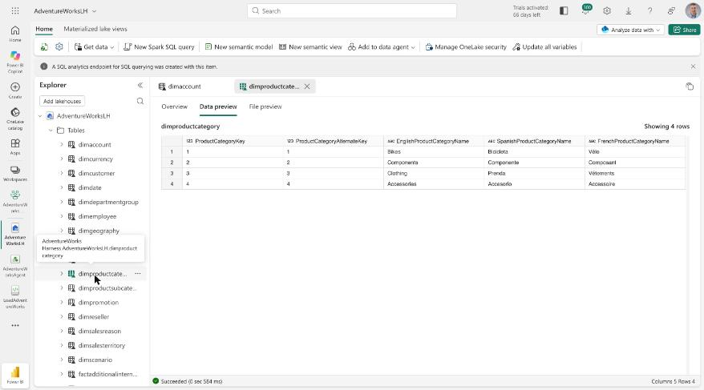

# DeepSeek Harness over the AdventureWorks Lakehouse

In [Part 4](/posts/fabriclakehouse4/) I followed Microsoft's tutorial for a Fabric data agent. I loaded the tutorial's AdventureWorks sample, created a data agent over it, and asked the agent two questions. It needed a paid F2 capacity, and it refused my product question three times before it answered.

In this part I take the same sample data, the same two questions, the same ticked tables and the same instructions, and I point [DeepSeek Harness](/posts/deepseekharness/) at them instead. It is a general harness that is not part of Fabric, and it gets one small SQL tool. **The results are the same.** The free trial could not create the Fabric agent, but it can hold the whole data layer, so this part needs no F2.

The two questions are the ones that I asked in Part 4, word for word. I wrote them in the style of the tutorial's example questions. They are not the tutorial's own two example questions, which are about repeat purchases and monthly totals. [Part 6](/posts/fabriclakehouse6/) uses one of those.

## Part 4 and Part 5 side by side

| | Part 4: Fabric data agent | Part 5: DeepSeek Harness |
|---|---|---|
| Sample data | The tutorial's AdventureWorks, 28 tables, loaded with the tutorial's notebook on an F2 | The same sample, loaded with the same notebook on my free trial |
| Questions | Top 5 products by list price with their categories, and total sales by sales territory country | The same two, word for word |
| Tables | Ten ticked, then eleven | Ten in the tool's scope, then eleven |
| Instructions | The tutorial's, then my corrected version | The same two files |
| Country totals | Six, matching my SQL | The same six, to the cent, in 6 of 6 runs |
| Top 5 products, eleven tables | The five Road-150 Red bikes at 3,578.27, in Bikes, after a refresh and a new chat | The same five, in 3 of 3 runs |
| Top 5 products, ten tables | Refused three times | The five bikes listed, with the missing category link flagged, in 3 of 3 runs |
| Time per answer | 5 to 24 seconds | 14 to 47 seconds |
| Needed an F2 | Yes | No |

In short:

- **The same data and the same questions give the same answers.** Every country total and every product answer in the table matched my own SQL. Where I left out the table that links products to categories, the Fabric agent refused, and the harness gave the five bikes and said what was missing.
- **A scope is a convenience, not security.** Scoping the tool to the ticked tables narrows what the agent looks at, as ticking does in Fabric. What a person can read is set by the database permissions, and [Part 6](/posts/fabriclakehouse6/) shows the difference.
- **Fabric's agent adds more than tables.** In Part 6 I rebuild what one person needs, and list the enterprise features that I did not.

## Load the AdventureWorks sample on the trial

I created a workspace, `AdventureWorks Harness`, on my trial capacity, and a Lakehouse called `AdventureWorksLH` in it. I made them, and a load notebook, through the Fabric REST API, so I have no screenshots of those steps. [Part 4](/posts/fabriclakehouse4/) shows the same steps in the web page, and the notebook holds the same loading code.


*The workspace on my trial: a Lakehouse, its SQL analytics endpoint and the load notebook*

The notebook job completed in 5 minutes 34 seconds. In Part 4, all 28 tables were there after about 19 minutes on the F2.


*The 28 tables in the Lakehouse, with a preview of dimproductcategory*

:::watch-it The SQL endpoint lagged behind the Lakehouse
When the job finished, the Fabric API listed all 28 tables, but the SQL endpoint listed only 25 or 26 of them. A tool that reads the SQL endpoint can see fewer tables than the Lakehouse holds for a few minutes after a load.
:::

## The harness has no Fabric tools, so I wrote one

DeepSeek Harness can call tools that speak the Model Context Protocol (MCP). It has no Fabric tool, so I wrote a small MCP server with three tools:

- **list_tables** lists the tables.
- **describe_table** lists the columns of one table.
- **run_select** runs one T-SQL `SELECT` and returns at most 25 rows, as the Fabric data agent does. It refuses anything else.

It runs `sqlcmd` with the Azure sign-in of whoever runs it, so the database applies that person's permissions and no password is stored in the tool. It has an optional scope, a list of tables that it works with, which I describe below. It is a plain Python script with no packages.

```python
#!/usr/bin/env python3
"""A small read-only MCP server (stdio) for a Fabric Lakehouse SQL endpoint.

Tools: list_tables, describe_table, run_select. They run sqlcmd with the Azure CLI sign-in of whoever runs them
(set AZURE_CONFIG_DIR to use another sign-in), so the database applies that person's permissions and no password is stored.
Settings come from FABRIC_SQL_SERVER and FABRIC_DATABASE. If FABRIC_SCOPE_TABLES (comma separated) is set, the tools
work only with those tables, as ticking tables does for a Fabric data agent. That is a scope that narrows what the
agent looks at. It is not security: what a person can read is decided by the database permissions of the signed-in user.
"""
import json, os, re, subprocess, sys

SERVER = os.environ["FABRIC_SQL_SERVER"]
DATABASE = os.environ["FABRIC_DATABASE"]
MAX_ROWS = 25
SCOPE = {t.strip().lower() for t in os.environ.get("FABRIC_SCOPE_TABLES", "").split(",") if t.strip()}
_all_tables = None
BLOCKED = re.compile(r"\b(insert|update|delete|drop|alter|create|truncate|merge|exec|execute|grant|revoke|deny|into)\b", re.I)


def sql(query, limit=MAX_ROWS):
    out = subprocess.run(
        ["sqlcmd", "-S", SERVER, "-d", DATABASE, "--authentication-method=ActiveDirectoryAzCli", "-W", "-s", "|", "-Q", query],
        capture_output=True, text=True, timeout=120)
    lines = [l for l in (out.stdout + out.stderr).splitlines()
             if l.strip() and not l.startswith("Statement ID") and "rows affected" not in l]
    lines = [l for l in lines if not set(l.replace("|", "").replace(" ", "")) <= {"-"}]   # drop the dashed line under the header
    header, rows = lines[:1], lines[1:]
    note = f"\n(first {limit} rows shown)" if limit and len(rows) > limit else ""
    return "\n".join(header + (rows[:limit] if limit else rows)) + note


def out_of_scope(query):
    """The tables outside the scope that the query names anywhere, as whole words."""
    global _all_tables
    if _all_tables is None:
        _all_tables = {l.strip().lower() for l in sql("SELECT TABLE_NAME FROM INFORMATION_SCHEMA.TABLES", limit=None).splitlines()[1:]}
    return sorted(t for t in _all_tables - SCOPE if re.search(rf"\b{re.escape(t)}\b", query, re.I))


def run_select(query):
    q = query.strip().rstrip(";")
    if not re.match(r"(select|with)\b", q, re.I) or ";" in q or BLOCKED.search(q):
        return "Refused: only a single read-only SELECT statement is allowed."
    if SCOPE and (out_of_scope(q) or re.search(r"\b(?:sys|information_schema)\b", q, re.I)):
        return "Refused: that query uses a table that is not in scope. Tables in scope: " + ", ".join(sorted(SCOPE))
    return sql(q)


def describe_table(table):
    if not re.fullmatch(r"[A-Za-z0-9_]+", table):
        return "Refused: give a plain table name."
    if SCOPE and table.lower() not in SCOPE:
        return "Refused: that table is not in scope. Tables in scope: " + ", ".join(sorted(SCOPE))
    return sql("SELECT COLUMN_NAME, DATA_TYPE FROM INFORMATION_SCHEMA.COLUMNS "
               f"WHERE TABLE_NAME = '{table}' ORDER BY ORDINAL_POSITION")


TOOLS = {
    "list_tables": ("List the tables in the Lakehouse SQL endpoint.", {}, lambda a: ("TABLE_NAME\n" + "\n".join(sorted(SCOPE))) if SCOPE else sql(
        "SELECT TABLE_NAME FROM INFORMATION_SCHEMA.TABLES WHERE TABLE_SCHEMA = 'dbo' ORDER BY TABLE_NAME")),
    "describe_table": ("List the columns and data types of one table.",
                       {"table": {"type": "string", "description": "Table name, for example dimproduct"}},
                       lambda a: describe_table(a["table"])),
    "run_select": (f"Run one read-only T-SQL SELECT statement. At most {MAX_ROWS} rows come back.",
                   {"query": {"type": "string", "description": "A T-SQL SELECT statement"}},
                   lambda a: run_select(a["query"])),
}


def reply(id_, result=None, error=None):
    msg = {"jsonrpc": "2.0", "id": id_}
    msg["error" if error else "result"] = error or result
    sys.stdout.write(json.dumps(msg) + "\n"); sys.stdout.flush()


for line in sys.stdin:
    try:
        m = json.loads(line)
    except ValueError:
        continue
    method, id_ = m.get("method"), m.get("id")
    if id_ is None:
        continue                                   # notifications need no reply
    if method == "initialize":
        reply(id_, {"protocolVersion": m["params"].get("protocolVersion", "2024-11-05"),
                    "capabilities": {"tools": {}}, "serverInfo": {"name": "fabric-sql", "version": "1.0"}})
    elif method == "tools/list":
        reply(id_, {"tools": [{"name": n, "description": d,
                               "inputSchema": {"type": "object", "properties": p, "required": list(p)}}
                              for n, (d, p, _) in TOOLS.items()]})
    elif method == "tools/call":
        name, args = m["params"]["name"], m["params"].get("arguments") or {}
        try:
            text = TOOLS[name][2](args)
            reply(id_, {"content": [{"type": "text", "text": text}]})
        except Exception as e:
            reply(id_, {"content": [{"type": "text", "text": f"Error: {e}"}], "isError": True})
    else:
        reply(id_, error={"code": -32601, "message": "Method not found"})
```

I tested it by hand: it listed the tables, and it refused a `DELETE`. Its own check only allows a single `SELECT` statement.

I did not edit my existing harness profile. I made two new profiles, each with one row, so that the Business Central tools from my other posts do not load. The profile `fabricscope10` sets the scope to the ten tutorial tables. The profile `fabricscope11` adds `dimproductsubcategory`. The setting is `FABRIC_SCOPE_TABLES`:

```yaml
# The fabricscope10 profile: one row that adds the read-only Fabric SQL tools. Use: dsh --profile fabricscope10 "task"
- insert:
    - id: mcp-fabric-sql
      name: '@deepseek-ai/dsh-mcp-client'
      config:
        serverName: fabricsql
        transport: stdio
        command: python3
        args:
          - <home>/Documents/GitHub/fabric-harness/fabric_sql_mcp.py
        env:
          FABRIC_SQL_SERVER: <the Lakehouse SQL endpoint connection string>
          FABRIC_DATABASE: AdventureWorksLH
          FABRIC_SCOPE_TABLES: dimcustomer,dimdate,dimgeography,dimproduct,dimproductcategory,dimpromotion,dimreseller,dimsalesterritory,factinternetsales,factresellersales
        toolCallTimeoutMs: 120000
```

## Scope the tool to the ticked tables

In the Fabric agent, ticking tables narrows what the agent uses. It is a convenience for whoever builds the agent. It does not change what I can read. I was the workspace admin, and I could read every table, which is why the agent's "there is no product table" was about the agent, not about me. I wanted the same idea in the harness, so the tool has a scope, a list of tables, set in the profile. The harness itself signs in as me, with my full permissions, as the Fabric agent did.

When the scope is set, `list_tables` shows only those tables, `describe_table` refuses the others, and `run_select` refuses a query that names any table outside the scope. My first version only looked at the names after `FROM` and `JOIN`, so a comma join slipped through and returned data from a table that I had not scoped in. I changed it to refuse a query if any out-of-scope table name appears anywhere in it. With the ten tutorial tables in scope, I tried it:

| Call | Result |
|---|---|
| `list_tables` | The ten tables |
| `describe_table` on `dimproductsubcategory` | Refused: not in scope |
| A comma join to `dimproductsubcategory` | Refused: not in scope |
| `SELECT COUNT(*) FROM dbo.dimproduct` | 606 |

With `dimproductsubcategory` added to the scope, the same join returned `Road Bikes`.

A scope is not security. It narrows what the agent looks at, and it relies on the tool noticing table names. What a person can read is decided by the database permissions, and [Part 6](/posts/fabriclakehouse6/) shows that with a second user.

## The answer key

Before I ran the harness, I ran the two questions as SQL with `sqlcmd` against the same endpoint. The queries are in [Part 4](/posts/fabriclakehouse4/). I also ran the tie-check query that I wrote for Part 4 but never ran there:

```sql
SELECT p.EnglishProductName, p.ListPrice, c.EnglishProductCategoryName
FROM dbo.dimproduct p
JOIN dbo.dimproductsubcategory s ON p.ProductSubcategoryKey = s.ProductSubcategoryKey
JOIN dbo.dimproductcategory c ON s.ProductCategoryKey = c.ProductCategoryKey
WHERE p.ListPrice = (SELECT MAX(ListPrice) FROM dbo.dimproduct)
ORDER BY p.EnglishProductName
```

It returned exactly five rows: Road-150 Red in sizes 44, 48, 52, 56 and 62, each at 3,578.27 in the Bikes category. So the five-way tie in Part 4 was exactly five.

I did not compare the Part 4 and Part 5 Lakehouses row by row. Both were loaded by the same tutorial code, and my key queries return the same numbers in both, so I treat them as the same data. Here are the country totals from each:

| Country | Part 4: Fabric agent | Part 4: my SQL | Part 5: my SQL | Part 5: harness, 6 of 6 runs |
|---|---|---|---|---|
| United States | 9,389,789.94 | 9,389,789.94 | 9,389,789.94 | 9,389,789.94 |
| Australia | 9,061,000.72 | 9,061,000.72 | 9,061,000.72 | 9,061,000.72 |
| United Kingdom | 3,391,712.24 | 3,391,712.24 | 3,391,712.24 | 3,391,712.24 |
| Germany | 2,894,312.36 | 2,894,312.36 | 2,894,312.36 | 2,894,312.36 |
| France | 2,644,017.74 | 2,644,017.74 | 2,644,017.74 | 2,644,017.74 |
| Canada | 1,977,844.89 | 1,977,844.89 | 1,977,844.89 | 1,977,844.89 |

All four columns agree to the cent.

## The 12 runs

I used the same two questions as in Part 4, word for word. The first:

```PROMPT
What are the top 5 products with the highest list prices, and what are their categories?
```

The second:

```PROMPT
What is the total sales amount in factinternetsales by sales territory country?
```

The harness got each question inside the same short wrapper. This is the full prompt of the first run of the product question:

```PROMPT
Read instructions.md, which describe the data source. Then answer this question: What are the top 5 products with the highest list prices, and what are their categories? Use the fabricsql tools to look at the data. Do not change anything.
```

I ran each question in the two setups from Part 4, three times each, which makes 12 runs. Each run is a new headless session in its own folder, signed in as me, with an `instructions.md` file that the prompt tells the harness to read. The model was `deepseek-v4-flash` with high reasoning effort. I ran three at a time.

| Setup | Tables in the tool's scope | Instructions |
|---|---|---|
| tutorial | The 10 tutorial tables, with no `dimproductsubcategory` | Microsoft's tutorial instructions, which name three tables |
| corrected | Those 10 plus `dimproductsubcategory` | My corrected instructions from Part 4 |

The tutorial setup is the one where the Fabric agent refused. The corrected setup is the one where it answered. The instructions are in [Part 4](/posts/fabriclakehouse4/).

I scored each answer against the key with a script, and I read every product answer myself. I counted the tool calls from the harness's session logs.

## The results

All 12 runs matched the key.

| Setup | Question | Matches the key | Median time | Time range | Tool calls per run |
|---|---|---|---|---|---|
| tutorial | countries | 3 of 3 | 17.4 s | 14.4 to 22.5 s | 6, 8, 5 |
| tutorial | products | 3 of 3 | 44.4 s | 40.2 to 45.0 s | 13, 12, 12 |
| corrected | countries | 3 of 3 | 21.5 s | 20.2 to 23.1 s | 7, 8, 7 |
| corrected | products | 3 of 3 | 27.6 s | 20.8 to 46.9 s | 14, 9, 7 |

- **Countries:** all six totals matched to the cent in all six runs, with either scope.
- **Products with the subcategory table in scope:** all three runs listed the five Road-150 Red bikes at 3,578.27 and joined product to subcategory to category to get Bikes.
- **Products without it:** all three runs listed the same five bikes at the same price and flagged the missing category link. They took about one and a half times as long as the corrected setup.

## What the harness did when a table was missing

`dimproduct` has a subcategory key and no category key. Without `dimproductsubcategory` in scope, no query joins a product to its category. The tutorial's table list leaves that table out, but its own example queries never ask about product categories, so the gap only shows with my product question. All three runs found this out, and none of them refused. They gave the five bikes, and then they dealt with the category in three different ways.

Run 1 said that it could not tell from the data:

> **The category cannot be determined from this data source.** [...] **Unverified inference, flagged as such:** under the standard AdventureWorks reference model, subcategory key 2 is "Road Bikes", which rolls up to the **Bikes** category. That mapping comes from outside this dataset [...] so please don't treat "Bikes" as a data-derived result.

Run 3 gave Bikes and said that the mapping "follows the AdventureWorks subcategory→category model" and is corroborated by the product names and descriptions. It also warned that a direct join of the subcategory key to the category key would be wrong, because it would label these road bikes as Components. Run 2 gave Bikes and wrote that it "derived the category label from the data rather than a join", from the product families that each subcategory key holds.

So all three were honest about the gap, and they differed in how firmly they answered. This is where the Fabric agent differed most. When it could not answer, it said it could not, and it repeated the three tables from the instructions. The harness said what was missing, and then it did what a careful analyst would do.

All three runs also pointed out that the tutorial instructions name three tables while the tool's scope held ten.

## Does it match Part 4?

The answers match, as the table at the top shows. One thing differed. With the subcategory table missing, the Fabric agent refused the product question and wrongly said that there was no product table. The harness gave the five bikes and said that no table links a product to its category, which was the real gap. That was more useful in this one case. It is one question, three runs, a different model and my own tool. Taken with the rest, my conclusion is that for one person asking questions over one Lakehouse, the harness approach is better. The answers match, it needs no F2, it said what was missing where the Fabric agent refused, and I control the instructions, the example queries, the table scope and the model. The Fabric agent was faster in my tests, and it brings governance that I did not rebuild, so for an organisation that needs that, the choice is different. [Part 6](/posts/fabriclakehouse6/) covers what I did not rebuild.

Matching answers are evidence, not proof, that the two ran the same SQL. A `LEFT JOIN` and an `INNER JOIN` return the same rows here, and any query that finds the five tied products returns the same five. Six country totals matching to the cent is strong evidence, because a different grouping or filter would almost certainly change one of them. The product question is weaker, because many queries return those five rows. In Part 6, the harness ran different SQL without an example file and got a different number, so large differences do show up.

I compared answers, not queries. The Fabric agent's SQL sits in a collapsed step in its chat, which I did not open in Part 4. The harness's full list of queries was in its session logs, and I deleted those after saving the answers, so only some of its SQL survives in the saved answers. A next step is to have the tool log every query that it runs, and to open the agent's step, so that the two lists of queries can be compared directly.

In [Part 6](/posts/fabriclakehouse6/) I rebuild what one person needs from a Fabric data agent on top of tables, which is example queries, the asker's own permissions and a callable endpoint, and I list the enterprise features that I did not rebuild.

## Why this is not a fair test

- **Different models and tools.** I do not know which model the Fabric data agent uses. The harness used `deepseek-v4-flash`, and my own tool, which can run any `SELECT` on the tables in its scope.
- **A handful of questions.** The two main questions name tables that exist and have a single right answer.
- **Three runs per cell.** That is enough to see no refusals, and not enough to measure a rate.
- **No cost figure.** I did not read DeepSeek's usage, so I cannot compare costs. The Fabric side cost me about $0.22 of compute in Part 4, which is also an estimate.
- **Earlier attempts.** My first set of 18 runs let the harness see all 28 tables, and all 18 matched the key. My second set of 12 used an earlier, weaker version of the scope, and all 12 matched. A third set of 12 limited a second user with database permissions, and 11 of 12 matched, because one ten-table run gave the top five models, which is a different reading of the question. [Part 6](/posts/fabriclakehouse6/) covers that set. I kept the raw answers from every set. The results vary a little from set to set, and three runs per cell cannot tell me how much.

:::bullet-points What I learned
- A Lakehouse and its SQL endpoint run on the free trial. The load took under six minutes, and no F2 was needed.
- A coding harness needs one small tool to answer questions about a Lakehouse. Mine is a single Python file with three read-only tools and an optional scope of tables.
- With the same tables in scope, the harness matched the key in all 12 runs: all six country totals to the cent, and the five Road-150 Red bikes every time.
- With the table that links products to categories missing, the Fabric agent refused. The harness found the gap in all three runs and said so, but it took about one and a half times as long.
- The three runs differed in how firmly they gave the category: one called it an outside-knowledge inference, one a mapping corroborated by names and descriptions, and one derived from the data.
- A scope on table names works like ticking tables in Fabric. It narrows what the agent looks at, and it is not security. Permissions decide what a person can read.
- A SQL endpoint can list fewer tables than the Lakehouse holds for a few minutes after a load.
:::

## References

- [Part 4: A Fabric Data Agent over the AdventureWorks Lakehouse](/posts/fabriclakehouse4/)
- [Part 6: Rebuilding what a Fabric Data Agent adds](/posts/fabriclakehouse6/)
- [DeepSeek Harness](/posts/deepseekharness/)
- [Fabric data agent example with the AdventureWorks dataset (Microsoft Learn)](https://learn.microsoft.com/fabric/data-science/data-agent-end-to-end-tutorial)
- [Model Context Protocol](https://modelcontextprotocol.io/)
