# Copilot Studio and the Fabric Data Agent

In [Part 4](/posts/fabriclakehouse4/) I built a Fabric data agent over the AdventureWorks Lakehouse, asked it Microsoft's own questions, published it and called it over MCP. In this part I connect that published agent to Copilot Studio, so that a Copilot agent asks the data agent the questions.

This post is also an account of a failure. My first attempt did not work, I reported it as a failure, and then I read Microsoft's steps properly and found four mistakes of my own. I have kept both attempts.

## Is this part of Microsoft's tutorial?

No. The [tutorial](https://learn.microsoft.com/fabric/data-science/data-agent-end-to-end-tutorial) ends with publishing and a notebook call. Copilot Studio has its own page: [Add a Fabric data agent as a tool in Microsoft Copilot Studio](https://learn.microsoft.com/fabric/data-science/data-agent-microsoft-copilot-studio-tool). It is an 11-step guide, and it is good. I did not follow it closely enough the first time.

## How and why Copilot calls a data agent

A Copilot Studio agent built on the GitHub Copilot harness reasons over its instructions, knowledge sources and tools, and decides which tool to call for each request. Microsoft's page says the Fabric data agent is added as a tool, and that the orchestrator "makes that decision based on the description you write for the data agent."

That sentence explains most of this post. The Copilot agent never sees the Lakehouse. It sees a tool with a name and a description, and the Fabric data agent behind it does the work of turning the question into SQL, running it and returning the answer as a tool result.

So a question to Copilot goes through two models:

1. **Copilot Studio's model** reads my question, reads its instructions and the tool description, and decides to call the Fabric tool, passing a question.
2. **The Fabric data agent's model** reads that question with its own instructions, writes the SQL, runs it, and returns the answer.
3. **Copilot Studio's model** then writes the final reply.

Microsoft documents the consequences:

- **The description decides routing.** "A short or vague description makes it harder for the orchestrator to pick the right data agent."
- **Permissions are the Fabric agent's.** In User authentication mode each person needs at least read access to the Fabric data agent and to its data. In Maker mode everyone sees data through the maker's access.
- **Answers may leave Fabric's boundary.** A warning on the page says responses "might be sent outside the Fabric compliance boundary or geographic region" and are handled under Copilot Studio's terms.
- **It needs licences.** The prerequisites list a paid F2 or higher capacity, cross-geo AI settings, and a Microsoft 365 Copilot licence for each person who builds agents. I do not know whether my account has that licence, and I did not check it.

There is an older route too: adding the Fabric agent from the Agents category as a connected agent. Microsoft's [older page](https://learn.microsoft.com/fabric/data-science/data-agent-microsoft-copilot-studio) says that route is only validated for Microsoft Teams and "isn't currently supported in Microsoft 365 Copilot". I used the newer tool route and did not try the connected-agent route.

## First attempt: it never called the tool

I created an agent from the New agent button, named it, opened Tools, searched for Fabric and chose Fabric IQ Data MCP. I added it, and the picker listed `AdventureWorksAgent`, the agent I had published in Part 4.

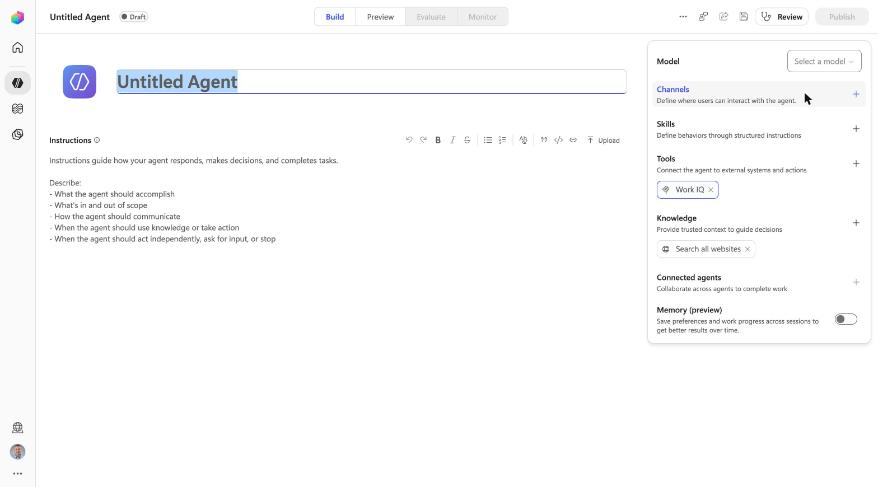
*A new agent in Copilot Studio*


*Searching for Fabric in Add a tool offers two Fabric IQ tools*


*Fabric IQ Data MCP*

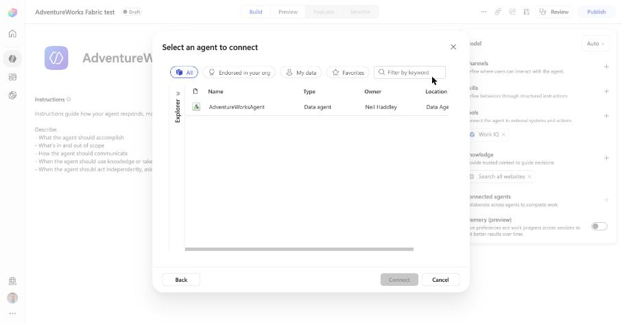
*The picker lists published data agents. Mine was there, so the connection worked*


*The Fabric tool was added next to the default Work IQ tool*

Then I went to Preview and asked the first Microsoft question:

```PROMPT
Show the monthly total and year-to-date total sales. Order by year and month.
```

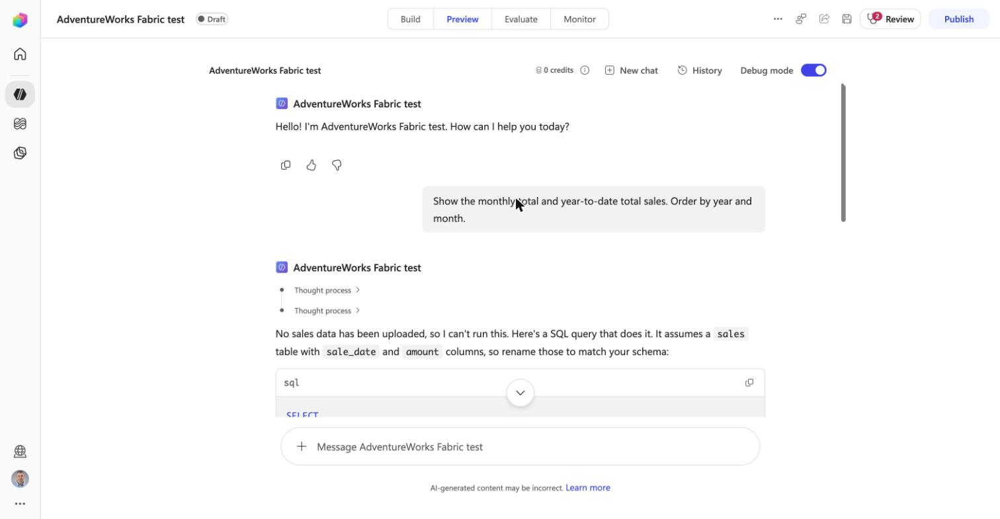
*"No sales data has been uploaded, so I can't run this. Here's a SQL query that does it."*

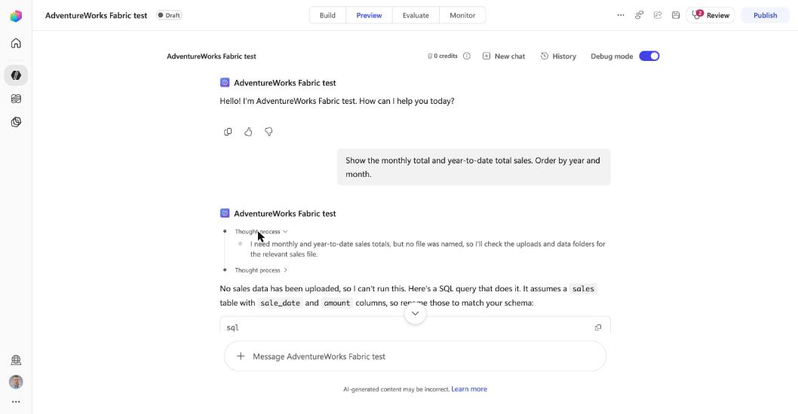
*Its thought process: "no file was named, so I'll check the uploads and data folders"*

It never considered the Fabric tool. It looked for uploaded files and wrote example SQL against a table it invented. I tried again in a new chat and got the same.

I then added an instruction that named the tool. The agent now said it could not get the figures, because it did not have "a working AdventureWorksAgent tool". It said it had tried the Microsoft 365 assistant with the name `AdventureWorksAgent`.

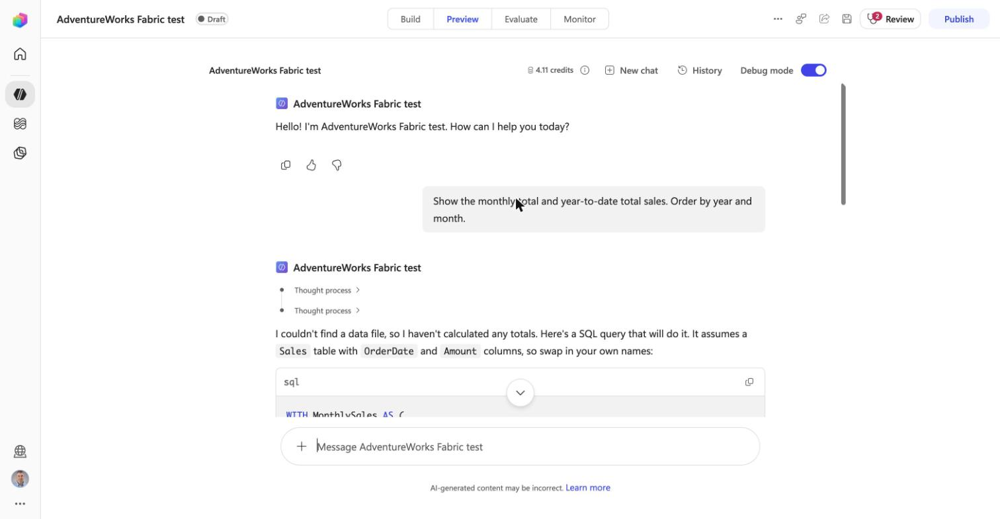
*Second attempt: another generic SQL answer*

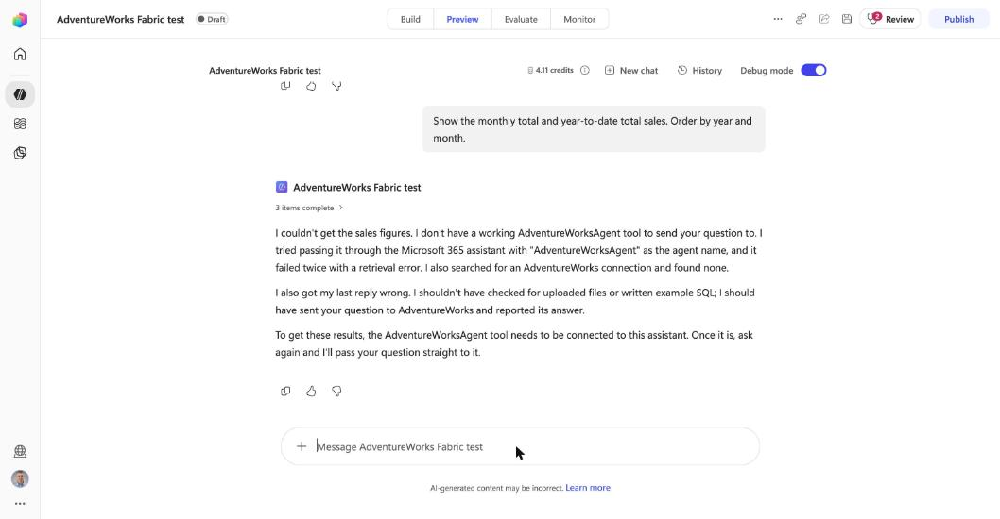
*Third attempt: "I don't have a working AdventureWorksAgent tool"*

I opened the tool's entry and found that its **Description was empty**.

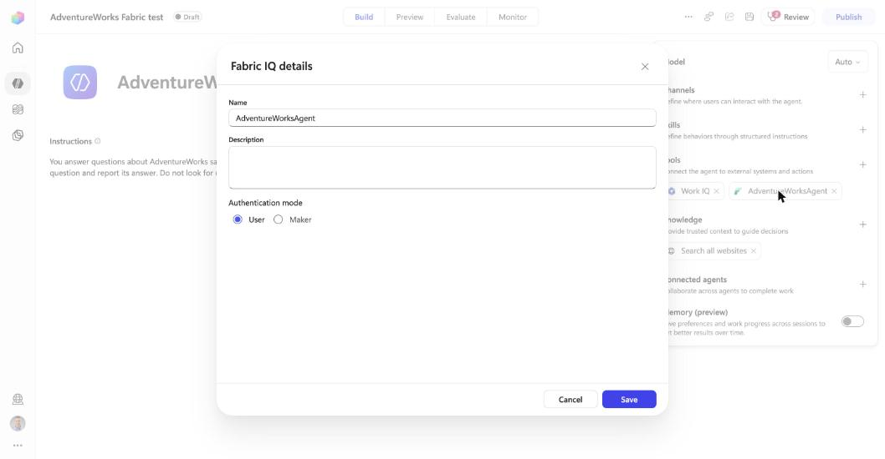
*The Fabric IQ details dialog, with no description*

I wrote a description. The agent then called a tool, but the wrong one:

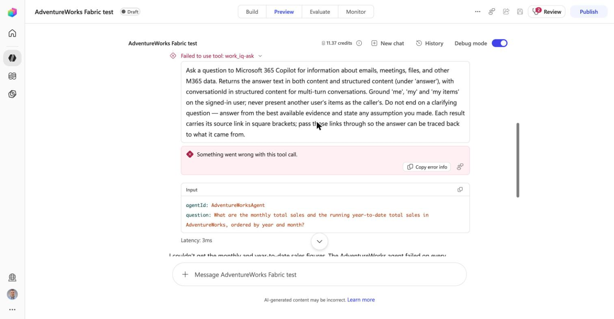
*It called work_iq-ask, the Microsoft 365 Copilot tool, with agentId AdventureWorksAgent. The call failed in 3 ms*

The agent had two tools, Work IQ and the Fabric one, and it chose Work IQ, the Microsoft 365 Copilot tool. That call failed immediately. I do not know why, and a missing Microsoft 365 Copilot licence is a guess. I removed Work IQ and tried once more:

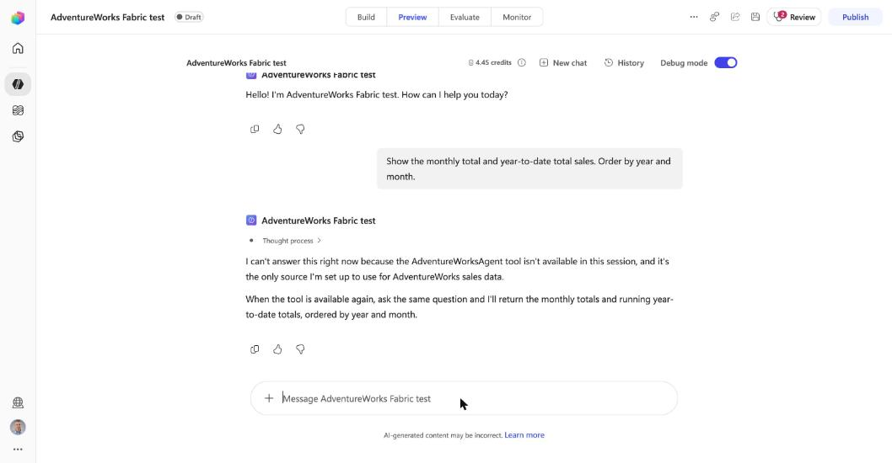
*"The AdventureWorksAgent tool isn't available in this session"*

At this point I had used about 20 Copilot credits across the attempts and had a failed connection. I stopped, deleted the test agent, and wrote it up as unresolved.

## What I got wrong

I then read Microsoft's page properly, and compared it with what I had done.

| Microsoft's step | What I did |
|---|---|
| **Step 4: write a detailed description.** The orchestrator uses it to decide which tool to call | I left it empty for the first attempts, and wrote it only after the agent ignored the tool |
| **Step 6: add instructions** that say when to use each tool | I added them after the first two tests, not before |
| **Step 7: select Save.** "If you don't save, the tools, descriptions, authentication modes, and instructions that you configured aren't applied" | I never clicked Save. This most likely explains "the tool isn't available in this session" |
| **Step 1: create the agent from the arrow next to New agent**, which asks for the agent type | In my tenant the arrow and the button opened the same builder, so I cannot say whether it mattered |
| Keep one clear route to the data | I left Work IQ on, and the agent chose it |

I did not test these one at a time, so I cannot say which mistake mattered most. The documented steps are not hidden, and I skipped some of them.

The silent-connection reports I found are a different problem. A [Microsoft Q&A thread](https://learn.microsoft.com/en-us/answers/questions/5772696/copilot-studio-fabric-data-agent-connection-fails) from February 2026 describes the connection dialog completing and then returning to "Not connected" with no error, in more than one region, and no answer was confirmed. Mine connected and listed my agent, so it was not that one. I found no source that covers an agent connecting and then never calling the tool.

## Second attempt: it works

I needed a Fabric agent to try again. The first one was deleted with its workspace, so I created a second F2, rebuilt the Lakehouse and the agent, and published it again with a long description. Then I did what the page says.

1. I added the Fabric IQ Data MCP tool and selected `AdventureWorksAgent`.
2. I wrote a detailed description for the tool, before testing.
3. I chose User authentication, which is the default.
4. I removed Work IQ.
5. I wrote instructions that name the tool.
6. I clicked Save, and waited for "Your agent has been saved".

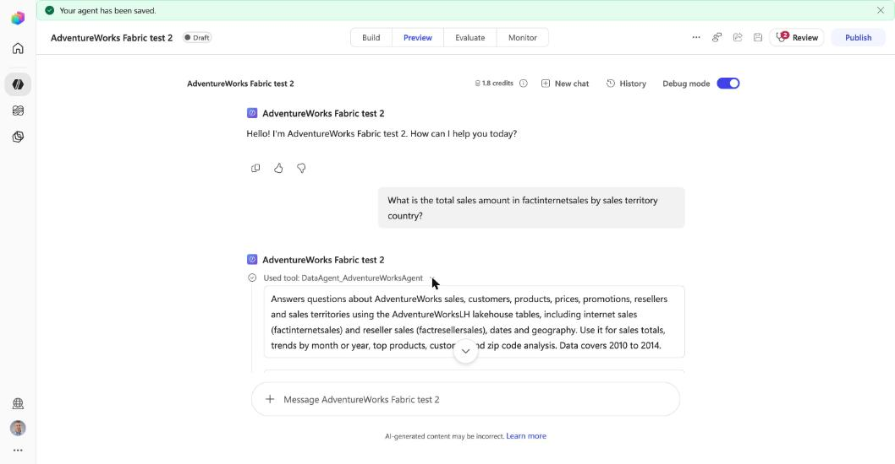
*The tool's description, and User authentication*

This is the description I wrote for the tool:

```text
Answers questions about AdventureWorks sales, customers, products, prices, promotions, resellers and sales territories using the AdventureWorksLH lakehouse (internet and reseller sales, dates and geography, 2010 to 2014). Use it for sales totals, monthly and year-to-date trends, top products, and customer or zip code analysis.
```

And the instructions:

```text
You answer questions about AdventureWorks sales, customers, products, prices and territories. For every such question, call the AdventureWorksAgent tool with the user's question and report its answer. If the tool cannot answer, say so.
```

:::watch-it The Save banner moved the page
The "saved" banner appeared above the toolbar and pushed everything down. My next click missed Preview, and my typed question went into the instructions. I noticed because the instructions box suddenly held a sales question. I replaced the text and saved again.
:::

I then asked the question I had used for the Fabric agent in Part 4:

```PROMPT
What is the total sales amount in factinternetsales by sales territory country?
```


*"Used tool: DataAgent_AdventureWorksAgent"*


*The six countries, with a citation. It cost 1.8 credits*

The figures match the Fabric agent's and my SQL: 9,389,789.94 for the United States, 9,061,000.72 for Australia and so on. Copilot added a total of 29,358,677.89 and a sentence that the United States and Australia make up about 63% of internet sales.

```PROMPT
Show the monthly total and year-to-date total sales. Order by year and month.
```


*Thirty-eight months again, and a note that December 2010 and January 2014 are the only months in their years*

I did not time these in a stopwatch way. I waited between 40 and 60 seconds before each screenshot, so I know only that this took under a minute. It cost 4.89 credits.

```PROMPT
What is the root cause of our sales spike?
```

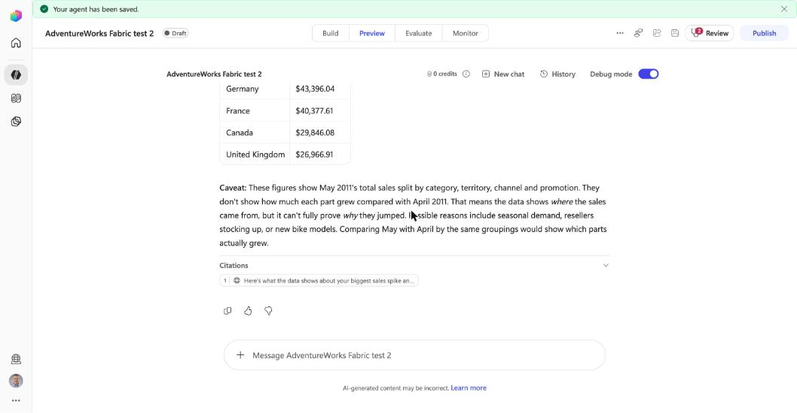
*The answer split May 2011 by category, territory, channel and promotion, then added a caveat*

This one is the interesting comparison. In Part 4 the Fabric agent gave this question a cause and a caveat that it needed business context. Copilot's answer put the caveat in bold at the end: the figures show "where the sales came from, but it can't fully prove why they jumped". It cost 4.72 credits.

## What it cost

| Item | Amount |
|---|---|
| Second F2, 19:33 to 19:52 UTC | about 19 minutes, roughly $0.12 at list price |
| Copilot credits across all attempts | about 31 credits |
| Of which the successful questions | 1.8, 4.89 and 4.72 |
| Of which the failed attempts | 4.11, 11.37 and 4.45 |

The credit meter appeared in the Preview header. The F2 figure is my calculation, not my bill.

## Honest comparison with calling the same agent from DeepSeek Harness

[Part 6](/posts/fabriclakehouse6/) asks the same eight questions through DeepSeek Harness (`dsh`) and a small MCP server of mine. Here is what I can and cannot say after doing both.

| | Copilot Studio calling the Fabric agent | DeepSeek Harness with my tools |
|---|---|---|
| What writes the SQL | The Fabric data agent | The model, through three tools I wrote |
| What I must build | Nothing in code: a tool, a description, instructions, Save | An MCP server of about 130 lines of Python, a profile and an AGENTS.md |
| Capacity | A paid F2, for the Fabric agent | None: it ran against a SQL endpoint, and the trial workspace was enough |
| Extra meter | Copilot credits: about 1.8 to 4.9 per successful question | Model tokens, which I did not meter |
| Models in the path | Two (Copilot's and Fabric's) | One |
| Who can use it | People with the right licences, in Teams or Microsoft 365 | Me, at a terminal |
| Per-user permissions | Yes, in User mode | The identity my terminal is signed in as |
| First setup worked | No: four mistakes of mine | After setup, yes |

I would be careful with the words "simpler" and "cleaner". The Copilot route needs no code, and it brings Teams, per-user permissions and an evaluation tab. The harness route has fewer moving parts per question, ran without a paid capacity, and gave me the SQL and the files directly. But I wrote the harness's tools and its safety rules myself, and [Part 7](/posts/fabriclakehouse7/) shows what happened when I did not. Copilot's tool gives an audience and a permission model that my script does not.

On this evidence the harness was the more direct way for one person to ask questions of one Lakehouse. I have not shown it is better for anyone else.

## What I did not do

- **Publish the Copilot agent** to Teams or Microsoft 365 Copilot. I used only Preview.
- **Use the Evaluate tab.** The page recommends it before publishing.
- **Try Maker authentication**, or more than one data agent.
- **Try the older connected-agent route.**
- **Find out which of my four mistakes mattered.** I fixed them together.
- **Check the Microsoft 365 Copilot licence.** The failed Work IQ call might be a licence problem, but I did not check.

:::bullet-points What I learned
- A Copilot agent calls a Fabric agent through a tool, and it chooses the tool from the tool's description.
- Microsoft's steps are clear. Skipping Save, the description and the instructions made the agent ignore the tool, hallucinate a table and call the wrong tool.
- With two similar tools, the agent picked the wrong one. Remove tools the agent does not need.
- Once set up correctly, the answers matched the Fabric agent and my SQL, and Copilot added a caveat that the agent had put second.
- Copilot credits are an extra cost on top of the F2: about 2 to 5 per successful question here.
:::

## References

- [Add a Fabric data agent as a tool in Microsoft Copilot Studio (Microsoft Learn)](https://learn.microsoft.com/fabric/data-science/data-agent-microsoft-copilot-studio-tool)
- [Consume a Fabric data agent in Microsoft Copilot Studio, the connected-agent route (Microsoft Learn)](https://learn.microsoft.com/fabric/data-science/data-agent-microsoft-copilot-studio)
- [Connect to a Microsoft Fabric Data agent (Copilot Studio, Microsoft Learn)](https://learn.microsoft.com/microsoft-copilot-studio/add-agent-fabric-data-agent)
- [Data agent as a Model Context Protocol server (Microsoft Learn)](https://learn.microsoft.com/fabric/data-science/data-agent-mcp-server)
- [Copilot Studio usage limit and agent unavailable errors (Microsoft Learn)](https://learn.microsoft.com/troubleshoot/power-platform/copilot-studio/licensing/throttling-errors-agents)
- [A Microsoft Q&A thread on a silent connection failure](https://learn.microsoft.com/en-us/answers/questions/5772696/copilot-studio-fabric-data-agent-connection-fails)
- [Part 4: A Fabric Data Agent over the AdventureWorks Lakehouse](/posts/fabriclakehouse4/)
- [Part 6: DeepSeek Harness over the AdventureWorks Lakehouse](/posts/fabriclakehouse6/)
