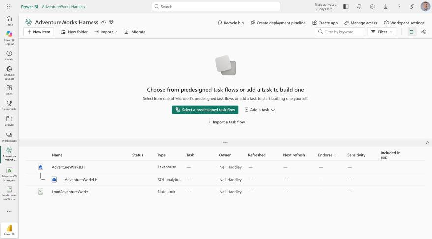
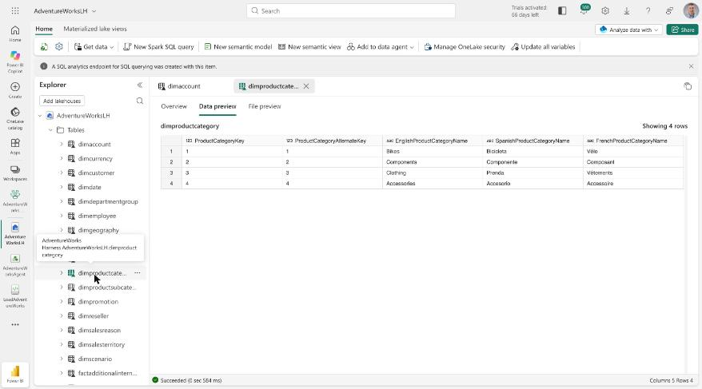

# DeepSeek Harness over the AdventureWorks Lakehouse

In [Part 4](/posts/fabriclakehouse4/) I asked a Fabric data agent all of Microsoft's own questions over the tutorial's AdventureWorks sample, in two setups. In [Part 5](/posts/fabriclakehouse5/) I called that agent from Copilot Studio. In this part I take the same sample data, the same eight questions and the same two setups, and I point [DeepSeek Harness](/posts/deepseekharness/) at them instead. It is a general harness that is not part of Fabric, and it gets one small MCP server of mine that runs read-only SQL. The free trial could not create the Fabric agent, but it can hold the whole data layer, so this part needs no F2.

I ran 48 sessions: eight questions, two setups and three runs each. I scored them against the answer keys that I built from my own SQL where a key was possible, and I read the rest.

## Part 4 and Part 6 side by side

| | Part 4: Fabric data agent | Part 6: DeepSeek Harness |
|---|---|---|
| Sample data | The tutorial's AdventureWorks, 28 tables, loaded on an F2 | The same sample, loaded with the same code on my free trial |
| Questions | Microsoft's seven, plus my country-totals question | The same eight, word for word |
| Setup A | The tutorial's three-table instructions, ten tables, no examples | The same instructions in `AGENTS.md`, ten tables in scope |
| Setup B | Corrected instructions, eleven tables, the tutorial's two example queries | The same instructions and the same two examples |
| Runs | One chat per question and setup, then two MCP calls per question | Three runs per question and setup |
| Needed an F2 | Yes | No |

The main findings:

- **Where an answer is checkable, they agree.** Country totals, the top five products and "no 2023 data" came out the same in all 6 runs of each.
- **The tutorial's instructions did not stop the harness.** It treated them as advice and looked at the data. The Fabric agent refused two questions in setup A.
- **Question 1 has no single right answer, and the two systems disagreed on what to do.** The tutorial's own SQL is ambiguous on ties, and the harness's runs used two different definitions.
- **Question 7, the root cause of a sales spike, produced three different stories.** The Fabric agent gave two more.
- **The harness took far longer on the open-ended question.** Question 7 took 204 to 419 seconds, against 46 to 68 for the Fabric agent. On the simple questions the two were close.


## Load the AdventureWorks sample on the trial

I created a workspace, `AdventureWorks Harness`, on my trial capacity, and a Lakehouse called `AdventureWorksLH` in it. I made them, and a load notebook, through the Fabric REST API, so I have no screenshots of those steps. [Part 4](/posts/fabriclakehouse4/) shows the same steps in the web page, and the notebook holds the same loading code.


*The workspace on my trial: a Lakehouse, its SQL analytics endpoint and the load notebook*

The notebook job completed in 5 minutes 34 seconds. In Part 4, all 28 tables were there after about 19 minutes on the F2.


*The 28 tables in the Lakehouse, with a preview of dimproductcategory*

:::watch-it The SQL endpoint lagged behind the Lakehouse
When the job finished, the Fabric API listed all 28 tables, but the SQL endpoint listed only 25 or 26 of them. A tool that reads the SQL endpoint can see fewer tables than the Lakehouse holds for a few minutes after a load.
:::

## The harness has no Fabric tools, so I wrote one MCP server with three tools

DeepSeek Harness can call tools that speak the Model Context Protocol (MCP). It has no Fabric tool, so I wrote a small MCP server with three tools:

- **list_tables** lists the tables.
- **describe_table** lists the columns of one table.
- **run_select** runs one T-SQL `SELECT` and returns at most 25 rows, as the Fabric data agent does. It refuses anything else.

In [Part 7](/posts/fabriclakehouse7/), I add a fourth tool, `export_query`, for questions that need more than 25 rows. The runs in this part used these three.

It runs `sqlcmd` with the Azure sign-in of whoever runs it, so the database applies that person's permissions and no password is stored in the tool. It has an optional scope, a list of tables that it works with, which I describe below. It is a plain Python script with no packages.

```python
#!/usr/bin/env python3
"""A small read-only MCP server (stdio) for a Fabric Lakehouse SQL endpoint.

Tools: list_tables, describe_table, run_select. They run sqlcmd with the Azure CLI sign-in of whoever runs them
(set AZURE_CONFIG_DIR to use another sign-in), so the database applies that person's permissions and no password is stored.
Settings come from FABRIC_SQL_SERVER and FABRIC_DATABASE. If FABRIC_SCOPE_TABLES (comma separated) is set, the tools
work only with those tables, as ticking tables does for a Fabric data agent. That is a scope that narrows what the
agent looks at. It is not security: what a person can read is decided by the database permissions of the signed-in user.
"""
import json, os, re, subprocess, sys

SERVER = os.environ["FABRIC_SQL_SERVER"]
DATABASE = os.environ["FABRIC_DATABASE"]
MAX_ROWS = 25
SCOPE = {t.strip().lower() for t in os.environ.get("FABRIC_SCOPE_TABLES", "").split(",") if t.strip()}
_all_tables = None
BLOCKED = re.compile(r"\b(insert|update|delete|drop|alter|create|truncate|merge|exec|execute|grant|revoke|deny|into)\b", re.I)


def sql(query, limit=MAX_ROWS):
    out = subprocess.run(
        ["sqlcmd", "-S", SERVER, "-d", DATABASE, "--authentication-method=ActiveDirectoryAzCli", "-W", "-s", "|", "-Q", query],
        capture_output=True, text=True, timeout=120)
    lines = [l for l in (out.stdout + out.stderr).splitlines()
             if l.strip() and not l.startswith("Statement ID") and "rows affected" not in l]
    lines = [l for l in lines if not set(l.replace("|", "").replace(" ", "")) <= {"-"}]   # drop the dashed line under the header
    header, rows = lines[:1], lines[1:]
    note = f"\n(first {limit} rows shown)" if limit and len(rows) > limit else ""
    return "\n".join(header + (rows[:limit] if limit else rows)) + note


def out_of_scope(query):
    """The tables outside the scope that the query names anywhere, as whole words."""
    global _all_tables
    if _all_tables is None:
        _all_tables = {l.strip().lower() for l in sql("SELECT TABLE_NAME FROM INFORMATION_SCHEMA.TABLES", limit=None).splitlines()[1:]}
    return sorted(t for t in _all_tables - SCOPE if re.search(rf"\b{re.escape(t)}\b", query, re.I))


def run_select(query):
    q = query.strip().rstrip(";")
    if not re.match(r"(select|with)\b", q, re.I) or ";" in q or BLOCKED.search(q):
        return "Refused: only a single read-only SELECT statement is allowed."
    if SCOPE and (out_of_scope(q) or re.search(r"\b(?:sys|information_schema)\b", q, re.I)):
        return "Refused: that query uses a table that is not in scope. Tables in scope: " + ", ".join(sorted(SCOPE))
    return sql(q)


def describe_table(table):
    if not re.fullmatch(r"[A-Za-z0-9_]+", table):
        return "Refused: give a plain table name."
    if SCOPE and table.lower() not in SCOPE:
        return "Refused: that table is not in scope. Tables in scope: " + ", ".join(sorted(SCOPE))
    return sql("SELECT COLUMN_NAME, DATA_TYPE FROM INFORMATION_SCHEMA.COLUMNS "
               f"WHERE TABLE_NAME = '{table}' ORDER BY ORDINAL_POSITION")


TOOLS = {
    "list_tables": ("List the tables in the Lakehouse SQL endpoint.", {}, lambda a: ("TABLE_NAME\n" + "\n".join(sorted(SCOPE))) if SCOPE else sql(
        "SELECT TABLE_NAME FROM INFORMATION_SCHEMA.TABLES WHERE TABLE_SCHEMA = 'dbo' ORDER BY TABLE_NAME")),
    "describe_table": ("List the columns and data types of one table.",
                       {"table": {"type": "string", "description": "Table name, for example dimproduct"}},
                       lambda a: describe_table(a["table"])),
    "run_select": (f"Run one read-only T-SQL SELECT statement. At most {MAX_ROWS} rows come back.",
                   {"query": {"type": "string", "description": "A T-SQL SELECT statement"}},
                   lambda a: run_select(a["query"])),
}


def reply(id_, result=None, error=None):
    msg = {"jsonrpc": "2.0", "id": id_}
    msg["error" if error else "result"] = error or result
    sys.stdout.write(json.dumps(msg) + "\n"); sys.stdout.flush()


for line in sys.stdin:
    try:
        m = json.loads(line)
    except ValueError:
        continue
    method, id_ = m.get("method"), m.get("id")
    if id_ is None:
        continue                                   # notifications need no reply
    if method == "initialize":
        reply(id_, {"protocolVersion": m["params"].get("protocolVersion", "2024-11-05"),
                    "capabilities": {"tools": {}}, "serverInfo": {"name": "fabric-sql", "version": "1.0"}})
    elif method == "tools/list":
        reply(id_, {"tools": [{"name": n, "description": d,
                               "inputSchema": {"type": "object", "properties": p, "required": list(p)}}
                              for n, (d, p, _) in TOOLS.items()]})
    elif method == "tools/call":
        name, args = m["params"]["name"], m["params"].get("arguments") or {}
        try:
            text = TOOLS[name][2](args)
            reply(id_, {"content": [{"type": "text", "text": text}]})
        except Exception as e:
            reply(id_, {"content": [{"type": "text", "text": f"Error: {e}"}], "isError": True})
    else:
        reply(id_, error={"code": -32601, "message": "Method not found"})
```

I tested it by hand: it listed the tables, and it refused a `DELETE`. Its own check only allows a single `SELECT` statement.

I did not edit my existing harness profile. I made two new profiles, each with one row, so that the Business Central tools from my other posts do not load. The profile `fabricscope10` sets the scope to the ten tutorial tables. The profile `fabricscope11` adds `dimproductsubcategory`. The setting is `FABRIC_SCOPE_TABLES`:

```yaml
# The fabricscope10 profile: one row that adds the read-only Fabric SQL tools. Use: dsh --profile fabricscope10 "task"
- insert:
    - id: mcp-fabric-sql
      name: '@deepseek-ai/dsh-mcp-client'
      config:
        serverName: fabricsql
        transport: stdio
        command: python3
        args:
          - <home>/Documents/GitHub/fabric-harness/fabric_sql_mcp.py
        env:
          FABRIC_SQL_SERVER: <the Lakehouse SQL endpoint connection string>
          FABRIC_DATABASE: AdventureWorksLH
          FABRIC_SCOPE_TABLES: dimcustomer,dimdate,dimgeography,dimproduct,dimproductcategory,dimpromotion,dimreseller,dimsalesterritory,factinternetsales,factresellersales
        toolCallTimeoutMs: 120000
```

## Scope the tool to the ticked tables

In the Fabric agent, ticking tables narrows what the agent uses. It is a convenience for whoever builds the agent. It does not change what I can read. I was the workspace admin, and I could read every table, which is why the agent's "there is no product table" was about the agent, not about me. I wanted the same idea in the harness, so the tool has a scope, a list of tables, set in the profile. The harness itself signs in as me, with my full permissions, as the Fabric agent did.

When the scope is set, `list_tables` shows only those tables, `describe_table` refuses the others, and `run_select` refuses a query that names any table outside the scope. My first version only looked at the names after `FROM` and `JOIN`, so a comma join slipped through and returned data from a table that I had not scoped in. I changed it to refuse a query if any out-of-scope table name appears anywhere in it. With the ten tutorial tables in scope, I tried it:

| Call | Result |
|---|---|
| `list_tables` | The ten tables |
| `describe_table` on `dimproductsubcategory` | Refused: not in scope |
| A comma join to `dimproductsubcategory` | Refused: not in scope |
| `SELECT COUNT(*) FROM dbo.dimproduct` | 606 |

With `dimproductsubcategory` added to the scope, the same join returned `Road Bikes`.

A scope is not security. It narrows what the agent looks at, and it relies on the tool noticing table names. What a person can read is decided by the database permissions, and [Part 7](/posts/fabriclakehouse7/) shows that with a second user.

## The answer key

Before I ran the harness, I ran the questions as SQL with `sqlcmd` against the same endpoint, and kept the results in a `key` folder. Not every question has a key.

| Question | Key |
|---|---|
| 1 repeat purchases | None that I trust. The tutorial's SQL orders ties by `OrderDate` only, and 10,514 customers have a first purchase date shared by several order lines. Two executions of the same SQL can pick different first lines. I ran it with and without a tie-break, and I got a mean of 45.67% in one and -17.23% in the other, over the same 289 zip codes |
| 2 monthly and year-to-date | The tutorial's example SQL: internet sales only, 38 months |
| 3 California 2023 | None needed: the sales tables end in January 2014. California by year: 2010 to 2014 only |
| 4 top five products | Exactly five rows tie: Road-150 Red in sizes 44, 48, 52, 56 and 62, at 3,578.27, in Bikes |
| 5 never sold | The top ten never sold in either channel: four HL Road Frames at 1,431.50, the HL Mountain Frames at 1,364.50 and 1,349.60, then four HL Road Frames at 1,301.36 |
| 6 factory productivity | No data exists, so the right answer is a refusal |
| 7 sales spike | No key: the question does not say which spike, and the data cannot show a cause |
| 8 countries | Six totals, below |

| Country | Fabric agent | My SQL | Harness, 6 of 6 runs |
|---|---|---|---|
| United States | 9,389,789.94 | 9,389,789.94 | 9,389,789.94 |
| Australia | 9,061,000.72 | 9,061,000.72 | 9,061,000.72 |
| United Kingdom | 3,391,712.24 | 3,391,712.24 | 3,391,712.24 |
| Germany | 2,894,312.36 | 2,894,312.36 | 2,894,312.36 |
| France | 2,644,017.74 | 2,644,017.74 | 2,644,017.74 |
| Canada | 1,977,844.89 | 1,977,844.89 | 1,977,844.89 |

## The 48 runs

The prompt was only the question, word for word as in the table in Part 4. The instructions are in a file called `AGENTS.md` in the harness's working folder, which the harness reads at the start of every session, so I did not repeat them in the prompt, and I did not name the Fabric tools. Each run is a new headless session in its own empty folder, signed in as me. The model was `deepseek-v4-flash`. I ran three at a time.

| Setup | Tables in scope | `AGENTS.md` |
|---|---|---|
| A | The ten tutorial tables | Microsoft's tutorial instructions, which name three tables |
| B | Those ten plus `dimproductsubcategory` | My corrected instructions, plus the tutorial's two example queries |

These runs used the final version of my server, which has a fourth tool, `export_query`, that writes a long result to a CSV file in the working folder. I added it in [Part 7](/posts/fabriclakehouse7/) because the 25-row cap makes a question like question 1 impossible without it.

## The results

| # | Question | Setup A | Setup B | Median time A | Median time B |
|---|---|---|---|---|---|
| 1 | Repeat purchases | 3 of 3 gave an answer, using order totals | 3 of 3 gave an answer, using the example's SQL | 79.0 s | 28.9 s |
| 2 | Monthly and year-to-date | 2 of 3 match the key. One combined internet and reseller | 3 of 3 match the key | 25.4 s | 13.2 s |
| 3 | California 2023 | 3 of 3 said there is no 2023 data | 3 of 3 said so | 42.1 s | 32.5 s |
| 4 | Top five products | 3 of 3 match the key | 3 of 3 match the key | 46.0 s | 19.7 s |
| 5 | Never sold | 3 of 3 lead with the key's rows | 3 of 3 lead with the key's rows | 57.6 s | 40.7 s |
| 6 | Factory productivity | 3 of 3 refused | 3 of 3 refused | 30.1 s | 26.7 s |
| 7 | Sales spike | 3 of 3 named a cause, 3 different ones | 3 of 3 named a cause | 271.6 s | 283.6 s |
| 8 | Countries | 3 of 3 match the key | 3 of 3 match the key | 14.1 s | 12.6 s |

The 48 runs took a total of about 53 minutes.

### The questions with a clear answer: 3, 4, 5, 6 and 8

All 30 runs gave the right kind of answer. Question 3, California in 2023, found that the sales tables end in January 2014 and reported no sales, without inventing a figure. Several runs added California by year as context. In both setups every run said so, so the tutorial's instructions did not make the harness say there were no sales tables, as it did the Fabric agent in setup A. Question 4 gave the five Road-150 Red bikes every time. Question 6 refused every time and said that the source has no factory data and no 2024 data. Question 8 matched to the cent.

### Question 2

Setup B copied the example's SQL, as the Fabric agent did, and matched the key three times. In setup A, runs 2 and 3 summed internet sales only and matched. Run 1 summed internet and reseller sales and gave 532,749.60 for December 2010 and 2,008,232.31 for January 2011. That is a defensible reading of "sales", and it is not the tutorial's reading. It stated which tables it used.

### Question 1

I cannot score question 1 against a key, so I compared the runs.

- **Setup A** treated a purchase as one sales order, summing the order's lines, and attached the customer's zip code. Each run said so in its method, and said that it broke ties by order number. The three runs used the same definition.
- **Setup B** used the example's SQL, line by line, with the tie-break left as in the example. All three runs gave the same figures: 289 zip codes, a lowest average of -90.89%, a highest of 1,870.48% and a mean of 13.54%. Run 3 wrote its 289 rows to a CSV file.

So the harness was self-consistent in each setup and used two different definitions between them. The tutorial's own question does not decide between them. The Fabric agent in Part 4 truncated its answer to 200 zip codes in setup A and returned 0% for every zip code in setup B. The harness's runs returned all 289.

### Question 5

Both setups gave a defined "never sold" as a product that appears in neither `factinternetsales` nor `factresellersales`, and all six led with the HL Road Frame at 1,431.50, as the key does. Several also found that 256 of the 606 products have never been sold, and that 211 of those have no list price at all.

### Question 7

This is where the runs diverged most, and they took the longest: 204 to 419 seconds, with 44 to 78 tool calls.

| Run | Its root cause |
|---|---|
| A1 | There is no real spike. It is a structural break in the internet-channel data feed in December 2012 |
| A2 | Two things: a real surge in the internet channel in 2013, and "fake spikes" in company-wide figures |
| A3 | A catalog launch in the week of 28 December 2012, when the internet store went from 31 to 102 SKUs |
| B1 | The 2013 step-change, with a decomposition by product, price and promotion |
| B2 | The launch of the Touring bike line on 28 December 2012, 83% of the year-over-year increase |
| B3 | The same: the Touring Bikes launch on 28 December 2012 |

I did not verify these claims against the data. Five of the six point at the end of December 2012, and the Fabric agent in Part 4 chose a different spike altogether, May 2011. The question does not say which spike it means. A good answer to this question is to ask. None of the six did, and neither did the Fabric agent. The Part 5 Copilot answer came closest, because it put the caveat that the data cannot prove why in bold.

### One run left its folder

The question 7 runs used the shell heavily: 26 shell calls in run A2 and 25 in A3, mostly Python over the CSV files that `export_query` wrote. One of them, A2, ran `ls -la /private/tmp/fh-ms/` to list the sibling run folders. That showed the names of the other runs. It did not open any of them, and the only paths in its session were its own folder and that listing. I mention it because [Part 7](/posts/fabriclakehouse7/) shows that a harness with a shell can reach more than its tools.

## What happens if I tell it to refuse

The Fabric agent refused, and the harness did not. I wanted to know whether refusing is something that I can switch on. I added one rule to the tutorial's instructions in `AGENTS.md`:

```text
If a question needs a join or a column that the tables in scope do not support, do not answer that part. Say that you cannot answer it, name the missing table or column, and do not fill the gap with knowledge from outside the data. Answer the parts of the question that the data does support.
```

I asked the ten-table product question three times, with only the question as the prompt.

| Run | What it did | Time |
|---|---|---|
| 1 | Refused. It said that only three tables are in scope, and named `dimproduct` and `dimproductcategory` as missing | 16 s |
| 2 | Listed the five bikes, refused the category, and named `dimproductsubcategory` as the missing table | 40 s |
| 3 | Refused after listing the tables, without querying the data, for the same reason as run 1 | 6 s |

Runs 1 and 3 repeated the three tables from the tutorial's instructions, as the Fabric agent did in Part 4, although `dimproduct` and `dimproductcategory` were in scope. Without the rule, the harness treated those instructions as advice and checked the data itself. With the rule, two runs treated them as the boundary. Run 2 did what I wanted: it gave what the data supports, and it named the real missing table.

So refusing is a setting that I choose in the instructions, and the refusal is only as good as the instructions. That is consistent with the Fabric agent's refusals in Part 4, which blamed the three tables in the instructions. I cannot see how the Fabric agent uses its instructions, so this is a possible explanation and not a finding.

## Compared with Part 4 and Part 5

| # | Fabric agent, setup A | Fabric agent, setup B | Harness, both setups |
|---|---|---|---|
| 1 | Truncated to 200 zip codes | 0% for every zip code | All 289 zip codes, in two stated definitions |
| 2 | Internet sales only | The example's SQL | Internet only in 5 of 6 runs, internet plus reseller in 1 |
| 3 | Refused: "no sales tables" | Found no 2023 sales | Found no 2023 sales, 6 of 6 |
| 4 | Refused | The five bikes | The five bikes, 6 of 6 |
| 5 | Twenty products | Twenty products | The same top rows, with the counts of unsold products |
| 6 | Refused | Refused, then an outline | Refused, 6 of 6 |
| 7 | A cause: early 2013 online demand | A cause: May 2011 bikes | A cause, three or four different ones, from 204 to 419 s |
| 8 | Correct, 14 s | Correct, 9 s | Correct, 6 of 6, 13 to 14 s |

The answers match where the question has an answer. The two disagree about question 7, because that question has none, and they differ on how to handle ties in question 1.

Two things count against the Fabric agent in this comparison, and one for it.

- **Against:** In setup A the Fabric agent refused questions 3 and 4 because of the three-table instructions, and in setup B the example made question 1 return 0% for every zip code. The harness had neither failure.
- **Against:** It returned a root cause for question 7 in both rounds, and a different one each time. The harness did the same, but it did far more work first.
- **For:** The Fabric agent was faster on every question. Its median ran from 9 to 27 seconds on the simple questions, and 46 to 68 seconds on question 7.

The Copilot Studio route in [Part 5](/posts/fabriclakehouse5/) gave the Fabric agent's answers and added a caveat to question 7. I did not run it through the 48-run process, so I cannot compare it in the same way.

Matching answers are evidence, not proof, that two systems ran the same SQL. Six country totals matching to the cent is strong evidence, because a different grouping or filter would almost certainly change one of them. The product question is weaker, because many queries return those five rows. I compared answers, not queries. I did open the Fabric agent's SQL for each question in Part 4, and that shows it used the example's SQL for question 2. The harness's full list of queries was in its session logs, which I read for the tool-call counts.

In [Part 7](/posts/fabriclakehouse7/) I rebuild what one person needs from a Fabric data agent on top of tables, which is example queries, the asker's own permissions and a callable endpoint, and I list the enterprise features that I did not rebuild.

## Why this is not a fair test

- **Different models and tools.** I do not know which model the Fabric data agent uses. The harness used `deepseek-v4-flash` and my own tool, which can run any `SELECT` on the tables in its scope.
- **A handful of questions.** Eight questions, of which five have a single right answer.
- **Three runs per cell.** That is enough to see no refusals, and not enough to measure a rate. The Fabric agent had one chat per question and setup, plus two MCP calls per question.
- **The Fabric agent's setup changed with the question.** Setup B was designed to fix questions 3 and 4, and I never tested its effect on question 1 alone.
- **No cost figure.** I did not read DeepSeek's usage, so I cannot compare costs. The Fabric side cost me about $0.33 of compute in Part 4 and about $0.12 in Part 5, which are also estimates.
- **Earlier sets.** Before these 48 runs I ran four other sets of 12 to 18 runs on my own two questions. Their results were similar, and they are summarised in [Part 7](/posts/fabriclakehouse7/).

:::bullet-points What I learned
- A Lakehouse and its SQL endpoint run on the free trial. The load took under six minutes, and no F2 was needed.
- A coding harness needs one small tool to answer questions about a Lakehouse. Mine is a single Python file with four tools, three read-only and one that writes a CSV file.
- On the questions with a right answer, the harness matched my SQL in every run.
- The harness did not treat the tutorial's instructions as a boundary, and the Fabric agent did. That is why the Fabric agent refused questions 3 and 4 in setup A.
- Questions that depend on a definition, such as repeat purchases, and questions that have no data answer, such as the root cause of a spike, gave different answers from every system and from every run.
- A harness with a shell can reach more than its tools. One run listed its parent folder.
- A scope on table names works like ticking tables in Fabric. It narrows what the agent looks at, and it is not security. Permissions decide what a person can read.
:::

## References

- [Part 4: A Fabric Data Agent over the AdventureWorks Lakehouse](/posts/fabriclakehouse4/)
- [Part 5: Copilot Studio and the Fabric Data Agent](/posts/fabriclakehouse5/)
- [Part 7: Rebuilding what a Fabric Data Agent adds](/posts/fabriclakehouse7/)
- [DeepSeek Harness](/posts/deepseekharness/)
- [Fabric data agent example with the AdventureWorks dataset (Microsoft Learn)](https://learn.microsoft.com/fabric/data-science/data-agent-end-to-end-tutorial)
- [Model Context Protocol](https://modelcontextprotocol.io/)
