Businesses that purchase items from Vendors need to provide payment.

Businesses should take advantage of payment terms and discounts for prompt payment.

:::brain-power Before you read on
When a company pays a supplier's invoice, two things happen in its books: the money leaves a bank account, and the debt to the supplier goes away. Which account would you expect to go down for each, and why?
:::

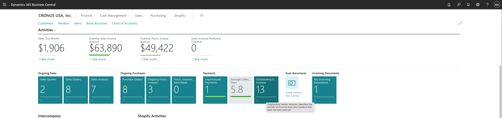
*I noticed that there were 13 Outstanding Vendor Invoices in the CRONUS USA, Inc. company accounts*

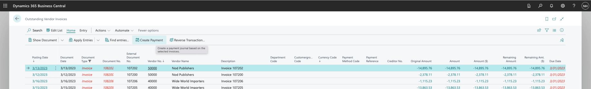
*I created a payment for the $14,895 Nod Publishers Invoice*

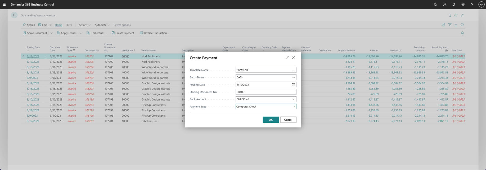
*I selected Payment Type "Computer Check"*

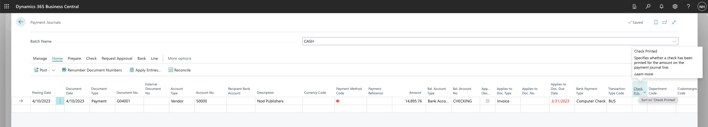
*I noticed that the Check Printed value was false (unselected)*

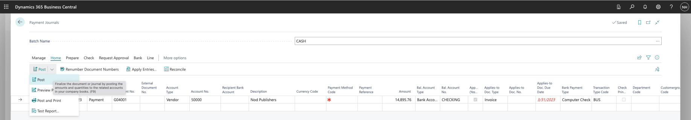
*As a test I tried to Post the payment*

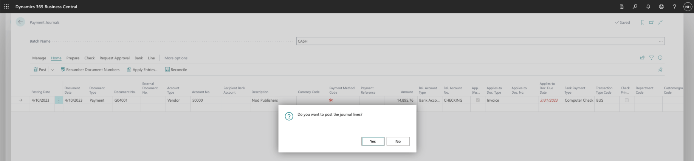
*I confirmed Yes*

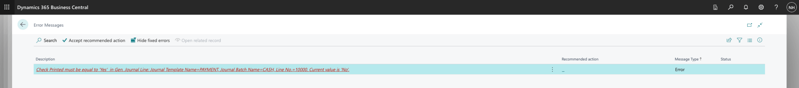
*Business Central generated an error. I had specified Computer Check but I had not printed a Check.*

:::no-dumb-questions
**Q: Why did Business Central refuse to post the payment?**

A: I had chosen Computer Check as the payment type, but I had not printed the check, and the Check Printed value was false. Business Central expected the check to exist before it recorded the payment.

**Q: How did I print a check?**

A: I used Check, then Print Check, then Send to, and chose the PDF Document option. Business Central produced Check.pdf, a one-page document that was ready to print.

**Q: Why use Preview Posting first?**

A: It lists the entries that the posting would create, so I could check them before I posted. I used it for a single payment and again for the batch.
:::

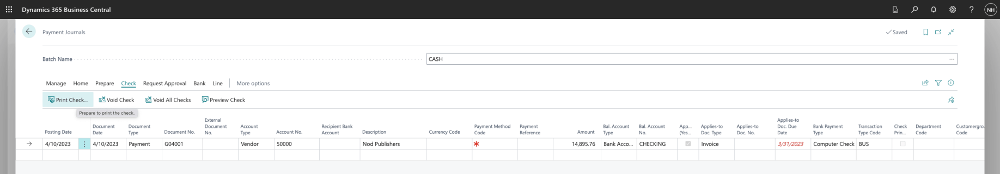
*I selected the Check|Print Check... menu item*

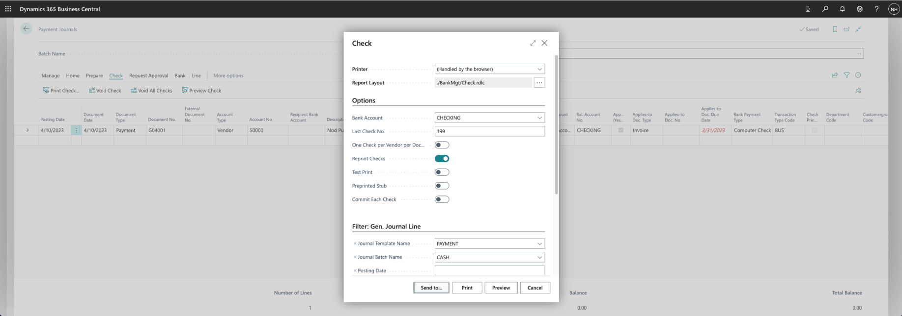
*I selected the "Send to..." link*

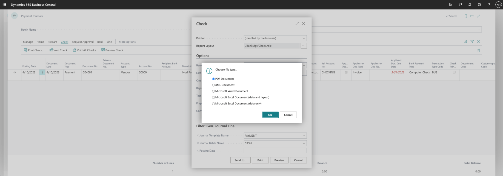
*I selected the PDF Document option*

*Check.pdf was downloaded*

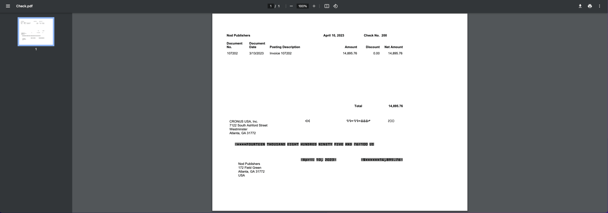
*Business Central generated a one page pdf document (ready for me to print)*

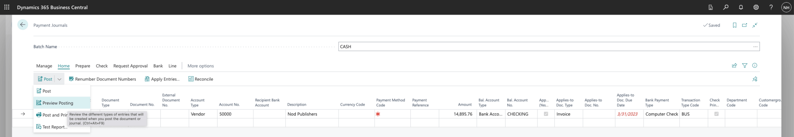
*I selected Preview Posting*

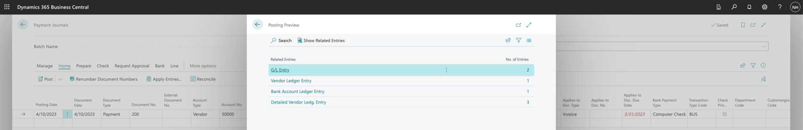
*There were going to be two General Ledger Entries added, a Vendor Ledger Entry added, a Bank Account Ledger Entry added, and three Detailed Vendor Ledger Entries added*

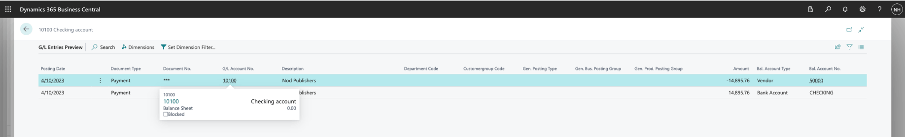
*A Credit entry was going to be added to the Checking Account (The value of the Asset would reduce)*

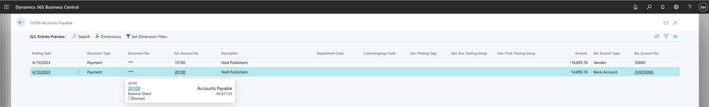
*A Debit entry was going to be added to the Accounts Payable Account (The size of the Liability would reduce). I noticed that the name of the Vendor was added as a Description*

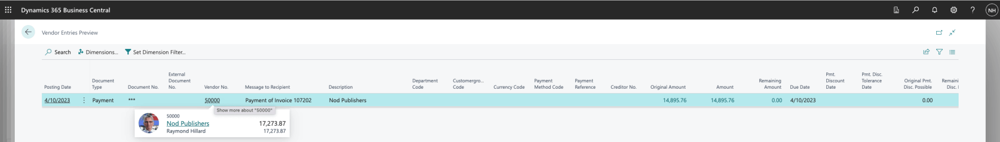
*A Debit entry was going to be added to the Nod Publishers Account in the Vendor Ledger*

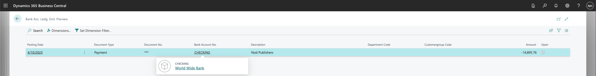
*A Credit entry was going to be added to the CHECKING Account in the Bank Account Ledger*

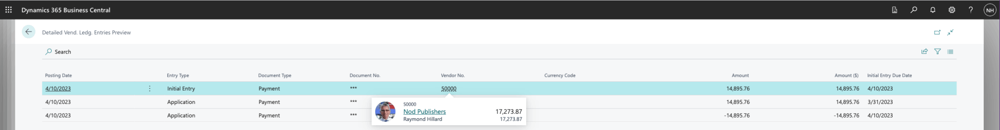
*Three entries were going to be added to the Detailed Vendor Ledger*

:::under-the-hood Reading the preview
For the single payment, the preview showed a credit to the Checking account, because the value of the asset goes down, and a debit to Accounts Payable, because the liability goes down. The vendor ledger got a debit entry for Nod Publishers, and the bank account ledger got a credit entry for CHECKING. The detailed vendor ledger received three entries.
:::

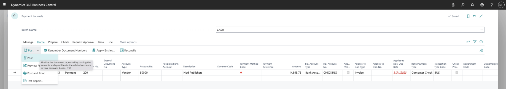
*I selected the Post|Post menu item*

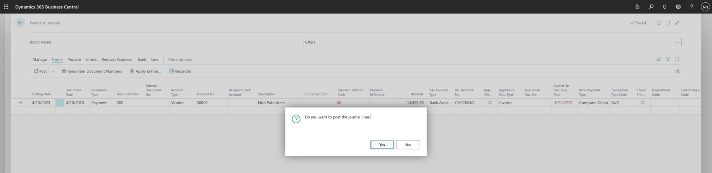
*I selected the Yes option*

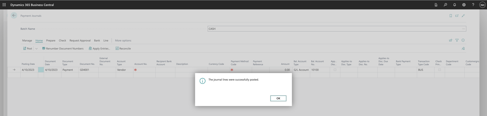
*The journal lines were successfully posted*

## Suggest Vendor Payments

I used the Suggest Vendor Payments menu item to suggest payment lines. In normal operations suggested payment lines would include payments that will qualify for payment discounts.

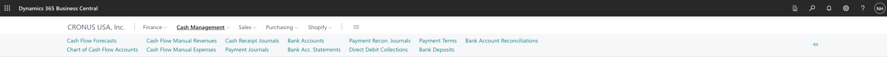
*I reviewed Payment Journals*

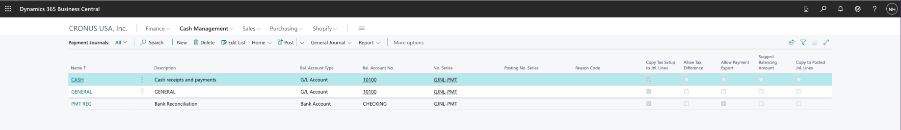
*I selected the CASH batch (as a starting point)*

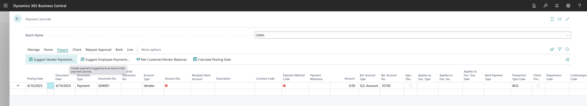
*I clicked the Suggest Vendor Payments link*

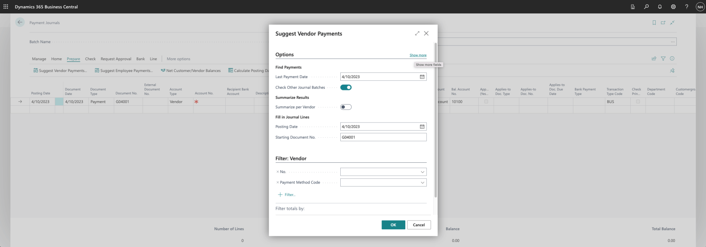
*I clicked the "Show more" link*

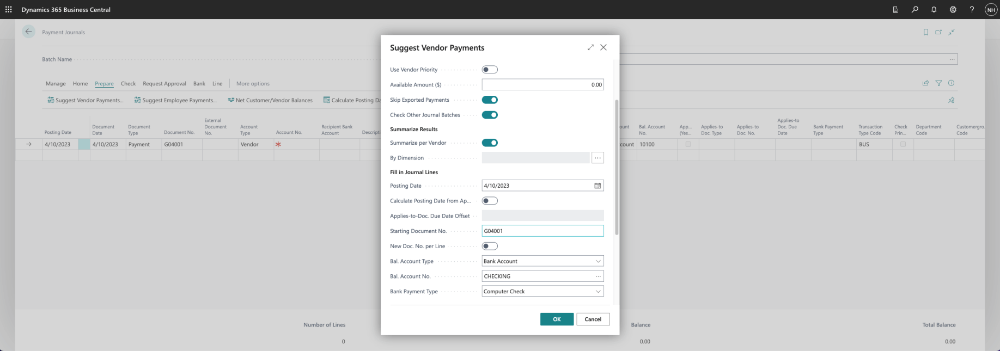
*I selected Bal. Account Type: Bank Account, Bal. Account No.: CHECKING, and Bank Payment Type: Computer Check*

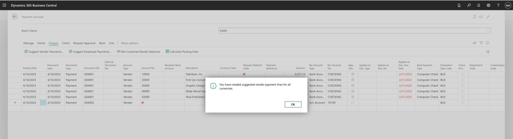
*I clicked the OK link*

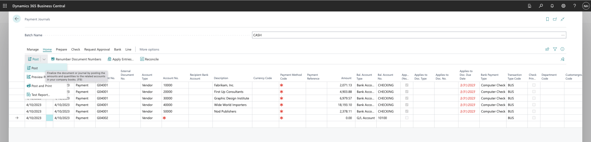
*As a test I tried to click the Post|Post link*

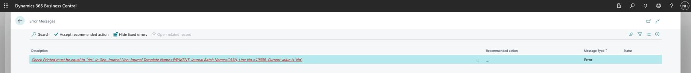
*Again Business Central generated an error. I had specified Computer Check but I had not printed the Checks.*

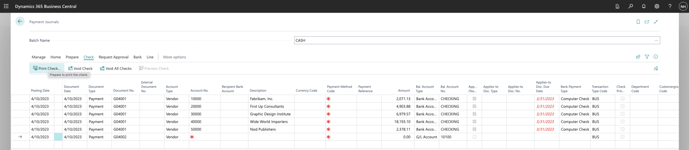
*I clicked the Check|Print Check... link*

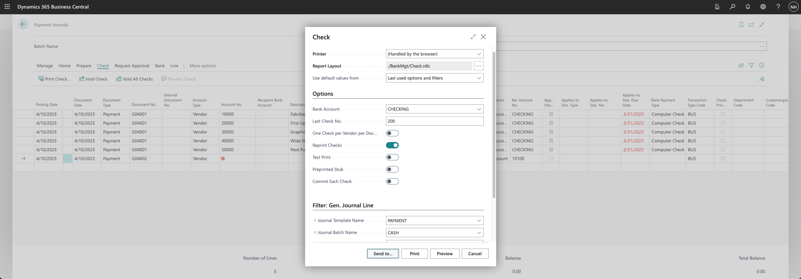
*I selected the Send to... link*

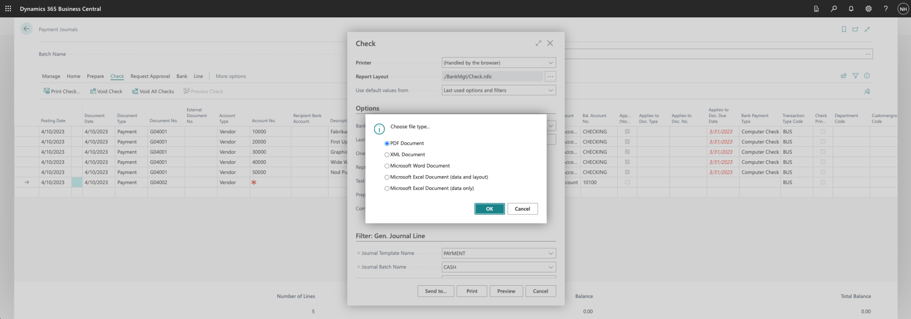
*I selected the PDF Document option*

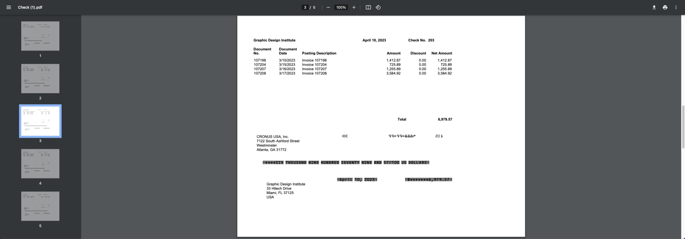
*The result was a 5 page pdf file. Each page included the check details and the corresponding Vendor invoice details*

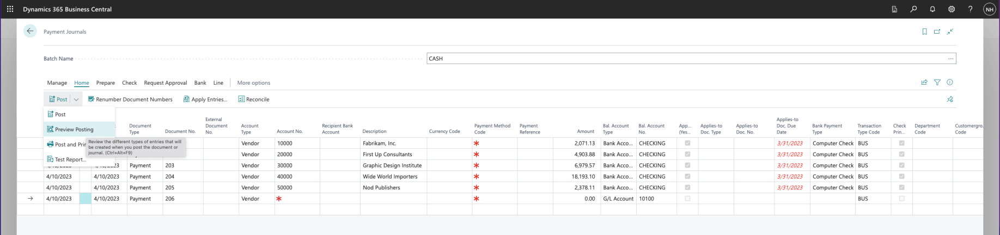
*I selected Preview Posting*

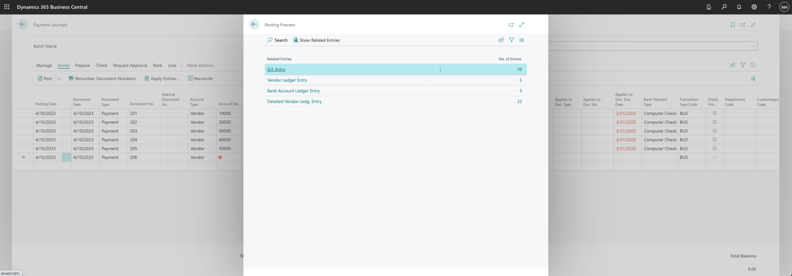
*There were going to be ten General Ledger Entries added, five Vendor Ledger Entries added, five Bank Account Ledger Entries added, and twenty two Detailed Vendor Ledger Entries added*

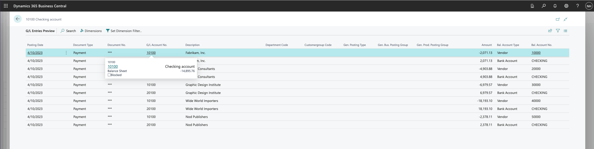
*Five Credit entries were going to be added to the Checking Account (The value of the Asset would reduce)*

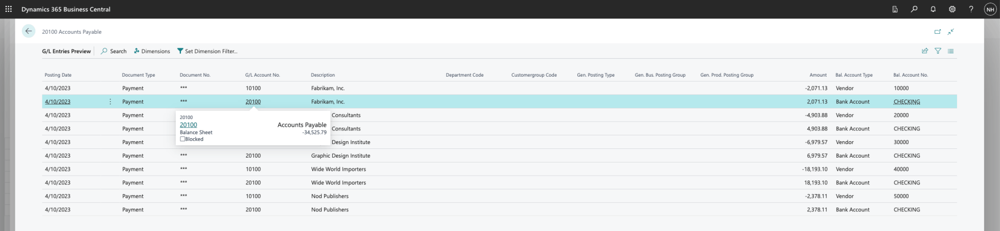
*Five Debit entries were going to be added to the Accounts Payable Account (The size of the Liability would reduce). I noticed that in each instance the name of the Vendor was added as a Description*

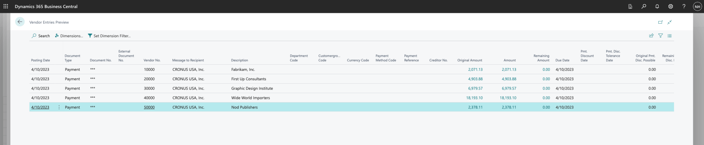
*Five Debit entries were going to be added to the Vendor Ledger (one for each of the five Vendor Accounts)*

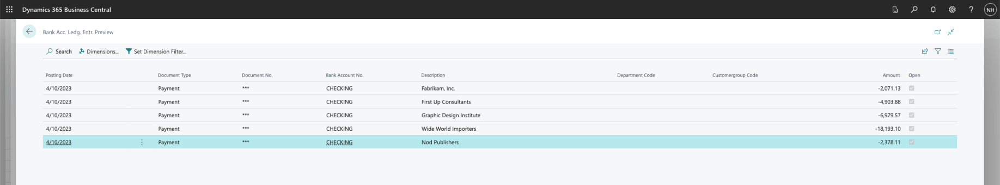
*Five Credit entries were going to be added to the CHECKING Account in the Bank Account Ledger*

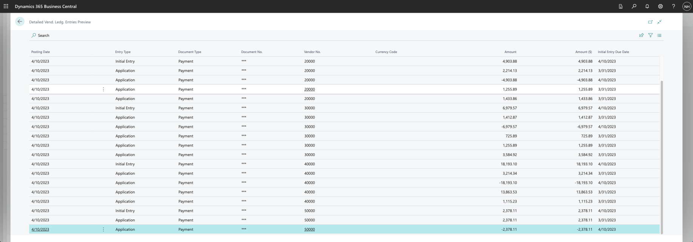
*Twenty two entries were going to be added to the Detailed Vendor Ledger*

:::pencil Predict the batch
For one payment, the preview showed two general ledger entries. Suggest Vendor Payments proposed five payments. How many general ledger entries would you expect in the batch preview, and how many bank account ledger entries?

:::answer
Ten general ledger entries, because each of the five payments creates two. The preview also showed five bank account ledger entries, one for each check, and five vendor ledger entries. The detailed vendor ledger received twenty two entries.
:::
:::

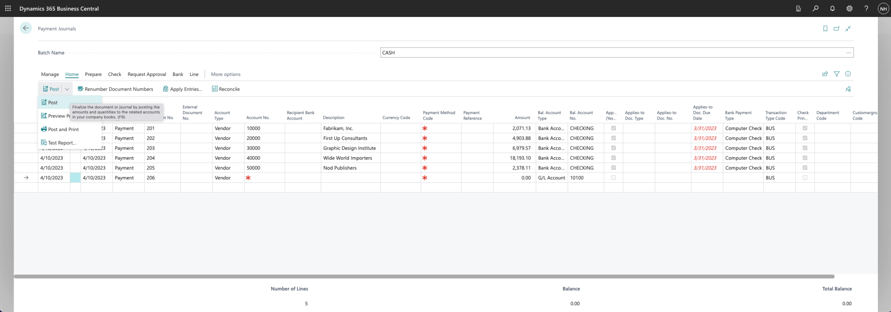
*I selected the Post|Post menu item*

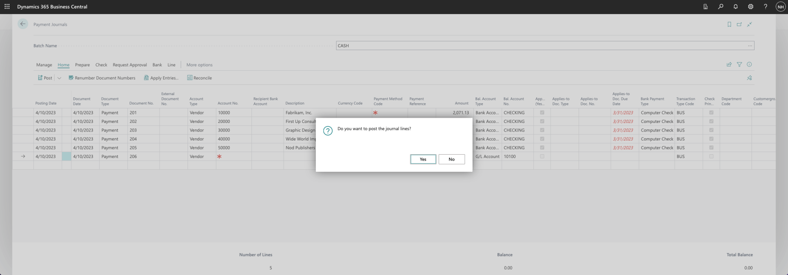
*I selected the Yes option*

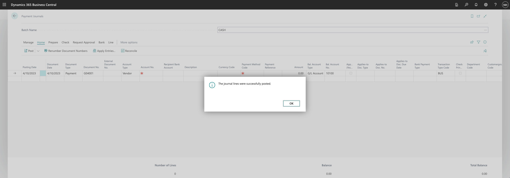
*The journal lines were successfully posted*

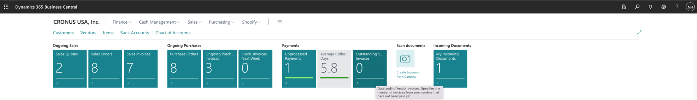
*The Outstanding Vendor Invoices count was reduced to 0*

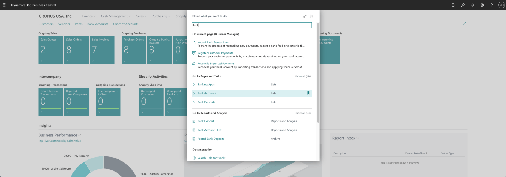
*I reviewed the bank accounts list*

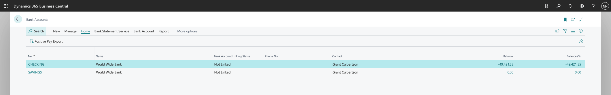
*At least $49,421.55 would need to be deposited in the CHECKING bank account before the Vendors received the physical checks.*

:::watch-it Check the bank balance before the checks go out
After I posted the batch, the bank accounts list showed that at least $49,421.55 would need to be deposited in the CHECKING account before the vendors received their physical checks. Posting the payments does not put money in the bank, so check the balance first.
:::

:::test-drive Try it yourself
1. Open a payment journal, create a payment for an outstanding vendor invoice, and choose Computer Check.
2. Print the check to a PDF, and then use Preview Posting.
3. Try Suggest Vendor Payments, and compare the preview with the single payment.
:::

:::bullet-points Recap
- A payment reduces the bank account, which is an asset, and the accounts payable account, which is a liability.
- Computer Check payments must be printed before they can be posted.
- Preview Posting shows the ledger entries before anything is recorded.
- Suggest Vendor Payments proposed five payments, and posting them cleared the outstanding invoices.
:::
