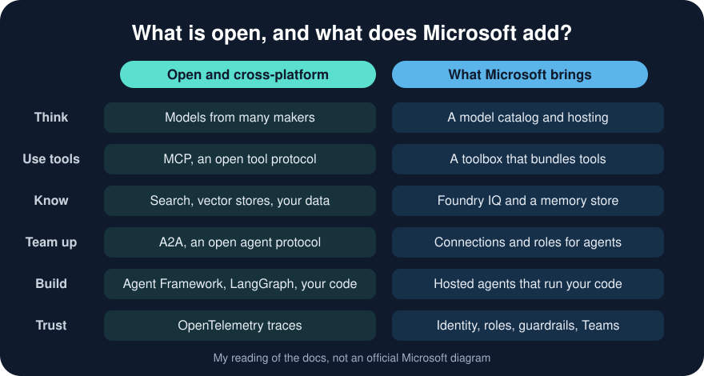

# Where to start in Microsoft Foundry

Microsoft Foundry has a lot of places to learn from: samples, solution templates, quickstarts and a learning path. When I started, I could not tell which one to open first, or which parts were Microsoft's and which were not. So I read them all. This post is the short version: the big picture, and the Microsoft learning path I would follow.

## An agent in one sentence

An agent is a model that can **think**, **use tools**, **know things** and **team up with other agents**, running with an **identity** that decides what it is allowed to do. Foundry is Microsoft's place to build, run and look after agents like that.

## What is open, and what does Microsoft add?

Most of the ideas are not unique to Microsoft. They are cross-industry standards and open source, and that is a good thing: what you learn is not locked in, and your tools and agents can work with other platforms. Microsoft's contribution is mostly the work around them: running agents, finding your data and keeping everything safe.

- **Open and cross-platform:** MCP for tools, A2A for agents talking to agents, OpenTelemetry for traces, and the OpenAI-style Responses API and SDK for talking to models. For code you can use Microsoft's Agent Framework (MIT licence, .NET and Python), LangGraph (MIT) or your own. A2A is Apache 2.0, and I found it lives under its own `a2aproject` organisation, with Google Cloud among the partners it names. I wrote about [MCP](/posts/mcpserver/), [LangGraph with A2A](/posts/orchestration3/) and [A2A in Foundry](/posts/azurefoundryagent5/).
- **Microsoft adds:** a place to host agents, one toolbox for tools, Foundry IQ and a memory store for knowledge, identity and roles for every agent, guardrails, and a way to publish to Teams and Microsoft 365.

:::brain-power Why would Microsoft build the second list?
Think about what a company needs before it lets an agent near real data. Who is the agent? What may it touch? Who can see what it did? That is my reading of Microsoft's reason: the models and protocols are shared, but a business needs identity, governance and hosting around them.
:::

:::fireside-chat MCP and Foundry compare notes
**MCP:** I am a protocol. I say how an agent asks a server "what tools do you have?" and how it calls one. I work the same on any platform.

**Foundry:** I like that. But somebody has to decide whether this agent may call that tool at all.

**MCP:** I can help with who is asking. My latest specification builds sign-in on OAuth 2.1 and OpenID Connect, and there are extensions for machine-to-machine access and company-managed access. I carry the identity. I do not make the policy call.

**Foundry:** That call is mine, inside Microsoft's stack. Every agent gets an identity and a role, and the tools sit in one toolbox. A tool connection can run as the project's identity, or as the signed-in user, depending on how I set it up.

**MCP:** So a server I talk to on Foundry also works somewhere else?

**Foundry:** Yes. You travel. And I am not the only place the rules can live. A gateway in front of tool traffic can check who is calling, limit how often and keep a log, and I have an AI Gateway setting of my own.

**MCP:** Then the split is clean. I handle connectivity and carry the identity.

**Foundry:** And permission is shared. It just has to be enforced somewhere.
:::

## The pattern: bring your own, and Microsoft runs it

The most useful thing I learned is a pattern. Foundry does not ask you to write agents its way. A hosted agent is your container, built with any framework, and Microsoft's own docs name Agent Framework, LangGraph, Semantic Kernel or plain custom code. Foundry then does the plumbing: it hosts the container, gives it an identity, and sends its traces to Application Insights through OpenTelemetry.

The edges speak open protocols. A hosted agent can answer on the Responses protocol, so any OpenAI-compatible SDK can talk to it. It can also answer on A2A, and it can use a custom Invocations protocol when the caller has its own format. Even the Microsoft-only parts show an open face:

- The **toolbox** exposes all its tools through one MCP endpoint.
- A **Foundry IQ knowledge base** is reached through an MCP endpoint too.
- The **model catalog** holds more than OpenAI models. Microsoft's page lists DeepSeek, Meta Llama, Mistral, Cohere, xAI and Black Forest Labs, and one of the samples runs an Anthropic Claude model through Foundry.

## How portable is it?

Here is my rough sorting of the pieces. It is my judgement from reading the docs, not a promise.

| Piece | How portable | Why |
|---|---|---|
| Tools as MCP servers | High | An open protocol, and any MCP client can use them |
| Agents you expose over A2A | High | An open protocol, though implementations differ (see below) |
| Code in Agent Framework or LangGraph | High | Open source, and it runs in any container |
| Traces | High | OpenTelemetry |
| A prompt agent definition | Low | It lives in Foundry, with no open standard for it |
| Memory store, project connections | Low | Foundry features with no open equivalent |
| Roles and identity | Low | Microsoft Entra, so they are tied to Azure |

So I would put the valuable logic in the open layer, and let Foundry carry the plumbing. Then moving later would mean replacing the plumbing, not rewriting the agents.

:::watch-it A shared standard is not the same as shared behaviour
An open protocol only helps if each side implements it the same way. In Part 4 I found that when a specialist agent asked for a missing fact, Foundry's A2A layer returned an empty answer, and the question never arrived. The protocol has a state for this, so I expect a fix. But the lesson is general: test your agents across the boundary, and do not assume the standard guarantees it.
:::

:::fireside-chat A2A and Foundry: peer or tool?
**A2A:** I was designed for peers. An agent talks to another agent, which has its own reasoning and its own state, and which may work for a long time before it answers. I even have a way for it to stop and say "I need more input".

**Foundry:** I use you. My A2A tool connects to a remote agent, and the remote agent does its own thinking. But to the model in the middle, I present it as a tool.

**A2A:** That is the part I find odd. A tool takes a request and returns a result. A peer can ask a question back.

**Foundry:** Someone has to own the conversation with the user. My calling agent sends the request, takes your answer and carries on. That keeps one voice in charge, and it is easy to reason about.

**A2A:** It is also narrower than I am. In Part 4 a specialist needed a missing fact, and the question never reached the supervisor. My input-required state had nowhere to go.

**Foundry:** I think that is a gap in how I carry it, not a different idea. The state exists, so I would expect it to be handled in time.

**A2A:** Then until it is, please remember that I am the protocol. Foundry's tool is one way to use me.

**Foundry:** Fair. And you are free to talk to peers in other ways. Just test the boundary first.
:::

## Standards Microsoft supports, and what comes next

Here are the standards I saw Microsoft support in its own docs and samples. I did not find one official list, so this is what I found, not everything.

| Standard | Where Microsoft supports it |
|---|---|
| MCP | The MCP tool, the toolbox endpoint, Foundry IQ knowledge bases and MCP servers on Azure Functions |
| A2A | The A2A tool and a hosted agent's A2A endpoint. Protocol 1.0 is generally available and 0.3 stays in preview |
| OpenTelemetry | Hosted agents emit traces by default |
| OpenAPI | The OpenAPI tool |
| OpenAI Responses API and SDKs | Any OpenAI-compatible SDK works against a hosted agent |
| OpenID Connect | Federated sign-in from GitHub Actions to Azure in the CI/CD quickstart |
| Containers | Hosted agents are container images |

Three cautions. Microsoft's own protocols, such as the Activity protocol for Teams and Microsoft Entra for identity, are not cross-industry standards. I did not check which MCP spec version Foundry supports. And I did not find explicit support for other agent protocols such as AG-UI, only a mention that you can serve one through the custom Invocations protocol.

**What Microsoft is working on with others.** I looked for places where Microsoft says it is helping to develop a standard, not just use one. Here is what I could confirm from primary sources.

| Standard | What Microsoft says or does | Confidence |
|---|---|---|
| MCP: authorization and security | Microsoft says its Developer Division and Microsoft Security work with Anthropic and the MCP steering committee on the authorization spec and security practices | Stated by Microsoft |
| MCP: the C# SDK | Microsoft built the official C# SDK with Anthropic. Version 2.0 implements the July 2026 spec, the largest revision since launch | Stated by Microsoft |
| MCP: the registry | A community registry led by GitHub, Anthropic and others, which Microsoft's blog names as an example of its collaboration | Stated by Microsoft |
| A2A | A Linux Foundation project. The Linux Foundation says Microsoft integrated it into Foundry and Copilot Studio, and quotes a Microsoft architect | Stated by the Linux Foundation |
| OpenTelemetry: multi-agent traces | Microsoft's Foundry docs say Microsoft, with Cisco Outshift, contributes conventions for multi-agent systems. They are still in development | Stated by Microsoft |
| Agent identity | Microsoft's Entra Agent ID uses OAuth 2.0 token exchange. MCP's roadmap plans an agent identity working group. I found no Microsoft-authored IETF draft | Not confirmed |
| Agent Skills (`SKILL.md`) | Anthropic developed it and released it as an open standard. Foundry's quickstarts use `SKILL.md`, but I found no sign that Microsoft helps develop it | Used, not co-developed |

Both big protocols now sit under the Linux Foundation. MCP moved to the Agentic AI Foundation in December 2025, and Anthropic's announcement lists Microsoft among its supporters. A2A is hosted by the Linux Foundation, with more than 150 supporting organisations.

**Where the standards are heading.** The MCP roadmap, dated August 2026, plans four things: long-running tasks and events, a simpler HTTP transport, agent identity (agents acting for a user who is not present) and a cleaner tool result shape. I find two of these interesting. Agent identity is the same theme as the roles and identities in the quickstarts, so the standards are moving towards agents, not just people, signing in. And MCP growing its own tasks starts to overlap with A2A's. I do not know how the two will fit together, so I would watch it. Both points are my reading.

:::watch-it Read "working with others" carefully
"Supporter" is not "author". Microsoft's own pages say it works on MCP authorization, the C# SDK and the OpenTelemetry multi-agent conventions, so I count those as real collaboration. For A2A and the agent identity standards I found support, not authorship. I also relied on a few secondary reports, for example about a Microsoft seat on the MCP steering committee, and left them out because I could not confirm them. I did not check the IETF directly.
:::

## What might become a standard next?

Earlier I said Microsoft's contribution is mostly the work around the standards: running agents, finding your data and keeping everything safe. Some of that work may harden into standards over time. Here is my guess, with the signal behind each one. These are guesses, not announcements.

| Piece | Signal I found | My guess |
|---|---|---|
| **Agent identity** | MCP's roadmap plans an agent identity working group. Microsoft's Entra Agent ID uses OAuth 2.0 token exchange. I found no finished IETF standard | Likely, and the most active area |
| **Multi-agent traces** | Microsoft and Cisco Outshift are contributing conventions to OpenTelemetry, still in development | Likely, because it is already under way |
| **Finding agents and servers** | The MCP community registry, A2A agent cards, and Foundry's control plane that registers A2A agents | Likely, since two open ways already exist |
| **Finding your data** | A Foundry IQ knowledge base is reached over an MCP endpoint | Partly. The access path is open, while the retrieval method inside is Microsoft's |
| **Long-running work** | MCP is adding tasks, and A2A already has them | Likely to converge, but I do not know how |
| **Running agents** | A hosted agent speaks the open Responses protocol and A2A, plus Microsoft's Activity protocol for Teams | Partly. The edges are open and the hosting is Microsoft's |
| **Memory** | A Foundry memory store with no open equivalent that I found | Unclear |
| **Guardrails** | Foundry guardrails and content safety, with no open equivalent that I found | Unclear |

The pattern I see is that the parts which cross a boundary tend to become standards first: who an agent is, how it is found, how its work is traced, and how it asks for something. The parts that sit inside one platform, such as memory and guardrails, are the least likely to.

## What the retirements tell us

Most of what Microsoft is retiring is its own shape, but not all of it. Connected Agents and workflows were Foundry features. They are replaced by the open A2A tool and by Agent Framework, which is open source. Prompt flow is the exception that teaches the most: it was open source too, with an MIT-licensed public repository on GitHub. Its repository sits in Microsoft's own GitHub organisation, and I found no foundation or other vendors behind it. That is my reading, because I could not tell contributors' employers apart from the commit data. Being open source did not save it, and it is retiring on 20 April 2027, with Agent Framework as the recommended replacement.

So the lesson is not simply "open good, Microsoft-only bad". An open licence does not make a tool a standard. MCP, A2A and OpenTelemetry are different because many companies back them, not because their code is open. That is the signal I would look for before building on something: a standard with several backers, or a Microsoft-only tool, and which of the two it is.

## Four kinds of agent

Foundry describes every agent with a kind. The first two are where I would start.

- **Prompt agent:** instructions, a model and tools, all defined in Foundry. Start here.
- **Hosted agent:** your own code, running as a container in Foundry.
- **Voice agent:** a managed agent you talk to. A side trip.
- **Workflow:** a visual flow of agents. Going away, see below.

## Follow the learning path

The best single thing I found is a Microsoft Learn path, [Develop AI agents on Azure](https://learn.microsoft.com/en-us/training/paths/develop-ai-agents-azure). It has nine modules and takes about ten hours, and each module ends with a 30-minute lab. I read the module pages, not the labs. It is the nearest thing to an official order, so I would follow it and use my posts and the quickstarts to go deeper.

| Module | What you do | Where my posts fit |
|---|---|---|
| 1. Foundry and VS Code | Build a first agent in the portal, then manage it as a YAML file in VS Code | [Part 1](/posts/azurefoundryagent2/), a prompt agent |
| 2. Custom tools | Give an agent a Python function, an Azure Function or an OpenAPI tool | |
| 3. MCP tools | Build a small MCP server and connect an agent to it | [My MCP series](/posts/mcpserver/), and [Part 3](/posts/azurefoundryagent4/) |
| 4. Foundry IQ | Ground an agent in a knowledge base, with rules like "always cite, never guess" | |
| 5. Microsoft 365 | Publish an agent to Teams and Copilot | |
| 6. Workflows | Build a visual flow of agents | **Skip it**, see below |
| 7. Agent Framework | Build an agent in code | [Part 2](/posts/azurefoundryagent3/), a hosted agent |
| 8. Multi-agent | Orchestrate agents in sequence, in parallel, as a group chat or with handoffs | |
| 9. A2A | Agent cards, an agent server and a client | [Part 4](/posts/azurefoundryagent5/), and [LangGraph with A2A](/posts/orchestration3/) |

I liked the Foundry IQ module most. Its sample instructions are a good template for any agent that must answer from documents.

:::watch-it What the path does not cover
Module 6 teaches workflows, and they retire on 1 December 2026. The module does not say so. The A2A module teaches the protocol, but not Foundry's A2A tool, its connections and roles, or an agent asking for a missing fact. That is what Part 4 covers. The path also mixes older and newer code styles, so expect small differences from the current portal.
:::

The quickstarts, the samples and the templates are for after the path. A quickstart teaches one thing, a sample is code to copy, and a template shows a whole system.

:::no-dumb-questions Quick answers
**Q: Which should I open first, a sample, a template or a quickstart?**
A: None of them. Start with the learning path, then use a quickstart to learn one thing, a sample to copy and a template to see a whole system.

**Q: How does an agent use an MCP server or another agent?**
A: As a tool. In code, an MCP server becomes an `MCPTool` with its address, and another agent becomes an A2A tool that points at a project connection. The model sees both as tools it can call. In Part 4 my supervisor had seven A2A tools, one per specialist.

**Q: Is an A2A tool a real A2A peer?**
A: Partly. The A2A documentation describes agents that collaborate as peers, and it calls the remote agent opaque, so the caller sees what the agent does and not how. A reply can be a quick message or a longer task that can stop and say "I need more input". Foundry's A2A tool uses the protocol but presents the remote agent to the model as a tool: the caller stays in charge, sends a request and uses the answer. The A2A documents I read do not require or forbid this, so it is a choice. It is also why I think the "need more input" state did not reach my supervisor in Part 4, though that is my explanation and not Microsoft's.

**Q: What were Connected Agents?**
A: The classic Agent Service let a main agent hand tasks to smaller agents without an outside orchestrator. The new Agent Service does not have them. Microsoft's migration table recommends the A2A tool instead, so the same idea lives on, with an open protocol underneath.

**Q: Are hub-based projects and the classic portal going away?**
A: Microsoft has announced no retirement date for either. New features land only in the current Foundry projects, so I would plan to move, but there is no date to plan around.
:::

## What is going away

Skip these. I confirmed the first two on Microsoft's pages.

| What | Date | Use instead |
|---|---|---|
| Workflows | 1 December 2026 | Microsoft Agent Framework |
| Classic agents | 31 March 2027 | The new Foundry Agent Service |
| Prompt flow ([my series](/posts/promptflow1/)) | 20 April 2027 | Agent Framework |

The Prompt flow date is stated in the project's own GitHub README. The learning path still has a workflows module, so skip that one. I did not check Microsoft's official retirement list, so confirm a date before you rely on it.

## Recap

:::bullet-points
- Most agent ideas are open: MCP, A2A, OpenTelemetry, the Responses API, Agent Framework and LangGraph.
- Microsoft adds hosting, a toolbox, knowledge, identity, guardrails and Teams.
- The pattern is: bring your own framework, speak open protocols, and let Foundry run and govern it.
- Keep the valuable logic in the open layer (MCP, A2A, Agent Framework, OpenTelemetry). The Foundry-only parts are the plumbing.
- Follow Microsoft's learning path: a prompt agent first, then tools, knowledge, your own code and, last, several agents.
- Skip workflows, classic agents and Prompt flow, including the path's workflows module. Prompt flow was open source, so an open licence alone is not a safe bet.
:::

## References

- [Foundry quickstarts](https://learn.microsoft.com/en-us/azure/foundry/quickstarts/quickstarts)
- [foundry-samples on GitHub](https://github.com/microsoft-foundry/foundry-samples)
- [A2A protocol at one year (Linux Foundation)](https://www.linuxfoundation.org/press/a2a-protocol-surpasses-150-organizations-lands-in-major-cloud-platforms-and-sees-enterprise-production-use-in-first-year)
- [A2A specification and guides](https://a2a-protocol.org/latest/)
- [MCP roadmap](https://modelcontextprotocol.io/development/roadmap)
- [Connect once, integrate anywhere with MCP (Microsoft for Developers)](https://developer.microsoft.com/blog/connect-once-integrate-anywhere-with-mcps/)
- [Donating MCP to the Agentic AI Foundation (Anthropic)](https://www.anthropic.com/news/donating-the-model-context-protocol-and-establishing-of-the-agentic-ai-foundation)
- [Agent tracing overview (Microsoft Foundry)](https://learn.microsoft.com/en-us/azure/foundry/observability/concepts/trace-agent-concept)
- [Agent Skills](https://agentskills.io/home)
- [Develop AI agents on Azure](https://learn.microsoft.com/en-us/training/paths/develop-ai-agents-azure)
- [Migrate from the Foundry (classic) portal](https://learn.microsoft.com/en-us/azure/foundry/how-to/navigate-from-classic)
- My Prompt flow series: [Part 1](/posts/promptflow1/), [Part 2](/posts/promptflow2/), [Part 3](/posts/promptflow3/), [Part 4](/posts/promptflow4/), [Part 5](/posts/promptflow5/) and [Part 6](/posts/promptflow6/)
