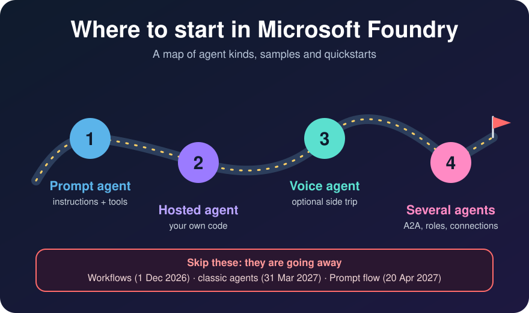

# Where to start in Microsoft Foundry

Microsoft Foundry has a lot of places to learn from: a samples repository, 21 solution templates and 16 quickstarts. When I started, I could not tell which one to open first. So I read all three and sorted them by the kind of agent each one builds. This post is the map I wish I had.

Good news first: the pieces fit together well. There are four stops on the path, each adds one new idea, and you can reach every one of them today.

## Meet the agent kinds

Foundry describes every agent with a `kind`. Here are the ones I met.

| Kind | What it is | Good for |
|---|---|---|
| **Prompt** | Instructions, a model and tools, all defined in Foundry | Your first agent |
| **Hosted** | Your own code, running as a container in Foundry | Custom logic, memory, evaluation |
| **Voice** | A managed real-time voice agent | Phone and microphone conversations |
| **Workflow** | A visual flow of agents | Going away (see below) |
| **External** | An agent that runs elsewhere | Agents you already have |

:::brain-power Which kind would you pick?
You want an agent that answers questions from six documents and asks the caller for a missing fact. Which kind is the simplest one that could work? I picked a prompt agent for every example in my Part 4 post.
:::

## Three places to look

I counted each source in late October 2026. Counts change, so treat them as a snapshot.

### The samples repository

The `microsoft-foundry/foundry-samples` repository is organised by agent kind, so it is the easiest place to find "an example of X".

| Kind | Python samples |
|---|---|
| Prompt | 4 |
| Hosted | 92 (28 Agent Framework, 19 [LangGraph](/posts/orchestration3/), 45 bring your own) |
| Voice | 12 |

Hosted agents have by far the most samples, and the hosted numbering (01 to 25) is a rough difficulty order, starting with `01-basic`.

### The 21 solution templates

The catalog does not label kinds, so I read each template's code to see what it creates.

| What I found | Templates |
|---|---|
| Prompt agents | 5 |
| Hosted agents | 1 (AI-powered prior authorization) |
| Voice | 2, both built on the Voice Live API |
| Workflow | 0 |
| Older style, from before the kinds | 7 |
| No Foundry agent at all | 5 |
| Unclear | 1 |

I did not run any of the templates, and a template can be misfiled by my search, so use this as a guide and not a verdict. Templates are best for seeing a whole architecture, such as networking for production.

### The 16 quickstarts

| Group | Count | What you build |
|---|---|---|
| Set up | 1 | A project, a model deployment and access |
| Build your first agent | 6 | A prompt agent, a web research agent, a voice agent, an optimizer run, the Responses API, chatting in code |
| Deploy hosted agents | 7 | Deploy, bring your own code, toolbox, memory, Foundry IQ, optimize, CI/CD |
| Evaluate and trace | 2 | Evaluate and trace a hosted agent |

:::watch-it Two sources, two opinions about voice
The voice quickstart calls the result a "voice-based prompt agent". The samples repository gives voice its own folder and its own kind. I could not tell which one Microsoft intends, so I treat voice as its own side trip.
:::

## A suggested order

Microsoft does not publish a numbered roadmap for the quickstarts. The grouping on the quickstarts page implies an order, and there is a learning path called [Develop AI agents on Azure](https://learn.microsoft.com/en-us/training/paths/develop-ai-agents-on-azure). The sequence below is my own, and each step adds one idea.

1. **Create resources.** A project, a model deployment and roles.
2. **A prompt agent.** Then chat with it in code and meet the Responses API. Everything later reuses this client side.
3. **Add tools.** Web research, and a function tool such as `ask_user` (I test one in [Part 4](/posts/azurefoundryagent5/)). If you want to build your own tool server, my [Model Context Protocol series](/posts/mcpserver/) starts with a first MCP server, and [Part 3](/posts/azurefoundryagent4/) adds an MCP server on Azure Functions to a voice agent.
4. **Voice, if you want it.** A side trip with its own scripts.
5. **A hosted agent.** Deploy one, then bring your own code, then add a toolbox, memory and Foundry IQ. This adds containers and `azd`.
6. **Evaluate and trace.** These make sense once you have an agent to measure.
7. **Several agents.** The Agent2Agent protocol (A2A). It has no quickstart, and it needs roles and connections, so I do it last.
8. **Production patterns.** Use the templates for architecture.

My own series follows this path:

| Step | Post |
|---|---|
| 2 | [Part 1](/posts/azurefoundryagent2/) |
| 5 | [Part 2](/posts/azurefoundryagent3/), a hosted agent |
| 4 | [Part 3](/posts/azurefoundryagent4/), a voice agent from a template |
| 7 | [Part 4](/posts/azurefoundryagent5/), a supervisor with six A2A specialists |

:::no-dumb-questions Quick answers
**Q: Is there a quickstart for several agents?**
A: No. None of the 16 covers A2A, a supervisor with specialists, or an agent asking the user for a missing fact. [Part 4](/posts/azurefoundryagent5/) is my attempt to fill that gap.

**Q: Are hub-based projects and the classic portal going away?**
A: Microsoft has announced no retirement date for either. Its pages say hub-based projects are not visible in the current portal, that you can switch back to the classic portal at any time, and that new generative AI features are available only in Foundry projects. Hub-based projects also stay useful for custom model training. I would plan to move, but there is no date to plan around.
:::

## What is going away

This is the one place I suggest you slow down. These are the dates I found, and how I know them.

| What | Date | Replacement | How I know |
|---|---|---|---|
| Foundry workflows | 1 December 2026 | Microsoft Agent Framework | Microsoft's workflow page |
| Classic agents | 31 March 2027 | The new Foundry Agent Service | Microsoft's classic agents page |
| Prompt flow (see my [six-part series](/posts/promptflow1/)) | 20 April 2027 | Agent Framework | Microsoft's announcement, as quoted in search results |
| Assistants API | 26 August 2026 | The Responses API | Microsoft's migration page |

Two cautions. The Assistants API date has already passed, and I did not check whether anything was extended. And I did not check Microsoft's official retirement list, so confirm any date before you rely on it.

## Recap

:::bullet-points
- Foundry describes agents by kind: prompt, hosted, voice, workflow and external.
- The samples repository is organised by kind. The templates mostly are not, because most predate the kinds.
- Start with a prompt agent, then add tools, then a hosted agent, and leave several agents until last.
- No quickstart covers several agents yet.
- Skip workflows, classic agents and Prompt flow. My own Prompt flow posts are now a record of how it worked. Hub-based projects and the classic portal have no announced date.
:::

## References

- My Prompt flow series: [Part 1](/posts/promptflow1/), [Part 2](/posts/promptflow2/), [Part 3](/posts/promptflow3/), [Part 4](/posts/promptflow4/), [Part 5](/posts/promptflow5/) and [Part 6](/posts/promptflow6/)
- [Foundry quickstarts](https://learn.microsoft.com/en-us/azure/foundry/quickstarts/quickstarts)
- [foundry-samples on GitHub](https://github.com/microsoft-foundry/foundry-samples)
- [Migrate from the Foundry (classic) portal](https://learn.microsoft.com/en-us/azure/foundry/how-to/navigate-from-classic)
- [Migrate from hub-based to Foundry projects](https://learn.microsoft.com/en-us/azure/foundry-classic/how-to/migrate-project)
- [Develop AI agents on Azure](https://learn.microsoft.com/en-us/training/paths/develop-ai-agents-on-azure)
