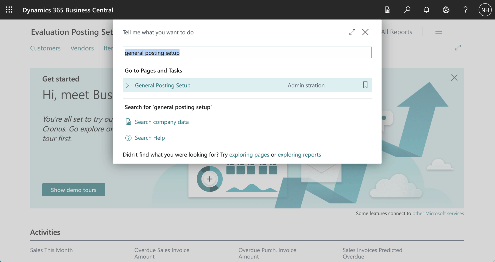
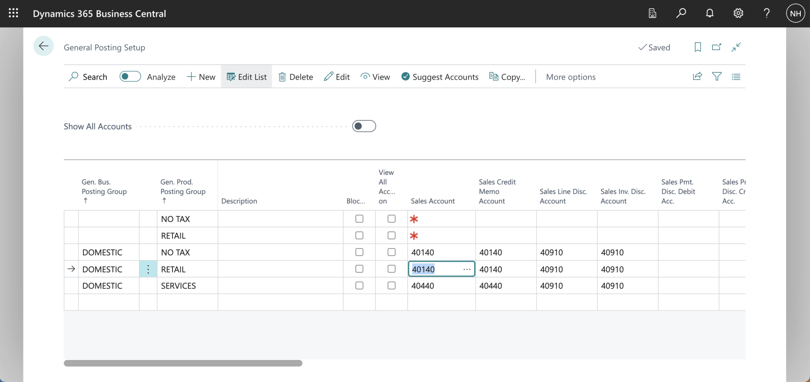
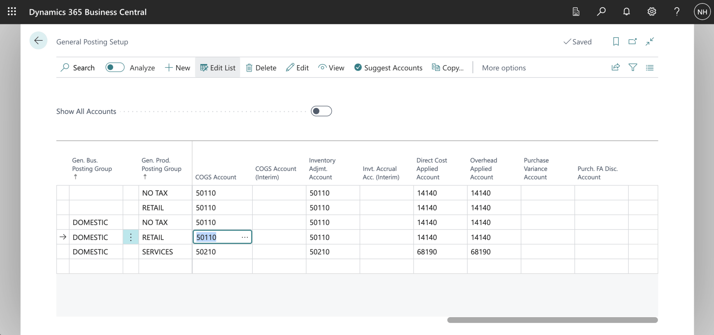
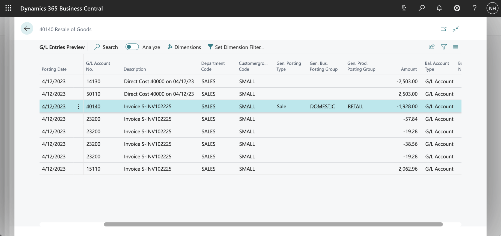
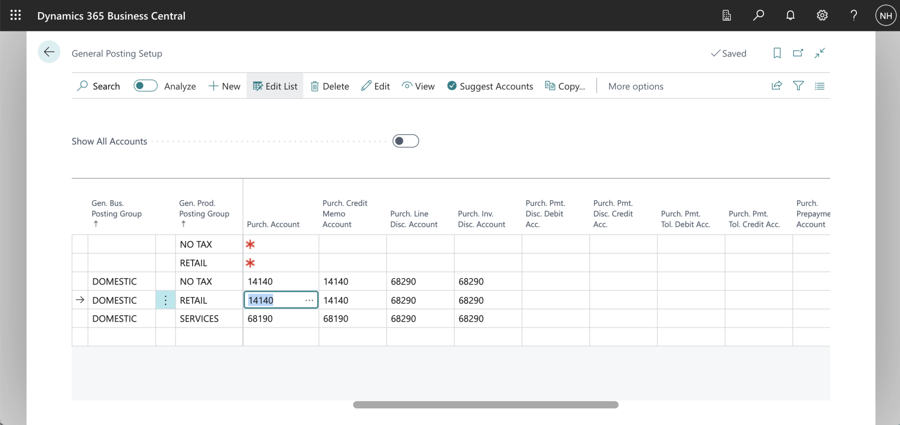
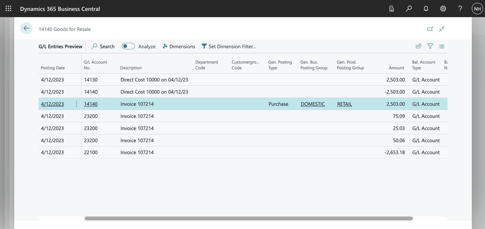

General Posting Setup is used to define which accounts receivable and cost of goods sold general ledger accounts to use when selling a given Item (with a given General Business Posting Group) to a given Customer (with a given General Product Posting Group).

General Posting Setup is used to define which accounts payable general ledger account to use when buying a given Item (with a given General Business Posting Group) from a given Vendor (with a given General Product Posting Group).

The General Posting Setup is maintained using the General Posting Setup page.

:::brain-power Before you read on
A company sells chairs to domestic customers and buys them from domestic vendors. Where should the software look up which ledger account records the sale, the cost of the goods, and the purchase?
:::

*I used search to navigate to the General Posting Setup page.*

*I noted that when selling a RETAIL item to a DOMESTIC customer, the 40140 Resale of Goods account is used to record the sale.*

*I noted that when selling a RETAIL item to a DOMESTIC customer, the 50110 Cost of Materials account is used to record the cost of goods sold.*

:::no-dumb-questions
**Q: What does General Posting Setup decide?**

A: Which general ledger accounts a transaction uses. Selling an item uses a sales account and a cost of goods sold account, and buying an item uses a purchase account.

**Q: What picks the row on the page?**

A: A pair of posting groups. In this post, the pair is RETAIL for the item and DOMESTIC for the customer or the vendor, and each pair has its own accounts.
:::

*I reviewed the ledger entries generated when selling a RETAIL item to a DOMESTIC customer.*

*I noted that when buying a RETAIL item from a DOMESTIC vendor, the 14140 Goods for Resale account is used to record the purchase.*

*I reviewed the ledger entries generated when buying a RETAIL item from a DOMESTIC vendor.*

:::pencil Which accounts?
Using the General Posting Setup page in this post, which account records the sale of a RETAIL item to a DOMESTIC customer, which records its cost, and which records buying a RETAIL item from a DOMESTIC vendor?

:::answer
The sale uses 40140 Resale of Goods, and its cost uses 50110 Cost of Materials. Buying the item from a DOMESTIC vendor uses 14140 Goods for Resale.
:::
:::

:::test-drive Try it yourself
1. Open the General Posting Setup page and find the RETAIL and DOMESTIC row.
2. Post a sale of a RETAIL item to a DOMESTIC customer, and look at its ledger entries.
3. Change one account on the setup row, and post another sale to see the difference.
:::

:::bullet-points Recap
- General Posting Setup chooses the general ledger accounts for sales, costs and purchases.
- A pair of posting groups selects the row, here RETAIL and DOMESTIC.
- The ledger entries showed which accounts each transaction used.
:::
