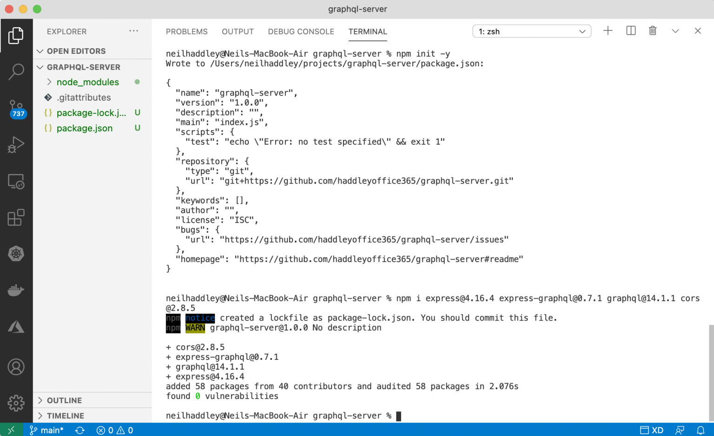
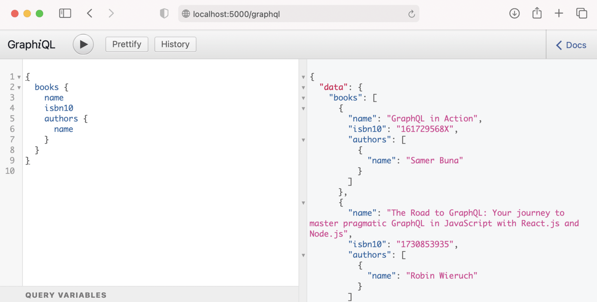
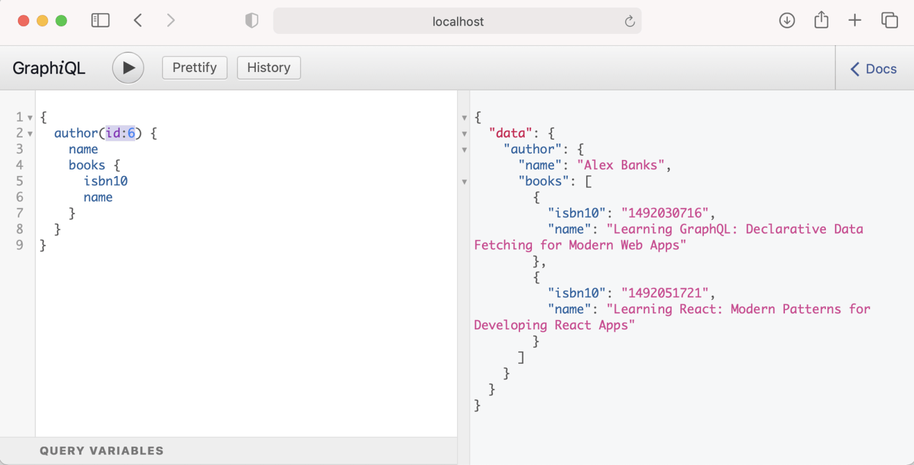
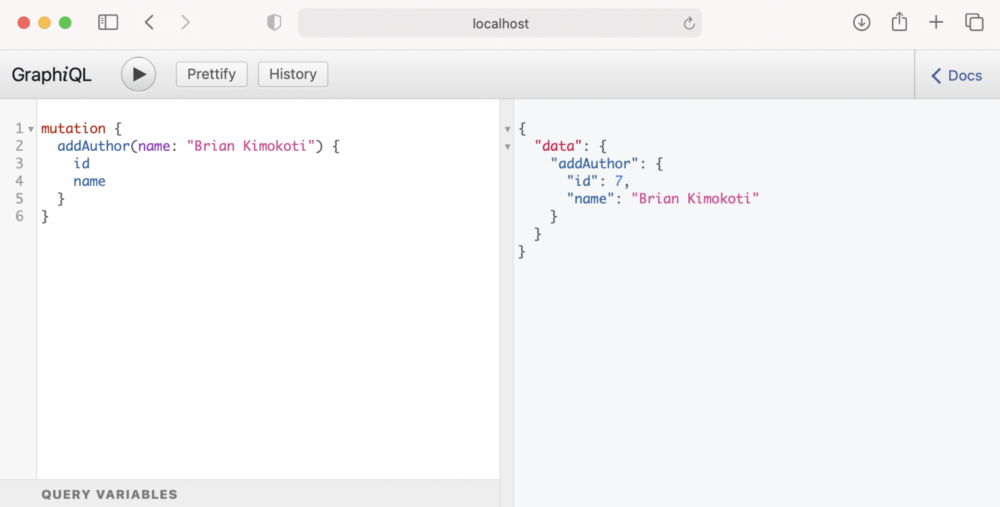
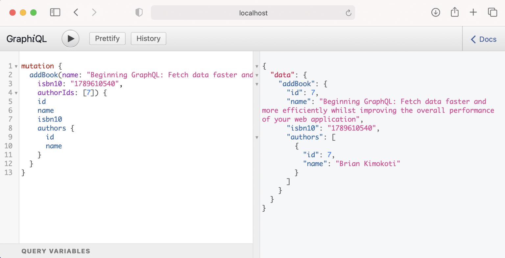
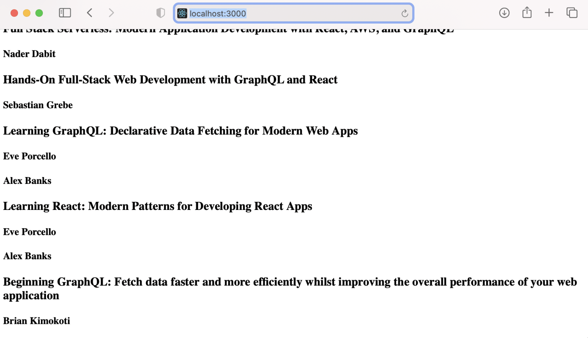

A [REST](/posts/restapiservice/) API client may need to make multiple calls to a REST Service to get all of the data it needs.

A GraphQL API client may be able to request all of the data it needs in a single call.

GraphQL supports reading data, mutating data, and subscribing to data (WebSockets).

:::brain-power Before you read on
A client wants a list of books and the names of each book's authors. With a REST API, how many calls would that take, and how much data that the client does not need would come back? What would you want to be able to say to the server instead?
:::

:::no-dumb-questions
**Q: How is a GraphQL API different from a REST API?**

A: A REST API has a URL for each kind of thing, so a client may need several calls to collect what it needs. A GraphQL API has one URL, and the client sends a query that names exactly the fields that it wants, so one call can return it all.

**Q: Is GraphQL the only way to ask for exactly the data I need?**

A: No. [OData](/posts/odata/) is the main alternative, and it is built into Business Central, Excel and Power BI. The section after this box explains how the two differ.

**Q: What are a schema and a resolver?**

A: The schema describes the types, such as Book and Author, and the fields that a client can ask for. A resolver is the code that supplies the value for a field. In server.js, the books field of the Query type has a resolver that returns the list of books.

**Q: What is the difference between a query and a mutation?**

A: A query reads data and a mutation changes it. In this post, books, book, authors and author are queries, and addBook and addAuthor are mutations.
:::


## GraphQL or OData?

[OData](/posts/odata/) is the other well-known answer to the same problem, and it is built into Business Central, Excel and Power BI. A client can also choose its properties and bring related items back in one call, but it does so with query options in the URL, such as $select, $filter and $expand.

The difference is where the power sits. The server in this post can find a book or an author by id, because I wrote an argument for that, and filtering by name would need another argument and more resolver code. In OData, a filter on any property is available without extra server code, and the price is that the service has to decide what it exposes. My [OData post](/posts/odata/) puts OData and GraphQL side by side.

## Setting up the project

I created a package.json file using the npm init command

```bash
$ npm init -y
```

I added the GraphQL dependencies using npm

```bash
$ npm i express@4.16.4 express-graphql@0.7.1 graphql@14.1.1 cors@2.8.5
```


*I ran npm i*


## server.js

Once the dependencies have been added we can create a server.js file.


## package.json

Now we can update the package.json file and run the GraphQL service.

"scripts": {
  "start": "node server.js"
  },


## npm start

I used "npm start" to run the GraphQL server.

```bash
$ npm start
```


*I read books and related author details*


*I read data for a single author*

:::under-the-hood How one query returns books and their authors
A book in the data holds only authorIds, such as [5, 6]. The Book type in server.js has an authors field with its own resolver, which filters the authors list for the ids in that book. The Author type does the same in reverse with its books field. So when a query asks for books and the name of each author, GraphQL calls the books resolver once and then the authors resolver for each book, and it returns the nested result in one response.
:::


*I mutated data by adding an author*


*I mutated data by adding a book*

:::pencil What must a client send to add a book?
Look at the addBook mutation in server.js below. Which arguments does a client have to send, and what happens if it leaves one out?

:::answer
It must send name, isbn10 and authorIds, because each of them is declared with GraphQLNonNull. If one is missing, GraphQL rejects the request before the resolver runs. The resolver then gives the new book an id of one more than the current number of books and adds it to the list.
:::
:::

:::watch-it The data lives in memory
The authors and books are arrays in server.js, and addBook and addAuthor push new items onto them. Anything that a mutation adds is lost when the server restarts, so this is a way to learn GraphQL, not a way to store data. [Part 5 of my Spring Boot series](/posts/spring-boot-5/) builds the same API in Java with a database.
:::


## A GraphQL client app

It is possible to use react and apollo to create a GraphQL client app.

I created a package.json file using the npm init command

```bash
$ npm init -y
```

I added the GraphQL and Apollo dependencies using npm

```bash
$ npm i apollo-boost@0.4.9 graphql@15.4.0 react@17.0.1 react-apollo@3.1.5 react-dom@17.0.1 react-scripts@4.0.1
```

The app.js code includes a GraphQL query, an ApolloProvider and a Query.


*I navigated to localhost:3000*


## API Gateway

I noticed that the Cross-Origin Resource Sharing (CORS) library reference in the GraphQL code above is not needed when the GraphQL server and the GraphQL client App are published using an [API Gateway](/posts/apigateway/).

:::no-dumb-questions
**Q: Why is the cors library in server.js marked optional?**

A: The React client runs on localhost:3000 and the GraphQL server runs on port 5000, so the browser treats them as different origins and blocks the call unless the server allows it. The cors library adds the headers that allow it. When an API Gateway publishes the client and the server under one address, the browser sees a single origin, and the library is no longer needed.
:::

:::watch-it These packages are old
I installed express-graphql 0.7.1 and graphql 14.1.1 in March 2021. Today npm says that express-graphql is no longer maintained, and recommends graphql-http instead. The ideas in this post still apply, but check which packages are current before you start a new project.
:::


## server.js

```javascript
const express = require('express')
const expressGraphQL = require('express-graphql')
const {
  GraphQLSchema,
  GraphQLObjectType,
  GraphQLString,
  GraphQLList,
  GraphQLInt,
  GraphQLNonNull
} = require('graphql')

const cors=require('cors'); // optional

const app = express()

app.use(cors()) // optional

const authors = [
  { id: 1, name: 'Samer Buna' },
  { id: 2, name: 'Robin Wieruch' },
  { id: 3, name: 'Nader Dabit' },
  { id: 4, name: 'Sebastian Grebe' },
  { id: 5, name: 'Eve Porcello' },
  { id: 6, name: 'Alex Banks' }
]

const books = [
  { id: 1, isbn10: '161729568X', name: 'GraphQL in Action', authorIds: [1] },
  { id: 2, isbn10: '1730853935', name: 'The Road to GraphQL: Your journey to master pragmatic GraphQL in JavaScript with React.js and Node.js', authorIds: [2] },
  { id: 3, isbn10: '1492059897', name: 'Full Stack Serverless: Modern Application Development with React, AWS, and GraphQL', authorIds: [3] },
  { id: 4, isbn10: '1789134528', name: 'Hands-On Full-Stack Web Development with GraphQL and React', authorIds: [4] },
  { id: 5, isbn10: '1492030716', name: 'Learning GraphQL: Declarative Data Fetching for Modern Web Apps', authorIds: [5, 6] },
  { id: 6, isbn10: '1492051721', name: 'Learning React: Modern Patterns for Developing React Apps', authorIds: [5, 6] },
]

const BookType = new GraphQLObjectType({
  name: 'Book',
  description: 'This represents a book written by an author',
  fields: () => ({
    id: { type: GraphQLNonNull(GraphQLInt) },
    name: { type: GraphQLNonNull(GraphQLString) },
    isbn10: { type: GraphQLNonNull(GraphQLString) },
    authorIds: { type: GraphQLNonNull(GraphQLList(GraphQLInt)) },
    authors: {
      type: new GraphQLList(AuthorType),
      resolve: (book) => {
        return authors.filter(author => (book.authorIds.includes(author.id)))
      }
    }
  })
})

const AuthorType = new GraphQLObjectType({
  name: 'Author',
  description: 'This represents an author of a book',
  fields: () => ({
    id: { type: GraphQLNonNull(GraphQLInt) },
    name: { type: GraphQLNonNull(GraphQLString) },
    books: {
      type: new GraphQLList(BookType),
      resolve: (author) => {
        return books.filter(book => (book.authorIds.includes(author.id)))
      }
    }
  })
})

const RootQueryType = new GraphQLObjectType({
  name: 'Query',
  description: 'Root Query',
  fields: () => ({
    book: {
      type: BookType,
      description: 'A Single Book',
      args: {
        id: { type: GraphQLInt }
      },
      resolve: (parent, args) => books.find(book => book.id === args.id)
    },
    books: {
      type: new GraphQLList(BookType),
      description: 'List of All Books',
      resolve: () => books
    },
    authors: {
      type: new GraphQLList(AuthorType),
      description: 'List of All Authors',
      resolve: () => authors
    },
    author: {
      type: AuthorType,
      description: 'A Single Author',
      args: {
        id: { type: GraphQLInt }
      },
      resolve: (parent, args) => authors.find(author => author.id === args.id)
    }
  })
})

const RootMutationType = new GraphQLObjectType({
  name: 'Mutation',
  description: 'Root Mutation',
  fields: () => ({
    addBook: {
      type: BookType,
      description: 'Add a book',
      args: {
        name: { type: GraphQLNonNull(GraphQLString) },
        isbn10: { type: GraphQLNonNull(GraphQLString) },
        authorIds: { type: GraphQLNonNull(GraphQLList(GraphQLInt)) }
      },
      resolve: (parent, args) => {
        const book = { id: books.length + 1, name: args.name, isbn10: args.isbn10, authorIds: args.authorIds }
        books.push(book)
        return book
      }
    },
    addAuthor: {
      type: AuthorType,
      description: 'Add an author',
      args: {
        name: { type: GraphQLNonNull(GraphQLString) }
      },
      resolve: (parent, args) => {
        const author = { id: authors.length + 1, name: args.name }
        authors.push(author)
        return author
      }
    }
  })
})

const schema = new GraphQLSchema({
  query: RootQueryType,
  mutation: RootMutationType
})

app.use('/graphql', expressGraphQL({
  schema: schema,
  graphiql: true
}))
app.listen(5000, () => console.log('Server Running'))
```

## package.json

```javascript
{
  "name": "graphql-server",
  "version": "1.0.0",
  "description": "",
  "main": "index.js",
  "scripts": {
    "start": "node server.js"
  },
  "repository": {
    "type": "git",
    "url": "git+https://github.com/haddleyoffice365/graphql-server.git"
  },
  "keywords": [],
  "author": "",
  "license": "ISC",
  "bugs": {
    "url": "https://github.com/haddleyoffice365/graphql-server/issues"
  },
  "homepage": "https://github.com/haddleyoffice365/graphql-server#readme",
  "dependencies": {
    "cors": "^2.8.5",
    "express": "^4.16.4",
    "express-graphql": "^0.7.1",
    "graphql": "^14.1.1"
  }
}
```

## app.js

```javascript
import ApolloClient from 'apollo-boost';
import { ApolloProvider, Query } from 'react-apollo';
import gql from 'graphql-tag';

const client = new ApolloClient({
  uri: 'http://localhost:5000/graphql'
})

const query = gql`
query booksQuery {
  books {
    id,
    name,
    authors
    {
      name
    }
  }
}
`

function App() {

  return (

    <ApolloProvider client={client}>

      <div>

        <Query query={query}>
          {
            ({ loading, error, data }) => {
              if (loading) return <h4>Loading...</h4>
              if (error) console.log({ error })
              return data.books.map(book =>
                <>
                  <h3 key={book.id}>{book.name}</h3>
                  {book.authors.map(author =>
                    <h4>{author.name}</h4>)}
                </>
              )
            }
          }
        </Query>

      </div>

    </ApolloProvider>

  );
}

export default App;
```

:::test-drive Try it yourself
1. Run npm start in the server folder, and open http://localhost:5000/graphql to use GraphiQL.
2. Ask for books, and include the name of each book's authors.
3. Run addAuthor, and then ask for authors to see the new one.
4. Start the React client and compare the list on localhost:3000 with what GraphiQL returned.
:::

:::bullet-points Recap
- A GraphQL client sends one query that names the fields it wants, and gets one response.
- The schema lists the types and fields, and resolvers supply the values.
- Queries read data and mutations change it, and GraphiQL lets me try both in the browser.
- The data is held in arrays, so changes are lost when the server restarts.
- The React client with Apollo sends a query to the server, and CORS is needed when the client and server run on different origins.
- OData answers the same need with query options in the URL, and gives clients generic filtering for free, as my [OData post](/posts/odata/) shows.
:::
