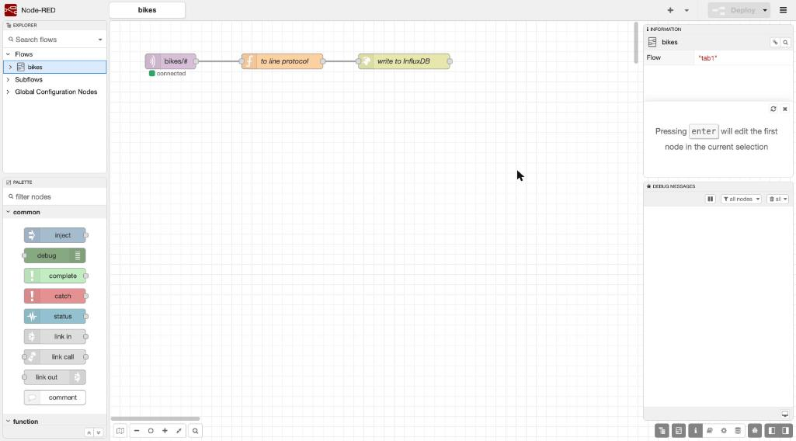
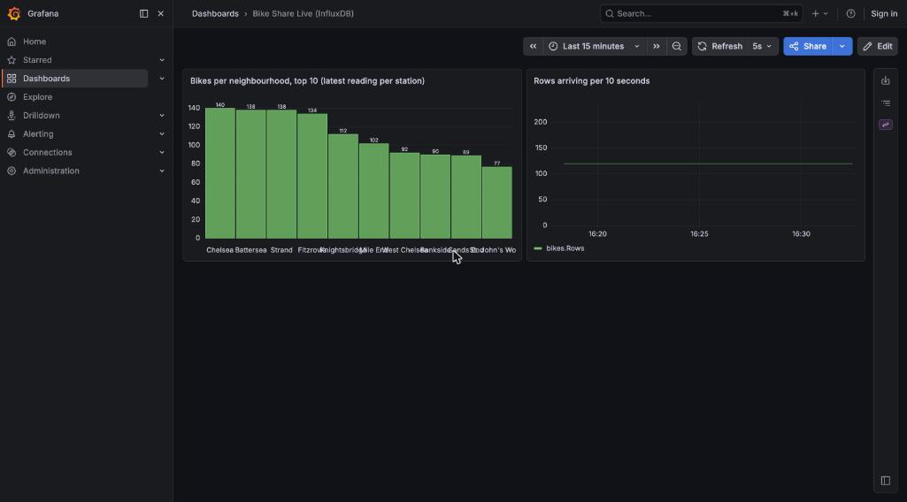
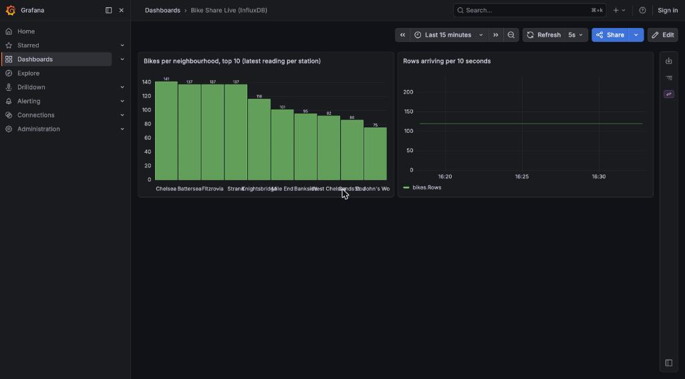

# The Fabric Part 3 Pipeline Again, with Mosquitto, Node-RED, InfluxDB and Grafana

In [Microsoft Fabric (Part 3)](/posts/fabriclakehouse3/) I streamed bike-share events into an Eventhouse, queried them with KQL, charted them on a dashboard, and timed how long a copy took to reach the SQL endpoint.

In 2021 I wrote about the tools that do a similar job without Fabric: [Mosquitto and an ESP8266](/posts/internetofthings1/), then [Node-RED and topic design](/posts/internetofthings2/). Those posts never stored a reading. They showed messages passing through a broker.

In this post I rebuild the Part 3 example with those tools plus a database and a dashboard. I want to see which steps are the same, which differ, and what I can measure.

I am not trying to show that one side is better. I measured a few things on one laptop with a small amount of data, and I say below what those numbers can and cannot tell us.

## The data: real stations, simulated readings

The Bicycles sample is a source inside Eventstream, and its messages go only into the stream. Microsoft's list of Eventstream destinations has nothing that publishes to an MQTT broker, and my Mosquitto broker runs on my laptop, which Fabric cannot reach from the cloud. I did not try writing code to bridge the two, so a small Python program (the publisher) replays the same 120 stations to Mosquitto instead.

I took the 120 real stations from my Part 3 Eventhouse: the station ID, street, neighbourhood, latitude, longitude, and the latest number of bikes and empty docks for each. The stations are real. The readings after the first are **simulated**: every 10 seconds each station's bikes move by minus one, zero or plus one, within the station's capacity. That is a burst of 120 messages every 10 seconds, about 12 a second, which is close to the rate I saw in Fabric.

The results grid in Fabric could not be copied as text, so I read the 120 rows off the screen in sections and typed them into a file. To check my typing I ran a checksum query in the Eventhouse and compared it with the same sums over my file.

| Check | Eventhouse | My file |
|---|---|---|
| Stations | 120 | 120 |
| Sum of latitudes | 6,180.026183 | 6,180.026183 |
| Sum of longitudes | -16.563682 | -16.563682 |
| Bikes | 1,538 | 1,538 |
| Empty docks | 1,550 | 1,550 |
| Total length of street names | 1,741 | 1,741 |
| Total length of neighbourhood names | 1,113 | 1,113 |

They matched exactly. The real data also has quirks, which I kept. One station is in "St.John's Wood", without a space, and every other station there uses "St. John's Wood", so the feed has 19 neighbourhoods and not 18. Two coordinates carried floating-point noise, such as `51.477684000000007`, which I rounded to six decimal places.

## The stack

The mapping from the Part 3 steps to this build is close to one for one.

| Part 3 | This post |
|---|---|
| Bicycles sample source | a small Python script that publishes JSON to Mosquitto |
| Eventstream | Node-RED: `mqtt in`, a function, and an `http request` |
| Eventhouse table `BikeEvents` | an InfluxDB 1.8 database called `bikes` |
| KQL query window | InfluxQL over HTTP |
| Real-Time Dashboard | Grafana with two panels |
| OneLake availability and the SQL endpoint | a second copy in Postgres, written by a small copier script |

Everything runs in Docker Compose on a MacBook Air (M4, 32 GB) with Docker Desktop. I used InfluxDB 1.8 because its query language is InfluxQL and it needs no tokens, which keeps the set-up short. It is an older version, and a newer one would use a different setup and query language.

A message looks like this:

```json
{"BikepointID":"BikePoints_81","Street":"Great Titchfield Street","Neighbourhood":"Fitzrovia",
 "Latitude":51.520253,"Longitude":-0.141327,"No_Bikes":13,"No_Empty_Docks":6}
```

The Node-RED flow has three nodes. The middle one turns each message into an InfluxDB line, with the station and neighbourhood as **tags** and the two counts as **fields**:

```javascript
const p = msg.payload;
const esc = s => String(s).replace(/ /g, '\\ ').replace(/,/g, '\\,').replace(/=/g, '\\=');
msg.payload = 'bikes,BikepointID=' + esc(p.BikepointID) + ',Neighbourhood=' + esc(p.Neighbourhood) +
  ' No_Bikes=' + p.No_Bikes + 'i,No_Empty_Docks=' + p.No_Empty_Docks + 'i';
msg.headers = {'Content-Type': 'text/plain'};
return msg;
```

I did not give the point a time. InfluxDB stamps it with the moment of writing, which matches what `ingestion_time()` gave me in Fabric: the time a row arrived, not a time the device reported.


*The whole Node-RED flow: subscribe to bikes/#, build a line, write it to InfluxDB*

:::under-the-hood The whole Docker Compose file
```yaml
services:
  mosquitto:
    image: eclipse-mosquitto:2
    ports: ["1883:1883"]
    volumes:
      - ./mosquitto/mosquitto.conf:/mosquitto/config/mosquitto.conf:ro
  influxdb:
    image: influxdb:1.8
    ports: ["8086:8086"]
    environment:
      INFLUXDB_DB: bikes
      INFLUXDB_HTTP_AUTH_ENABLED: "false"
    volumes:
      - influx-data:/var/lib/influxdb
  nodered:
    image: nodered/node-red:latest
    ports: ["1880:1880"]
    volumes:
      - ./node-red/flows.json:/data/flows.json
    depends_on: [mosquitto, influxdb]
  grafana:
    image: grafana/grafana-oss:latest
    ports: ["3300:3000"]
    environment:
      GF_AUTH_ANONYMOUS_ENABLED: "true"
      GF_AUTH_ANONYMOUS_ORG_ROLE: Admin
    volumes:
      - ./grafana/provisioning:/etc/grafana/provisioning
      - ./grafana/dashboards:/var/lib/grafana/dashboards
    depends_on: [influxdb]
  publisher:
    image: python:3.12-slim
    command: sh -c "pip install -q paho-mqtt && python -u /app/publisher.py"
    volumes:
      - ./publisher:/app
    depends_on: [mosquitto]
  postgres:
    image: postgres:16
    environment:
      POSTGRES_USER: bikes
      POSTGRES_PASSWORD: bikes
      POSTGRES_DB: bikes
    volumes:
      - pg-data:/var/lib/postgresql/data
  copier:
    image: python:3.12-slim
    command: sh -c "pip install -q psycopg2-binary && python -u /app/copier.py"
    environment:
      INTERVAL: "300"
    volumes:
      - ./copier:/app
    depends_on: [influxdb, postgres]
volumes:
  influx-data:
  pg-data:
```
:::

:::watch-it These settings are for a laptop only
The Mosquitto broker allows anonymous clients, InfluxDB has no authentication, Grafana gives anonymous visitors the admin role, and the Postgres password is `bikes`. That is fine on a closed laptop. Do not copy it onto a machine that other people can reach.
:::

| File | What it does | Lines |
|---|---|---|
| `docker-compose.yml` | the seven services | 57 |
| `publisher/publisher.py` | replays the 120 stations to MQTT | 41 |
| `node-red/flows.json` | subscribe, build a line, write to InfluxDB | 88 |
| `grafana/dashboards/bikes.json` | the two panels | 92 |
| `grafana/provisioning/*.yml` | the data source and the dashboard folder | 17 |
| `mosquitto/mosquitto.conf` | listener and anonymous access | 3 |
| `copier/copier.py` | copies new rows from InfluxDB to Postgres | 46 |

Pretty-printed JSON inflates those counts, so they say little about effort. The project is a folder on my Mac, and I have not published it. The compose file above and the snippets in this post are the main parts.

## Start it

The first start pulled the images, which took 76 seconds. After that, `docker compose up -d` had rows in InfluxDB in about 2 seconds in two separate runs. In the final run there were 120 rows four seconds after I started it.

In Part 3, the time from publishing the Eventstream to the first row in the Eventhouse was 1 minute 47 seconds (13:30:20 to 13:32:07). That included a manual step to configure the data connection, so it is a measure of my clicking as well as of Fabric.

## The charts

Grafana refreshes every 5 seconds. My first version of the bar chart showed all 19 neighbourhoods, unsorted, with overlapping labels, because I had not copied the `top 10` from Part 3. I added a sort and a limit to the panel and it matched.


*The two panels with Last 15 minutes selected*


*About 20 seconds later: several bars had changed by a bike or two, and nothing was clicked*

The time axis uses the browser's time zone, so it showed local time. The Fabric dashboard in Part 3 showed UTC. I kept the "rows per 10 seconds" panel so the two dashboards match, but it is flat at 120 here, because my publisher sends exactly 120 messages in each burst. It works as a loss check, not as a picture of the data: a dip would mean dropped messages and a gap would mean the stream stopped. The same panel in Part 3 is not flat, because it showed a start-up spike, a gap while I paused the stream, and the restart.

## The same questions in two languages

I ran the equivalent of my three Part 3 queries. Here are the second and third in both languages.

```kusto
// KQL, Part 3
BikeEvents
| extend Arrived=ingestion_time()
| summarize arg_max(Arrived, No_Bikes) by BikepointID, Neighbourhood
| summarize Bikes=sum(No_Bikes) by Neighbourhood
| top 10 by Bikes
```

```sql
-- InfluxQL, this post (the top 10 is done in Grafana)
SELECT sum("last") AS "Bikes" FROM (
  SELECT last("No_Bikes") FROM "bikes" WHERE time > now() - 1h
  GROUP BY "BikepointID", "Neighbourhood")
GROUP BY "Neighbourhood"
```

```kusto
// KQL, Part 3
BikeEvents | summarize Rows=count() by Arrived=bin(ingestion_time(), 10s)
```

```sql
-- InfluxQL
SELECT count("No_Bikes") AS "Rows" FROM "bikes" WHERE time > now() - 1h GROUP BY time(10s) fill(none)
```

I timed them.

| Query | Eventhouse, server side | InfluxDB, client side |
|---|---|---|
| Count the rows | median 4.3 ms (5 runs, slowest 94.9 ms) | median 1.2 ms (20 runs, slowest 2.9 ms) |
| Latest bikes per neighbourhood | median 12.1 ms (6 runs, slowest 84.1 ms) | median 2.4 ms (20 runs, slowest 3.4 ms) |
| Rows per 10 seconds | median 6.0 ms (4 runs, slowest 21.8 ms) | median 4.2 ms (20 runs, slowest 5.0 ms) |

:::watch-it These two columns are not the same measurement
The Eventhouse numbers come from the `.show queries` history, which records each query's server-side duration. They cover only 3 to 6 runs of each query, made while the table grew from under 1,000 to about 12,000 rows. The InfluxDB numbers are 20 timed HTTP requests from my Mac to a container on my Mac, with 9,960 rows. They include the local network round trip but no sign-in. At this size both are a few milliseconds, and I cannot rank them. The dashboard tile in Part 3 showed 0.435 seconds in the browser, which includes the trip across the internet.
:::

## Message to stored row, and loss

For each of the last 8 bursts, I compared the time the publisher finished sending 120 messages with the time InfluxDB stamped the points.

- The first point of each burst was written between 1 millisecond before and 24 milliseconds after the publisher finished.
- The last point was written 35 to 45 milliseconds after, with a median of 36 milliseconds.
- The publisher sent 9,960 messages and InfluxDB held 9,960 rows. Nothing was lost.

I could not take the same measurement in Fabric. I explain why below.

## The second copy

Part 3 ended on a delay: the Eventhouse's copy in OneLake, and the SQL endpoint reading it, were minutes behind the live table. The open-source version needs a second copy too, if another engine is to read the data. I used Postgres as the other engine and wrote a copier. Every `INTERVAL` seconds it reads the rows newer than its last position from InfluxDB and inserts them into a Postgres table, ignoring duplicates. I set `INTERVAL` to 300 seconds, to match the 5-minute minimum I set in Fabric.

Here are readings from the final run, taken every 30 seconds. New rows arrive at 12 a second, so a gap of 3,240 rows is 270 seconds.

| Time (UTC) | Rows in InfluxDB | Rows in Postgres | Behind |
|---|---|---|---|
| 05:22:57 | 3,360 | 120 | 3,240 rows (270 s) |
| 05:23:27 | 3,720 | 3,720 | 0 (a copy had just run) |
| 05:23:58 | 4,080 | 3,720 | 360 rows (30 s) |
| 05:25:28 | 5,160 | 3,720 | 1,440 rows (120 s) |
| 05:27:59 | 6,960 | 3,720 | 3,240 rows (270 s) |
| 05:28:29 | 7,320 | 7,320 | 0 (a copy had just run) |
| 05:31:00 | 9,120 | 7,320 | 1,800 rows (150 s) |

The copies ran at 05:18:24, 05:23:24 and 05:28:25. Each of the later two moved 3,601 rows in 61 milliseconds. The copy was empty one moment and 270 seconds behind the next, with a smooth sawtooth in between. That is the same pattern as Part 3, but there are two differences.

- **I set the delay and it is exact.** Fabric's batching was less regular. At 13:38:31 the lake held 2,480 rows, and at 13:40:00 it held 3,060 while the Eventhouse held 5,040.
- **There was one layer, not two.** In Part 3 the lake could be up to date while the SQL endpoint still showed old data, and one click on its refresh icon moved the count from 3,060 to 7,860. Postgres reads its own table, so there was nothing between the copy and the query.

In Fabric the copy was a switch and the delay was a setting. Here it is 46 lines that I wrote and have to keep running.

## What it used

| | This stack | Eventhouse |
|---|---|---|
| Memory | 422 MiB across 7 containers (one sample) | not shown |
| CPU | 0 to 6% per container (one sample) | not shown |
| Stored data | InfluxDB folder 1.7 MB for 9,960 rows; Postgres table 864 kB for 7,320 rows | 1.1 MB raw, 48.9 KB compressed, 12K rows ingested |
| Compute | Docker on a laptop | 0.3 minutes of activity over the day, as the overview reported it |

I cannot compare these. The InfluxDB folder includes its write-ahead log and other files, and I did not separate them. The Eventhouse figure is compressed table data only. I do not know how 0.3 minutes of activity maps to Fabric capacity units, and I did not install the capacity metrics app.

## What I could not measure in Fabric

I wanted the Fabric equivalent of the message-to-row time and the loss check. That needs a sender that stamps each event and pushes it into the Eventstream, and the Eventstream's custom endpoint gives you a connection string for that. I added the endpoint and tried to read the string off the page, because the page's copy button did not reach my clipboard. The permission check on my browser tool blocked that read, and I did not look for another way around it.

So I do not have a Fabric figure for message-to-row delay or loss. I left a script, `send_to_fabric.py`, that reads the connection string from an environment variable, sends timestamped events, and prints the KQL that works out the delay and the loss. Whoever runs it supplies the key.

## What was the same

- **The chain.** Source, transport, ingest, store, query, chart, and a second copy for another engine. Each step in one build has a counterpart in the other.
- **Delivery and storage are separate.** Mosquitto and Eventstream both move messages and keep nothing. The database or the Eventhouse is where they land.
- **You declare the shape first.** In Fabric I named a table and a mapping. Here I chose tags and fields.
- **Arrival time.** Both stamp the row with when it arrived, not when the device read it.
- **Repeated readings.** Both feeds resend each station every 10 seconds, so a row count counts readings.
- **A second copy is behind the first.** Whoever builds it, you have to compare counts on both sides.

## What was different

- **Who owns the state.** Here the data sits in container volumes I would have to back up. In Fabric I did not manage any storage.
- **Where the effort went.** Fabric took clicking and one manual fix. This took writing 410 lines of files and fixing port clashes and a sleeping laptop.
- **What triggers a refresh.** Learn says Fabric's Live refresh updates a tile when new data is ingested. Grafana refreshed on a 5-second timer.
- **Sharing with another engine.** A switch in Fabric. A script I wrote here.
- **Remote access and sign-in.** The 2021 video sets up a VPN. Fabric needs a Microsoft sign-in. My stack allowed anyone on my laptop.

:::watch-it Things that went wrong
- **Ports 3000 and 3001 were taken** by Node processes already running on my Mac, so Grafana is on 3300.
- **My laptop went to sleep.** It was on battery at 19% and entered maintenance sleep while I was waiting, which paused Docker and left gaps in my first full run. I threw that run away and repeated it with sleep prevention on.
- **Node-RED asked to send usage data** to its developers on first start. I declined.
- **My first station list was invented.** I replaced it with the real stations and repeated all the measurements.
:::

## What I would not conclude

- **Nothing about scale.** I used about 10,000 rows, one laptop, and one run of each test.
- **Nothing about price.** I have no cost for Fabric and none for running my own stack.
- **Nothing about reliability.** Both ran for minutes, not days.
- **Nothing about which is easier.** Mine was familiar territory for me. Someone who knows Fabric but not Docker would find the opposite.
- **Nothing about InfluxDB in general.** I used version 1.8. A current version works differently.

:::bullet-points What I learned
- The pipeline has the same shape in both builds, and the second copy lags in both. It is the one pattern that appeared everywhere.
- At about 10,000 rows, queries took a few milliseconds in both places, so speed does not separate them here.
- With Mosquitto, nothing was lost and each burst was stored within 45 milliseconds of being sent.
- Fabric hid two things I had to build myself: the copy into another engine, and the storage.
- Measuring took more care than building. A sleeping laptop, an invented station list and mismatched timings each gave me numbers that looked fine and were wrong.
:::

## References

- [Microsoft Fabric (Part 3): streaming events into an Eventhouse](/posts/fabriclakehouse3/)
- [Internet of Things (Part 1)](/posts/internetofthings1/) and [Internet of Things (Part 2)](/posts/internetofthings2/)
- [#295 Raspberry Pi Server based on Docker, with VPN, Dropbox backup, Influx, Grafana, etc: IOTstack (YouTube)](https://www.youtube.com/watch?v=a6mjt8tWUws)
- [Turn on OneLake availability for an eventhouse (Microsoft Learn)](https://learn.microsoft.com/fabric/real-time-intelligence/event-house-onelake-availability)
