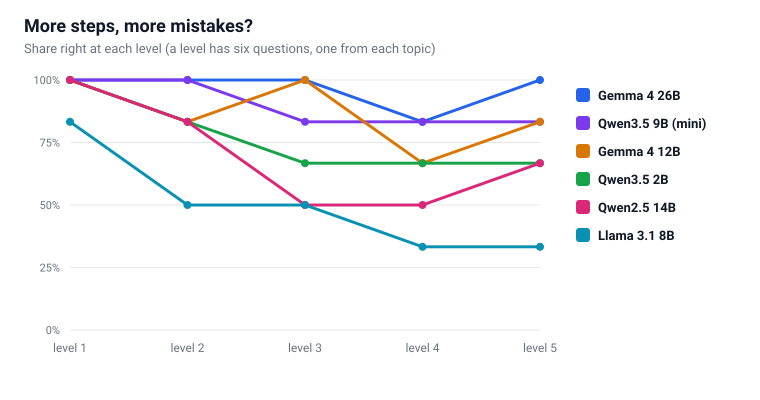
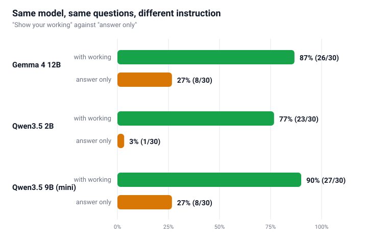

# LLM Benchmarking, from Scratch

I already have a benchmarking tool for accounting questions. [llm-accounting-benchmark](https://github.com/Haddley/llm-accounting-benchmark) is a Streamlit app. It holds 285 prompts, sends them to local and cloud models, asks a second model to mark every answer against a rubric (accuracy, completeness and clarity, ten points each), and keeps the results in SQLite. It works. It is also a lot of machinery, and the idea gets lost in it.

So I started again from nothing, with one rule: build the smallest benchmark that still teaches me something true. This post walks through it. It is one folder with a handful of small files, no database and no second model to do the marking. I ran it for real on six models: five on my MacBook Air, and the Qwen3.5 9B that powers this blog's assistant on my Mac mini.

:::brain-power
Before you read on: I am going to compare language models on bookkeeping questions. Write down three things I could measure. Then write down one thing that would make the comparison unfair.
:::

## The five parts of any benchmark

Big or small, every benchmark is the same five boxes. Watch the question travel through them.


*A question goes in at the left. Each box glows as it passes. The model never sees the right answer; the checker does.*

1. **Questions with the right answer attached.** Without the right answer there is nothing to mark against.
2. **A prompt.** The question plus the rules for replying. The rules matter more than you would think, as the last section of results shows.
3. **A model.** Whatever answers. Here it is a model running on my own machine through Ollama.
4. **A checker.** Reads the reply and decides whether it is right.
5. **A scoreboard.** Adds up the marks, and the time each answer took.

The big project and this one have all five. They differ in boxes 1 and 4, and that difference is the whole post.

:::no-dumb-questions
**Q: Does a small benchmark need a database?**

A: No. This one makes 30 results per model, and each run writes them to a plain text file with one line per question. You can open it in an editor, search it, and put it in git. A database starts to earn its place when you have thousands of results to query across many runs, or several programs writing at once. That is why the big project uses SQLite, and why this one does not.

**Q: What is PCA, and where is it?**

A: PCA is principal component analysis. Each model has a score on every question, which is 30 measurements per model and too many to draw. PCA finds the few directions along which the models differ most, uses the best two as the sides of a flat map, and puts each model on it as a dot. Dots that sit together behave alike, so tiers show up. The big project uses it across many models and 285 prompts. Here there are six models and 30 questions, and a table and a grid of squares show everything directly. PCA would add a chart that looks clever and says nothing new.
:::

## Questions that know their own answers

The big project's questions come with an ideal answer written in prose, and a model can answer in any shape, so marking takes judgement. That is why it needs a judge.

I took the opposite route. [questions.py](/assets/files/llmbenchmark/questions.py) builds 30 questions with code, and the same code works out the right answer. There are six topics, picked to echo areas the big project covers (bank reconciliation, depreciation, GST, margins, financial statements and inventory), and five levels in each. Level 1 needs one step. Level 5 needs five.

Here is the same question at its easiest and its hardest. Only the second line changes the arithmetic, but notice how much more the model has to keep track of.

```PROMPT
Level 1: The cash book shows a balance of $5,150.00. Bank charges of $80.00 are on the bank statement but not yet in the cash book. What balance appears on the bank statement?
```

```PROMPT
Level 5: The cash book shows a balance of $3,930.00. Bank charges of $60.00 are on the bank statement but not yet in the cash book. Interest of $25.00 was credited by the bank but is not yet in the cash book. Cheques totalling $350.00 were issued but have not yet been presented to the bank. A deposit of $360.00 was made but has not yet been credited by the bank. A customer's cheque for $330.00 was dishonoured; the bank has deducted it but the cash book still shows it. What balance appears on the bank statement?
```

The sum that produces the right answer is five lines of Python, kept apart from the question text so that it can be tested:

```python
def bank_statement_balance(cash_book, charges=0.0, interest=0.0,
                           unpresented=0.0, uncredited=0.0, dishonoured=0.0):
    """Balance on the bank statement, from the cash book balance and the reconciling items."""
    return round(cash_book - charges + interest + unpresented - uncredited - dishonoured, 2)
```

:::pencil Do the level-5 question by hand
Use the question above. Work out the balance on the bank statement. Which items make the balance go down, and which make it go up?

:::answer
Start with the cash book balance and bring it up to date with the items the bank has recorded that the cash book has not: subtract the $60 bank charges, add the $25 interest and subtract the $330 dishonoured cheque. That gives $3,930 − $60 + $25 − $330 = $3,565. Then add the two timing items that explain why the bank statement differs from the cash book: add the $350 of cheques not yet presented (the bank has not paid them yet, so its balance is higher) and subtract the $360 deposit not yet credited. That gives $3,565 + $350 − $360 = **$3,555**, which is the answer the program holds for this question.
:::
:::

:::under-the-hood Why the questions never change
Every question comes from a random number generator that starts from one fixed seed (20261112). Run the program tomorrow, or on your machine, and you get the same 30 questions with the same numbers. That is what lets two people compare results: they asked the same thing. The sums are covered by 10 small tests in [test_questions.py](/assets/files/llmbenchmark/test_questions.py), which check them against answers I worked out by hand.
:::

:::watch-it The checker needs checking too
**An impossible question.** My first version of the level-5 inventory question could ask a model to sell more units than were left after a return. No model could get that right, and I would have counted it as the model's failure. I caught it only because I reviewed the generator before running anything. The fix is a single line, and there is now a test that rebuilds the questions from 200 different seeds and checks that none sells more than is left.

**One cent.** After the first run, one answer looked unfairly marked: the model said 1578.13 and I had 1578.12. I allow a one-cent difference, so it should have passed. It did not, because in floating-point arithmetic 1578.13 minus 1578.12 is a hair more than 0.01. My test had only tried a half-cent difference, so it passed anyway. The fix is to compare whole cents. Because every run saves the number the model gave, I could re-mark all the saved answers without asking a single model again. That is the best argument for saving raw answers.

If every model fails the same question, suspect the question before you suspect the models.
:::

## Asking, then marking

Each question goes to the model with the same instructions. Here they are in full:

```PROMPT
You are helping with an accounting exam. Work out the answer step by step, keeping it short, then finish with one final line in exactly this form:
ANSWER: <number>
Use digits only: no currency symbol, no commas and no units. Use a minus sign for a loss or a refund. Round to 2 decimal places if needed.

Question:
...
```

The final line is the trick that makes marking easy. [minibench.py](/assets/files/llmbenchmark/minibench.py) looks for the last `ANSWER:` line, reads the number, and compares it with the right answer to within one cent. If the line is missing, the answer is marked wrong, and the report counts those separately so that I can tell "got the sum wrong" from "did not follow the format".

The settings are chosen to make the run repeatable. The temperature is 0 and the random seed is fixed, so a model should give the same answer to the same question. The model's own "thinking" mode is switched off, so that every model is judged on what it writes in the reply. Answers are cut off at 700 tokens.

:::fireside-chat A judge and a checker
**Judge:** I read the whole answer. I notice when the working is sound but the last line has a typo, and I notice when the number is right for the wrong reasons.

**Checker:** I read one line. If the number after ANSWER is the right number, you pass.

**Judge:** That sounds harsh.

**Checker:** It is also free, instant and identical every time. You are another language model. You cost a model call for every mark, and you might mark the same answer differently tomorrow.

**Judge:** I can mark an essay. You can mark a sum.

**Checker:** Then we should be used for different jobs. Nobody should ask me about clarity, and nobody should ask you whether 1,578.13 equals 1,578.12.
:::


*Two ways to mark the same answer. The checker only works when the question has one right number.*

## The runs

I ran the same 30 questions on six models. Five of them ran on my MacBook Air (Apple M4, 32 GB). The sixth, Qwen3.5 9B, ran on the Mac mini (Apple M4, 16 GB) that serves this blog's assistant. Every model is the build Ollama downloads by default, which is a compressed (quantised) copy of the original. The table shows which compression each one uses, because they are not all the same.

| Model | Parameters | Compression | Machine | Time for the 30 questions | Speed (tokens a second) |
|---|---|---|---|---|---|
| Gemma 4 26B | 25.8B (mixture of experts) | Q4_K_M | MacBook Air | 5.3 minutes | 17.5 |
| Qwen3.5 9B | 9.7B | nvfp4 | Mac mini | 4.2 minutes | 34.6 |
| Gemma 4 12B | 11.9B | Q4_K_M | MacBook Air | 11.1 minutes | 9.3 |
| Qwen3.5 2B | 2.3B | Q8_0 | MacBook Air | 3.3 minutes | 38.0 |
| Qwen2.5 14B | 14.8B | Q4_K_M | MacBook Air | 13.0 minutes | 7.1 |
| Llama 3.1 8B | 8.0B | Q4_K_M | MacBook Air | 4.3 minutes | 18.6 |

The times add up the seconds each answer took, without the one-off wait while the model loads into memory. The MacBook Air ran Ollama 0.40.16 and the Mac mini ran 0.40.14. The two machines have the same chip but different amounts of memory, so I treat speeds across them as a rough guide only.

## The scoreboard

All six models answered the same 30 questions, with the working shown. The bars grow as the answers are counted.


*Share of the 30 questions answered correctly. The numbers in brackets are right answers out of 30.*

Gemma 4 26B got 29 of 30 right. Qwen3.5 9B on the Mac mini got 27, Gemma 4 12B got 26, Qwen3.5 2B got 23, Qwen2.5 14B got 21, and Llama 3.1 8B got 15, which is half.

Look at the middle of the table. Qwen2.5 14B is more than six times the size of Qwen3.5 2B, and it scored lower: 21 against 23. A bigger number on the label is not a better model.

:::no-dumb-questions
**Q: So Qwen is better than Llama?**

A: Not as a general statement. On these 30 questions, with this prompt, on these compressed builds, the Qwen3.5 models scored higher than Llama 3.1 8B. Change the questions to law, or poetry, or code, and the order could change. A benchmark answers the question you asked it, and no other.

**Q: Why not just use the biggest model that fits?**

A: Because "biggest" is not the same as "slowest" or "best". The next few sections show a larger model that was both faster and more accurate than a smaller one.
:::

## Every answer, one square each

The scoreboard hides where the mistakes are. This picture does not. Each square is one question: green is right, red is a wrong number, and amber means the model never finished with an `ANSWER:` line. The squares light up question by question.


*Six models down the side. Six topics across the top, with the questions getting harder, 1 to 5 steps, inside each topic.*

Two things jump out. The first is the reconciliation column, which is red almost everywhere: across all six models only 12 of the 30 reconciliation answers were right, compared with 29 of 30 for the financial statements questions, which are plain arithmetic with named parts. Llama 3.1 8B got none of the five reconciliation questions right.

The second is that 13 of the 30 questions were answered correctly by every model. Those questions tell me little about which model is better. A bigger benchmark would spend its questions on the space between "everybody gets it" and "nobody gets it".

### The question every model missed

One question, `reconciliation-4`, was missed by all six models, and one, `reconciliation-5`, was solved only by Gemma 4 26B. My own rule applies: when everyone fails, suspect the question first.

:::watch-it All six models gave the wrong answer. I checked my question before blaming them.
Here is `reconciliation-4`. The cash book shows $8,050.00. Bank charges of $50.00 and interest of $40.00 are on the bank statement but not yet in the cash book. Cheques totalling $230.00 were issued but have not yet been presented to the bank, and a deposit of $480.00 was made but has not yet been credited by the bank. What balance appears on the bank statement? My program says **$7,790.00**. Three models said $8,290.00, one said $8,390.00, one said $9,390.00, and one never produced a final line.

Here is the working Gemma 4 26B wrote:

```
Adjusted Cash Book Balance = Bank Statement Balance + Unpresented Cheques - Uncredited Deposits
$8,040.00 = Bank Statement Balance + $230.00 - $480.00
$8,040.00 = Bank Statement Balance - $250.00
Bank Statement Balance = $8,040.00 + $250.00
Bank Statement Balance = $8,290.00
```

That formula is upside down. The models are making a classic bookkeeping mistake: they get the signs of the two timing items the wrong way round.
:::

:::pencil Settle it with a tiny example
Forget my numbers. A cash book shows $1,000. A cheque for $100 has been written, so the cash book has already taken the $100 off, but the bank has not paid it yet. What does the bank statement show? Then: a deposit of $50 is in the cash book, but the bank has not credited it yet. What does the bank statement show now?

:::answer
The bank still holds the $100, so the bank statement shows **$1,100**: unpresented cheques are added to get from the cash book to the bank. The $50 deposit is in the cash book but not at the bank, so the bank shows $50 less: **$950**. So the bank balance is the cash book balance, plus unpresented cheques, minus uncredited deposits, which is the order my program uses. The models wrote it the other way round.
:::
:::

So the benchmark did find a real weakness, and I would not have believed it without doing the sum myself.

One more detail: Qwen3.5 9B was the model that gave no final line. It wrote on until it reached the 700-token limit on this question, so it was marked wrong, and the report counts it as a missing answer, not a wrong number. Across the 180 answers where the models showed their working, that was the only time a model failed to give an `ANSWER:` line.

## More steps, more mistakes?

Each topic has five levels, and each level needs one more step than the one before. Here is how the models did at each level. The lines draw themselves from left to right.


*Share of questions right at each level. Every level has six questions, one from each topic.*

Across all six models, level 1 had 35 of 36 answers right, level 2 had 30, level 3 had 27, level 4 had 23 and level 5 had 26. So, mostly yes: more steps meant more mistakes. The line is not smooth, and it should not be: six questions per level is thin, and level 4 contains the reconciliation question that everyone missed. I would not draw a trend line through five points.

## Fast, or right?

Accuracy is only one axis. Here is how quickly each model wrote its answers, against how many it got right.


*Each dot is a model. Further right is faster (tokens written per second); higher is more accurate. The hollow dot ran on the Mac mini.*

The best spot is the top right, and the Qwen3.5 9B on the Mac mini is nearest to it: 27 right at about 35 tokens a second. Qwen3.5 2B is the fastest at 38.0 tokens a second, and still got 23 right. Gemma 4 12B and Qwen2.5 14B are slow, at 9.3 and 7.1 tokens a second: an answer took them 22.3 and 26.0 seconds on average, against 6.6 for the 2B.

The surprise is Gemma 4 26B. It is more than twice the size of the 12B, yet it wrote at 17.5 tokens a second, nearly twice as fast, and answered in 10.7 seconds on average instead of 22.3.

:::under-the-hood Why a bigger model can be faster
Ollama can show a model's metadata. Gemma 4 26B lists 128 experts, with 8 used for each token. That is a mixture-of-experts design: the model holds a lot of knowledge, but for each word it writes, only a few of its experts do any work. Its speed looks more like a small model's than a 26-billion-parameter one's, while its knowledge comes from the whole. The Gemma 4 12B has no experts listed, so every part of it works on every token. I checked the metadata, not the design papers, so treat this as the most likely reason rather than a proven one.
:::

A caution on this picture. The Mac mini result comes from a different machine, with a different amount of memory and a different compression (nvfp4 against the Q4_K_M that most of the others use), so its position on the speed axis is a guide, not a measurement I would compare to the decimal.

## The same model, told two ways

So far every model was asked to show its working. What happens if I ask for the answer and nothing else? I ran three of the models a second time with a different instruction, and nothing else changed:

```PROMPT
You are helping with an accounting exam. Do not show any working. Reply with one line only, in exactly this form:
ANSWER: <number>
```


*The same questions, the same models, the same checker. Only the instruction changed.*

Qwen3.5 2B fell from 23 right to 1. Qwen3.5 9B fell from 27 to 8, and Gemma 4 12B fell from 26 to 8. The answers came back quickly, and they were mostly wrong. With working, the models wrote between 179 and 269 tokens an answer. Without it they wrote 10 to 12 tokens, which is just the number.

My explanation, which I did not test, is that a language model does its arithmetic by writing. The steps are the computation. Take away the room to write them, and it has to produce the final number in one go.

:::watch-it The benchmark measures the model and the prompt together
Nothing about the three models changed between the two runs, and the scores moved by up to 22 questions. When you read a leaderboard, the question to ask is not only "which model", but "with which instructions". I also switched off every model's own "thinking" mode so that the comparison would be about what each writes in its reply. Turning it on would very probably have helped the "answer only" runs, which means "answer only" here means "no working at all", and it should not be read as the most that each model can do.
:::


## Try it yourself

:::test-drive Run it on your own machine
You need Python 3.9 or later, [Ollama](https://ollama.com), and a model. The smallest in my tests is about 2.7 GB.

1. Download the files from the table at the end of this post into one folder.
2. Pull a model: `ollama pull qwen3.5:2b`
3. Check the sums: `python3 -m unittest` (it should say 10 tests passed).
4. Ask five questions first: `python3 minibench.py --model qwen3.5:2b --limit 5`
5. Then all 30: `python3 minibench.py --model qwen3.5:2b`
6. Read the scoreboard: `python3 report.py`
7. Try the other prompt: `python3 minibench.py --model qwen3.5:2b --style direct`, then `python3 report.py` again.
:::

:::pencil Add a topic
Open `questions.py` and write a seventh topic. Pick something with one right number, such as simple interest or a weighted average. Add it to the `DOMAINS` list and write a test for its sum in `test_questions.py`. What is the first thing you would check before you let a model answer it?

:::answer
That the question can be answered at all, and that the arithmetic is right. Run `python3 questions.py` and read every prompt as if you were the model, then work two of them by hand. A benchmark question that nobody has checked is a coin toss that you will blame on a model.
:::
:::

## What a benchmark is for, and what it is not

A benchmark answers one narrow question: how good is this model at solving this kind of problem using only what is stored in its weights? That is a useful thing to know. If I give a model an accountancy exam question, the answer comes from what it absorbed in training and nothing else. A model that understands standard accounting terms should be more useful to an accountant than one that gets confused by them, and a benchmark is how I check that instead of guessing.

But a real problem is not an exam question, and a real answer needs more than a good model. It needs a **harness**: everything around the model that decides what it is asked, what it can look at, what it can use, and what happens to its answer before anyone relies on it.

:::brain-power Where did the six models go wrong?
Think back to the scoreboard. Which of the mistakes were the model not knowing accounting, and which were something around the model that nobody had built?
:::

Here is what a harness adds, with each item tied to something I saw in this post:

| What the harness provides | What I saw in this benchmark |
|---|---|
| **The right instruction** | The same three models scored 1, 8 and 8 when I asked for the answer only, against 23, 27 and 26 when I let them show their working. The prompt is part of the harness, and it moved the score more than the choice of model. |
| **A calculator** | The models do their arithmetic by writing it out. A harness that hands the sums to code removes a whole class of slips, and the model only has to decide which sums to ask for. |
| **A check on the answer** | All six models gave a wrong answer to `reconciliation-4`, and the same sign mistake was in more than one of them. The checker found it because my program knew the answer. In real work nobody knows the answer in advance, so a harness needs a second route to the same number, a rule, or a person who signs off. |
| **A way to cope with a missing answer** | Qwen3.5 9B once wrote on until it ran out of room and never gave a final line. A harness notices that, and asks again or sends it to a person, instead of passing on nothing. |
| **The facts of the case** | An exam question contains everything needed. A real client question needs the ledger, the invoice, the tax year and the rules in force. The model has none of those stored, so a harness has to fetch them and put them in front of it. |
| **A record** | I saved every raw answer so I could mark them again after I found my own checker bug. A harness keeps that record so any answer can be traced, repeated and corrected later. |

:::watch-it A high score does not mean a finished product
A benchmark score is a measurement of the model with a particular harness: here, a plain prompt and a number checker. It is not a measurement of what the model will do inside yours. Two teams with the same model can get very different results because one built a better harness. When I read that a model scored 90 percent on an exam, I ask what it was given, what it was allowed to use, and what checked the answer.
:::

:::no-dumb-questions
**Q: So is the benchmark pointless if the harness matters this much?**

A: No. It tells me how much work the harness has to do. A model that gets 29 of 30 right needs less rescuing than one that gets 15, and it is cheaper to build around a model that is already mostly right. The benchmark picks the engine. It does not build the car.

**Q: Should I benchmark the model or the whole system?**

A: Both, and they answer different questions. The model on its own tells me which one to start with. The model inside the harness, on real tasks with real data, tells me whether the product works. This post only does the first.
:::

I have not built a harness for these questions, so the table is reasoning from what these runs showed, not a test of it. A good follow-up is to run the same 30 questions through a loop that gives the model a calculator and a second chance, and see which of the lost points come back.

## What this does not tell you

- **It is small.** Thirty questions is enough to see big differences, such as a model that gets most right and one that gets half. It is not enough to rank two models that are three questions apart.
- **Each question was asked once.** At temperature 0 a model should give almost the same answer each time, so repeating the run would tell me less about luck than it would for a sampled model. It also means I have no measure of how a model behaves when you let it vary.
- **It only marks sums.** A model could write brilliant explanations and still fail here, and the reverse. The judge in the big project exists for the questions that have no single number.
- **The questions are made up by me.** They are the shape of real bookkeeping problems, not real ones. A model might have seen a textbook version of a bank reconciliation.
- **The numbers belong to these exact files.** A different seed, a different prompt or a different quantisation would give different scores. That is why the files, the seed and the settings are all in the download.

:::bullet-points What to remember
- A benchmark is five boxes: questions with answers, a prompt, a model, a checker and a scoreboard.
- If a question has one right number, a few lines of code can mark it. No second model, no database, no cost per mark.
- Save the raw answer from every run. Marking can be fixed later; asking again is slow.
- The wording of the prompt can change a model's score more than the choice of model.
- Check the questions and the checker before you trust the scores.
:::

## Download

| What | File |
|---|---|
| The 30 questions, their sums and the checker | [questions.py](/assets/files/llmbenchmark/questions.py) |
| Ask a model and save the answers | [minibench.py](/assets/files/llmbenchmark/minibench.py) |
| Print the scoreboard | [report.py](/assets/files/llmbenchmark/report.py) |
| Tests for the sums and the checker | [test_questions.py](/assets/files/llmbenchmark/test_questions.py) |
| The runs behind this post | [run_all.sh](/assets/files/llmbenchmark/run_all.sh) |
| Every answer from every run | [results.json](/assets/files/llmbenchmark/results.json) |
| Which machine ran which model | [machines.json](/assets/files/llmbenchmark/machines.json) |

## References

- [llm-accounting-benchmark](https://github.com/Haddley/llm-accounting-benchmark), the bigger project this one simplifies
- [Ollama](https://ollama.com)
- [Qwen](https://qwenlm.github.io)
- [Gemma](https://ai.google.dev/gemma)
- [Llama](https://www.llama.com)
