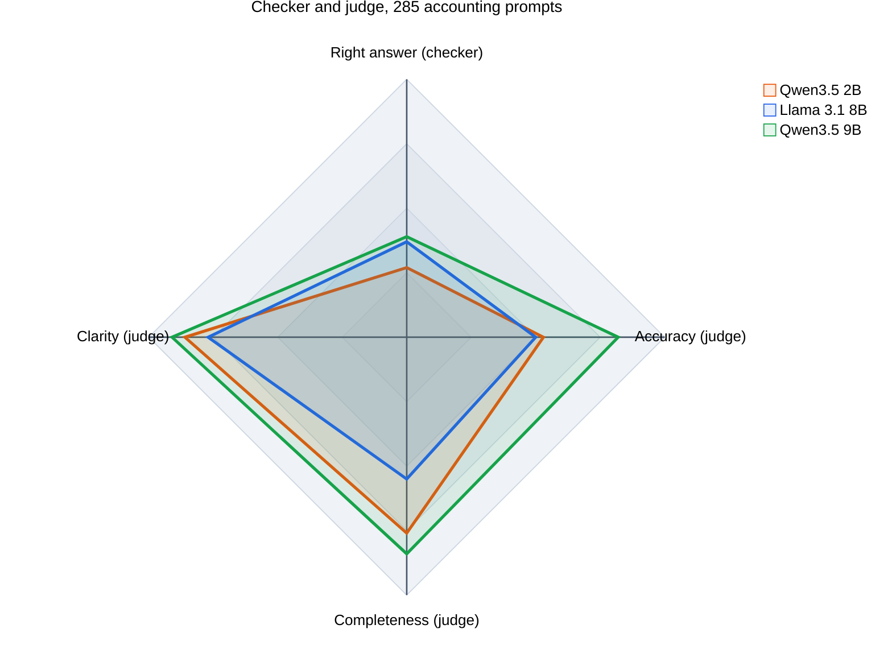

# LLM Benchmarking, Part 2: A Checker and a Judge

In [LLM Benchmarking](/posts/llmbenchmark/) I wrote 30 questions that know their own answers, so a checker could mark them with no second model. I said that this works only for questions with one right answer, and that an explanation needs a judge. This post tests both on the 285 prose prompts from my older [llm-accounting-benchmark](https://github.com/Haddley/llm-accounting-benchmark).

I ran three models on them: Qwen3.5 2B, Llama 3.1 8B and Qwen3.5 9B. Three larger ones, Gemma 4 12B, Qwen2.5 14B and Gemma 4 26B, are still answering, and I will add them as an update.

## What is in the 285 prompts

I expected 285 open questions. I counted, and 282 of them are **multiple choice**, with options A to D and a reference answer such as "The correct answer is C: $3". Only 3 are open-ended, and all three are reconciliation tasks, such as reconciling a bank passbook with a cash book.

That changes the job. A multiple-choice question has a right letter, so a checker can mark 282 of the 285 prompts, and the judge is needed for two other things: the 3 open-ended prompts, and the **reasoning** behind each letter.

:::brain-power Before you read on
A model writes three paragraphs of careful reasoning and then names the wrong option. Should the reasoning score count for something? Now turn it round: a model names the right option after a muddled explanation. Which of the two would you rather have as an accounting assistant?
:::

## Marker 1: the checker

The checker reads the letter the model chose and compares it with the reference. Models do not make that easy. They discuss every option and then end with "**Correct Option: B**", and some bold a word that happens to start with a letter. My first reader had both mistakes, and I found them only by reading real answers by hand. The reader now takes the last clear statement of a choice, ignores "Option D is incorrect", and has seven small tests, each one a layout that fooled an earlier version.

When no clear letter appears, I count the answer as not right. That is a real result: a model that never commits to an option cannot be marked right.

| Model | Right | Of 282 | Named a wrong letter | Named no letter |
|---|---|---|---|---|
| Qwen3.5 2B | 77 | **27.3%** | 115 | 90 |
| Llama 3.1 8B | 104 | **36.9%** | 126 | 52 |
| Qwen3.5 9B | 109 | **38.7%** | 105 | 68 |

All three are well below what I would want from an assistant. The picture is different if I look only at the answers where a model did name a letter. The 2B is right on 40.1% of those, the 8B on 45.2% and the 9B on 50.9%. Chance on four options is 25%.

## Marker 2: the judge

The judge is Gemma 4 26B. For every answer it sees the question and the model's reply, and it does **not** see the reference answer. It gives three scores from 1 to 10, Accuracy, Completeness and Clarity, and a verdict: SOUND, SLIP (a small error), FLAWED, or UNSUPPORTED (a claim with no reasoning behind it). I kept the reference answer from the judge on purpose. The judge answers the question "does this reasoning hold up?", and the checker answers "did it land on the key?". They are two different measurements.

| Model | Accuracy | Completeness | Clarity | SOUND | SLIP | FLAWED | UNSUPPORTED |
|---|---|---|---|---|---|---|---|
| Qwen3.5 2B | 5.3 | 7.6 | 8.6 | 101 | 10 | 173 | 1 |
| Llama 3.1 8B | 5.0 | 5.5 | 7.7 | 99 | 8 | 172 | 6 |
| Qwen3.5 9B | 8.2 | 8.4 | 9.1 | 203 | 11 | 67 | 4 |

(Each row covers all 285 answers. Scores are means.)

## One picture with four axes

The radar below puts the checker beside the three judge scores. I multiplied the scores by ten so that all four axes run from 0 to 100.

The 9B covers the most area, and the shape explains why. Its three judge axes sit near the rim, and its checker axis does not. It writes the clearest, most complete explanations of the three, and it still picks the right option well under half the time.

## Where the two markers disagree

I split each model's 282 multiple-choice answers four ways: did the checker mark it right, and did the judge call the reasoning sound (SOUND or SLIP) or flawed (FLAWED or UNSUPPORTED)?

| Model | Right, sound reasoning | Right, flawed reasoning | Wrong, sound reasoning | Wrong, flawed reasoning |
|---|---|---|---|---|
| Qwen3.5 2B | 47 | 30 | 64 | 141 |
| Llama 3.1 8B | 61 | 43 | 46 | 132 |
| Qwen3.5 9B | 99 | 10 | 115 | 58 |

Two cells matter.

**Right answer, flawed reasoning** is the lucky guess. The 8B has 43 of them, against 61 right answers with sound reasoning. A checker alone would have counted every one as a success.

**Wrong answer, sound reasoning** is the one that worries me. The 9B has 115. The judge looked at the explanation and found nothing wrong, and the answer was still not the key.

:::watch-it A judge that has not seen the key cannot catch a confident wrong answer
Here is a real one. The question asks what an auditor should do when a change in accounting principles has an immaterial effect on comparability. The reference answer is A, do not refer to the change in the report. The 9B wrote a tidy explanation, ended with "**Correct Answer: B**" (refer to the note that discusses the change), and the judge gave it 10 for Accuracy, 10 for Completeness, 10 for Clarity and a verdict of SOUND. The reasoning is fluent, and it supports an answer that the key says is wrong.
:::

I did not take the 115 on trust. I read 18 of the disagreements by hand, across three models. Both markers make mistakes. Some were checker misreads, which I fixed in the reader. Some were judge scores of 10 for an explanation that never clearly chose the reference option. While I was looking for examples I also found one where the key looks wrong. A question asks a risk-averse investor to order three (risk, return) pairs, and the key lists the highest-risk pair first. The 9B ordered them the other way and the judge approved. I read that as an error in the key and not in the model, and I have not been able to check it against the source.

## Can I trust the judge?

I tested it directly. I took 24 answers that the 9B had right, changed one number in each (the first figure after an equals sign, or a plus sign flipped) and asked the judge to review the original and the damaged copy.

- The judge rated 20 of the 24 originals SOUND or SLIP.
- Of those 20, it caught the damage in 14, which is 70%. I counted a catch as a verdict of SLIP or FLAWED on the damaged copy.
- The mean Accuracy score fell by 1.9 points, for answers that I had made wrong.

So the judge notices a planted error most of the time, and it misses about three in ten. Several of the misses kept an Accuracy score of 9 or 10 on a number that I had changed.

:::no-dumb-questions
**Q: Why not tell the judge the right answer?**

A: Then it would be a second checker, and it would lose the one thing a checker cannot do: say whether the reasoning stands on its own. In practice most questions in a real accounting job have no answer key. The judge has to work without one, so I wanted to see how it behaves without one.

**Q: Why not use the checker alone, since 282 of 285 prompts have a key?**

A: Because the checker cannot see the 43 lucky guesses by the 8B, and it cannot mark the 3 open-ended prompts at all. It also scores a model with no letter as simply wrong, and cannot say whether that model reasoned well.
:::

## The open-ended prompts: the judge is the only option

The three bank reconciliation prompts have no letter. There is nothing for the checker to read, so the judge is the only marker, and I treat its output with the care that the last section earned.

All three models were rated FLAWED on all three prompts, nine out of nine. The judge's one-line reasons are specific. For the 2B: "The student incorrectly adds bank charges and subtracts unpresented cheques when reconciling from the Passbook to the Cash Book." For the 9B on the third prompt: it "incorrectly identifies the $35k deposit as 'in transit' when it appears on both records, and the math for the adjustment is incorrect." Three prompts cannot rank three models, and I do not rank them. They show that every model I ran fails the one task here that looks most like real month-end work.

## What I take from this

- **The checker and the judge measure different things,** and the gap between them is the finding. The 9B's reasoning looks excellent and its answers are right about half the time when it names a letter. A single score would hide that.
- **The checker is only as good as its reader and its key.** I fixed the reader after reading real answers, and I found a probable error in the key.
- **A judge without the key rates fluency.** A confident, well-structured wrong answer can score 10, and a planted number error slipped past it three times in ten.
- **The two markers together find the lucky guesses and the confident misses,** which neither finds alone.

:::bullet-points What to remember
- 282 of the 285 prompts are multiple choice, so a letter checker marks almost all of them.
- Count an answer with no clear letter as not right, and say how many there were.
- Keep the key from the judge if you want to measure reasoning, and test the judge by planting faults.
- Read a sample of the disagreements by hand. Both markers make mistakes, and so can the answer key.
- Lucky guesses (right answer, flawed reasoning) and confident misses (wrong answer, sound reasoning) are the cases that a single score cannot show.
:::

## What comes next

Gemma 4 12B, Qwen2.5 14B and Gemma 4 26B are still answering. I will add them, judge them in the same way and update the radar and the tables. The 26B is also my judge, so I will mark its answers with the same judge and say so, because a model marking its own work is a case worth watching.

## References

- [LLM Benchmarking](/posts/llmbenchmark/): part 1, with 30 questions and a checker
- [llm-accounting-benchmark](https://github.com/Haddley/llm-accounting-benchmark): the 285 prompts and the rubric
- [Azure AI Foundry agent: Our AI Agent and DeepSeek with search](/posts/azurefoundryagent7/): the radar style that I borrowed
