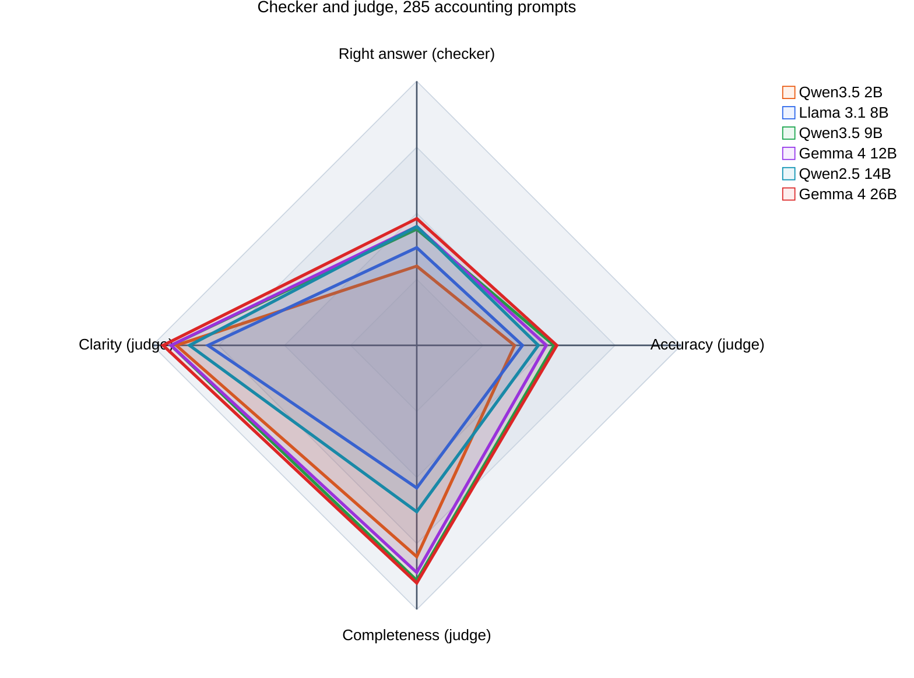

# LLM Benchmarking, Part 2: A Checker and a Judge

In [LLM Benchmarking](/posts/llmbenchmark/) I wrote 30 questions that know their own answers, so a checker could mark them with no second model. I said that this works only for questions with one right answer, and that an explanation needs a judge. This post tests both on the 285 prose prompts from my older [llm-accounting-benchmark](https://github.com/Haddley/llm-accounting-benchmark).

I ran six models on them: Qwen3.5 2B, Llama 3.1 8B, Qwen3.5 9B, Gemma 4 12B, Qwen2.5 14B and Gemma 4 26B. Each one answered all 285 prompts through Ollama.

## What is in the 285 prompts

I expected 285 open questions. I counted, and 282 of them are **multiple choice**, with options A to D and a reference answer such as "The correct answer is C: $3". Only 3 are open-ended, and all three are reconciliation tasks, such as reconciling a bank passbook with a cash book.

That changes the job. A multiple-choice question has a right letter, so a checker can mark 282 of the 285 prompts. The judge is needed for two other things: the 3 open-ended prompts, and the **thinking** behind each letter.

:::brain-power Before you read on
A model writes three paragraphs of careful reasoning and then names the wrong option. Should the reasoning score count for something? Now turn it round: a model names the right option after a muddled explanation. Which of the two would you rather have as an accounting assistant?
:::

## Marker 1: the checker

The checker reads the letter the model chose and compares it with the reference. That would be easy if the prompt asked for a fixed last line, such as "ANSWER: B", the way the 30 questions in part 1 did. These 285 prompts do not ask for one, so every model chose its own way to name a letter. Some discuss every option and then end with "**Correct Option: B**", and some bold a word that happens to start with a letter. My first reader had both mistakes, and I found them only by reading real answers by hand. The reader now takes the last clear statement of a choice, ignores "Option D is incorrect", ignores a bold letter inside a table row or a bold "B:" that labels an option under discussion, and has thirteen small tests, each one a layout that fooled an earlier version. I kept the original prompts so that the results stay comparable with the old benchmark, and that choice is what made the reader hard. Asking for a last line would have made it one line of code.

The last fix came late. I sampled answers that the reader marked as naming no letter, and several did name one: "I would choose: B. $500", a boxed "C. $2,000", or a closing line that was simply the option. I added a last look at the final three lines of an answer, used only when nothing else matched. It moved the Qwen2.5 14B from 104 right answers to 126, because that model writes short answers that end on the option itself.

When no clear letter appears, I count the answer as not right. That is a real result: a model that never commits to an option cannot be marked right.

| Model | Right | Of 282 | Named a wrong letter | Named no letter | Right, of those that named a letter |
|---|---|---|---|---|---|
| Qwen3.5 2B | 85 | **30.1%** | 133 | 64 | 39.0% |
| Llama 3.1 8B | 104 | **36.9%** | 130 | 48 | 44.4% |
| Qwen3.5 9B | 123 | **43.6%** | 113 | 46 | 52.1% |
| Gemma 4 12B | 126 | **44.7%** | 136 | 20 | 48.1% |
| Qwen2.5 14B | 126 | **44.7%** | 139 | 17 | 47.5% |
| Gemma 4 26B | 134 | **47.5%** | 121 | 27 | 52.5% |

All six are well below what I would want from an assistant. Chance on four options is 25%, and the best model is right on 47.5% of the prompts.

:::watch-it My own limit cut many answers short
I first capped every reply at 500 tokens, and the cap cut off most of the "no letter" answers of the two Qwen3.5 models. I reran the cut-off answers with a cap of 1500 tokens, and for the Qwen3.5 9B I reran all 285 answers, so that nothing in the table comes from the 500-token run. The rerun helped the Qwen3.5 9B most, from 109 right answers to 123, and the Gemma 4 12B and 26B gained 6 each, from 120 to 126 and from 128 to 134. It did not remove the problem. At 1500 tokens, 35 answers of the Qwen3.5 2B, 35 of the Qwen3.5 9B and 21 of the Llama 3.1 8B were still running when the cap stopped them, and they make up 23, 26 and 20 of those models' "no letter" answers. I have not read them to find out why they run so long.
:::

## Marker 2: the judge

The judge is Gemma 4 26B. For every answer it sees the question, **the correct answer** and the model's reply. It gives three scores from 1 to 10, Accuracy, Completeness and Clarity, and a verdict: SOUND, SLIP (a small error), FLAWED, or UNSUPPORTED (a claim with no reasoning behind it).

The checker and the judge have separate jobs. The checker answers "did the model land on the key?", with a letter and no opinion. The judge answers "how good was the thinking?", and it has the key so that it does not have to solve the problem itself.

| Model | Accuracy | Completeness | Clarity | SOUND | SLIP | FLAWED | UNSUPPORTED |
|---|---|---|---|---|---|---|---|
| Qwen3.5 2B | 3.7 | 8.0 | 9.1 | 77 | 6 | 202 | 0 |
| Llama 3.1 8B | 4.0 | 5.4 | 7.9 | 83 | 7 | 192 | 3 |
| Qwen3.5 9B | 5.2 | 8.9 | 9.3 | 128 | 1 | 155 | 1 |
| Gemma 4 12B | 4.9 | 8.6 | 9.3 | 115 | 4 | 163 | 3 |
| Qwen2.5 14B | 4.6 | 6.3 | 8.6 | 105 | 0 | 176 | 4 |
| Gemma 4 26B | 5.3 | 9.0 | 9.6 | 131 | 2 | 148 | 4 |

(Each row covers all 285 answers. Scores are means.)

Completeness follows length. The Llama 3.1 8B and the Qwen2.5 14B write short answers, a median of 102 and 87 tokens, and score 5.4 and 6.3 for Completeness. The other four write a median of 257 to 301 tokens and score 8.0 to 9.0.

## One picture with four axes

The radar below puts the checker beside the three judge scores. I multiplied the scores by ten so that all four axes run from 0 to 100.

The shape is the same for every model. Clarity sits near the rim, Completeness follows the length of the answer, and the two axes that depend on the key, Right answer and Accuracy, stay in the lower half. A model can write a clear, complete explanation and still land on the wrong option. The Gemma 4 26B covers the most area, and no model reaches 60 on either key axis.

Once the judge holds the key, its Accuracy score tracks the checker. That is the point of giving it the key, and it also means Accuracy adds little to the Right answer axis. The new information is in the cases where the two markers differ.

## Where the two markers disagree

I split each model's 282 multiple-choice answers four ways: did the checker mark it right, and did the judge call the thinking sound (SOUND or SLIP) or flawed (FLAWED or UNSUPPORTED)?

| Model | Right, sound thinking | Right, flawed thinking | Wrong, sound thinking | Wrong, flawed thinking |
|---|---|---|---|---|
| Qwen3.5 2B | 71 | 14 | 12 | 185 |
| Llama 3.1 8B | 87 | 17 | 2 | 176 |
| Qwen3.5 9B | 118 | 5 | 10 | 149 |
| Gemma 4 12B | 114 | 12 | 4 | 152 |
| Qwen2.5 14B | 105 | 21 | 0 | 156 |
| Gemma 4 26B | 128 | 6 | 4 | 144 |

Two cells matter, and both are small.

**Right answer, flawed thinking** is the lucky guess. The Qwen2.5 14B has 21 of them, against 105 right answers with sound thinking. A checker alone would have counted every one as a success. The judge takes the credit from 5 to 21 answers per model, 75 in all.

**Wrong answer, sound thinking** is the one that worries me, and it is mostly not what it looks like. Of the 32 answers in this cell across the six models, 29 named no letter. They are sound working that stopped before the model committed to an option, and 6 of the 32 ran into my token cap. The judge was right that the thinking was fine, and the checker was right that the model had not answered. With the key in its hands, the judge approved a wrong letter only 3 times in 1,692 answers. I read two of the three, both from the Gemma models. In each, the model wrote that the key looked wrong, and gave its own figure.

I also read the other answers where the judge and the checker disagreed while I was building the reader. Each reading found a mistake.

**The checker misread several.** In my first run, the Qwen3.5 9B answered a question about which segments Swift Co. must disclose. Its table showed segments A and B passing the 10% tests and C failing, and the reply was cut off in the middle of "Segments A and B meet the quantitative thresholds". The reference is A, and the model was right. My reader had picked up the bold **C** in the last table row as the choice. Three more cases fooled it the same way: a bold "**B:**" that labelled an option under discussion, "Correct Mathematical Choice: D" with a word between "Correct" and "Choice", and "(Option D)" in brackets after "the correct value is". I fixed the reader each time and added a test, and the counts above are from the fixed reader. A fifth kind surfaced only when I sampled the "no letter" answers: a choice stated in the closing lines, as "I would choose: B. $500". My first fix for that went too far, because a bracketed "(D)" in a sentence that said option D was wrong made the reader choose D. I dropped that pattern and added a test for it.

:::watch-it The judge disagreed with itself, and I think the key is wrong
The question asks which technique is *least* useful to a manager whose critical machine has limited capacity. The key says A, the theory of constraints. Three models answered B, economic order quantity, and explained that it "offers no direct guidance" for a capacity problem. The judge had the key in front of it. It gave the two Gemma answers an Accuracy of 1 and a verdict of FLAWED. It gave the Qwen3.5 9B's B answer 10 for Accuracy, 10 for Completeness, 10 for Clarity and a verdict of SOUND. I read the key as an error, because the theory of constraints is exactly what that manager needs. But the judge treated the same answer in two opposite ways, and I have not been able to check the key against its source.
:::

Both markers make mistakes, and so can the answer key. That is a reason to read a sample by hand.

## Can I trust the judge?

I tested it directly. I took 23 answers that the 9B had right in its new run, changed one number in each (the first figure after an equals sign, or a plus sign flipped) and asked the judge, with the key, to review the damaged copy as well as the original.

| | With the key |
|---|---|
| Originals rated SOUND or SLIP | 23 of 23 |
| Damage caught (damaged copy SLIP or FLAWED) | 7 of 23 |
| Damaged copy rated FLAWED | 1 of 23 |
| Mean fall in Accuracy | 0.8 points |

The judge caught the damage in 30% of the copies, and missed the other 16. A damaged answer still ends on the right letter, so the key tells the judge that the answer is right. Six of the 7 catches were a SLIP, a small error, and only one was FLAWED. In 16 of the 23 copies the damaged answer was still rated SOUND, and in 21 the Accuracy score stayed at 9 or 10.

So the judge is a good check on the conclusion and a weak check on the arithmetic. I use its verdicts to find lucky guesses and fluent wrong answers, and I do not trust it to find a single wrong number. That test used 23 answers from one model and one kind of damage, so the 30% is a rough figure. A first version of the test, on an earlier run of the same model, caught 11 of 23.

:::no-dumb-questions
**Q: Why give the judge the right answer? Is it not then a second checker?**

A: Partly. Its Accuracy score tracks the checker, and I accept that. What it adds is Completeness and Clarity, a verdict on the working, and a catch for the lucky guesses. Without the key, a judge would have to solve the problem itself, and a small model judging accounting will sometimes be wrong about the answer.

**Q: Why not use the checker alone, since 282 of 285 prompts have a key?**

A: Because the checker cannot see the 75 lucky guesses across the six models, and it cannot mark the 3 open-ended prompts at all. It also scores a model with no letter as simply wrong, and cannot say whether that model reasoned well.
:::

## The open-ended prompts: the judge is the only option

The three bank reconciliation prompts have no letter. There is nothing for the checker to read, so the judge is the only marker, and I treat its output with the care that the last section earned.

Across six models and three prompts, the judge rated 14 of 18 answers FLAWED. The four it called SOUND were the Llama 3.1 8B on the third prompt, and the Qwen3.5 9B and both Gemma models on the second. The judge's one-line reasons are specific. For the Qwen3.5 2B on the second prompt: "The student fails to reach the correct conclusion and incorrectly identifies reconciled items as reconciling items." For the Qwen3.5 9B on the third: "The student invented transactions and errors to force a reconciliation that is mathematically impossible with the given data."

Three prompts cannot rank six models, and I do not rank them. They show that most models fail the one task here that looks most like real month-end work. The judge is itself a Gemma 4 model, so I would read its verdicts for the Gemma models with a doubt about family bias. Two of the three SOUND verdicts on the second prompt went to Gemma answers, but the third went to a Qwen answer, and the Qwen3.5 9B has a higher Accuracy mean than the Gemma 4 12B. I cannot rule bias out. The checker does not share it, and it also puts the Gemma 4 26B first.

## What I take from this

- **The checker and the judge measure different things,** and a single score would hide the difference. Every model writes clear explanations (Clarity 7.9 to 9.6) and none reaches 50% right.
- **The checker is only as good as its reader and its key.** I fixed the reader several times after reading real answers, and one fix moved a model by 22 right answers. I also found a probable error in the key.
- **The judge checks the conclusion better than the steps.** It caught a planted number error in 30% of the copies.
- **My own settings can distort the result.** A 500-token cap turned working answers into "no letter", and the rerun with a larger cap gave the Qwen3.5 9B 14 more right answers.

:::bullet-points What to remember
- 282 of the 285 prompts are multiple choice, so a letter checker marks almost all of them.
- Ask the model for a fixed last line, such as "ANSWER: B". Without one, the checker has to guess how each model says it.
- Count an answer with no clear letter as not right, and say how many there were and why.
- Give the judge the key, and plant faults to see what it catches. Mine missed seven in ten of the planted number errors.
- Read a sample of the disagreements by hand. Both markers make mistakes, and so can the answer key.
- Set the answer limit with care, and rerun the cut-off answers with a larger one. A cap that cuts the model off scores as a wrong answer.
:::

## What comes next

A different judge, such as a model from another family, would settle the family bias question: the Gemma 4 26B is both a contestant and the judge. I would also read the answers that still run to the 1500-token cap, to find out why they never reach a letter.

## References

- [LLM Benchmarking](/posts/llmbenchmark/): part 1, with 30 questions and a checker
- [llm-accounting-benchmark](https://github.com/Haddley/llm-accounting-benchmark): the 285 prompts and the rubric
