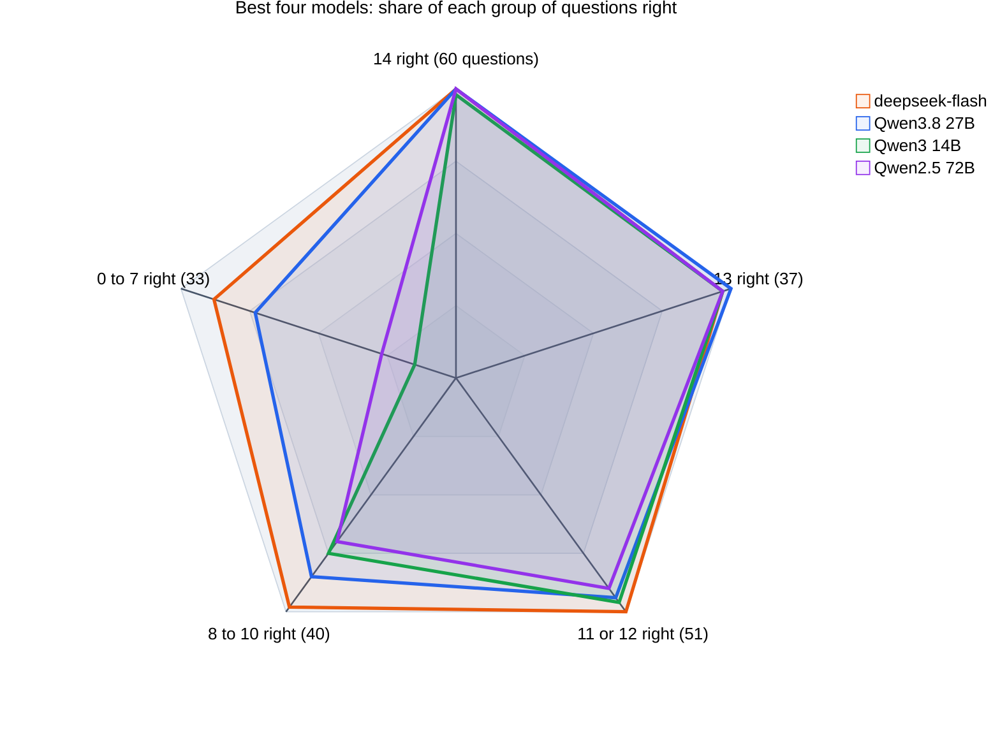
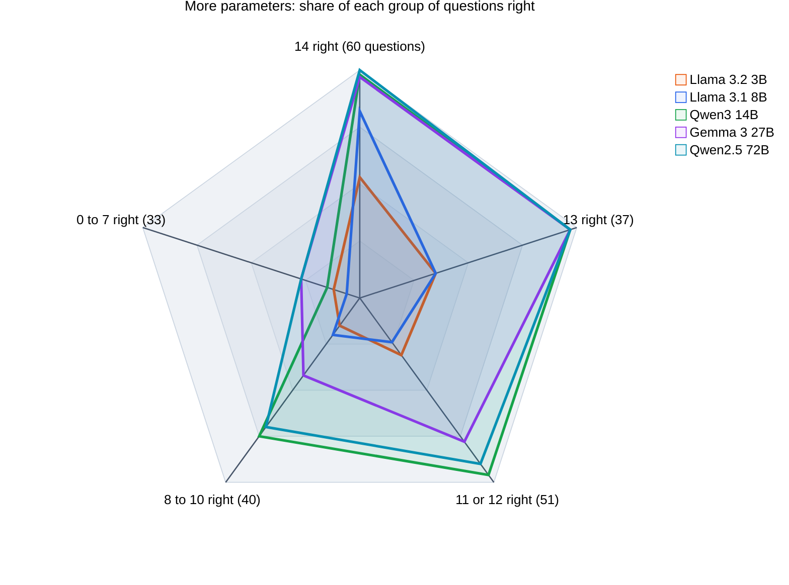

In [Part 2](/posts/llmbenchmark2/) I ranked fifteen models on 282 accounting exam questions. A ranking hides something more useful: which questions the models get wrong, and whether they get the same ones wrong. If they fail on different questions, asking several models should help. If they fail together, it will not.

:::bullet-points The short answer
- **The models fail together more than they fail alone.** 61 questions (22%) were right for all fifteen models, and not one was wrong for all fifteen. The models still agreed on the hard ones.
- **The hardest questions ask for a rule and its exception.** Ten of the eleven hardest are about a specific rule in auditing, tax, contract law or government reporting. The models that fail know the general rule and miss the special case.
- **Models from the same family fail together more.** Same-family pairs scored 0.35 on a 0-to-1 similarity scale, against 0.25 for different families.
- **A vote helps only when the voters are about equally good.** It beat each of its members, and it did not beat the best single model.
- **When most models agree on a wrong answer, check the key.** Some of the hardest questions have an arguable answer in the dataset.
:::

## How the questions split

I counted, for each of the 282 questions, how many of the fifteen models got it right. (These counts use my first pass of each model, with brief reasoning.)

| Models right | 15 | 14 | 13 | 12 | 11 | 10 | 9 | 8 | 7 or fewer |
|---|---|---|---|---|---|---|---|---|---|
| Questions | 61 | 60 | 37 | 31 | 20 | 17 | 11 | 12 | 33 |

61 questions were easy for every model. No question was impossible for every model. If the models failed independently, I would expect about 7 questions that all fifteen get right, so the real figure is about nine times that. Easy questions are easy for everyone.

### Where each model loses its points

A total score hides where a model loses points. I grouped the questions by how many models got them right, and asked each model what share of each group it got right. The 61 questions that every model got right are left out, because every model scores 100 on them.

All four get nearly every question that 13 or more models get right. They separate on the two hardest groups. `deepseek-flash` gets 88% of the 33 questions that 7 or fewer models got right, and Qwen3.8 27B gets 73%. Qwen3 14B gets 15% and Qwen2.5 72B 27%. That is where the top two earn their lead.

The two small Llama models fail even the easier groups. From 14B up the shapes are alike, and more parameters did not extend the reach into the hardest group, where the 14B and 72B models both fall below 30%. (The groups come from the same models, so a model that gets a question wrong helps to put it in a harder group. Read the charts as a description of these models, not as a measure of difficulty that holds for others.)

## Models from the same family fail together

I measured how alike two models' right-and-wrong patterns are with a number called phi: 1 means identical patterns and 0 means unrelated. Pairs from the same family score higher than pairs from different families. The 26 same-family pairs average 0.35 and the 79 different-family pairs average 0.25. (I counted DeepSeek-R1 32B with the Qwen models, because it is a distilled Qwen.) The most alike pair is Qwen2.5 14B and Qwen2.5 72B, at 0.50. The least alike is `deepseek-flash` against the 3B Llama, at 0.04.

:::under-the-hood What phi is
Phi answers one question: when one model gets a question wrong, is the other model more likely to get it wrong too? It is the ordinary correlation, applied to a list of right and wrong marks.

For two models I sort the 282 questions into four boxes:

| Qwen2.5 14B and Qwen2.5 72B | 72B right | 72B wrong |
|---|---|---|
| **14B right** | 211 | 13 |
| **14B wrong** | 29 | 29 |

Both models are right most of the time, so they would agree often even if they were unrelated. Phi removes that effect by comparing the diagonal (both right, both wrong) with the other two boxes, and scaling the result:

phi = (211 × 29 − 13 × 29) ÷ √(224 × 58 × 240 × 42) = 5,742 ÷ 11,444 = **0.50**

- **1** means the two models are right and wrong on exactly the same questions.
- **0** means that knowing one model's mark tells you nothing about the other's.
- **Below 0** would mean one tends to be right where the other is wrong. No pair here goes below 0.

Compare `deepseek-flash` with the 3B Llama. Llama is wrong on 150 of the 282 questions, and DeepSeek is wrong on only 6. If DeepSeek's mistakes had nothing to do with Llama's, I would expect about 3 of those 6 to be among Llama's 150, and 4 are. Phi is 0.04.
:::

A model from the same family as one that is wrong is more likely to be wrong on the same question. That is why a second opinion from another family is worth more than a second opinion from the same family.

## What the hardest questions have in common

Eleven questions were answered correctly by 4 or fewer of the fifteen models:

| Topic | Models right |
|---|---|
| Client integrity before accepting an audit | 1 |
| Bond premium amortised by the wrong method | 2 |
| Accepting a compilation engagement | 2 |
| Basis of stock received as a gift | 3 |
| Auditor's subsequent-events procedures | 4 |
| Contract formation under the UCC | 4 |
| Tax preparer penalty on a disclosed shelter | 4 |
| Statistical tables in a government annual report | 4 |
| Basis in a partnership interest | 4 |
| What a standard compilation report implies | 4 |
| Comparing investment projects with NPV and IRR | 4 |

Ten of the eleven ask for a specific rule or standard in auditing, tax, contract law or government reporting, and the eleventh is a finance question. None needs a long calculation.

:::under-the-hood Worked examples: two hard questions and their reasoning
**Contract law (UCC).** Jackson, a merchant, mailed Sands a signed offer to sell 500 fans at $10 each, with a promise not to revoke and no expiry date. Jackson then mailed a revocation, which Sands received on day 6. On day 7 Sands mailed an acceptance. Was a contract formed? The key is D: a contract was formed on the day Sands mailed the acceptance.

- **Right reasoning** (`deepseek-v4-pro`, Qwen3.8 27B): a signed offer from a merchant that promises to stay open is a firm offer under UCC section 2-205. It stays open for a reasonable time even without an expiry date, so the revocation has no effect. An acceptance counts when it is mailed, so the contract formed on day 7.
- **Wrong reasoning** (Qwen2.5 72B and Llama 3.3 70B, both chose B): they saw the promise not to revoke, and then said that a revocation received before the acceptance still works. They used the ordinary rule and missed the exception.

**Tax on a gift of stock.** Simmons gave her child stock with a basis of $40,000 and a market value of $30,000. The child sold it for $36,000. What gain or loss does the child recognise? The key is B: none.

- **Right reasoning** (`deepseek-v4-pro`, Qwen3.8 27B): for a gift worth less than the donor's basis, the child uses the donor's basis of $40,000 to work out a gain and the market value of $30,000 to work out a loss. $36,000 sits between them, so there is no gain and no loss.
- **Wrong reasoning:** Qwen2.5 72B used the donor's basis for both and found a $4,000 loss (A). Llama 3.3 70B used the market value for both and found a $6,000 gain (C). Each knew a rule and applied it to the wrong half of the question.

In both questions the models know the general rule. The ones that fail miss the special case that applies.
:::

The wrong answers are not random. In the audit and compilation questions, the models choose the option that looks most suspicious to a general reader, and the right answer needs the specific professional standard. Qwen3.8 27B, for example, called inventory write-offs before year end "a major red flag" and dismissed the key's answer, that management would not let the CPA see information, as "a scope limitation issue". `deepseek-flash`, the only model right, reasoned from the audit rule instead.

:::watch-it When 14 of 15 models agree on a wrong answer, check the key
On the audit question, 14 of 15 models chose C. The key says B, and I think C is a defensible answer, so I would not call the 14 wrong without seeing the source. On the investment question the key says "The IRR never changes the ranking of the projects". IRR is the internal rate of return, and it can rank projects differently from NPV, so I do not see how that is true. Only 4 of the 15 models chose it. A dataset can contain a wrong key, and the questions that nearly every model gets wrong are the first place to look.
:::

## Does a vote help?

If the models fail on different questions, a majority vote should beat each of them. I tested this on the saved answers, with the strongest model breaking ties.

| Voters | Vote | Best member alone |
|---|---|---|
| QwQ 32B, Qwen3 14B, Qwen2.5 72B | **257** (91.1%) | 244 |
| 7 strongest local models | 265 (94.0%) | 264 (Qwen3.8 27B) |
| 3 strongest local models, including Qwen3.8 27B | 259 (91.8%) | 264 |
| Qwen3 14B, Qwen2.5 14B, Gemma 3 27B | 236 (83.7%) | 240 |
| 7 small models (3B to 14B, including gpt-oss 20B) | 237 (84.0%) | 240 |
| All 13 local models | 256 (90.8%) | 264 |
| All 15 models | 265 (94.0%) | 275 (DeepSeek V4 Pro) |

- **A vote can beat each of its members.** The first row gains 13 right answers over its best member, from models of similar strength.
- **A vote rarely beats the strongest single model.** Qwen3.8 27B alone scores 93.6%, and voting with it gives 94.0% at best.
- **Voting among small models does not rescue them.** Seven small models vote to 84.0%, and Qwen3 14B alone scores 85.1%.
- **Weak voters drag the result down.** The vote is better with 7 voters than with 13, because the two small Llamas are wrong too often.

So one stronger model beats a committee of weaker ones here, because the weaker models share their blind spots.

## Does giving the model the rule help?

The hard questions need a rule that the model failed to apply. So I tried the obvious fix: put the rule in the prompt. For ten of the eleven hard questions (I left out the investment question, where I doubt the key) I wrote a short note of three or four sentences that states the relevant rule or standard. A note never names an option. For example, for the gift-of-stock question it says that the donee uses the donor's basis to compute a gain and the market value at the date of the gift to compute a loss, and that a sale price between the two gives no gain or loss.

I ran each question three ways for each model:

- **None.** The question alone.
- **Rule.** The note for that question, then the question.
- **Control.** The note for a different question, then the question. This checks whether any extra text helps, not only the right rule.

*Draft note for review: the results table goes here when the runs finish. The two DeepSeek models are running now, and five local models are queued behind the other jobs: Qwen3 14B, Qwen2.5 14B, Gemma 3 27B, Qwen2.5 72B and Llama 3.3 70B.*

:::watch-it The experiment has a flaw I cannot remove
I wrote the notes myself, and I knew the key when I wrote them. A note that states the rule clearly may lean toward the key without meaning to. If the rule helps, the result shows that the models can apply a rule when they are given it. It does not show that they would find the rule on their own.
:::

## What I would do with this

- **Do not ask the same family twice.** A second model from the same family is the least likely to catch the first one's mistake.
- **A vote is for models of equal strength.** Use two or three strong models from different families. Do not add weak ones.
- **Treat the questions that most models miss as a list to check.** They are either hard rule exceptions or questions with a doubtful key, and both are worth a human look.
- **For rule-exception questions, put the rule in front of the model** if the experiment above shows that it helps. I will update this section when it finishes.

## References

- [Part 2](/posts/llmbenchmark2/): the ranking of the fifteen models
- [Part 4](/posts/llmbenchmark4/): how far I trust these numbers
- [cais/mmlu](https://huggingface.co/datasets/cais/mmlu): the test, `professional_accounting` subject
