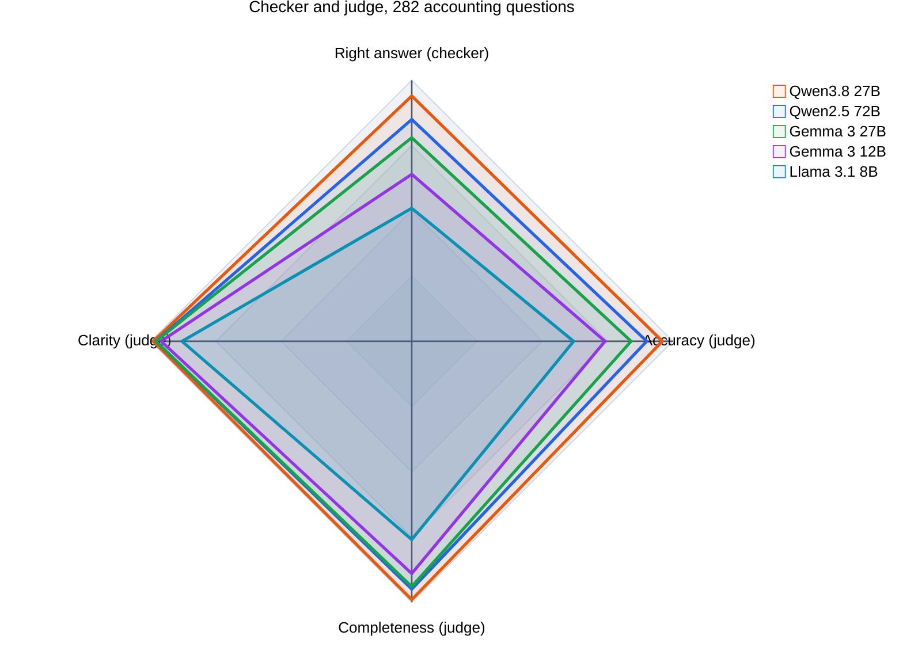
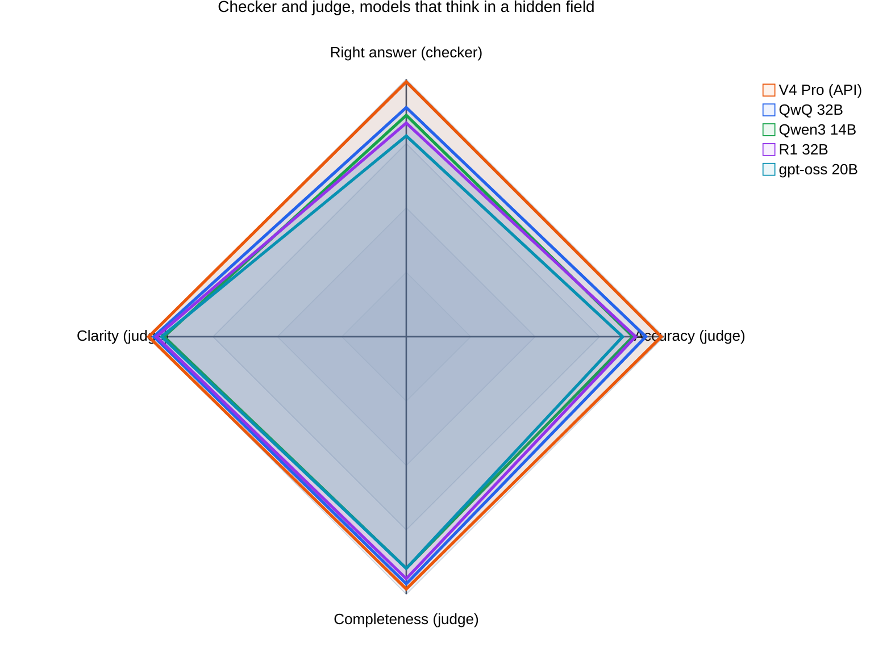

[Part 2](/posts/llmbenchmark2/) ranked fifteen models on 282 accounting questions, and [Part 3](/posts/llmbenchmark3/) looked at the questions they miss. Both rest on numbers that I produced with code, a token allowance and a judge model. This post checks those numbers: how much they move when I repeat a run, what a bad setting costs, and what a judge can and cannot see.

:::bullet-points The short answer
- **Gaps under about 2 points are ties.** Running the same model again moved its score by 3 to 6 questions out of 282.
- **Count the empty replies before trusting a score.** A thinking model that runs out of tokens writes no answer, and the checker counts that as wrong. Raising the allowance gained 3 to 10 right answers for five of six models.
- **Ask for a fixed last line.** "ANSWER: X" turns the checker into one short pattern. I count an answer with no letter as wrong, and report how many there were.
- **A judge that holds the answer key follows the checker.** Its Accuracy score tracked the right-answer rate, and it found only 16 lucky guesses in 1,974 answers.
- **A judge is a poor check on arithmetic.** I changed one digit in 40 right answers, and it caught 1.
- **Two judges from different families agreed** on 58 of 59 verdicts, so its verdicts are steady even where its scores are not.
:::

## The checker

The checker reads the letter the model chose and compares it with the key (the correct answer that the dataset supplies). Part 1 taught me to end every prompt with a line in a fixed form, such as "ANSWER: B". The checker only has to find that line and read the letter after it, so it does not have to guess which option a long answer is pointing at. This is the core of the runner:

```python
INSTR = {
    "direct": "Reply with only the letter of the correct option (A, B, C or D) and nothing else.",
    "reason": "Think it through briefly, then end your reply with a final line in exactly this form: ANSWER: X (where X is A, B, C or D).",
}[mode]

for i, o in enumerate(orig):
    opts = "\n".join(f"{'ABCD'[k]}. {c}" for k, c in enumerate(o["choices"]))
    prompt = f"{o['question']}\n\nOptions:\n{opts}\n\n{INSTR}"
    body = {"model": model, "messages": [{"role": "user", "content": prompt}], "stream": False,
            "options": {"temperature": 0, "seed": 1, "num_predict": 12 if mode == "direct" else NUM_PREDICT}}
    reply = json.load(urllib.request.urlopen(request(body)))
    record = {"i": i, "key": "ABCD"[o["answer"]], "text": reply["message"]["content"]}
```

and this is the checker. It takes the last `ANSWER:` line, and only if there is none does it fall back to a longer reader, [reader.py](/assets/files/llmbenchmark2/reader.py), that looks for phrases such as "the correct answer is":

```python
def letter(text, mode):
    m = re.findall(r"ANSWER:\s*\**\s*\(?([A-D])\b", text, re.I)
    if m:
        return m[-1].upper()
    if mode == "direct":
        m = re.match(r"^\W*([A-D])\b", text.strip(), re.I)
        if m:
            return m.group(1).upper()
    return read(text)          # None when no letter can be found

right = sum(letter(r["text"], mode) == r["key"] for r in records)
```

An answer with no clear letter counts as wrong. That is a real result: a model that never commits to an option cannot be marked right. The table in Part 2 reports how many of each model's answers had no letter.

## The noise

I ran seven of the models twice. The second time I saved their thinking, and for some I also raised the token allowance, so the table separates the two cases. Where nothing changed, the score still moved:

| Model | First run | Second run | What changed |
|---|---|---|---|
| deepseek-flash | 276 | 273 | nothing |
| deepseek-v4-pro | 275 | 272 | nothing |
| deepseek-v4-pro | 272 | 278 | allowance raised from 8,000 to 32,000 tokens |
| Qwen3 14B | 240 | 240 | nothing |
| Qwen3 14B | 240 | 243 | allowance raised from 4,000 to 12,000 tokens |

The hosted models do not repeat themselves exactly even at temperature 0, so a gap of a few questions between two models is not worth reading into. That is why I will not say whether `deepseek-flash` or `deepseek-v4-pro` is better.

## The token allowance

A model that thinks can spend its whole allowance thinking and never write an answer. In my first run, six answers from `deepseek-v4-pro` had 32,000 to 42,000 characters of thinking and an empty reply. [Part 2](/posts/llmbenchmark2/) has the table: five of six models gained 3 to 10 right answers when I redid the cut-off answers with a larger allowance, and DeepSeek-R1 32B gained none. Four of the six `deepseek-v4-pro` answers that came back right used only 783 to 3,540 tokens the second time, so a cut-off answer is not always a model that needs more room. Sometimes the first run simply thought for too long.

The lesson for a benchmark is to report the number of answers with no letter next to the score, and to treat a large number as a setting to fix before it is a finding.

## The judge

A letter says whether a model landed on the key. It does not say whether the working was any good. I added a judge to mark that. The judge is `gemma4:12b`, running locally. It is not one of the 15 models, so it never marks its own answers. It does share a family name with the two Gemma 3 models it marks, and I cannot rule out that it favours them. For every reply it sees the question, the four options, the correct answer and the model's reply, and it gives three scores from 1 to 10 (Accuracy, Completeness and Clarity) and a verdict: SOUND, SLIP (a small error), FLAWED or UNSUPPORTED (a claim with no reasoning behind it).

This is the prompt:

```python
PROMPT="""You are marking a student's answer to a multiple-choice accounting question. You are given the correct answer.

Question:
{question}

Options:
{options}

Correct answer: {key}

Student's reply:
\"\"\"
{reply}
\"\"\"

Mark the reply. Give three scores from 1 to 10:
- accuracy: is the reasoning and the figures right, and does it reach the correct answer?
- completeness: does it work through what is needed to justify its answer?
- clarity: is it easy to follow?
And a verdict, one of: SOUND (right thinking), SLIP (a small error), FLAWED (wrong thinking or wrong answer), UNSUPPORTED (a claim with no reasoning behind it).
Reply with JSON only: {{"accuracy": n, "completeness": n, "clarity": n, "verdict": "...", "reason": "one sentence"}}"""
```

The judge can only mark what it is shown. Seven of the models write their working in the reply, and I judged those first:

| Model | Right (checker) | Accuracy | Completeness | Clarity | SOUND | FLAWED |
|---|---|---|---|---|---|---|
| Qwen3.8 27B | 93.6% | 9.6 | 9.9 | 9.9 | 264 | 17 |
| Qwen2.5 72B | 85.1% | 9.0 | 9.5 | 9.8 | 238 | 42 |
| Llama 3.3 70B | 84.8% | 8.9 | 9.4 | 9.7 | 235 | 43 |
| Qwen2.5 14B | 79.4% | 8.5 | 9.4 | 9.8 | 217 | 62 |
| Gemma 3 27B | 78.4% | 8.4 | 9.4 | 9.8 | 218 | 62 |
| Gemma 3 12B | 63.5% | 7.4 | 8.9 | 9.6 | 176 | 99 |
| Llama 3.1 8B | 51.4% | 6.2 | 7.6 | 8.8 | 140 | 140 |

(These are the first-run answers that the judge marked. The cut-off reruns in [Part 2](/posts/llmbenchmark2/) later added one right answer each for Qwen3.8 27B and Llama 3.3 70B. Scores are means over 282 answers. A few verdicts are missing where the judge left the field out, so the SOUND and FLAWED counts can add to a little less than 282.)



Clarity and Completeness sit near the rim for every model except the weakest: all seven write clear, thorough-looking explanations. The two axes that depend on the key, Right answer and Accuracy, separate the models. The judge holds the key, so its Accuracy follows the checker closely, and I would not count it as a second opinion on the answer. What it adds is the verdict on the working, and it found little: of 1,974 answers, only 16 were right with FLAWED thinking (a lucky guess), and only 2 were wrong with SOUND thinking.

### Models that think in a hidden field

The other seven models do their thinking in a hidden field and reply with little more than "ANSWER: X", so a judge that sees only the reply gives them a Completeness of 1. I ran them again with the thinking saved, and gave the judge the thinking and the reply together.

| Model | Right (checker) | No letter | Accuracy | Completeness | Clarity | SOUND | FLAWED |
|---|---|---|---|---|---|---|---|
| deepseek-v4-pro | 98.6% | 0 | 9.9 | 9.8 | 10.0 | 275 | 4 |
| deepseek-flash | 96.8% | 0 | 9.7 | 9.7 | 10.0 | 272 | 9 |
| QwQ 32B | 89.0% | 7 | 9.3 | 9.6 | 9.8 | 251 | 28 |
| Qwen3 14B | 86.2% | 1 | 8.8 | 9.0 | 9.4 | 237 | 39 |
| Qwen3 8B | 83.7% | 5 | 8.7 | 9.1 | 9.6 | 234 | 46 |
| DeepSeek-R1 32B | 83.3% | 11 | 8.9 | 9.4 | 9.7 | 234 | 42 |
| gpt-oss 20B | 78.4% | 7 | 8.4 | 9.0 | 9.5 | 220 | 59 |



The shapes follow the checker, as they did for the models that write their working in the reply.

The most useful result is in the answers that the judge rated SOUND thinking and the checker marked wrong. Before I raised the allowance there were 15 among the first models I judged, and every one had an empty reply. The model ran out of tokens while it was still thinking, and the thinking was fine. The judge was right about the thinking, and the checker was right that no answer arrived.

## Can I trust the judge?

I tested it two ways.

:::watch-it The judge is a good check on the conclusion and a poor check on the numbers
I took 40 answers that the checker marked right and the judge rated SOUND, and changed the last digit of the first figure after an equals sign (so that $245 × 2 = $490 became $493). The judge rated 39 of the 40 damaged copies SOUND again, and the mean Accuracy fell by 0.1 points. A damaged answer still ends on the right letter, and the key tells the judge that the letter is right. Use its verdicts to find answers where the conclusion is wrong, and do not trust it to find a wrong number.
:::

This is the damage function:

```python
def damage(t):
    m=re.search(r'=\s*\$?(\d[\d,]*\.?\d*)',t)
    if not m: return None
    num=m.group(1); i=m.start(1)+len(num)-1
    while not t[i].isdigit(): i-=1
    new=str((int(t[i])+3)%10)
    return t[:i]+new+t[i+1:]
```

I also asked `deepseek-v4-pro` to judge 60 of the same answers, picked at random. The two judges put 58 of the 59 comparable answers in the same group, sound (SOUND or SLIP) or flawed. DeepSeek scored Completeness and Clarity about 0.6 points lower than Gemma. The verdicts are steady across two judges from different families. The finer scores are a matter of taste.

The judge also tried to explain why models went wrong on the eleven hardest questions in [Part 3](/posts/llmbenchmark3/). I did not use its explanations. It called 76 of 97 wrong replies "wrong rule", which says more about the judge's habit than about the models, and some explanations restated the key without testing it.

:::no-dumb-questions
**Q: Why give the judge the right answer? Is it not then a second checker?**

A: Partly. Its Accuracy tracks the checker, and I accept that. What it adds is a verdict on the working and a catch for the lucky guesses. Without the key, a judge would have to solve the problem itself, and a small model judging accounting is sometimes wrong about the answer.

**Q: Why not trust the judge's scores?**

A: Its verdicts held across two judges, and its scores did not move much with a planted error. Use it to sort answers into sound and flawed, and read a sample by hand.
:::

## A checklist before I trust a benchmark

- **Ask for a fixed last line,** and count answers without a letter as wrong, reported next to the score.
- **Read how many replies were cut off** at the token allowance, for every model that thinks, and redo them with a larger one.
- **Run it twice** and treat a gap smaller than the difference between the runs as a tie.
- **If a judge marks the working, test it with planted faults.** Mine missed 39 of 40.
- **Use a second judge from another family** on a sample.
- **Read the questions that nearly every model misses.** The key may be wrong.

## The code

The files are in [llmbenchmark2](/assets/files/llmbenchmark2/README.md): `run.py` runs a model, `grade.py` and `reader.py` mark the answers, `judge.py` marks the working, `plant.py` is the planted-error test, `second_judge.py` is the second judge, and `overlap.py` counts how many models get each question right.

## References

- [Part 2](/posts/llmbenchmark2/): the ranking of the fifteen models
- [Part 3](/posts/llmbenchmark3/): the questions they miss
- [LLM Benchmarking](/posts/llmbenchmark/): part 1, with 30 questions and a checker
