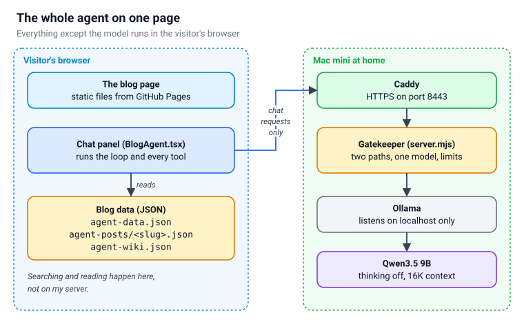
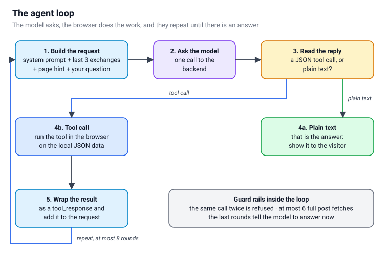
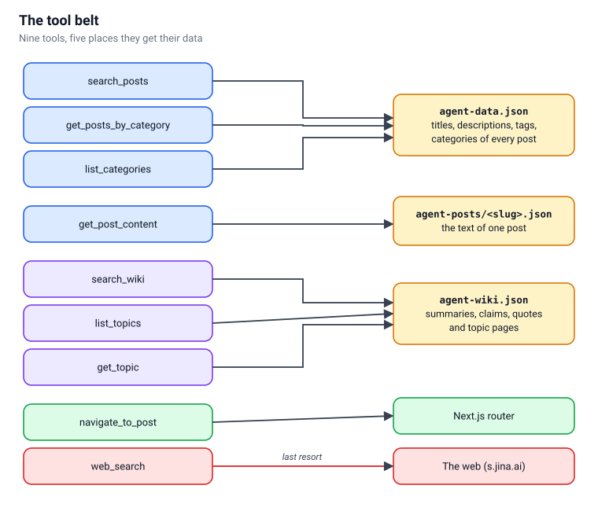
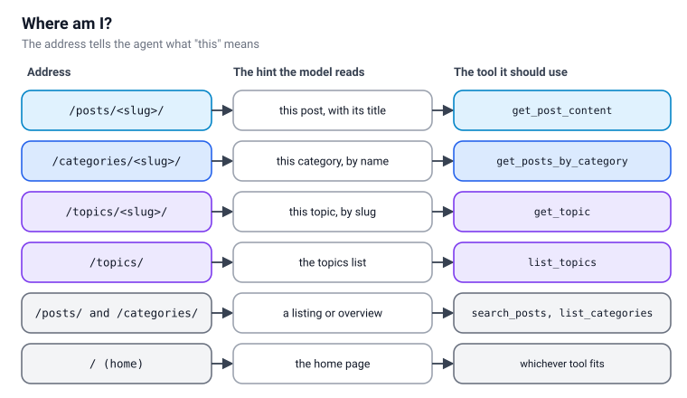
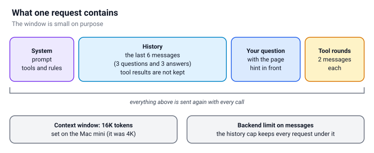
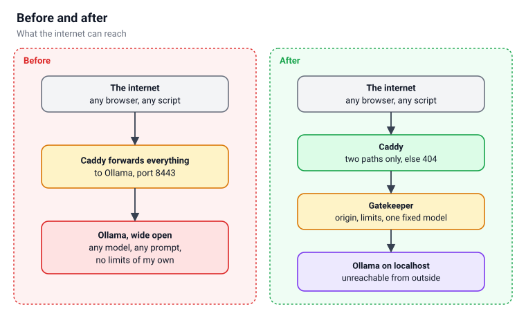
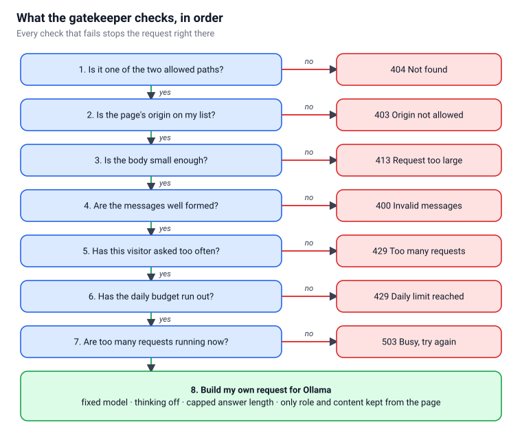
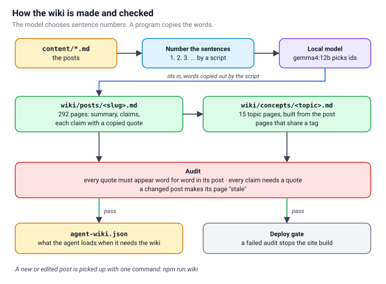

# How the Blog Assistant Works Now

In [Part 1](/posts/localagent/) I added a chat button to this blog. It had two backends: a model that ran inside the visitor's browser, and an Ollama server that I ran myself and put on the internet.

I have since rebuilt most of it. The browser model is gone. There is one fixed model, one gatekeeper program in front of it, and a small wiki that the assistant reads. This post walks through every part, with a diagram for each.

:::brain-power
Suppose you put a language model online so that strangers can chat with it. What is the first thing you would worry about? Write it down, then count how many of your worries the gatekeeper in this post covers.
:::

## What changed since Part 1

| | Part 1 | Now |
|---|---|---|
| Model | The visitor chose WebLLM or Hosted | One fixed model, Qwen3.5 9B |
| Who reaches Ollama | Anyone, through a reverse proxy | Nobody. Ollama listens on localhost only |
| What the internet reaches | Ollama | A gatekeeper program that I wrote |
| What the assistant knows | Titles, tags and post text | Those, plus a wiki of checked summaries and topic pages |
| Which page it is on | Post pages | Posts, categories and topics |

## The whole agent on one page

Here is everything on a single picture. The left half is the visitor's browser. The right half is a Mac mini at home.

*The browser does the searching and reading. Only the call to the model travels to my Mac mini.*

Look at the arrow between the two halves. Searching the blog, reading a post and looking something up in the wiki all happen in the browser, on JSON files that the site already serves. My server never sees them. The only thing that crosses to the Mac mini is the conversation that the model needs to read.

That split is deliberate. The model is the expensive, risky part, so it is the only part that I run and defend myself. Everything else is static files on GitHub Pages.

## The loop in the browser

The model never searches the blog itself. It asks, my code in the browser does the work, and the answer goes back. They repeat until the model has enough to write a reply.

*One question, up to eight rounds. A plain-text reply ends the loop.*

Here is what one turn looks like:

1. The page builds a request: the system prompt with the tool definitions, the last few exchanges, a hint about the current page, and the visitor's question.
2. The page sends the request to the backend and gets a reply.
3. If the reply is a JSON block such as `{"name": "search_posts", "arguments": {"query": "docker"}}`, the page runs that tool on the local data.
4. The page wraps the result in a `<tool_response>` block, adds it to the request and asks again.
5. If the reply is plain text, that is the answer, and the loop stops.

Two guard rails keep a small model out of trouble. The page refuses to run the same tool call twice in one turn, and it limits how many full posts one turn may fetch. In the last rounds it tells the model to answer now, so a model that keeps searching still ends up saying something.

The **Show working** toggle under an answer lists every step: what the model thought and which tools it called. That is the same list the loop kept while it ran.

:::no-dumb-questions
**Q: Why not use the model's built-in tool calling?**

A: In Part 1 I found that tool calling through the browser engine only worked for a fixed list of models. I kept the prompt-based loop, where the tool definitions sit in the system message and the model answers with a JSON block, because it works with any instruction-tuned model I might swap in later. It also keeps the whole loop in my own code, where I can read it. The backend would not pass a tools field through anyway, as you will see below.

**Q: What if the model writes bad JSON?**

A: The page also accepts a `<tool_call>` block, closed or not, and strips code fences and any preamble the model adds. If it still cannot find a call, it treats the reply as the answer.
:::

## The tool belt

The model has nine tools. Each one reads from one of five places.

*Three tools search the post list, one reads a post, three read the wiki, one moves the page and one goes to the web.*

| Tool | Reads | Used for |
|---|---|---|
| `search_posts` | `agent-data.json` | Keyword search over titles, descriptions and tags |
| `get_posts_by_category` | `agent-data.json` | "Any Java posts?" |
| `list_categories` | `agent-data.json` | "What categories are there?" |
| `get_post_content` | `agent-posts/<slug>.json` | "Summarise this post" |
| `search_wiki` | `agent-wiki.json` | "What did you conclude about RAG?" |
| `list_topics` | `agent-wiki.json` | "What topics do you have?" |
| `get_topic` | `agent-wiki.json` | One topic page: summary, quoted claims, differences |
| `navigate_to_post` | The Next.js router | Taking the visitor to a post |
| `web_search` | The web | A last resort, for things the blog does not cover |

The site builds the three JSON sources before every deploy. `agent-data.json` is the list of posts, `agent-posts/` holds one file per post, and `agent-wiki.json` is the wiki. The wiki file is the largest, so the page downloads it only the first time a wiki tool runs.

## Where am I?

A visitor on a post page says "summarise this", and the assistant needs to know what "this" means. So every question goes out with a short hint that names the page.

*The address decides which hint the model reads and which tool it should reach for.*

:::watch-it The route that did not exist
My first version of this hint recognised category pages at `/posts/category/<slug>/`. The real pages live at `/categories/<slug>/`. On the 3D category page a visitor typed "summarise this category", and the assistant answered with the counts for all 24 categories, because as far as it knew it was on the categories overview.

The fix was two lines of address matching and one new rule in the hint: on a category page, "this category" means that category, so call `get_posts_by_category` with its name and do not list the categories. I tested the new rule text against the hosted model on a cut-down prompt, and it chose the right tool for both a category page and a topic page. Topic pages had no hint at all before, so "summarise this topic" had nothing to go on.
:::

## What the model sees

Every call carries the whole conversation again, because the model has no memory of its own. So I keep that conversation small.

*Everything in one request, sent again with every call.*

After each answer the page keeps only your question and the final reply. The tool results from that turn are thrown away, because the answer already says what mattered in them. The page keeps the last six messages, which is three exchanges, and always starts the window on a message from the visitor.

:::watch-it The context window was 4K, and my setting did nothing
Ollama showed me a context window of 4,096 tokens. A system prompt with nine tool definitions, a page hint and two tool results can fill that quickly, and when it overflows, Ollama drops the oldest text without telling anyone. The oldest text is the system prompt.

I set `OLLAMA_CONTEXT_LENGTH` to 16384 with `launchctl`, restarted Ollama and checked again: still 4,096. The Ollama desktop app keeps its own context-length setting in its settings database, and that setting wins. I changed the setting there, stopped the app properly (the first restart left the old process running), started it again, and `ollama ps` finally showed 16,384.

The lesson is to check the number the server reports, not the number you set.
:::

## The gatekeeper

Part 1 put Ollama on the internet behind a reverse proxy. That worked, and it meant that anyone could pick any model and send any prompt. I wanted none of that.

*Before, the internet reached Ollama. Now it reaches a program that decides what Ollama may be asked.*

Now Ollama listens on the Mac mini's own address only, so nothing outside the machine can connect to it. In front of it sits a small Node program with no dependencies, which I call the gatekeeper. Caddy handles HTTPS and forwards two paths to it. Every other path, including every Ollama path, gets a plain 404.

*A request passes seven checks before the gatekeeper builds its own request for Ollama.*

The last box matters most. The gatekeeper does not forward what the page sent. It keeps only the `role` and `content` of each message and builds a fresh request: the fixed model, thinking off, and a cap on the length of the answer. A page that sends a different model name, a tools field or any option has those parts dropped.

:::fireside-chat A page that asks for too much
**Browser:** I would like the 70B model, with a 100,000-token answer, please.

**Gatekeeper:** You may send messages. I decide the rest.

**Browser:** Fine. Then here are my messages, plus a field called `tools`.

**Gatekeeper:** I kept the role and the content of each message. The `tools` field is gone.

**Browser:** And if I ask twenty times in a row?

**Gatekeeper:** Then I send back a 429 and tell you how many seconds to wait.
:::

:::pencil Which check stops it?
A script on another website sends a request to `/api/tags` to list the models on my machine. Which check in the diagram stops it, and what does the script get back?

:::answer
Check 1 stops it. The path is not one of the two allowed paths, so the script gets a plain 404 and learns nothing. Ollama itself never saw the request, and could not have, because it only listens on the machine's own address.
:::
:::

:::no-dumb-questions
**Q: What are the limits?**

A: There is a limit per visitor, a daily budget, and a cap on how many requests run at once. I am not publishing the numbers. They are not secrets that protect anything, but there is no reason to hand someone a target either. The point is that each limit exists and returns its own error.

**Q: Does the backend log what visitors type?**

A: No. It logs a short hash of the address, the status and how long the call took. It does not log message content.

**Q: How does Caddy get a certificate when my router answers ports 80 and 443?**

A: Caddy proves it owns the name by creating a DNS record, so it needs no inbound port for the certificate. I built Caddy with the plugin for my DNS provider, and only port 8443 is forwarded to the Mac mini.
:::

### Thinking off

Qwen3.5 can reason before it answers, and that reasoning costs tokens. With it on, my first test question on the Mac mini took 139 seconds and came back with an empty answer, because the model spent its whole token allowance thinking. With thinking off, the same kind of question comes back in a fraction of a second.

:::watch-it An empty answer is not an error
The call returned a normal 200 status with a normal-looking response. The `content` field was an empty string, and the thinking was in a separate `reasoning` field. If your page only shows `content`, the visitor sees nothing, and nothing in your logs looks wrong.
:::

The gatekeeper now asks Ollama for no reasoning by default. A setting turns it back on, for the day I want slower and more careful answers.

## The wiki

The assistant used to search titles and tags. That finds a post called "Docker", but it cannot answer "what did you conclude about running models locally", because the conclusion is a sentence somewhere inside several posts.

So I wrote a wiki: a short page for each post that has enough text to summarise, and a page for each topic that several posts share.

*The model picks sentence numbers. A program copies the words. An audit checks every quote.*

Each post page holds a summary, a list of claims and, for every claim, a quote from the post. A topic page pulls the claims from the posts that share a tag, and says where those posts differ. I can read these pages without a model: they are plain Markdown in the repository.

:::under-the-hood Why the model never writes a quote
If I ask a model to quote a post, it tends to improve the quote. It tidies a word, drops a clause or merges two sentences, and the result looks like a quotation while no longer being one.

So the script splits the post into numbered sentences and shows the numbered list to the model. The model returns numbers, and the script copies the sentences with those numbers into the page. The quote is the post's own text by construction, not by the model's good behaviour.

An audit then checks every quote anyway. It confirms that the text appears word for word in the post, ignoring only whitespace, curly quotes and Markdown emphasis. At the time of writing it checks 1,720 quotes across 292 post pages and 15 topic pages, and every one passes.
:::

:::watch-it A hash that looks like a number
Each wiki page stores a short hash of its post, so a script can tell when the post has changed. One hash came out as `8894981679e9`. A YAML reader sees digits, an `e` and more digits, and decides that it is the number 8.89 × 10¹⁸. The page then looked out of date on every run, and would have been regenerated every time.

The fix was to put quotes around every hash. Anything that merely looks like a number deserves quotes in YAML.
:::

### Keeping it current

A new or edited post is picked up with one command, `npm run wiki`. It regenerates only the pages whose post changed, rebuilds the topic pages that depend on them, runs the audit and refreshes the data file. The audit also runs in the deploy workflow, so an edit that removes a sentence the wiki quotes stops the build and names the page.

The topic pages on this site use Head First boxes now too: a question before the explanation, the idea in a recap box, and a warning box where my posts disagree. Only the layout changed. Every sentence is still the audited text.

## Try it

:::test-drive Ask the assistant three questions
1. Open a category page, such as [3D](/categories/3d/), click the chat button and type **summarise this category**.
2. Open a topic page, such as [Docker](/topics/docker/), and type **summarise this topic**.
3. Open any post and type **summarise post**, then press **Show working** under the answer and read the steps.

Then ask the same questions on the home page, where the assistant has no page to rely on, and compare the answers.
:::

## What is still rough

- **A 9B model is small.** It follows the tool format most of the time, not all of the time. The guard rails in the loop exist because of the times it did not.
- **The hint is a request, not a guarantee.** I tested the rule text on a cut-down prompt and the hosted model chose the right tool, but a model can still ignore a rule, and I have not tested every page type end to end.
- **One machine.** If the Mac mini is off, the assistant says that it is not reachable and offers a Retry button. There is no second server.
- **The wiki lags my edits** until I run `npm run wiki`. The audit tells me when a page is older than its post.

:::bullet-points What to remember
- The browser runs the loop and every tool. Only the conversation goes to the model.
- The gatekeeper builds its own request: one fixed model, thinking off, a capped answer.
- Ollama listens on localhost only. The internet reaches Caddy and the gatekeeper, and nothing else.
- A page hint turns "this" into a category, a topic or a post.
- The conversation window is small: the last three exchanges, with tool results dropped.
- The wiki quotes come from numbered sentences, and an audit checks every one before a deploy.
:::

## References

- [Local Agent (Part 1)](/posts/localagent/)
- [Ollama](https://ollama.com)
- [Caddy](https://caddyserver.com)
- [Qwen](https://qwenlm.github.io)
