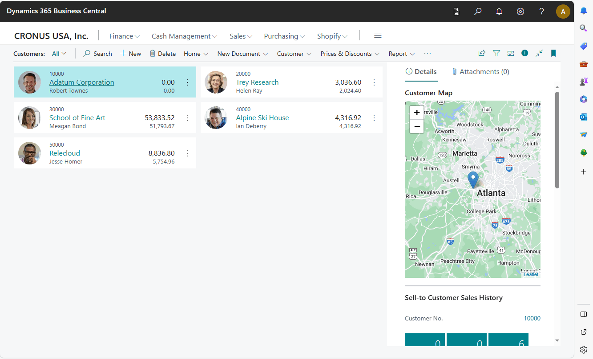
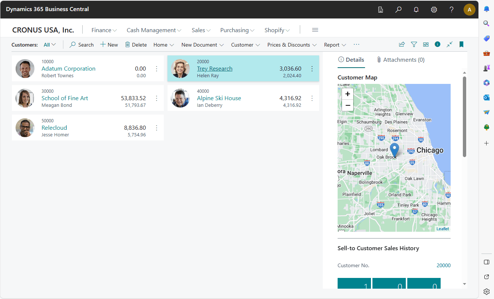
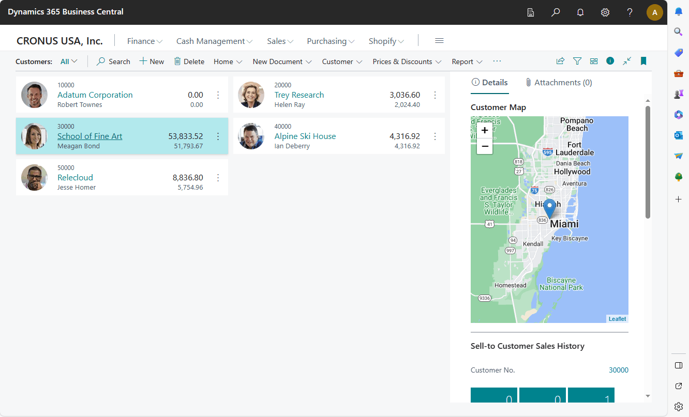
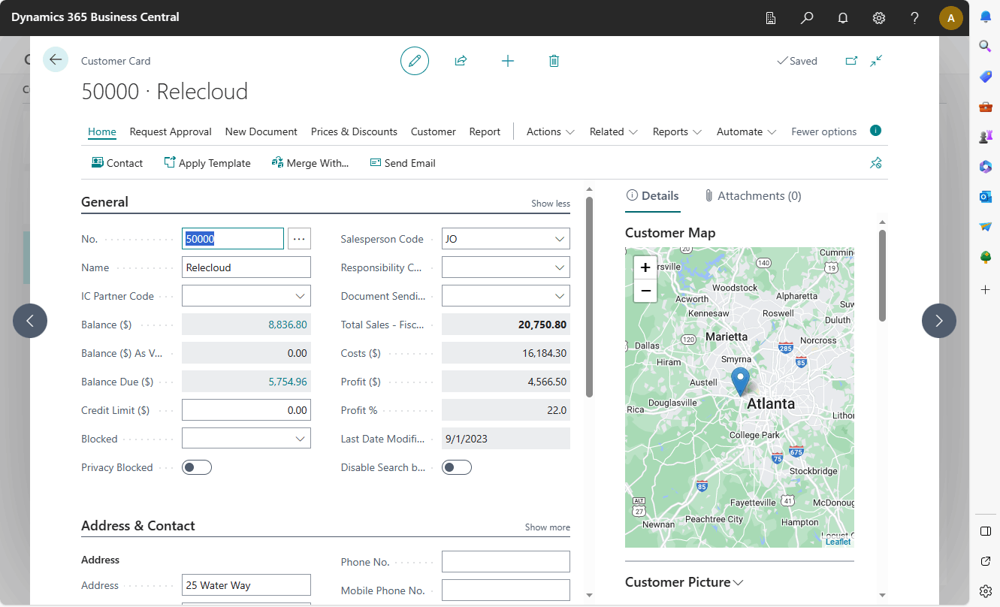
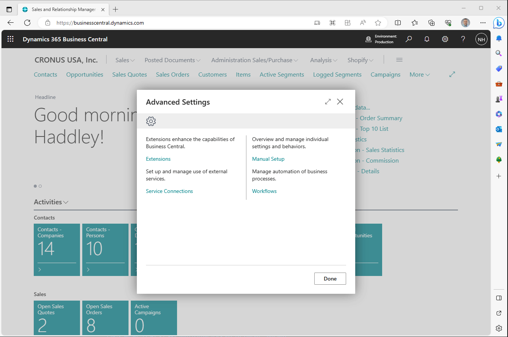
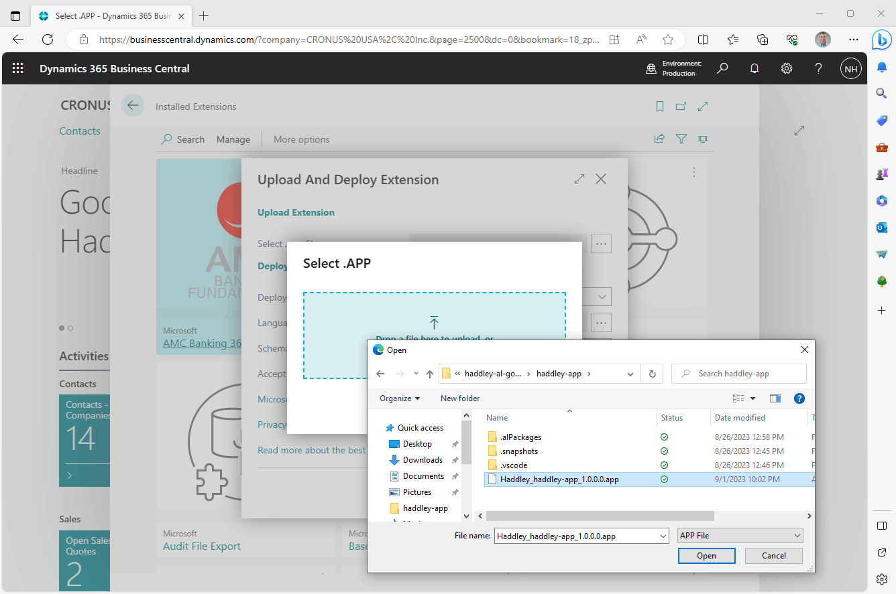
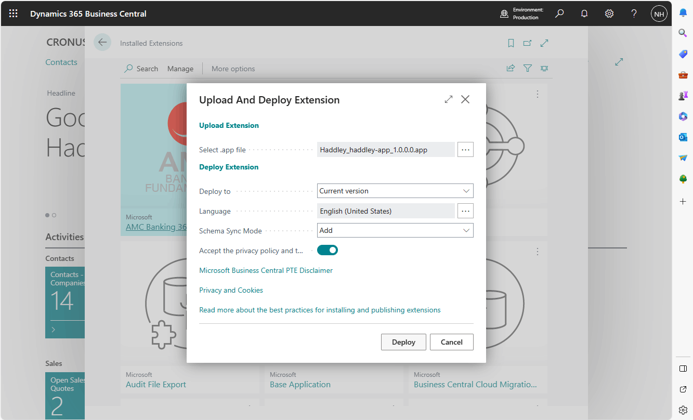
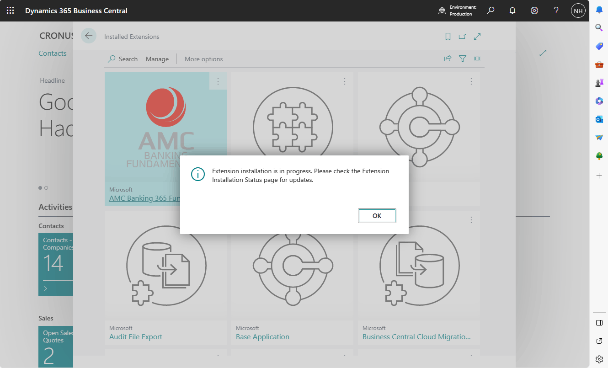
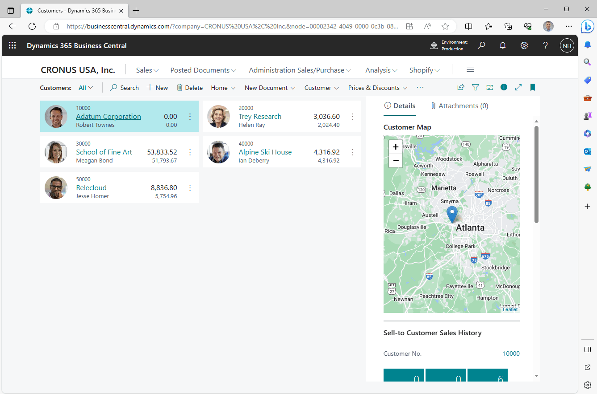

I built a Microsoft Dynamics 365 Business Central Extension that allows users to view Customer locations in a map.

:::brain-power Before you read on
A customer card lists an address, but an address is hard to picture. What would you need to add to the customer pages to show the customer on a map, and where in the page would you put it?
:::


## ChatGPT

**Please explain this Business Central AL code**

The provided Business Central AL (Application Language) code is defining an extension for a Business Central application that adds a Leaflet map visualization to customer-related pages in the application. Let's break down the code step by step:

**Control Add-in Definition (LeafletMapsFactBox):**
This section defines a control add-in named LeafletMapsFactBox. Control add-ins are used to integrate external controls or web content into Business Central pages.

RequestedHeight and MaximumHeight specify the height of the control.
VerticalStretch and VerticalShrink control the vertical resizing behavior.
HorizontalStretch and HorizontalShrink control the horizontal resizing behavior.
Scripts specifies JavaScript files that are needed for the control add-in. It includes two URLs, one for Leaflet.js and another for LeafletMapsFunctions.js.
Stylesheets specifies the CSS styles needed for the control add-in, including the Leaflet CSS.

The ControlReady event is defined, which will be triggered when the control is ready. Additionally, there's a procedure CreateSidebar defined.

**Page 50101 (LeafletMapsCustListFactBoxPart):**
This section defines a page named LeafletMapsCustListFactBoxPart. It is a fact box part that extends the Customer table and is intended to display on a card page.

PageType specifies that this is a card part.
SourceTable specifies that this part is related to the "Customer" table.

In the layout section, it defines a user control (Sidebar) that references the LeafletMapsFactBox control add-in defined earlier. This user control will be placed in the "Content" area of the page.
The OnAfterGetRecord trigger is defined. It is executed after a record is retrieved. It calls the CreateSidebar procedure defined in the LeafletMapsFactBox control add-in, passing the customer's number and city as parameters.

**Page Extension 50102 (LeafletMaps Cust Card):**
This section defines a page extension that extends the "Customer Card" page. It adds a fact box part, LeafletMapsCustListFactBoxPart, to the "Customer Card" page.

It places the fact box part in the "FactBoxes" area.
ApplicationArea specifies that this extension is applicable to all areas.
Caption sets the caption for the fact box part to "Customer Map."
SubPageLink indicates that this fact box is linked to the customer number ("No.").

**Page Extension 50103 (LeafletMaps Cust List):**
This section defines a page extension that extends the "Customer List" page. Similar to the previous extension, it adds the LeafletMapsCustListFactBoxPart fact box part to the "Customer List" page.

It also places the fact box part in the "FactBoxes" area.
ApplicationArea specifies that this extension is applicable to all areas.
Caption sets the caption for the fact box part to "Customer Map."
SubPageLink indicates that this fact box is linked to the customer number ("No.").

In summary, this code extends customer-related pages in a Business Central application to include a fact box displaying a Leaflet map. The map is populated with customer data, and users can interact with it to visualize customer locations. The LeafletMapsFactBox control add-in provides the functionality for rendering the map, and the code specifies when and where this control should be displayed on customer card and list pages.


*I viewed Customer Adatum Corporation based in Atlanta*


*I viewed Customer Trey Research based in Chicago*


*I viewed Customer School of Fine Art based in Miami*


*I viewed Customer Relecloud based in Atlanta*

:::no-dumb-questions
**Q: What is a control add-in?**

A: A way to bring an external control or web content into a Business Central page. The LeafletMapsFactBox add-in loads Leaflet.js and my own LeafletMapsFunctions.js, and it loads the Leaflet style sheet too.

**Q: Why does the map appear on both the Customer Card and the Customer List?**

A: There are two page extensions, one for each page, and each adds the same fact box part. The part is linked to the customer number, so it shows the customer that is selected.
:::

:::under-the-hood How the map gets its data
The fact box part is based on the Customer table. Its OnAfterGetRecord trigger runs after each customer record is read, and it calls the CreateSidebar procedure of the control add-in. The JavaScript then draws the map for that customer, which is why the map moves when I select a different customer.
:::

:::watch-it Check an AI explanation against the code
The explanation of the AL code near the top of this post came from ChatGPT. It is a useful way to read unfamiliar code, but an AI explanation can be wrong, so I compared each part with the code in the post before I relied on it.
:::


## Upload and deploy extension

To upload and deploy the extension to Microsoft Dynamics 365 Business Central, I followed these steps. Extensions in Business Central typically come in the form of [.app](https://haddley.github.io/businesscentral/Haddley_haddley-app_1.0.0.0.app) files or .zip files containing the extension's artifacts and metadata.

I logged in to my Microsoft Dynamics 365 Business Central environment with the appropriate credentials. I navigated to the Extension Management page, found under "Extension Management" or "Extensions." I selected "Upload Extension" to upload the extension package (the .app file) from my local machine. I provided the necessary configuration details and permissions following the on-screen instructions. I clicked "Install" to initiate the installation process and monitored the installation progress. Once the installation was complete, I checked the status of the extension to ensure it was successfully installed and deployed. I then enabled and configured it further, setting up permissions and defining data mappings as needed.


*I opened Advanced Settings*


*I clicked Upload And Deploy Extension*


*I clicked Deploy*


*I confirmed installation was in progress*


*I confirmed the Extension was running in the cloud*

:::test-drive Try it yourself
1. Build the extension, or download the .app file that the reference links to.
2. In Extension Management, choose Upload And Deploy Extension and deploy the file.
3. Open a customer card and look for the Customer Map fact box.
4. Select different customers and watch the map change.
:::

:::bullet-points Recap
- A control add-in lets a Business Central page show a Leaflet map.
- A fact box part, linked to the customer number, is added to both the Customer Card and the Customer List.
- OnAfterGetRecord calls CreateSidebar so that the map follows the selected customer.
- I uploaded and deployed the extension from the Extension Management page.
:::


## LeafletMapsExtension.al

```al
controladdin LeafletMapsFactBox
{
    RequestedHeight = 400;
    MaximumHeight = 600;
    VerticalStretch = false;
    VerticalShrink = false;
    HorizontalStretch = true;
    HorizontalShrink = true;
    Scripts = 'https://unpkg.com/leaflet@1.7.1/dist/leaflet.js', 'LeafletMapsFunctions.js';
    Stylesheets = 'https://unpkg.com/leaflet@1.7.1/dist/leaflet.css';


    event ControlReady()
    procedure CreateSidebar(no: Text; city: Text);
}


page 50101 LeafletMapsCustListFactBoxPart
{
    PageType = CardPart;
    SourceTable = "Customer";


    layout
    {
        area(Content)
        {
            usercontrol(Sidebar; LeafletMapsFactBox)
            {
                ApplicationArea = All;
            }
        }
    }


    trigger OnAfterGetRecord()
    begin
        CurrPage.Sidebar.CreateSidebar(rec."No.", rec.City);
    end;
}


pageextension 50102 "LeafletMaps Cust Card" extends "Customer Card"
{
    layout
    {
        addfirst(FactBoxes)
        {
            part(LeafletMapsCustListFactBoxPart; LeafletMapsCustListFactBoxPart)
            {
                ApplicationArea = All; //Basic, Suite;// all;
                Caption = 'Customer Map';
                SubPageLink = "No." = FIELD("No.");


            }
        }
    }


}


pageextension 50103 "LeafletMaps Cust List" extends "Customer List"
{


    layout
    {
        addfirst(FactBoxes)
        {
            part(LeafletMapsCustListFactBoxPart; LeafletMapsCustListFactBoxPart)
            {
                ApplicationArea = all;
                caption = 'Customer Map';
                SubPageLink = "No." = FIELD("No.");
            }
        }


    }


}
```

## LeafletMapsFunctions.js

```javascript
function CreateSidebar(no, city) {
    debugger;
    var __div = document.getElementById('controlAddIn');


    // clear contents of controlAddIn div
    __div.innerHTML = '';


    // create the map div
    var __innerDiv = document.createElement("div");
    __innerDiv.id = 'map';
    __innerDiv.style = 'height: 100vh'


    // add the map div to the controlAddIn div
    __div.appendChild(__innerDiv);


    // get latitude and longitude position for this city
    var location = GetCityLocation(city)


    // What map zoom level should we use?
    var zoomLevel = 9;


    // create the Leaflet Map
    var map = L.map('map').setView(location, zoomLevel);


    // add a tile layer
    L.tileLayer('//services.arcgisonline.com/ArcGIS/rest/services/World_Imagery/MapServer/tile/{z}/{y}/{x}.jpg').addTo(map);


    // add a marker
    var newMarker = new L.marker(location).addTo(map);


    Microsoft.Dynamics.NAV.InvokeExtensibilityMethod("ControlReady");


}


function GetCityLocation(city) {
    if (city == "Atlanta")
        return [33.7674828, -84.5025308]


    if (city == "Miami")
        return [25.782479, -80.2706579]


    if (city == "Chicago")
        return [41.833871, -87.8967688]


    // else return London's location
    return [51.505, -0.09]
}
```

## References

- [Map Extension](https://haddley.github.io/businesscentral/Haddley_haddley-app_1.0.0.0.app)
