I built a Business Central Copilot using the PromptDialog page type, which allows users to provide prompts, generate AI responses, review and regenerate outputs, and then save or discard the result.

:::brain-power Before you read on
A Copilot page needs somewhere to type a request, somewhere to show the answer, and a way to try again or keep the result. What buttons would you put on it?
:::

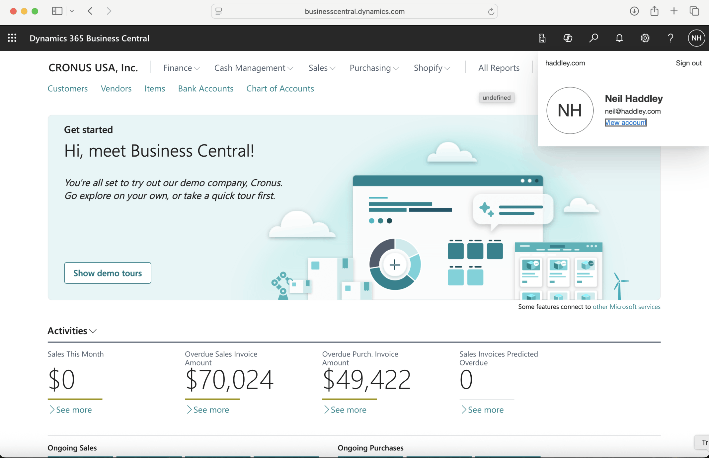
*I navigated to Business Central https://businesscentral.dynamics.com*

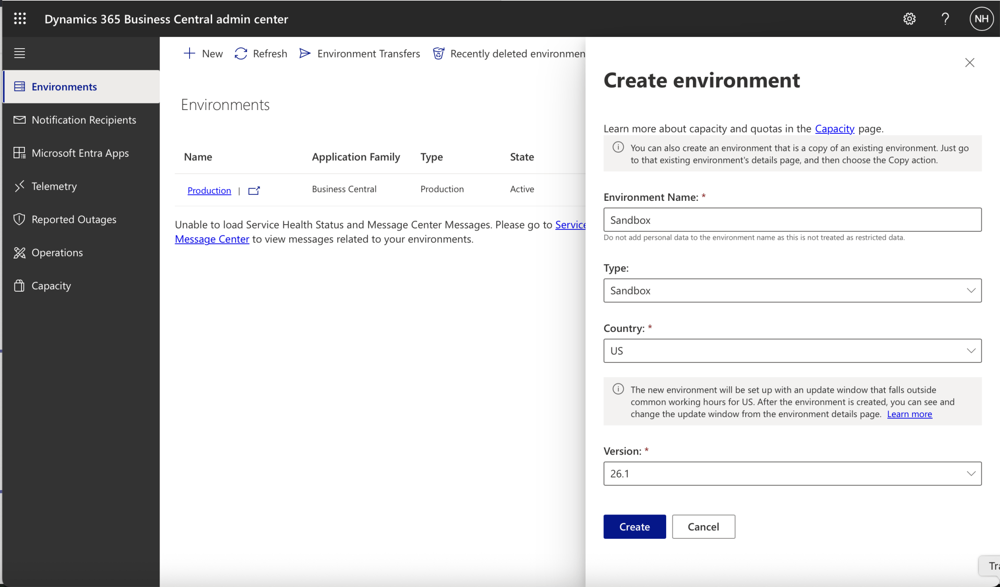
*I created a Sandbox Environment*

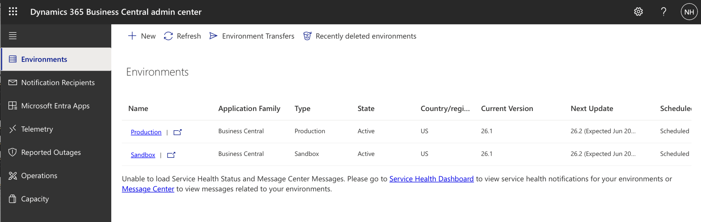
*The Sandbox Environment state updated to Active*

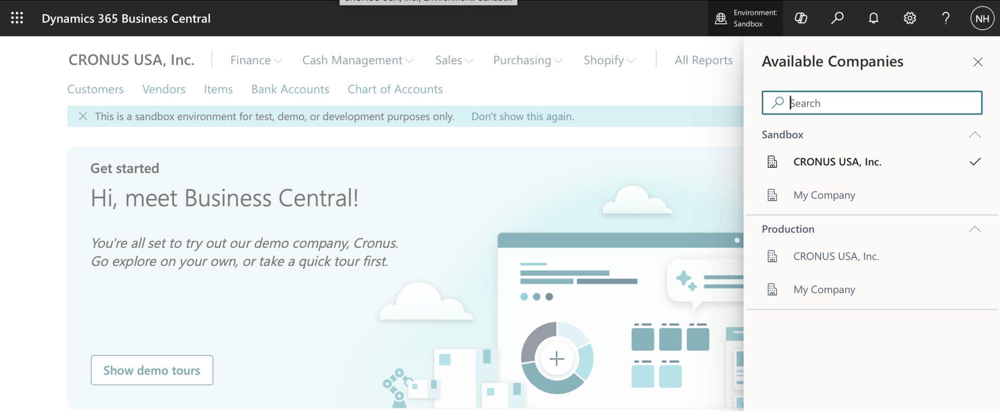
*I switched to the CRONUS company in the Sandbox Environment*

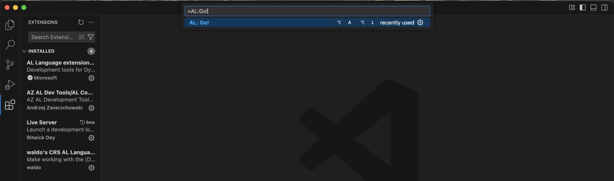
*In Visual Studio Code I selected the View | Command Palette menu item and entered Al:Go!*

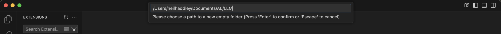
*I entered the Project/Extension name LLM*

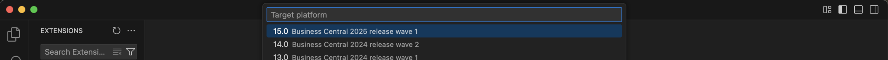
*I selected the latest Business Central version*

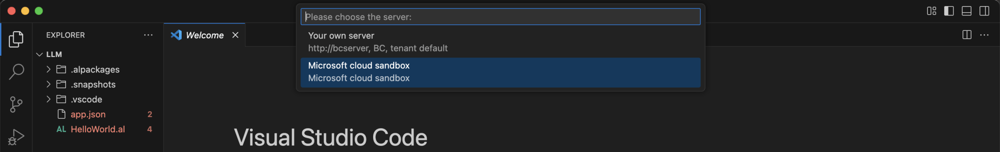
*I selected the Microsoft cloud sandbox option*

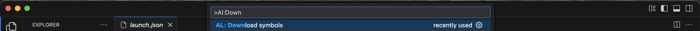
*I used the View | Command Palette menu item and entered Al:Download symbols*

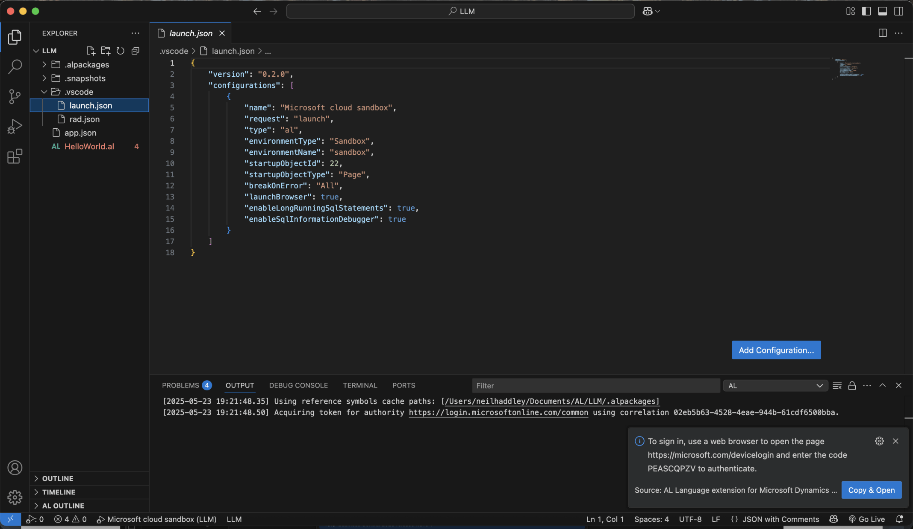
*I clicked the Copy & Open button*

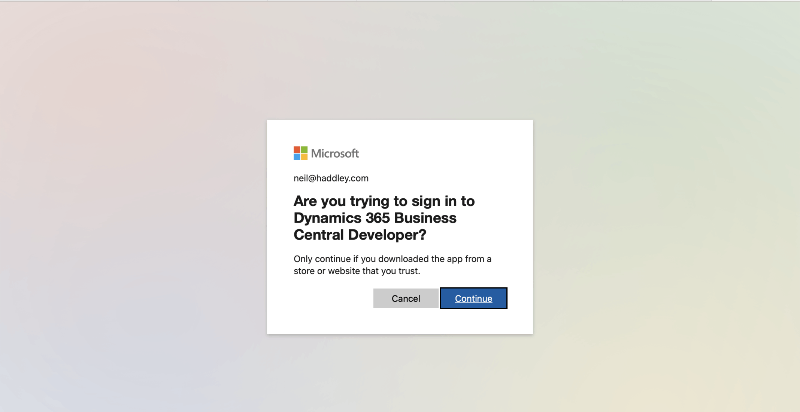
*I clicked Continue*

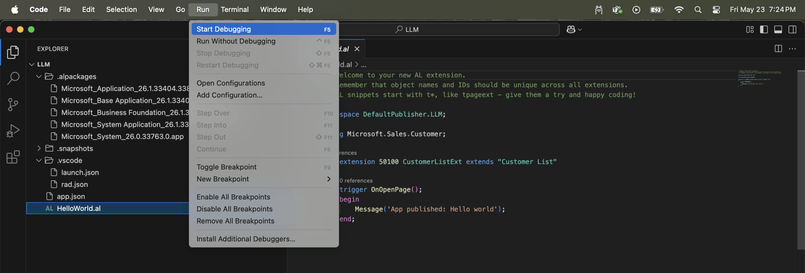
*I clicked the Start Debugging menu item*

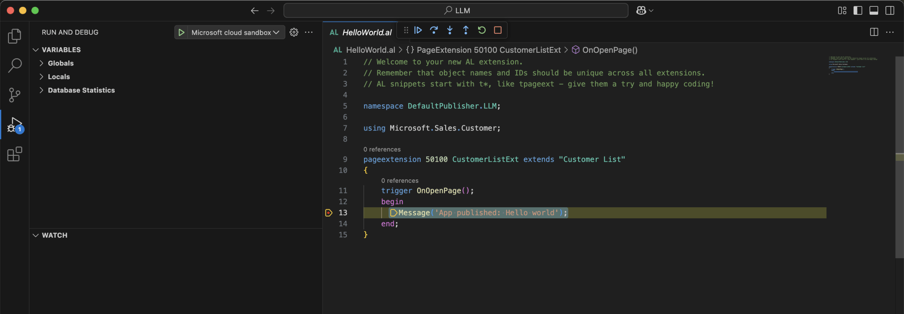
*The Debugger stopped on the Message statement. I clicked Continue*

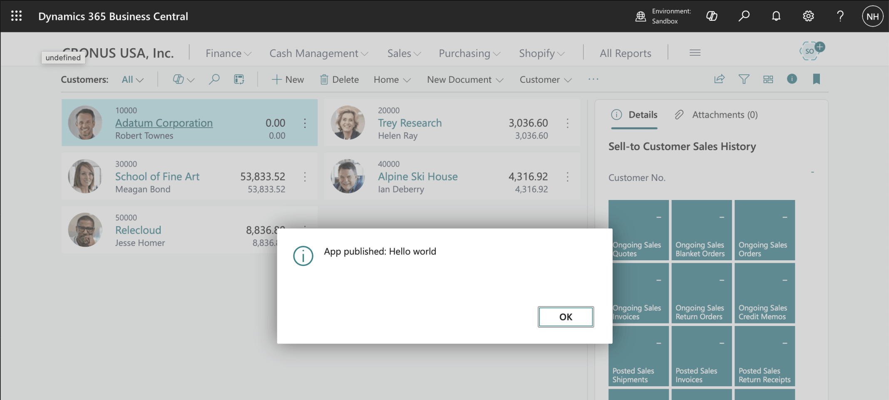
*The Message was displayed on the Business Central page*

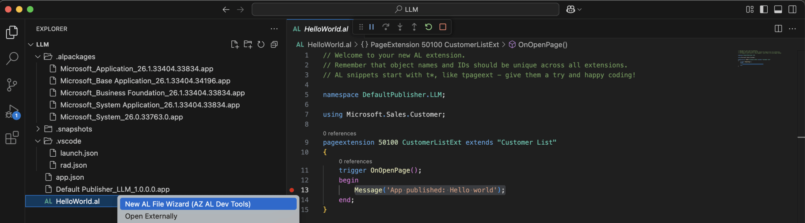
*I selected the New AL File Wizard right click menu item*

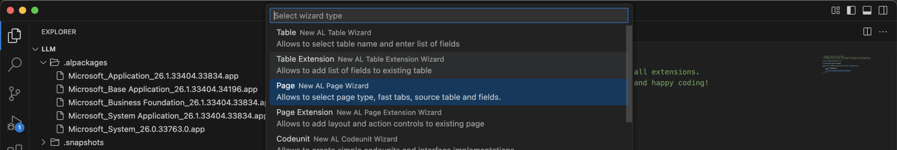
*I selected Page*

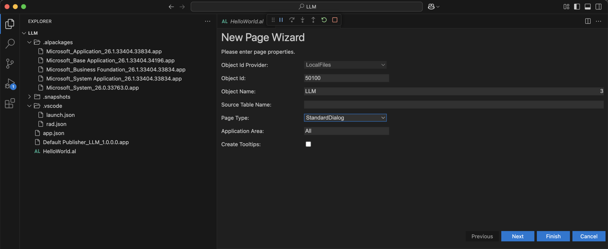
*I accepted the Object Id 50100 and entered the page name LLM*

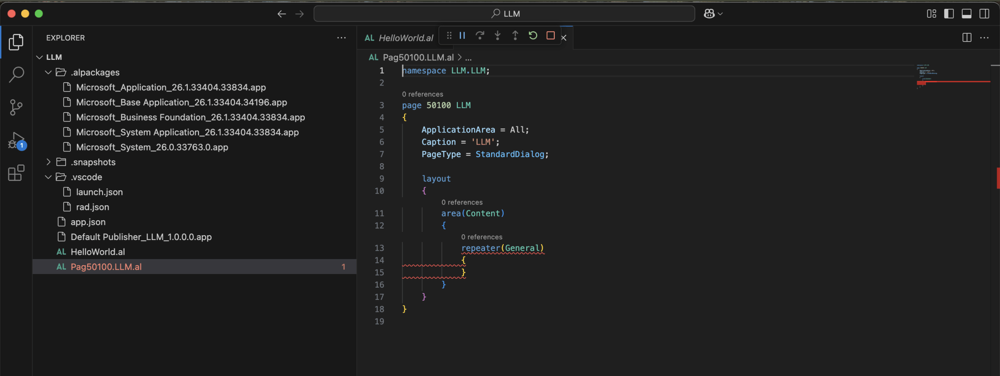
*A page was generated*

:::no-dumb-questions
**Q: What is a PromptDialog page?**

A: A page type for Copilot experiences. It has a prompt area for the user's request, a content area for the output, and system actions such as Generate, Regenerate, OK and Cancel.

**Q: What is the prompt guide?**

A: A set of ready-made prompts. My page has one action, Capital City, which fills the prompt with What is the Capital of the country that I choose. The user then edits the text.
:::

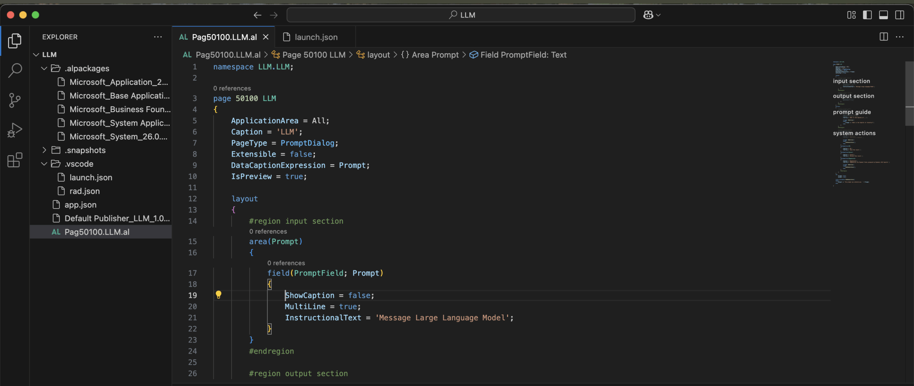
*I updated the generated page with Prompt Dialog specific AL code*

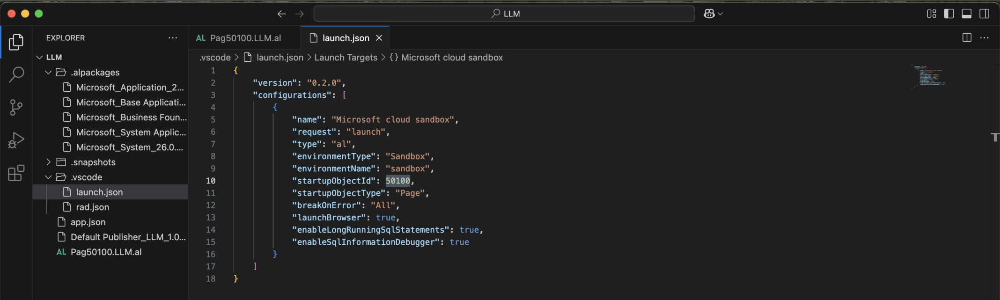
*I updated the startupObjectId. I clicked Run | Start Debugging*

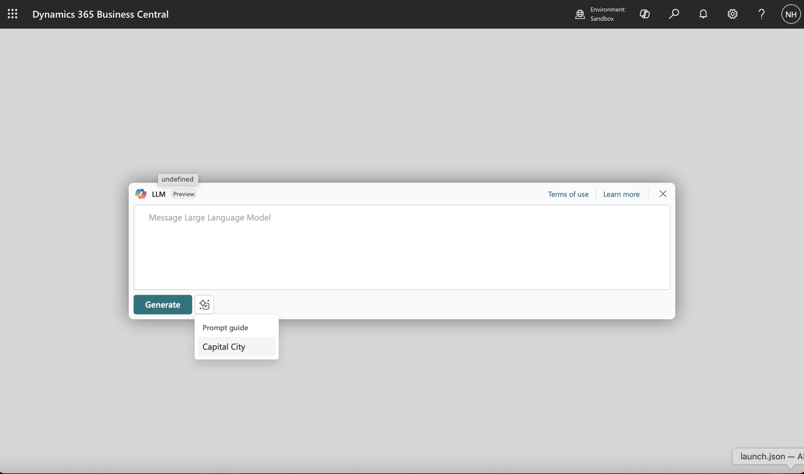
*The Prompt Dialog page was displayed. I selected the Capital City item from the Prompt guide*

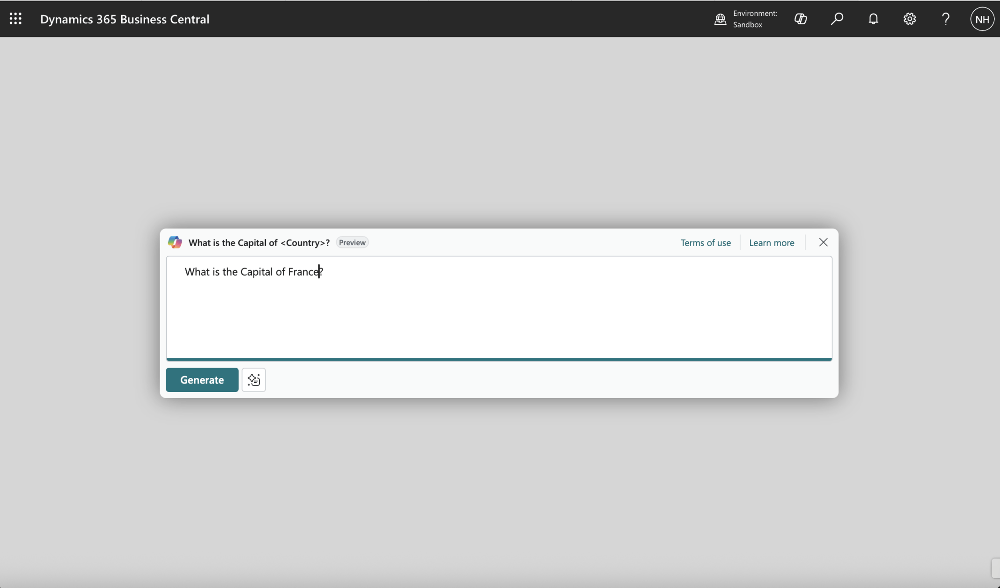
*I updated the text to What is the Capital of France? and clicked the Generate button*

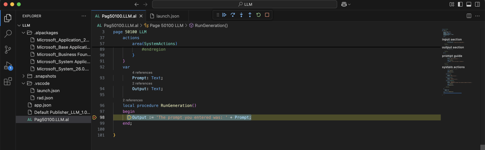
*The RunGeneration procedure was executed. This code updated the Output variable/field based on the Prompt*

:::under-the-hood Why this is a good first step
Both the Generate and the Regenerate actions call the same RunGeneration procedure. That means the page, its buttons and the OK and Cancel handling all work before any AI is involved. When I swap the body of RunGeneration for a real model call, nothing else on the page has to change.
:::

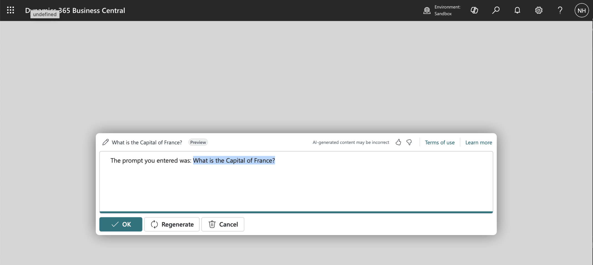
*The generated response was displayed*

:::pencil What will the answer be?
In this part, RunGeneration does not call a language model. Read the procedure in the code below. I typed What is the Capital of France? and clicked Generate. What text do you expect in the output?

:::answer
The output is "The prompt you entered was: What is the Capital of France?". The procedure only joins a fixed sentence to the prompt, so it echoes the question. [Part 2](/posts/promptdialog2/) replaces it with a call to Azure OpenAI.
:::
:::


## Pag50100.LLM.al

```al
namespace LLM.LLM;

page 50100 LLM
{
    ApplicationArea = All;
    Caption = 'LLM';
    PageType = PromptDialog;
    Extensible = false;
    DataCaptionExpression = Prompt;
    IsPreview = true;

    layout
    {
        #region input section
        area(Prompt)
        {
            field(PromptField; Prompt)
            {
                ShowCaption = false;
                MultiLine = true;
                InstructionalText = 'Message Large Language Model';
            }
        }
        #endregion

        #region output section
        area(Content)
        {
            field(OutputFiled; Output)
            {
                ShowCaption=false;
                MultiLine = true;
            }
        }
        #endregion
    }
    actions
    {
        #region prompt guide
        area(PromptGuide)
        {
            action("Capital City")
            {
                ApplicationArea = All;
                Caption = 'Capital City';
                ToolTip = 'What is the Capital of ...';

                trigger OnAction()
                begin
                    Prompt := 'What is the Capital of <Country>?';
                end;
            }
        }
        #endregion

        #region system actions
        area(SystemActions)
        {
            systemaction(Generate)
            {
                Caption = 'Generate';
                ToolTip = 'Generate a response.';

                trigger OnAction()
                begin
                    RunGeneration();
                end;
            }
            systemaction(OK)
            {
                Caption = 'OK';
                ToolTip = 'Save the result.';
            }
            systemaction(Cancel)
            {
                Caption = 'Cancel';
                ToolTip = 'Discard the result.';
            }
            systemaction(Regenerate)
            {
                Caption = 'Regenerate';
                ToolTip = 'Regenerate a response.';

                trigger OnAction()
                begin
                    RunGeneration();
                end;
            }
            #endregion
        }
    }
    var
        Prompt: Text;
        Output: Text;

    local procedure RunGeneration()
    begin
        Output := 'The prompt you entered was: ' + Prompt;
    end;

}
```

:::test-drive Try it yourself
1. Create the LLM page, and set it as the startup object.
2. Choose the Capital City prompt guide item, change the country, and click Generate.
3. Click Regenerate, and then OK or Cancel, and notice what each one does.
:::

:::bullet-points Recap
- A PromptDialog page gives a Copilot experience a prompt area, an output area and system actions.
- The prompt guide offers starter prompts, and Generate and Regenerate call RunGeneration.
- In Part 1 RunGeneration only echoes the prompt, so that the page works before any model is connected.
:::
