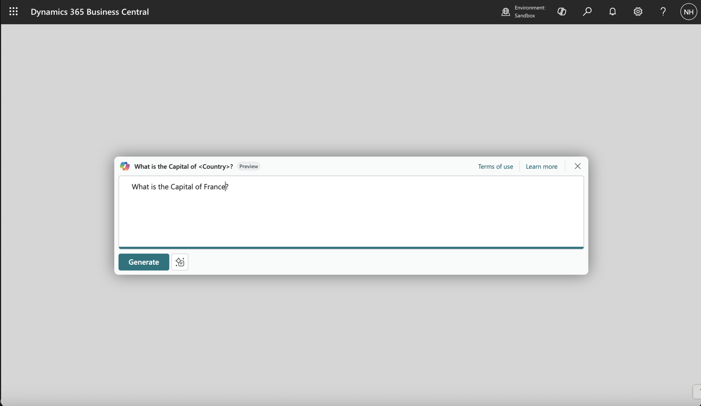
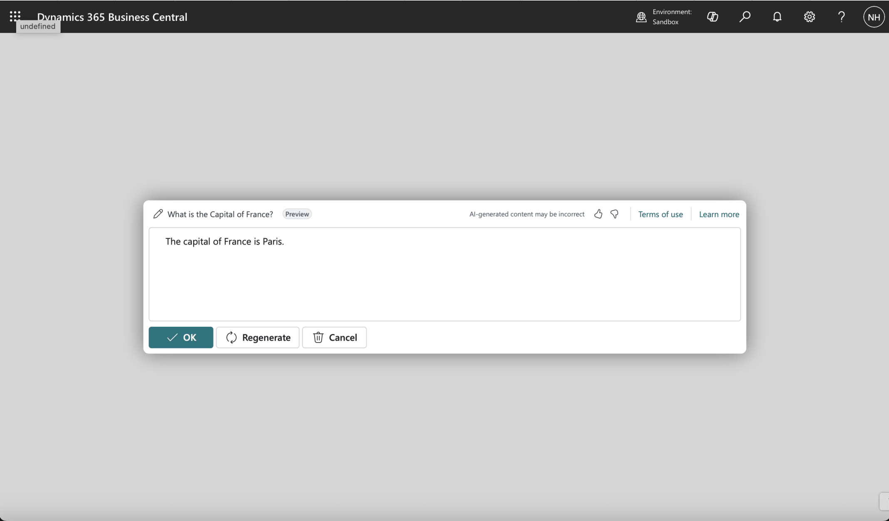
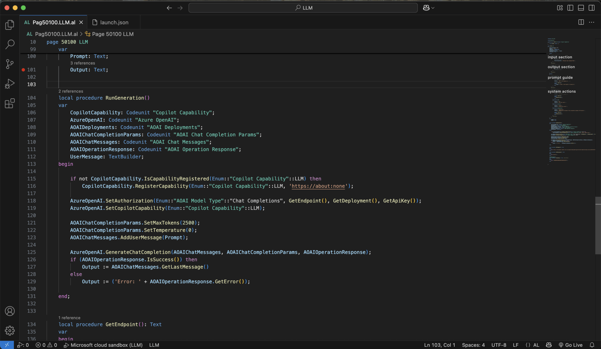
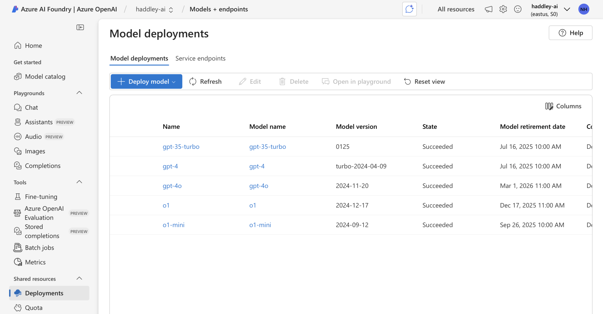
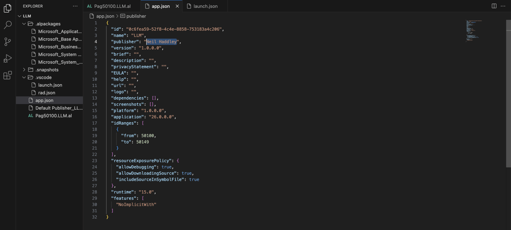
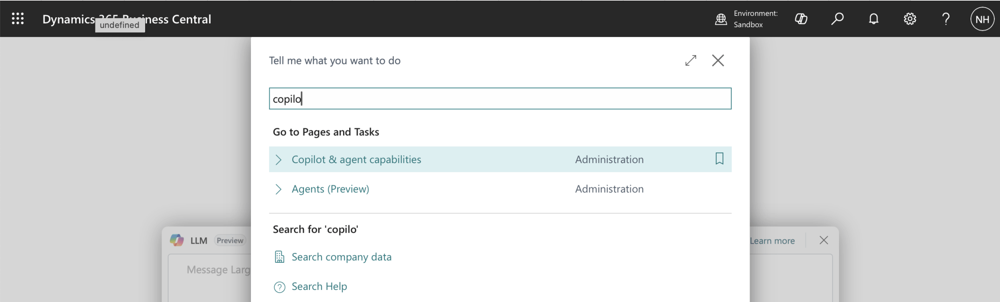
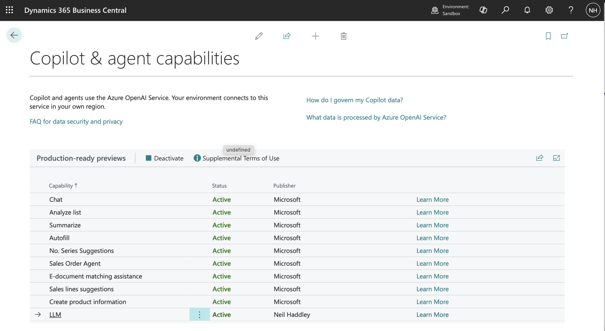

I connected the Business Central PromptDialog to Azure OpenAI, so the Copilot generates real AI responses rather than static text. The RunGeneration procedure calls Azure OpenAI's chat completions API and returns the model's output to the Output field.

:::brain-power Before you read on
The page from Part 1 echoes whatever the user types. To make it answer, the extension has to reach a language model. What would the extension need to know to do that, and where should that information be kept?
:::


*I updated the LLM Prompt Dialog page*


*Output is generated by a Large Language Model and returned to the user*


*I updated the RunGeneration procedure*

:::under-the-hood What RunGeneration does now
If the capability is not yet registered, the procedure registers it. It then sets the authorization with the endpoint, the deployment name and the API key, tells the Azure OpenAI codeunit which Copilot capability this is, and calls GenerateChatCompletion with the user's prompt. The model's answer is returned to the Output field.
:::

:::watch-it Do not hard-code a real key
The GetApiKey procedure in the code returns a fixed string, and it is marked NonDebuggable. The string in the post is a placeholder, and a real key does not belong in source code, because anyone who can read the extension can read the key. Keep real keys and endpoints in a protected store, such as Isolated Storage or a key vault, and read them at run time.
:::



*For more detail please see* [this blog page](/posts/azureopenal/).


*I updated the "publisher" property*


*I found the Copilot & agent capabilities page in Business Central*


*The LLM Capability appeared in the list*

:::no-dumb-questions
**Q: What is a Copilot capability?**

A: A registered entry that tells Business Central which Copilot features an extension offers. I registered an LLM capability, and it appeared on the Copilot and agent capabilities page, where an administrator can see it.

**Q: Which Azure OpenAI details does the code need?**

A: An endpoint, a deployment name and an API key. The code sets them with SetAuthorization. My deployment is gpt-4o, and the [Azure OpenAI post](/posts/azureopenal/) shows how I created it.
:::

:::test-drive Try it yourself
1. Create an Azure OpenAI deployment, and put its endpoint and deployment name into the code.
2. Run the extension and use the LLM page to ask a real question.
3. Open the Copilot and agent capabilities page and find your LLM capability.
:::

:::bullet-points Recap
- RunGeneration now calls Azure OpenAI's chat completions, so the Copilot gives real answers.
- The extension registers a Copilot capability, and it appears on the Copilot and agent capabilities page.
- The endpoint, deployment and key are set with SetAuthorization, and a real key must not live in the code.
:::


## Pag50100.LLM.al updated

```al
namespace LLM.LLM;

using System.AI;

enumextension 50100 LLM extends "Copilot Capability"
{
    value(50100; "LLM") { }
}

page 50100 LLM
{
    ApplicationArea = All;
    Caption = 'LLM';
    PageType = PromptDialog;
    Extensible = false;
    DataCaptionExpression = Prompt;
    IsPreview = true;

    layout
    {
        #region input section
        area(Prompt)
        {
            field(PromptField; Prompt)
            {
                ShowCaption = false;
                MultiLine = true;
                InstructionalText = 'Message Large Language Model';
            }
        }
        #endregion

        #region output section
        area(Content)
        {
            field(OutputFiled; Output)
            {
                ShowCaption = false;
                MultiLine = true;
            }
        }
        #endregion
    }
    actions
    {
        #region prompt guide
        area(PromptGuide)
        {
            action("Capital City")
            {
                ApplicationArea = All;
                Caption = 'Capital City';
                ToolTip = 'What is the Capital of ...';

                trigger OnAction()
                begin
                    Prompt := 'What is the Capital of <Country>?';
                end;
            }
        }
        #endregion

        #region system actions
        area(SystemActions)
        {
            systemaction(Generate)
            {
                Caption = 'Generate';
                ToolTip = 'Generate a response.';

                trigger OnAction()
                begin
                    RunGeneration();
                end;
            }
            systemaction(OK)
            {
                Caption = 'OK';
                ToolTip = 'Save the result.';
            }
            systemaction(Cancel)
            {
                Caption = 'Cancel';
                ToolTip = 'Discard the result.';
            }
            systemaction(Regenerate)
            {
                Caption = 'Regenerate';
                ToolTip = 'Regenerate a response.';

                trigger OnAction()
                begin
                    RunGeneration();
                end;
            }
            #endregion
        }
    }
    var
        Prompt: Text;
        Output: Text;


    local procedure RunGeneration()
    var
        CopilotCapability: Codeunit "Copilot Capability";
        AzureOpenAI: Codeunit "Azure OpenAI";
        AOAIDeployments: Codeunit "AOAI Deployments";
        AOAIChatCompletionParams: Codeunit "AOAI Chat Completion Params";
        AOAIChatMessages: Codeunit "AOAI Chat Messages";
        AOAIOperationResponse: Codeunit "AOAI Operation Response";
        UserMessage: TextBuilder;
    begin

        if not CopilotCapability.IsCapabilityRegistered(Enum::"Copilot Capability"::LLM) then
            CopilotCapability.RegisterCapability(Enum::"Copilot Capability"::LLM, 'https://about:none');

        AzureOpenAI.SetAuthorization(Enum::"AOAI Model Type"::"Chat Completions", GetEndpoint(), GetDeployment(), GetApiKey());
        AzureOpenAI.SetCopilotCapability(Enum::"Copilot Capability"::LLM);

        AOAIChatCompletionParams.SetMaxTokens(2500);
        AOAIChatCompletionParams.SetTemperature(0);
        AOAIChatMessages.AddUserMessage(Prompt);

        AzureOpenAI.GenerateChatCompletion(AOAIChatMessages, AOAIChatCompletionParams, AOAIOperationResponse);
        if (AOAIOperationResponse.IsSuccess()) then
            Output := AOAIChatMessages.GetLastMessage()
        else
            Output := ('Error: ' + AOAIOperationResponse.GetError());

    end;


    local procedure GetEndpoint(): Text
    var
    begin
        exit('https://haddley-ai.openai.azure.com');
    end;

    local procedure GetDeployment(): Text
    var
    begin
        exit('gpt-4o');
    end;

    [NonDebuggable]
    local procedure GetApiKey(): Text //SecretText
    var
    begin
        exit('12345678901234567890123456789012');
    end;


}
```
