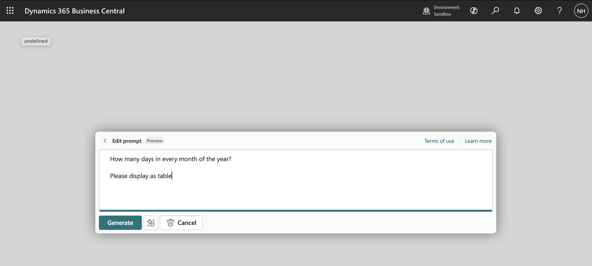
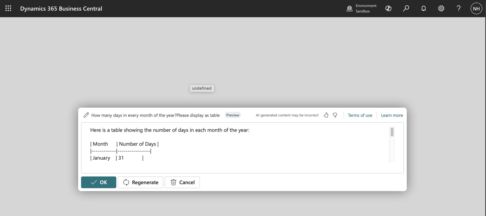
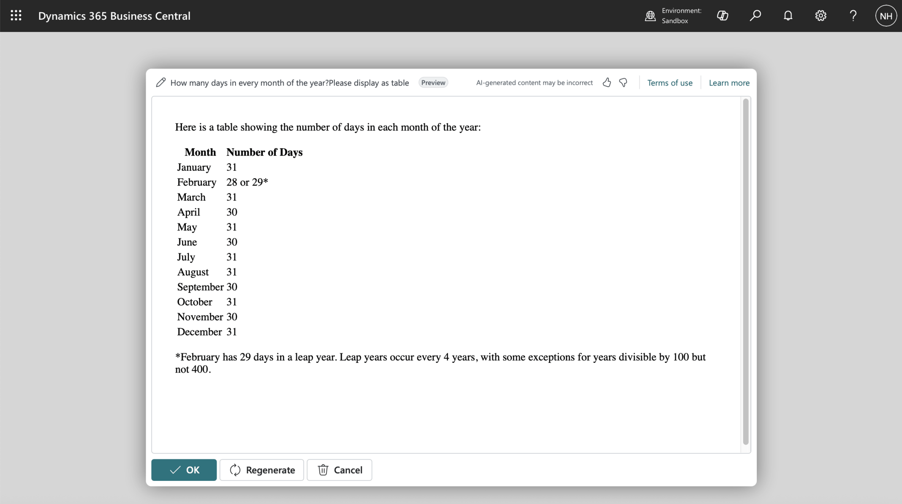
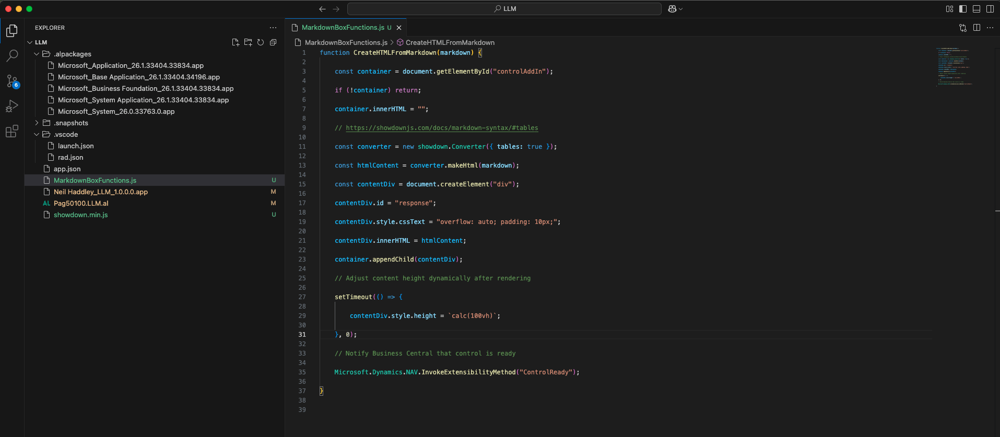
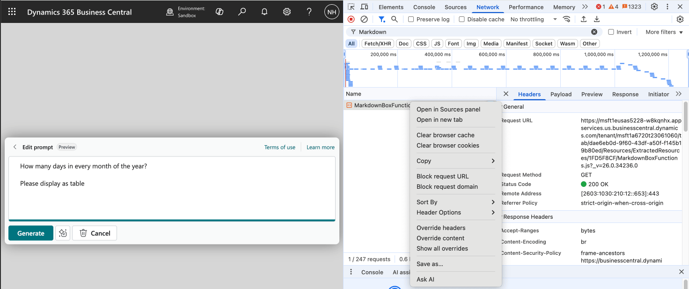
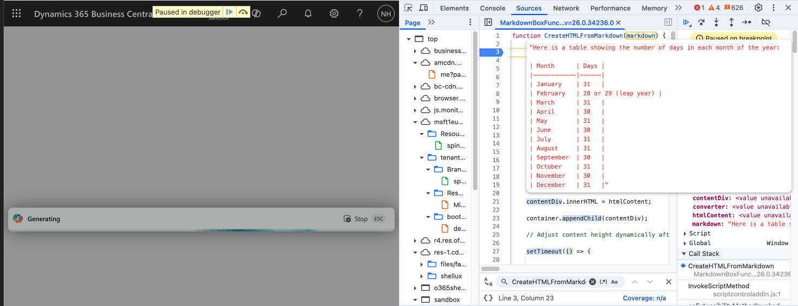

I extended the PromptDialog to render Markdown-formatted LLM responses as HTML. Because LLMs typically return Markdown, displaying the raw text was hard to read. I added a `controladdin` that uses the ShowdownJS library to convert Markdown to HTML and inject it into the page.

:::brain-power Before you read on
A language model often answers with Markdown: headings, bullets, tables and bold text. What would a user see if the page showed that text as it is, and what would you need to do to show it properly?
:::


*I provided a prompt that would return a Markdown formatted response*


*The Markdown formatted result was hard to read*

:::no-dumb-questions
**Q: What is a control add-in, and why did I need one?**

A: A way to run JavaScript and HTML inside a Business Central page. A text field shows raw text, so I added a control add-in called MarkdownBox to show the answer as formatted HTML instead.

**Q: What is ShowdownJS?**

A: A JavaScript library that converts Markdown into HTML. The add-in loads showdown.min.js and my MarkdownBoxFunctions.js, and I turned on its table support.
:::


*I added a controladdin to the PromptDialog*


*The CreateHTMLFromMarkdown JavaScript function is the key move*

:::under-the-hood What CreateHTMLFromMarkdown does
The function finds the control add-in's container and clears it. It then creates a Showdown converter with tables switched on, converts the Markdown to HTML, and puts the HTML into the page with innerHTML. The page calls the function whenever a new answer arrives.
:::

:::watch-it The HTML comes from a model
The function sets innerHTML from text that a language model wrote. If a model can be influenced by what it reads, it could produce markup that you do not want on the page. Think about whether the output should be sanitized before it is displayed, especially if the prompt can include text from other people.
:::


*I opened the file in the Sources panel*


*Debugging the JavaScript*


## MarkdownBoxFunctions.js

```javascript
function CreateHTMLFromMarkdown(markdown) {

    const container = document.getElementById("controlAddIn");

    if (!container) return;

    container.innerHTML = "";

    // https://showdownjs.com/docs/markdown-syntax/#tables

    const converter = new showdown.Converter({ tables: true });

    const htmlContent = converter.makeHtml(markdown);

    const contentDiv = document.createElement("div");

    contentDiv.id = "response";

    contentDiv.style.cssText = "overflow: auto; padding: 10px;";

    contentDiv.innerHTML = htmlContent;

    container.appendChild(contentDiv);

    // Adjust content height dynamically after rendering

    setTimeout(() => {

        contentDiv.style.height = `calc(100vh)`;

    }, 0);

    // Notify Business Central that control is ready

    Microsoft.Dynamics.NAV.InvokeExtensibilityMethod("ControlReady");

}
```

## Pag50100.LLM.al

```al
namespace LLM.LLM;

using System.AI;

controladdin MarkdownBox
{
    RequestedHeight = 500;
    MaximumHeight = 700;
    VerticalStretch = false;
    VerticalShrink = false;
    HorizontalStretch = true;
    HorizontalShrink = true;
    Scripts = 'showdown.min.js', 'MarkdownBoxFunctions.js';
    // ShowdownJS v 2.0 is released under the MIT license. Previous versions are released under BSD. https://github.com/showdownjs/showdown

    event ControlReady()
    procedure CreateHTMLFromMarkdown(markdown: Text);
}

enumextension 50100 LLM extends "Copilot Capability"
{
    value(50100; "LLM") { }
}

page 50100 LLM
{
    ApplicationArea = All;
    Caption = 'LLM';
    PageType = PromptDialog;
    Extensible = false;
    DataCaptionExpression = Prompt;
    IsPreview = true;


    layout
    {
        #region input section
        area(Prompt)
        {
            field(PromptField; Prompt)
            {
                ShowCaption = false;
                MultiLine = true;
                InstructionalText = 'Message Large Language Model';
            }
        }
        #endregion

        #region output section
        area(Content)
        {
            usercontrol(Formatted; MarkdownBox)
            {
                ApplicationArea = All;
            }
            
            /*field(OutputFiled; Output)
            {
                ShowCaption = false;
                MultiLine = true;
            }*/
        }
        #endregion
    }
    actions
    {
        #region prompt guide
        area(PromptGuide)
        {
            action("Capital City")
            {
                ApplicationArea = All;
                Caption = 'Capital City';
                ToolTip = 'What is the Capital of ...';

                trigger OnAction()
                begin
                    Prompt := 'What is the Capital of <Country>?';
                end;
            }
        }
        #endregion

        #region system actions
        area(SystemActions)
        {
            systemaction(Generate)
            {
                Caption = 'Generate';
                ToolTip = 'Generate a response.';

                trigger OnAction()
                begin
                    RunGeneration();
                    CurrPage.Formatted.CreateHTMLFromMarkdown(Output);
                end;
            }
            systemaction(OK)
            {
                Caption = 'OK';
                ToolTip = 'Save the result.';
            }
            systemaction(Cancel)
            {
                Caption = 'Cancel';
                ToolTip = 'Discard the result.';
            }
            systemaction(Regenerate)
            {
                Caption = 'Regenerate';
                ToolTip = 'Regenerate a response.';

                trigger OnAction()
                begin
                    RunGeneration();
                    CurrPage.Formatted.CreateHTMLFromMarkdown(Output);
                end;
            }
            #endregion
        }
    }
    var
        Prompt: Text;
        Output: Text;


    local procedure RunGeneration()
    var
        CopilotCapability: Codeunit "Copilot Capability";
        AzureOpenAI: Codeunit "Azure OpenAI";
        AOAIDeployments: Codeunit "AOAI Deployments";
        AOAIChatCompletionParams: Codeunit "AOAI Chat Completion Params";
        AOAIChatMessages: Codeunit "AOAI Chat Messages";
        AOAIOperationResponse: Codeunit "AOAI Operation Response";
        UserMessage: TextBuilder;
    begin

        // CopilotCapability.UnregisterCapability(Enum::"Copilot Capability"::LLM);

        if not CopilotCapability.IsCapabilityRegistered(Enum::"Copilot Capability"::LLM) then
            CopilotCapability.RegisterCapability(Enum::"Copilot Capability"::LLM, 'https://about:none');

        AzureOpenAI.SetAuthorization(Enum::"AOAI Model Type"::"Chat Completions", GetEndpoint(), GetDeployment(), GetApiKey());
        AzureOpenAI.SetCopilotCapability(Enum::"Copilot Capability"::LLM);


        AOAIChatCompletionParams.SetMaxTokens(2500);
        AOAIChatCompletionParams.SetTemperature(0);
        AOAIChatMessages.AddUserMessage(Prompt);

        AzureOpenAI.GenerateChatCompletion(AOAIChatMessages, AOAIChatCompletionParams, AOAIOperationResponse);
        if (AOAIOperationResponse.IsSuccess()) then
            Output := AOAIChatMessages.GetLastMessage()
            
        else
            Output := ('Error: ' + AOAIOperationResponse.GetError());

    end;


    local procedure GetEndpoint(): Text
    var
    begin
        exit('https://haddley-ai.openai.azure.com');
    end;

    local procedure GetDeployment(): Text
    var
    begin
        exit('gpt-4o');
    end;

    [NonDebuggable]
    local procedure GetApiKey(): Text //SecretText
    var
    begin
        exit('1234567890123456789012');
    end;
}
```

:::test-drive Try it yourself
1. Ask a prompt that returns a table or a list, and look at it without the add-in.
2. Add the MarkdownBox control add-in, and ask again.
3. Open the JavaScript in the browser's Sources panel and set a breakpoint in CreateHTMLFromMarkdown.
:::

:::bullet-points Recap
- Language models usually answer in Markdown, which is hard to read as plain text.
- A control add-in with ShowdownJS converts the Markdown to HTML.
- CreateHTMLFromMarkdown clears the container, converts, and sets the HTML.
- Output from a model should be treated with care before it is put on a page.
:::
