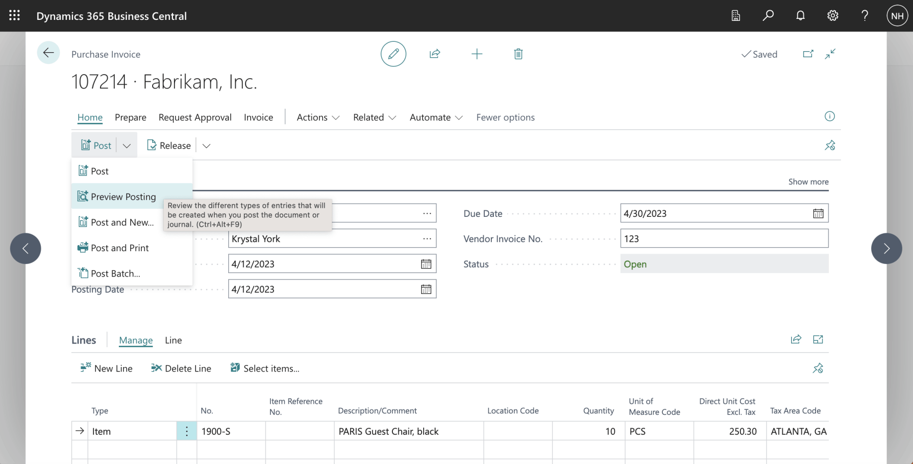
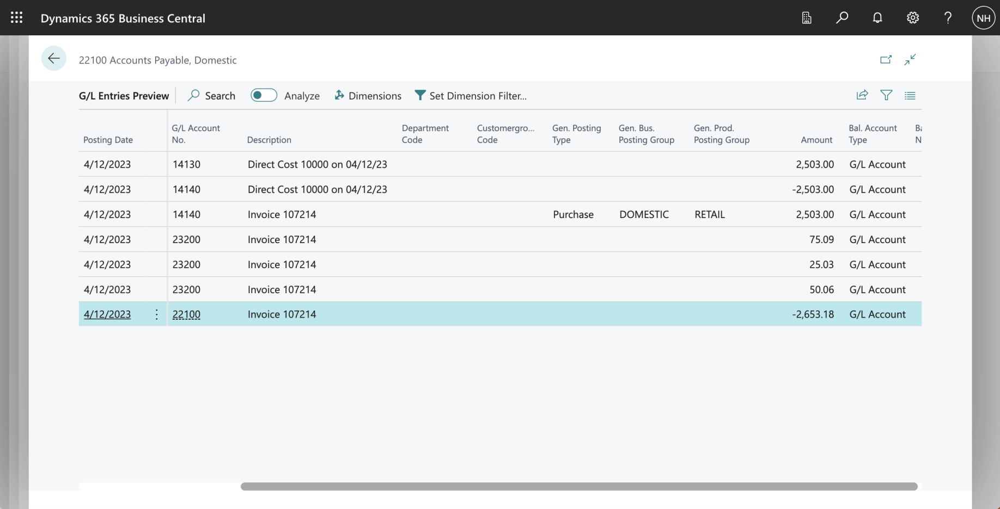
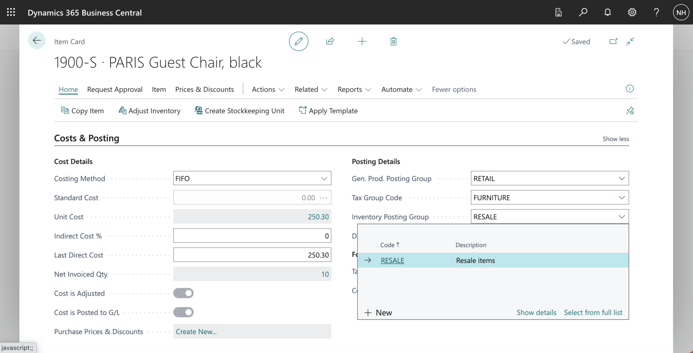
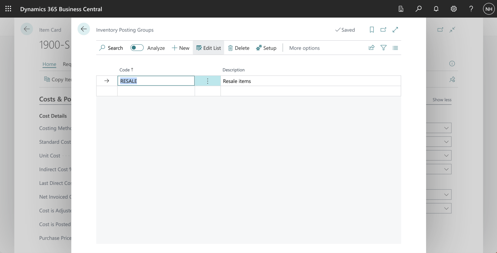
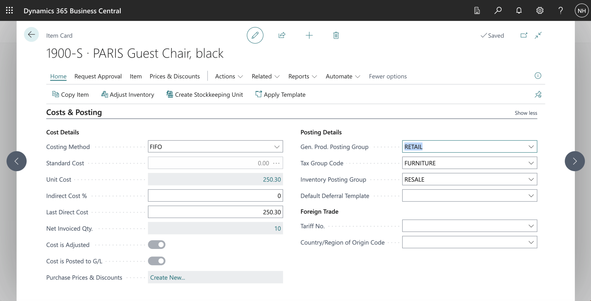
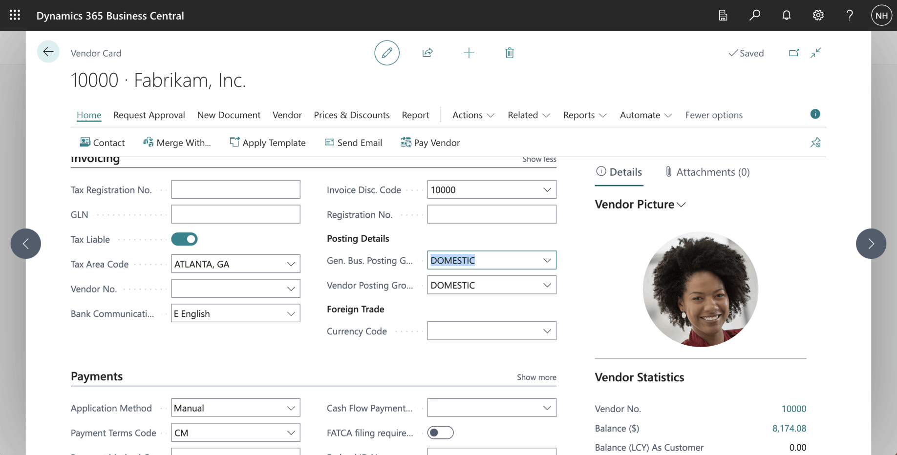
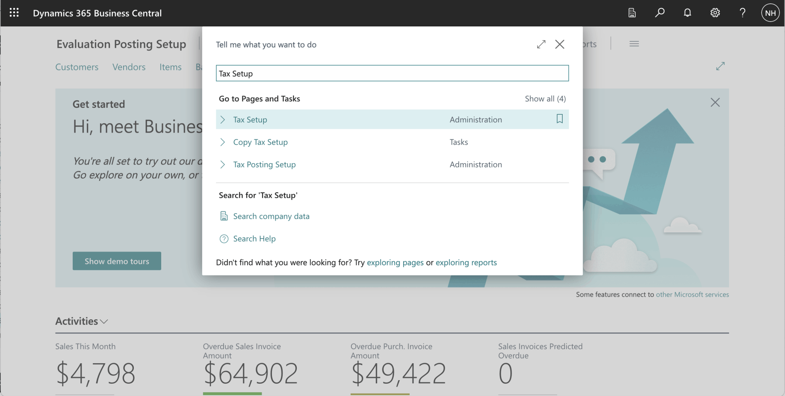
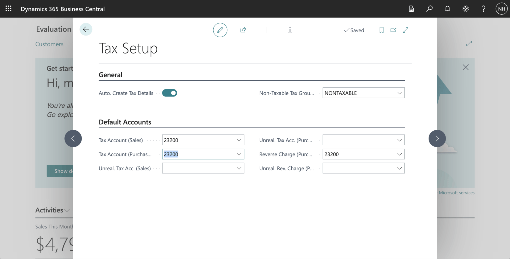
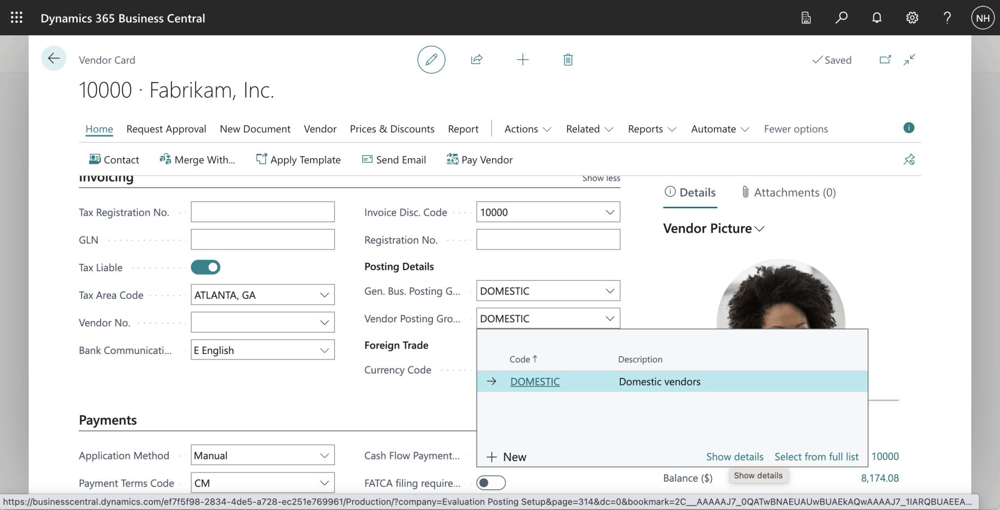
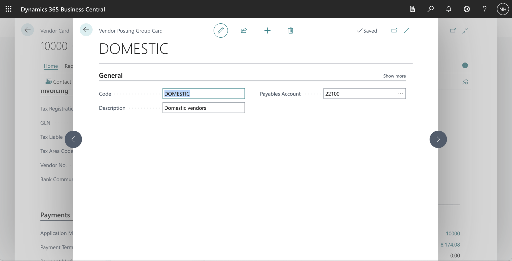

I traced how Business Central determines the Inventory, Purchase, Tax, and Payables accounts for a Purchase Invoice, using the Inventory Posting Group, General Product Posting Group, General Business Posting Group, General Posting Setup, Tax Setup, and Vendor Posting Group.

:::brain-power Before you read on
A purchase invoice touches several accounts: the stock, the purchase itself, the tax and the money owed. How would software know which account to use for each of them?
:::

*I purchased a RETAIL RESALE item from a DOMESTIC vendor.*

*I reviewed the General Ledger entries generated from the Purchase Invoice Document*

*The Item we are purchasing is a "RESALE" item. I clicked the Show details link.*

*RESALE is an Inventory Posting Group. I clicked on the Setup button.*

*When purchasing a RESALE item, the system uses account 14130 Finished Goods as the Inventory Account.*

*The Item we are purchasing is a "RETAIL" item.*

*The Vendor we are buying from is a "DOMESTIC" vendor.*

*When buying a RETAIL item from a DOMESTIC vendor, the system uses the 14140 Goods for Resale account to record the purchase*

*I used search to navigate to the Tax Setup page*

*When buying any item from any vendor, the system uses the 23200 Taxes Liable account to record City, County, and State tax.*

*The Vendor is a "DOMESTIC" vendor. I clicked the show details link*

*When purchasing from a DOMESTIC vendor, the system uses 22100 Accounts Payable, Domestic as the Payables Account*

:::no-dumb-questions
**Q: Which setups decide the accounts?**

A: Four of them in this post. The item's Inventory Posting Group gives the inventory account, the General Posting Setup gives the purchase account, the Tax Setup gives the tax account, and the Vendor Posting Group gives the payables account.

**Q: What are RESALE, RETAIL and DOMESTIC?**

A: RESALE is the item's Inventory Posting Group, RETAIL is its product posting group, and DOMESTIC is the vendor's group. The pair RETAIL and DOMESTIC selects the purchase account.
:::

:::pencil Trace the four accounts
I purchased a RETAIL RESALE item from a DOMESTIC vendor. Which account would you expect for the inventory, for the purchase, for the tax, and for the amount owed to the vendor?

:::answer
Inventory goes to 14130 Finished Goods, the purchase goes to 14140 Goods for Resale, the tax goes to 23200 Taxes Liable, and the amount owed goes to 22100 Accounts Payable, Domestic.
:::
:::

:::test-drive Try it yourself
1. Post a purchase invoice for an item with a known Inventory Posting Group and vendor.
2. Open the general ledger entries, and note each account.
3. Find the setup page that supplies each account, as in this post.
:::

:::bullet-points Recap
- The Inventory Posting Group supplies the inventory account.
- General Posting Setup, using the product and business groups, supplies the purchase account.
- Tax Setup supplies the tax account, and the Vendor Posting Group supplies the payables account.
:::
