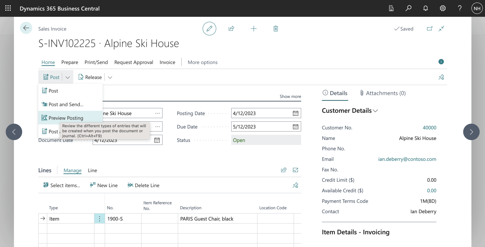
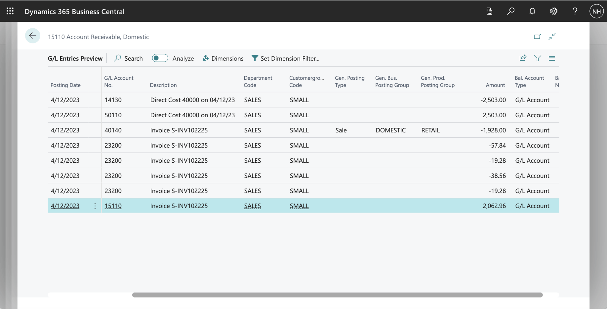
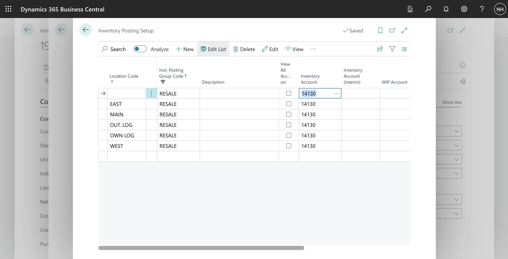
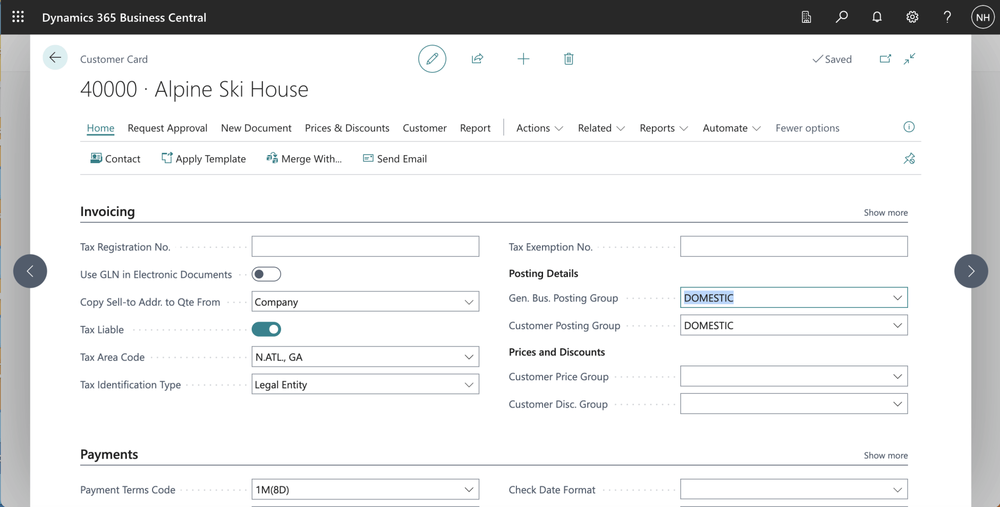
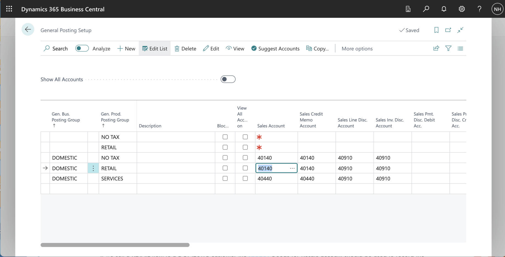
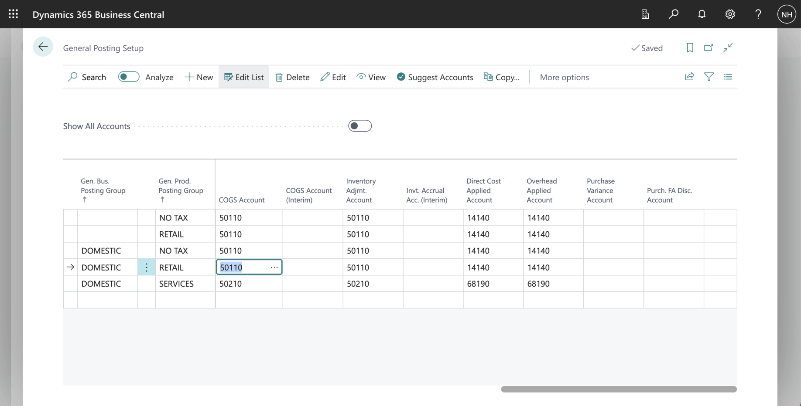
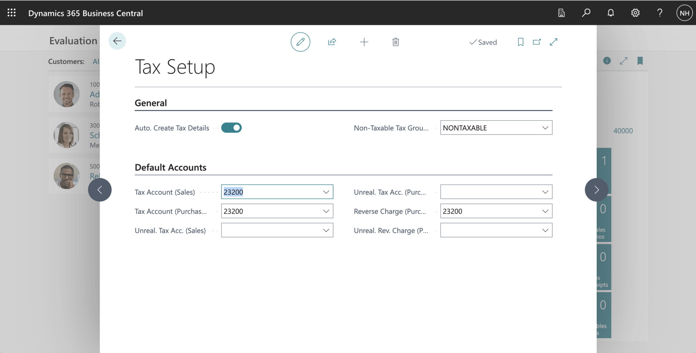
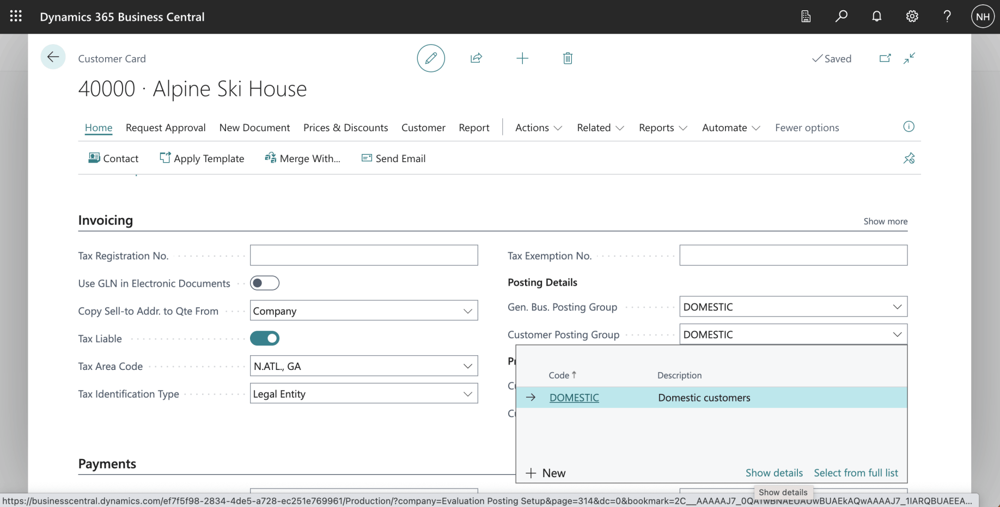
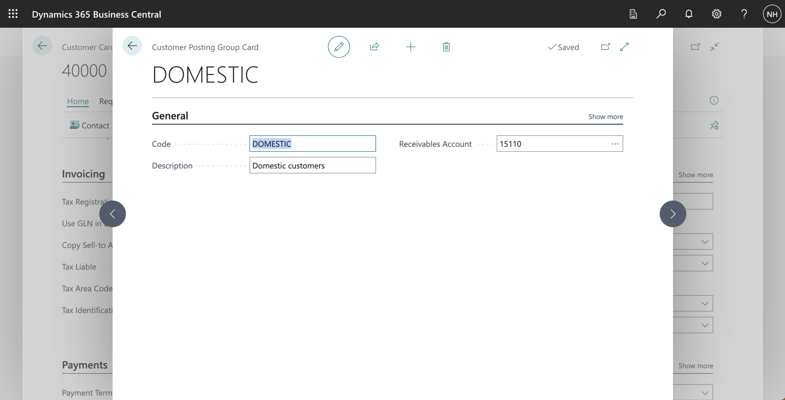

I traced how Business Central determines the Inventory, Sale, Tax, and Receivables accounts for a Sales Invoice, using the Inventory Posting Group, General Product Posting Group, General Business Posting Group, General Posting Setup, Tax Setup, and Customer Posting Group.

:::brain-power Before you read on
A sales invoice moves stock out, records a sale and its cost, adds tax, and creates a debt that the customer owes. How would software know which account to use for each of those?
:::

*I sold a RETAIL RESALE item to a DOMESTIC customer.*

*I reviewed the entries generated from the Sales Invoice Document*

*The Item we are selling is a "RESALE" item. I clicked the Show details link.*

*RESALE is an Inventory Posting Group. I clicked on the Setup button.*

*When selling a RESALE item, the system uses account 14130 Finished Goods as the Inventory Account.*

*The item I sold is a "RETAIL" item.*

*The customer I sold to was a "DOMESTIC" customer.*

*When selling a RETAIL item to a DOMESTIC customer, the system uses the 41040 Resale of Goods account to record the sale*

*When selling a RETAIL item to a DOMESTIC customer, the system uses the 50110 Cost of Materials account to record the cost of goods sold.*

*I used search to navigate to the Tax Setup page*

*When selling any item to any customer, the system uses the 23200 Taxes Liable account to record City, County, and State tax.*

*The Customer is a "DOMESTIC" customer. I clicked the show details link*

*When selling to a DOMESTIC customer, the system uses 15110 Accounts Receivable, Domestic as the Receivables Account*

:::no-dumb-questions
**Q: Which setups decide the accounts?**

A: Four of them in this post. The item's Inventory Posting Group gives the inventory account, the General Posting Setup gives the sales and cost of goods sold accounts, the Tax Setup gives the tax account, and the Customer Posting Group gives the receivables account.

**Q: What are RESALE, RETAIL and DOMESTIC?**

A: RESALE is the item's Inventory Posting Group, RETAIL is its product posting group, and DOMESTIC is the customer's group. The pair RETAIL and DOMESTIC selects the sales and cost accounts.
:::

:::pencil Trace the five accounts
I sold a RETAIL RESALE item to a DOMESTIC customer. Which accounts would you expect for the inventory, the sale, the cost of goods sold, the tax and the amount that the customer owes?

:::answer
Inventory is 14130 Finished Goods, the sale is 41040 Resale of Goods, the cost of goods sold is 50110 Cost of Materials, the tax is 23200 Taxes Liable, and the amount owed is 15110 Accounts Receivable, Domestic.
:::
:::

:::test-drive Try it yourself
1. Post a sales invoice for an item with a known Inventory Posting Group.
2. Open the general ledger entries, and note each account.
3. Find the setup page that supplies each account, as in this post.
:::

:::bullet-points Recap
- The Inventory Posting Group supplies the inventory account.
- General Posting Setup supplies the sales and cost of goods sold accounts.
- Tax Setup supplies the tax account, and the Customer Posting Group supplies the receivables account.
:::
