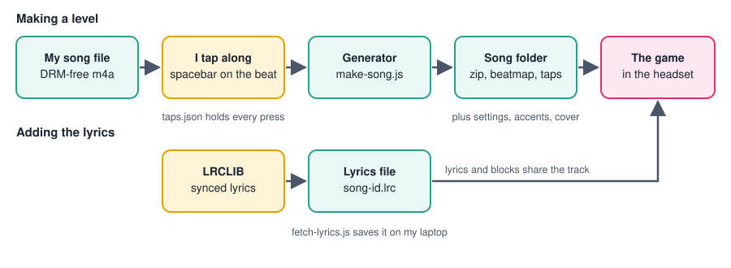
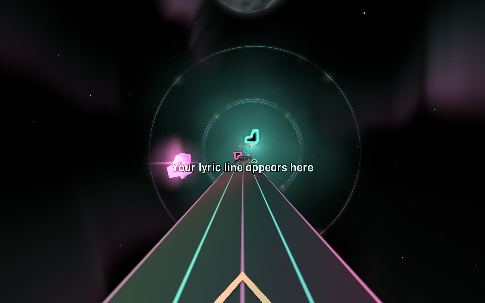

I wanted to play my own music in VR. Not a catalogue of community levels, but the songs I actually own: a track from a cast recording, a Sting song, a Teddy Swims song. I also wanted the words on screen, like a karaoke machine, while I slice blocks to the beat.

I call the result SingSaber. This post tells the story of mashing it up with Claude Code on top of an open-source WebXR game. It covers how a song becomes a challenge, what the files on disk look like, and the many things that went wrong on the way.


*The finished game, with a placeholder where my lyric line appears: the song clock in yellow, and blocks flying toward me*

## What I built

I turned a browser VR rhythm game ([Moon Rider](https://moonrider.xyz)) into a personal jukebox. I pick a song from my iTunes music library, and within minutes I am slicing blocks to its beat while the lyrics sit on the track like a karaoke screen. My version adds three things to the original game:

- **A local song library**, so the game plays songs from my laptop instead of a community catalogue.
- **A level generator** that turns a DRM-free track into a playable level with Easy and Normal difficulties.
- **Synced karaoke lyrics** that share the play space with the blocks, with an optional song clock.

Three songs from my own library have made it through so far: Sting's *Desert Rose*, the *It Works* cast recording from the Back to the Future musical, and Teddy Swims' *Lose Control*.


*I opened the song list and my own songs appear at the top, ahead of the community songs*

## The game underneath

The game is [Moon Rider](https://github.com/supermedium/moonrider) by Supermedium, an open-source, Beat Saber-style game built with A-Frame and WebXR. It runs in a headset's web browser with nothing to install, and its code is published under the MIT licence. I first wrote about it in my [WebVR](/posts/webvr/) post, where I ran it in the Oculus Quest 2 browser. By default it downloads community levels from a public catalogue.

I made a private copy of the project, started a development server on my laptop, and opened the webpage page in the headset's browser over my home network. Everything in this post is changes to that private copy.

## Why any song is the hard part

:::brain-power Before you read on
A Beat Saber level is a list of blocks, each with a time, a lane and a swing direction, and people place every one by hand. If I want a level for a song nobody has mapped, what has to take the human's place?
:::

The songs I wanted were not in the community catalogue, so I had to generate the levels. It took several attempts to learn what a good level actually is:

| Attempt | What happened |
| --- | --- |
| Put a block on each strong hit the audio analysis finds | Terrible. Blocks fell on loud events, not on a rhythm I could swing to. |
| Track the beat and snap every block to it | A little better. The blocks sat on the beat, but there was no sense of structure. |
| Split bass and melody between the hands, pick lanes from pitch, thin out the quiet parts | More varied and more playable, but still not right. |
| Hunt for the song's ticking clock in the audio | Failed. The tick sits under drums and vocals, and every spacing I found was a multiple of the beat. |
| **Tap along with the spacebar** | It worked. |

This is how I described the problem to Claude Code after the third attempt:

```PROMPT
It Works "beats" are still terrible (a little better? but still terrible gameplay)
```

*It Works* opens with a ticking clock that drives the whole song. I could hear it clearly, and the analysis could not find it:

```PROMPT
There is literally a tick-tock metronome track on this song. You are missing it. Please try again.
```

Claude Code searched for periodic clicks in several frequency bands and in sliding windows across the song. Nothing stable came back, so it asked me for the one thing it could not measure for itself:

```PROMPT
from the start "tick tock tick tock tick tock tick tock..."
```

## What finally worked: tapping the pulse

Claude Code wrote a small tool that plays the song and records every key press. I press the spacebar on each tick, for about twenty-five seconds:

```bash
node scripts/tap-ticks.js --id itworks --seconds 25
node scripts/make-song.js --id itworks
```

The generator turns my taps into an exact, steady grid of beats. Two details make that work:

- **My taps are late.** I press the key about 0.19 seconds after the sound, which is ordinary reaction time. The generator measures that delay by lining the grid up with the audio, then removes it.
- **Everything else sits on the grid.** The blocks land exactly on the beats I tapped, the two hands alternate, and the loudness of the song decides where the blocks rest.

For *It Works*, 56 taps gave a tick every 0.4196 seconds, which is 143 ticks per minute. For *Desert Rose* I tapped the whole song, 242 taps, and the generator built Easy and Normal from them.


*I opened my taps (left) next to an early version of the Easy beatmap the generator produced (right) in VS Code*

The two files are linked by one conversion. My taps are in seconds, and the beatmap measures time in beats, so `_time` is the tap time multiplied by the tempo and divided by 60. At 112.2 beats per minute, my tap at 5.63 seconds became a block at `_time` 10.528, which is what the screenshot shows. I later removed my reaction delay of 0.19 seconds, so the current file starts at `_time` 10.173, which is 5.44 seconds.

### Why a tapped map feels right

I had expected the analysis to beat my ear. Instead my taps felt right and my own generated maps did not, so I asked Claude Code to measure why:

```PROMPT
I am really pretty happy with the beats generated for Easy. Please review the song and taps again to try to understand why I am happy and you are not.
```

The measurements explained it:

- The strongest repeating pulse in *Desert Rose* is every two beats, exactly where I tapped. The single-beat pulse that the beat tracker had chosen is weaker.
- Once the delay was removed, my taps sat 15 milliseconds from the audio's beats.
- Each hand stays on the same beat of the bar for the whole song: blue on beat 1 and red on beat 3.
- The sixteen-second gap I left was a steady stretch of the song that I chose to rest, not a place with missing rhythm.
- I tapped the kick on beat 1 and the quiet beat 3. The loud snares on beats 2 and 4 fall between my blocks, so the song answers each swing.


*The loud snares fall between my taps*

:::no-dumb-questions
**Q: Why not just tap on the snare?**
A: I could, and the map would be fine. I tapped the kick and the quiet beat because that gave blocks a steady, comfortable spacing, and I liked playing it. The measurements describe what I tapped. They do not say it is the only right choice.
:::

### Turning what I learned into a draft generator

Claude Code wrote the measurements into rules, so a song without any taps still gets a first draft:

1. Pick the pulse where the music repeats strongly, preferring a spacing near one second.
2. Find the downbeat from the kick drum.
3. Lock each hand to the same place in the bar.

I asked it to make the tapped approach the normal way to create beats:

```PROMPT
What have we learned? Write it up. The button-pressing approach just seems to work really well. Set this as a normal way of creating beats for new songs?
```

Run on *Desert Rose* without my taps, the draft put a note within 100 milliseconds of 237 of my 238 Easy notes, and gave every one of them the same hand that I had.

### When the tempo changes

A steady grid fails when the song does not stay steady. *It Works* slows right down in the middle and speeds up for a big finish. The generator can find where the grid stops matching the music, which was 113 seconds in. It also writes a click track, a copy of the song with a click on every block, so I could hear the problem for myself.

I tried a tempo tracker. It reported 144, 72, 96, 73 and 123 beats per minute through the song, because the music keeps its pulse but flips between half-time and a dotted feel. So I took a simpler route:

- The generator detects where the grid stops matching, and after that places blocks on the real onsets.
- I can mark a stretch with no blocks at all.
- I can tap a later steady section separately, as I did for the finish.


*How a song flows from my music library into the game*

## What is in a song folder

Every song is a folder under `assets/songs`, and its lyrics are a single file under `assets/lyrics`. I wanted the format to be readable, because I edit these files by hand when something sounds wrong.

```
assets/
  songs/
    index.json                the list the menu reads
    desertrose/
      source.m4a              my DRM-free copy of the track
      taps.json               the beats I tapped, in seconds
      taps-158.json           optional: taps for a later section (It Works has one)
      settings.json           options remembered for this song
      accents.json            the moments where the lyrics pop
      cover.jpg               the menu cover, 500 by 500
      map.json                metadata and a summary per difficulty
      desertrose.zip          what the game loads: audio and beatmap
      beatmap/
        Info.dat              song details and the difficulty list
        EasyStandard.dat      the Easy blocks and walls
        NormalStandard.dat    the Normal blocks and walls
  lyrics/
    desertrose.lrc            the timed lyrics
```


*I selected Desert Rose and the song card shows its length, note count, difficulty and ID, which is also its folder name*

### taps.json

The taps file is just a list of times in seconds, one for every key press:

```json
[1.297, 2.399, 3.5, 4.599, 5.63, 6.7, 7.782]
```

If a note sounds wrong, I can delete a number or nudge it, run the generator again, and the block moves.

### settings.json

Each song remembers the options I used, so I can rebuild it by running `node scripts/make-song.js --id itworks` with nothing else. This is the real file for *It Works*, apart from a note about where the audio came from:

```json
{
  "title": "It Works",
  "artist": "Back to the Future: The Musical Cast",
  "cover": "assets/songs/itworks/cover.jpg",
  "rest": "1:55.36-2:40.48",
  "walls": "1:55.36-02:33.93",
  "trim": "Easy=2,Normal=2"
}
```

- `rest` removes every block between those two times.
- `walls` puts walls along the edges of the track between those two times. It is a separate setting, so the walls do not have to cover the whole rest.
- `trim` drops the last blocks of a difficulty, which I used to remove the final two notes.

### The beatmap files

The `.dat` files are plain JSON with a different extension. `Info.dat` says which difficulties exist and the tempo. Each difficulty file has a list of notes, a list of obstacles and a list of events. This is the first note of *Desert Rose* on Easy: a red block in the second lane from the left, on the middle row, to be cut down and to the left:

```json
{"_time": 10.173, "_lineIndex": 1, "_lineLayer": 1, "_type": 0, "_cutDirection": 6}
```

| Field | Meaning |
| --- | --- |
| `_time` | When the block arrives, measured in beats |
| `_lineIndex` | The lane from the left: 0, 1, 2 or 3 |
| `_lineLayer` | The row from the bottom: 0, 1 or 2 |
| `_type` | 0 for the red block (left hand), 1 for the blue block (right hand) |
| `_cutDirection` | 0 up, 1 down, 2 left, 3 right, 4 up-left, 5 up-right, 6 down-left, 7 down-right, 8 any |

I added VS Code's file association for `.dat` files, so they open with JSON colours and folding.

### Walls

The generator can add walls. A wall is a full-height barrier that runs along the track for a stretch of the song. This is the first wall in *It Works* on Normal:

```json
{"_time": 275.326, "_lineIndex": -0.5, "_type": 0, "_duration": 15.342, "_width": 1}
```

The `_lineIndex` of -0.5 sits half a lane outside the left edge. The game only knew about lanes 0 to 3, so I taught it to place a wall at any position, and the generator puts one wall at -0.5 and one at 3.5. That leaves a wide gap in the middle and keeps the walls out of the way of my body. `_type` 0 is a full-height wall, `_type` 1 is a ceiling that I would duck under, and `_duration` is the wall's length in beats.


*I played the rest section of It Works and the walls frame the track while the lyrics keep going*

### accents.json

The generator also finds the strongest hits and the biggest kick drums, about one every twenty seconds, and saves their times in seconds. This is the real list for *Desert Rose*:

```json
[17.26, 32.24, 49.36, 64.36, 79.34, 101.86, 120.06, 143.64, 171.49, 187.57, 221.9, 242.23, 265.81]
```

The lyrics use this list to change colour and size at those moments.

### The lyrics file

Lyrics use the plain-text LRC format. Each line starts with the time it appears, and the song's file name is its ID. This is an example with made-up words:

```
[offset:2000]
[00:10.85] First line of the song
[00:13.75] Second line of the song
[00:18.53]
[00:24.00] The line after a short gap
```

- `[mm:ss.xx]` is the time the line appears, in minutes and seconds.
- A line with no words hides the lyrics until the next line.
- `[offset:ms]` shifts every line. A positive number shows the lyrics earlier and a negative number shows them later.

I download synced lyrics for a song from LRCLIB, an open database of timed lyrics, with `node scripts/fetch-lyrics.js desertrose`, and save the file on my laptop.

## Making it feel like a game

### The hands have to move

The first *Desert Rose* map was a surprise. The timing was right, but my hands never moved. Every block sat in the same two cells, with only straight up and down swings. I noticed when I compared it with *It Works*:

```PROMPT
The It Works beats move around a lot more than the Desert Rose ones do. Update the generating logic and regenerate the Desert Rose beats so that I actually have to move my hands (as I do in the It Works song)
```

Claude Code made two changes. Pitch now chooses the lane and row of every block, and a hand is never allowed to stay in the same cell for two blocks in a row. It measured the result against the old map:

| Desert Rose, Easy | Before | Now | It Works, Easy |
| --- | --- | --- | --- |
| Blocks where the hand moves to a new cell | 0% | 100% | 67% |
| Average sideways move per block | 0.00 | 0.43 | 0.33 |
| Average up or down move per block | 0.00 | 0.96 | 0.64 |
| Diagonal swings | 0% | 42% | 34% |
| Lanes used | 2 | 4 | 4 |

### Difficulty by ear

I named the first two difficulties by their numbers, and my ear disagreed. What the generator called Normal felt like Easy to me. I recalibrated them by playing, not by counting:

- **Easy** is a block on every second tick, about 1.1 blocks per second.
- **Normal** is a block on every tick, about 1.7 to 2.5 blocks per second, depending on the song.

On a fast song like *Lose Control*, at about 161 beats per minute, Normal came out identical to Easy, so the generator now adds blocks between the ticks in that case.


*I played Normal on Lose Control, with more blocks and the song clock switched off, which is the default*

### Accent moments

The lyrics stand out at the moments where the music does. For about a second around each accent, the lyric line changes to the colour theme's accent colour and swells by 30%, then eases back.


*I reached an accent moment and the lyric line turned pink and grew larger, with the clock in yellow beside it*

I asked for the clock so I could check these times against the music:

```PROMPT
Add time to the lyric display so that I can track "0:17, 0:32, 0:49, 1:04, 1:24, 1:42, 2:00 and 2:24: strong hits or big kicks"
```

## Karaoke lyrics in a headset

The lyric line sits low on the track, where the blocks fly over it. The song time follows the lyric in yellow, and a dark outline made of four black copies of the text keeps the line readable on any background. Both can be switched on and off in the options menu, with lyrics on and the clock off by default.


*I opened the options menu and found the lyrics and clock switches next to the colour themes*

### Seeing the lyrics

The first version drew the lyrics over everything, which hid the blocks. The next version put them behind the tunnel frames, which hid the lyrics. The cause was a rule in three.js that I had not known:

:::watch-it Objects are sorted by their parent group first
three.js draws objects in order of their parent group's render order and only then by their own. Every A-Frame entity is a group, so raising a mesh's own render order did nothing while its group stayed at zero. The fix was to set the order on the entity as well as the mesh.
:::

The final order, from back to front, is the road and tunnel frames, then the walls, then the lyrics and clock, then the blocks. The lyrics sit above the scenery and below every block, so I can always see what I am about to hit.

### Getting the timing right

Synced lyrics from an open database can be off by seconds from the recording I own. For *Desert Rose* I slid the lyric times against the music until the lines lined up with the vocal entries, which suggested the lyrics were about 2.85 seconds late. Then I told Claude Code the fix was too much:

```PROMPT
Now it feels like the lyrics are coming up too soon
```

So I set the offset to 2.0 seconds, and Claude Code added two keys for tuning by ear while the song plays. The bracket keys move the lyrics later and earlier by a quarter of a second, and the clock shows the offset in force.

### Small bugs that were hard to see

Two bugs only showed up in the headset:

```PROMPT
I have noticed that the first lyric line is often shown and then quickly hidden at the start of the song. Can you fix that too?
```

Claude Code reproduced it. At the start of a song the game flags the audio as playing about a second before the audio really starts. During that second the song clock holds a stale time, and the lyrics trusted it and showed a line from the wrong part of the song. The lyrics now wait until the song has really started.

```PROMPT
I think when the lyrics appear after being gone for a while they show the old lyric until there is a quick refresh. Can you find out why?
```

The text was always right. What carried over was the look of the previous line: while the lyrics were hidden, their accent colour and size stayed frozen, so a line came back big and pink and then shrank. The look now resets whenever the line is hidden.

And one request about the walls, which went through the draw-order change above:

```PROMPT
Excellent, but I can't read the lyrics when there are walls... How can we fix the issue of walls blocking lyrics? Also, walls could be a bit further apart?
```

## Running it on my own Wi-Fi

The game is a web page, so any computer can serve it. I start the development server on my laptop and open the page in the headset's browser:

```bash
export NODE_OPTIONS=--openssl-legacy-provider
npm run start
```

Then I open `https://` followed by my laptop's address on the network and `:3000` in the headset. The server uses a self-signed certificate, which WebXR requires, so I accept the browser's warning once.

Two changes let the game run with no internet at all:

- **The A-Frame library is now a local file.** The original loaded it from a content delivery network.
- **My songs load from the laptop.** The menu lists the local songs first, and falls back to them whenever a search fails.

## Lessons and gotchas

:::bullet-points Lessons from this project
- A person picks the felt pulse of a song in seconds, and my analysis could not. I now ask for taps first.
- Measure before guessing. Most of my wrong theories died the moment I checked them against the audio.
- A silent failure is the worst kind. The game's audio decoder says nothing if it cannot read a file, so I added a watchdog that reports the reason after twenty seconds.
- macOS can stop Terminal reading your Music folder. The error was `AudioFileOpen failed (-54)`, and the fix was to copy the audio into the project folder.
- Hot reloading in the middle of a play session can leave a half-updated game, so I reload the page after every change.
- Clean up your test songs. A throwaway song I forgot to delete turned up in my menu.
:::

## Private use only

:::no-dumb-questions
**Q: Can I use songs from a streaming service?**
A: Not the protected downloads. I only use files I bought without copy protection, and I do not remove protection from anything. If the file will not play outside its own app, I cannot use it.

**Q: Are you sharing the songs, the levels or the lyrics?**
A: No. The audio, the lyrics, the covers, my taps and the generated levels stay on my laptop and in a private repository. The published project contains only code.

**Q: Where do the lyrics come from?**
A: LRCLIB, an open database of timed lyrics. It is not licensed by the people who own the lyrics, so I keep what I download for my own use and never publish it.
:::

The game itself builds on [Moon Rider](https://github.com/supermedium/moonrider) by Supermedium, which is open source under the MIT licence, and on the level format that the Beat Saber community uses. If you build something similar, use your own files, keep them private, and credit the project underneath.

## What is next

- **Groups of blocks.** At each accent moment, a block becomes a pair, one for each hand, so the biggest hits of the song feel bigger.
- **A light show.** Colour changes on the beat, and a flash at each accent.
- **Harder levels.** Notes between the ticks that follow the singing, and pairs on the accents.
- **One pass of tapping for a whole song.** A tempo curve fitted to a single run, so songs that drift need no separate sections.
- **Repeated sections.** When a chorus comes back, the level repeats the same pattern.

## References

- [Moon Rider](https://moonrider.xyz), the free VR rhythm game that runs in a web browser
- [Moon Rider on GitHub](https://github.com/supermedium/moonrider), the open-source code by Supermedium
- [WebVR](/posts/webvr/), my earlier post that runs Moon Rider in the Oculus Quest 2 browser
