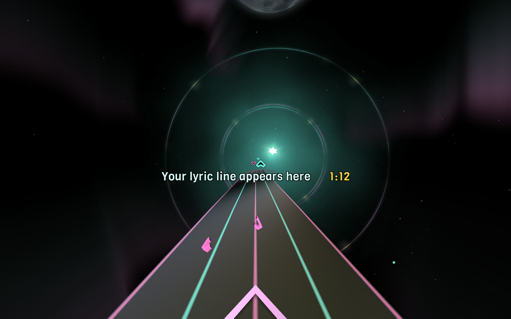
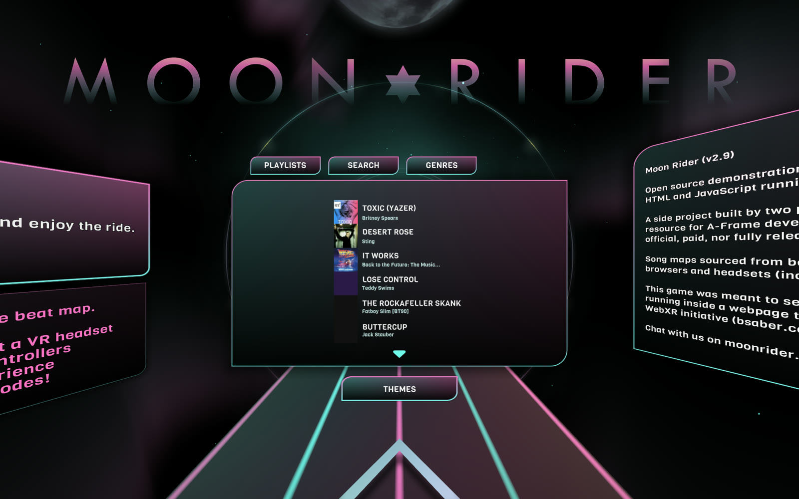
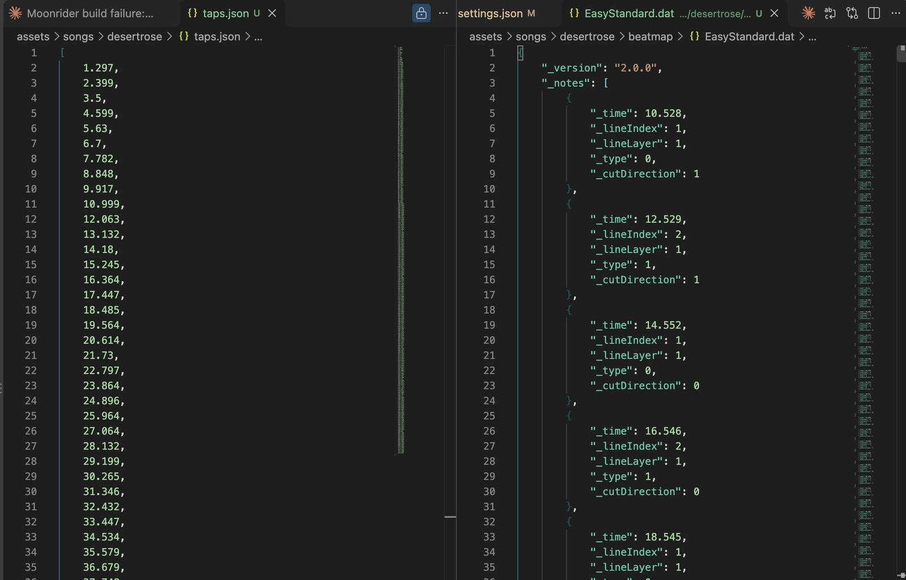
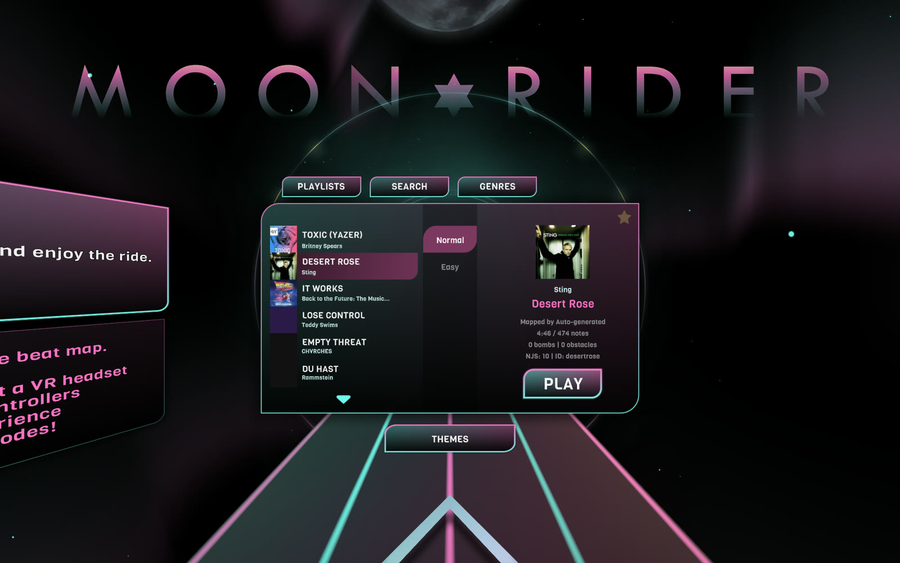
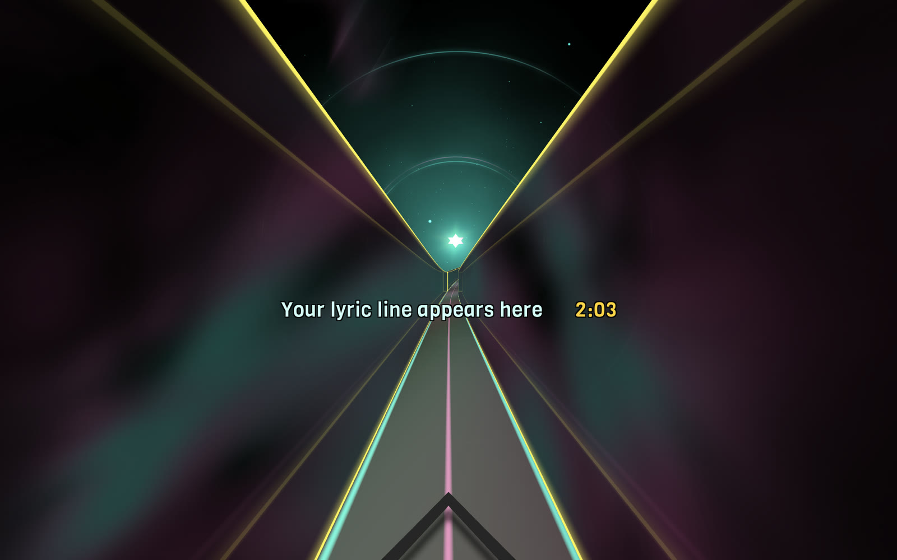
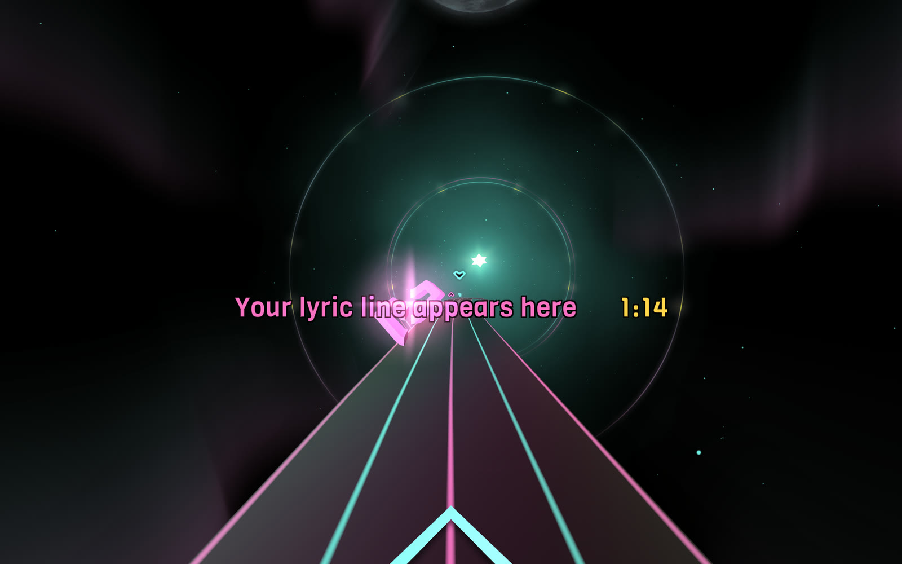
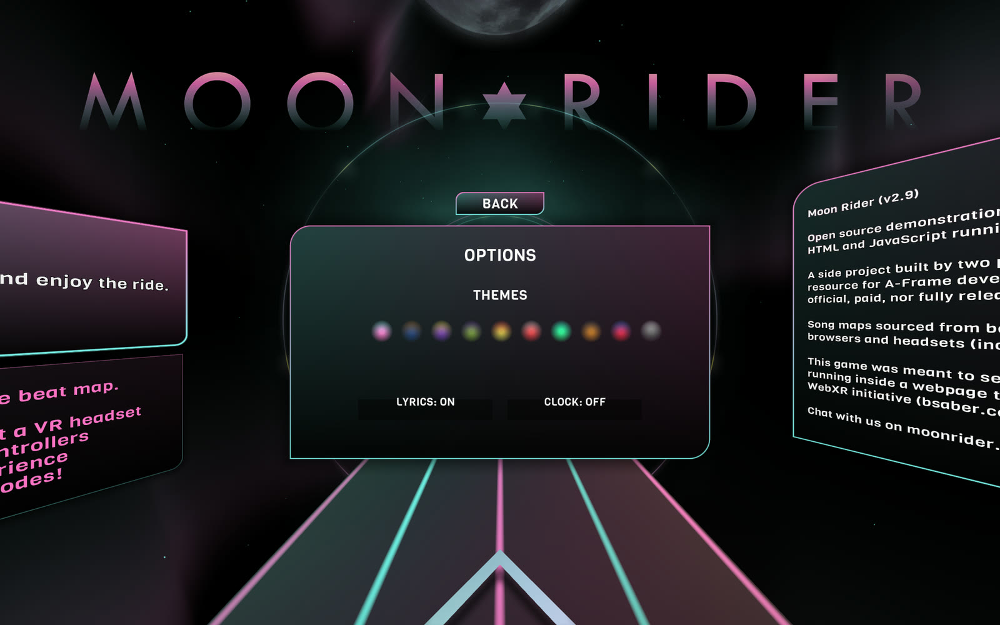

I want to sing along to the songs I've bought over the years, in Virtual Reality (VR), with the lyrics on screen and beats (blocks) to smash.

## What I built

I call the answer to my dreams SingSaber. I used Claude Code to bolt karaoke lyrics onto an existing open-source WebXR game. This post covers how a song becomes a challenge.


*The finished game, with a placeholder where my lyric line appears: the song clock in yellow, and blocks flying toward me*

- **A level generator.** Claude Code wrote scripts that turn any DRM-free track, from the iTunes Store or elsewhere, into a playable challenge (song) with one or more levels.
- **Synced karaoke lyrics.** Claude Code wrote a script that fetches timed lyrics, and the game shows them on screen so that I can sing along as I smash those beats.

Three songs from my iTunes library have made it through so far: Sting's *Desert Rose*, the *It Works* cast recording from the *Back to the Future* musical, and Teddy Swims' *Lose Control*. *Lose Control* has 267 beats in the Easy level and 534 in the Normal level. The song lasts 3 minutes 31 seconds.


*I opened the challenge list and my challenges appear at the top, ahead of the community contributed challenges*

## The game underneath

The original game is [Moon Rider](https://github.com/supermedium/moonrider) by Supermedium, an open-source, Beat Saber-style game built with A-Frame and WebXR. It runs in a VR headset's web browser with nothing to install, and its code is published under the MIT licence. I first wrote about it in my March 2021 [WebVR](/posts/webvr/) post, where I ran it in the Oculus Quest 2 browser. By default Moon Rider downloads community challenges from a public catalogue.

In the headset my hands appear as a pair of oversize fists, red for my left hand and blue for my right, and the beats arrive as cubes that I hit with my firsts.

## Why any song is the hard part

A Beat Saber level is a list of beats (blocks), each with a time, a lane and a swing direction. I understand that level designers place every beat into the level by hand. For my iTunes songs I needed to create the challenge folder and the level .dat files. I asked Claude Code for help:

| Attempt | What happened |
| --- | --- |
| Put a block on each strong hit the audio analysis finds | Terrible. Blocks fell on loud events, not on a rhythm I could swing to. |
| Track the beat and snap every block to it | A little better. The blocks sat on the beat, but there was no sense of structure. |
| Split bass and melody between the hands, pick lanes from pitch, thin out the quiet parts | More varied and more playable, but still not right. |
| Hunt for the song's ticking clock in the audio | Failed. The tick sits under drums and vocals, and every spacing I found was a multiple of the beat. |
| **Manually tap along with the spacebar** | It worked. |

This is how I described the problem to Claude Code after the third attempt:

```PROMPT
It Works "beats" are still terrible (a little better? but still terrible gameplay)
```

*It Works* opens with a ticking clock that drives the whole song. I could hear it clearly, and the analysis could not find it:

```PROMPT
There is literally a tick-tock metronome track on this song. You are missing it. Please try again.
```

Claude Code looked for periodic clicks in several frequency bands and sliding windows. Nothing stable came back.

## What finally worked: tapping the pulse

At my suggestion Claude Code wrote a small tool that plays the song and records every key press. I listened to each song and pressed the spacebar on each "tick", for about twenty-five seconds:

```bash
node scripts/tap-ticks.js --id itworks --seconds 25
node scripts/make-song.js --id itworks
```

The generator turns my taps into an exact, steady grid of beats. The two hands alternate.

For *It Works*, 56 taps gave a tick every 0.4196 seconds, which is 143 ticks per minute. For *Desert Rose* I tapped the whole song, 242 taps, and the generator built the Easy and Normal levels from them.


*I opened my taps (left) next to an early version of the Easy beatmap the generator produced (right) in VS Code*

The two files are linked by one conversion. My taps are in seconds, and the beatmap measures time in beats, so `_time` is the tap time multiplied by the tempo and divided by 60. At 112.2 beats per minute, my tap at 5.63 seconds became a block at `_time` 10.528, which is what the screenshot shows. I later removed my reaction delay of 0.19 seconds, so the current file starts at `_time` 10.173, which is 5.44 seconds.

### Why a tapped map feels right

I had expected Claude Code's analysis of the song to beat my ear. Instead my taps felt right and the Claude Code generated maps did not. 

### Turning what I learned into a draft generator

I asked Claude Code to make the tapped approach the normal way to create beats:

```PROMPT
What have we learned? Write it up. The button-pressing approach just seems to work really well. Set this as a normal way of creating beats for new songs?
```

### When the tempo changes

The steady grid breaks down when the song doesn't hold its tempo. *It Works* slows right down in the middle and speeds up for a big finish. The generator could see where the grid stops matching the music, which was 113 seconds in but it could not fix the problem by itself so I just recorded taps manually for the whole song.

## What is in a song folder

Every song is a folder under `assets/songs`, and its lyrics are in a single file under `assets/lyrics`. Every challenge has an id and the name of the corresponding lyric file is <id>.lrc.

```
assets/
  songs/
    index.json                the list the menu reads
    desertrose/
      source.m4a              my DRM-free copy of the track
      taps.json               the beats I tapped, in seconds
      taps-158.json           optional: taps for a later section (It Works has one)
      settings.json           options remembered for this song
      accents.json            the moments where the lyrics pop
      cover.jpg               the menu cover, 500 by 500
      map.json                metadata and a summary per difficulty
      desertrose.zip          what the game loads: audio and beatmap
      beatmap/
        Info.dat              song details and the difficulty list
        EasyStandard.dat      the Easy blocks and walls
        NormalStandard.dat    the Normal blocks and walls
  lyrics/
    desertrose.lrc            the timed lyrics
```


*I selected Desert Rose and the song card shows its length, note count, difficulty and id, which is also its folder name*

### taps.json

The taps file is just a list of times in seconds, one for every key press:

```json
[1.297, 2.399, 3.5, 4.599, 5.63, 6.7, 7.782]
```

If a note sounds wrong, I can delete a number or nudge it, run the generator again, and the block moves.

### settings.json

Each song remembers the options I used, so I can rebuild it by running `node scripts/make-song.js --id itworks` with nothing else. This is the real file for *It Works*, apart from a note about where the audio came from:

```json
{
  "title": "It Works",
  "artist": "Back to the Future: The Musical Cast",
  "cover": "assets/songs/itworks/cover.jpg",
  "rest": "1:55.36-2:40.48",
  "walls": "1:55.36-02:33.93",
  "trim": "Easy=2,Normal=2"
}
```

- `rest` removes every block between those two times.
- `walls` puts walls along the edges of the track between those two times. It is a separate setting, so the walls do not have to cover the whole rest.
- `trim` drops the last blocks of a difficulty, which I used to remove the final two notes.

### The beatmap files

The `.dat` files are plain JSON with a different extension. `Info.dat` says which difficulties exist and the tempo. Each difficulty file has a list of notes, a list of obstacles and a list of events. This is the first note of *Desert Rose* on Easy: a red block in the second lane from the left, on the middle row, to be cut down and to the left:

```json
{"_time": 10.173, "_lineIndex": 1, "_lineLayer": 1, "_type": 0, "_cutDirection": 6}
```

| Field | Meaning |
| --- | --- |
| `_time` | When the block arrives, measured in beats |
| `_lineIndex` | The lane from the left: 0, 1, 2 or 3 |
| `_lineLayer` | The row from the bottom: 0, 1 or 2 |
| `_type` | 0 for the red block (left hand), 1 for the blue block (right hand) |
| `_cutDirection` | 0 up, 1 down, 2 left, 3 right, 4 up-left, 5 up-right, 6 down-left, 7 down-right, 8 any |

I added VS Code's file association for `.dat` files, so they open with JSON colours and folding.

### Walls

The generator can add walls. A wall is a full-height barrier that runs along the track for a stretch of the song. This is the first wall in *It Works* on Normal:

```json
{"_time": 275.326, "_lineIndex": -0.5, "_type": 0, "_duration": 15.342, "_width": 1}
```

The `_lineIndex` of -0.5 sits half a lane outside the left edge. The game only knew about lanes 0 to 3, so I taught it to place a wall at any position, and the generator puts one wall at -0.5 and one at 3.5. That leaves a wide gap in the middle and keeps the walls out of the way of my body. `_type` 0 is a full-height wall, `_type` 1 is a ceiling that I would duck under, and `_duration` is the wall's length in beats.


*I played the rest section of It Works with the walls up, singing over the empty stretch*

### accents.json

The generator also finds the strongest "hits" and the biggest "kick drums" in each song, about one every twenty seconds, and saves their times in seconds. This is the real list for *Desert Rose*:

```json
[17.26, 32.24, 49.36, 64.36, 79.34, 101.86, 120.06, 143.64, 171.49, 187.57, 221.9, 242.23, 265.81]
```

The lyrics use this list to change colour and size at those dramatic moments.

### The lyrics file

Lyrics use the plain-text LRC format. Each line starts with the time it appears, and the song's file name is its ID. This is an example with made-up words:

```
[offset:2000]
[00:10.85] First line of the song
[00:13.75] Second line of the song
[00:18.53]
[00:24.00] The line after a short gap
```

- `[mm:ss.xx]` is the time the line appears, in minutes and seconds.
- A line with no words hides the lyrics until the next line.
- `[offset:ms]` shifts every line. A positive number shows the lyrics earlier and a negative number shows them later.

I download synced lyrics for each song from LRCLIB, an open database of timed lyrics, with `node scripts/fetch-lyrics.js <id>`.

## Making it feel like a game

### The beats have to move

The first *Desert Rose* map surprised me. The timing was right, but the path of the blocks never varied. Every block that came for my left hand arrived at the same height, in the same cell. Every block that came for my right hand arrived at the same height too, in the mirror cell the same distance to the right of the centre. I compared it with *It Works*:

```PROMPT
The It Works beats move around a lot more than the Desert Rose ones do. Update the generating logic and regenerate the Desert Rose beats so that I actually have to move my hands (as I do in the It Works song)
```

Claude Code made two changes. Pitch now chooses the lane and row of every block, and a hand is never allowed to stay in the same cell for two blocks in a row. It measured the result against the old map:

| Desert Rose, Easy | Before | Now | It Works, Easy |
| --- | --- | --- | --- |
| Blocks where the hand moves to a new cell | 0% | 100% | 67% |
| Average sideways move per block | 0.00 | 0.43 | 0.33 |
| Average up or down move per block | 0.00 | 0.96 | 0.64 |
| Diagonal swings | 0% | 42% | 34% |
| Lanes used | 2 | 4 | 4 |

### Accent moments

The lyrics stand out at the moments where the music does (see above). For about a second around each accent, the lyric line changes to the colour theme's accent colour and swells in size by 30%, then eases back.


*I reached an accent moment and the lyric line turned pink and grew larger, with the clock in yellow beside it*

I asked for the clock so I could track down and fix issues more quickly:

```PROMPT
Add time to the lyric display so that I can track "0:17, 0:32, 0:49, 1:04, 1:24, 1:42, 2:00 and 2:24: strong hits or big kicks"
```

## Karaoke lyrics in a headset

The lyric line sits low on the track, where the blocks usually fly over it. The song time follows the lyric in yellow, and a dark outline made of four black copies of the text keeps the line readable on any background. Both can be switched on and off in the options menu, with lyrics on and the clock off by default.


*I opened the options menu and found the lyrics and clock switches next to the colour themes*

### Getting the timing right

Synced lyrics from an open database can be off by seconds from the recording I own. For *Desert Rose* I slid the lyric times against the music until the lines lined up with the vocal entries, which suggested the lyrics were about 2.85 seconds late. Then I told Claude Code the fix was too much:

```PROMPT
Now it feels like the lyrics are coming up too soon
```

So I set the offset to 2.0 seconds, and Claude Code added two keys for tuning by ear while the song plays. The bracket keys move the lyrics later and earlier by a quarter of a second, and the clock shows the offset in force.

## Running it on my own Wi-Fi

I start the development server on my laptop and open the page in the headset's browser:

```bash
export NODE_OPTIONS=--openssl-legacy-provider
npm run start
```

Then I open `https://<laptop-ip>:3000` in the headset. The server uses a self-signed certificate, which WebXR requires, so I accept the browser's warning once.

## Private use only

The audio and the lyrics are not mine to share.

## Credit

SingSaber is a modestly extended version of [Moon Rider](https://github.com/supermedium/moonrider) by Supermedium.

## References

- [Moon Rider](https://moonrider.xyz), the free VR rhythm game that runs in a web browser
- [Moon Rider on GitHub](https://github.com/supermedium/moonrider), the open-source code by Supermedium
- [WebVR](/posts/webvr/), my earlier post that runs Moon Rider in the Oculus Quest 2 browser
