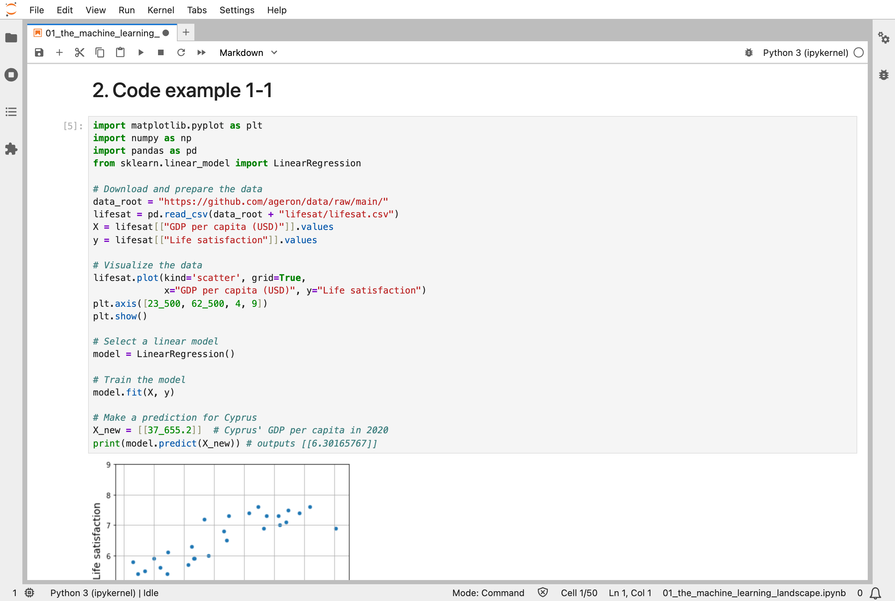
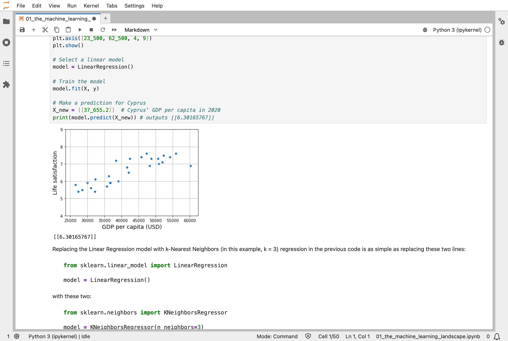
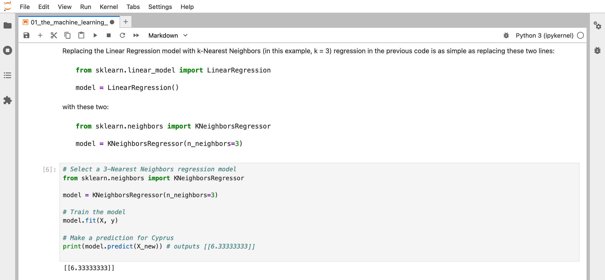

Scikit-Learn is a Python library for machine learning that simplifies building and training models. It provides tools for data preprocessing, model selection, and evaluation.

## Key Points

**Why Scikit-Learn?**
- Simple syntax with consistent API (application programming interface)
- Built-in datasets and visualization tools
- Comprehensive documentation and community support

**Core Features:**
1. **Preprocessing**: Data cleaning, feature scaling, and encoding  
2. **Models**: Hundreds of algorithms (regression, classification, clustering)  
3. **Evaluation**: Cross-validation, metrics, and model comparison  
4. **Pipeline**: Easy workflow management  

:::brain-power
Both models below predict Cyprus's life satisfaction from its gross domestic product (GDP) per capita, and both are trained with the same call, `fit`. One does its work when it is trained, and one waits until it is asked for a prediction.
:::

## Quick Example

In the first chapter of the Hands-On Machine Learning book with Scikit-Learn, the authors use an example with GDP per capita data to predict life satisfaction scores:

```python
from sklearn.linear_model import LinearRegression

# Create and train model
model = LinearRegression()
model.fit(X, y) 

# Make prediction for Cyprus
prediction = model.predict([[37_655.2]])
print(prediction)
```

The same task can be accomplished with a different algorithm, such as k-Nearest Neighbors:

```python 
from sklearn.neighbors import KNeighborsRegressor

model = KNeighborsRegressor(n_neighbors=3)
model.fit(X, y)
prediction = model.predict([[37_655.2]])
print(prediction)  
```

In both cases, Scikit-Learn gives the model the same two calls, `fit` and `predict`, so swapping one algorithm for a completely different one changes only two lines. The models here are simple, but the same two calls work for the much more complicated ones in later chapters.

This approach makes it easy to experiment with different algorithms and quickly evaluate their performance.

:::watch-it The same two calls, not the same model
`fit` and `predict` look identical for every model, but what happens inside them does not. The next section shows that these two models learn in completely different ways, even though their predictions for Cyprus, 6.30 and 6.33, are almost the same.
:::

## What training means here

Both examples call `model.fit(X, y)`, which trains the model on the 27 countries in the data. The two models learn in completely different ways.

**Linear regression learns two numbers.** It works out the straight line that best fits the 27 countries, directly, in one calculation (least squares): an intercept of 3.749, and a slope of 0.0678, the extra life satisfaction for every extra $1,000 of GDP per capita. Predicting for Cyprus is then arithmetic: 3.749 + 0.0678 × 37.655 = 6.30.

**k-Nearest Neighbors learns nothing.** Its `fit` just stores the 27 countries. The work happens when it predicts: it finds the three countries whose GDP per capita is closest to Cyprus's $37,655, and averages their life satisfaction.

| Country | GDP per capita | Life satisfaction |
|---|---|---|
| Israel | $38,341 | 7.2 |
| Lithuania | $36,732 | 5.9 |
| Slovenia | $36,548 | 5.9 |

(7.2 + 5.9 + 5.9) ÷ 3 = 6.33. The book calls these two kinds *model-based learning* and *instance-based learning*.

Neither one trains the way a neural network does. My [MiniGPT](/posts/minigpt-grown/) model starts from 826,433 random numbers and nudges every one of them thousands of times, using [backpropagation](/posts/sklearn10/) to find which way each should move. Here there is nothing to nudge: one model is worked out exactly, and the other just remembers.

:::no-dumb-questions
**Q: Is k-nearest neighbors really learning, if `fit` only stores the data?**

A: The book calls it *instance-based learning*: what it knows is the stored examples themselves, and each prediction compares a new country with them. Nothing is summed up into a few numbers, so the model is as big as its data.

**Q: Why three neighbours? Why not one, or five?**

A: The three is a choice, not a law: the notebook sets `n_neighbors=3`, and I did not tune it. It is a trade-off. With one neighbour, the prediction copies a single country, which might be unusual: for Cyprus, that gives 7.20, much higher than the line's 6.30. With all 27, every country gets the same answer, the average of all of them: 6.57 for Cyprus. In between, I tried a few values of k for Cyprus, and got 6.55 for 2, 6.33 for 3, 6.26 for 5, and 6.37 for 10. To compare them fairly, I left each country out in turn and predicted it from the other 26, and measured the typical error: 0.55 for k = 1, 0.43 for 3, 0.40 for 5, 0.36 for 7, and 0.37 for 10. So 3 is a reasonable choice, but not the best on this data, and with only 27 countries, the differences are small and could be noise. This is a hyperparameter, a setting that I choose before training, and [Part 2](/posts/sklearn2/) shows how to choose one with cross-validation, which is what this leaving-one-out test is a version of.

**Q: Why are the two predictions for Cyprus so close?**

A: Cyprus's three nearest neighbours, Israel, Lithuania, and Slovenia, average 6.33, and the line gives 6.30 at the same GDP. Here the two agree; for a country whose neighbours sit far from the line, they would not.

**Q: Where are the slopes and the nudging from MiniGPT?**

A: Not here yet. Linear regression has a direct formula for its two numbers, and k-nearest neighbors has no numbers to find. Nudging first appears in [Part 3](/posts/sklearn3/), and is explained in [Part 4](/posts/sklearn4/).
:::

## Running the notebook in Jupyter

Both examples come from the chapter 1 notebook that goes with the book, [01_the_machine_learning_landscape.ipynb](https://github.com/ageron/handson-ml3/blob/main/01_the_machine_learning_landscape.ipynb). I opened it in JupyterLab and ran the setup cells, then Code example 1-1 and the k-Nearest Neighbors version.


*I ran Code example 1-1: it downloads the life satisfaction data, plots it, and trains a linear regression model*


*The scatter plot of GDP per capita against life satisfaction, and the linear model's prediction for Cyprus: 6.30*


*I swapped in k-Nearest Neighbors with k = 3, which predicts 6.33 for Cyprus*

:::bullet-points The first models, in short
- Every Scikit-Learn model is trained with `fit` and used with `predict`, so swapping models changes two lines.
- Linear regression works out its two numbers directly, in one calculation.
- k-nearest neighbors stores the 27 countries, and averages the three nearest when asked.
- Neither model is nudged; a neural network such as MiniGPT is.
:::

Next, [Scikit-Learn (Part 2)](/posts/sklearn2/) works through chapter 2's end-to-end project: predicting California house prices, from raw data to a tested model.

## References

- [Aurélien Géron's chapter 1 notebook](https://github.com/ageron/handson-ml3/blob/main/01_the_machine_learning_landscape.ipynb) - for Hands-On Machine Learning with Scikit-Learn, Keras, and TensorFlow (third edition)
- [scikit-learn](https://scikit-learn.org/) - the library's documentation
