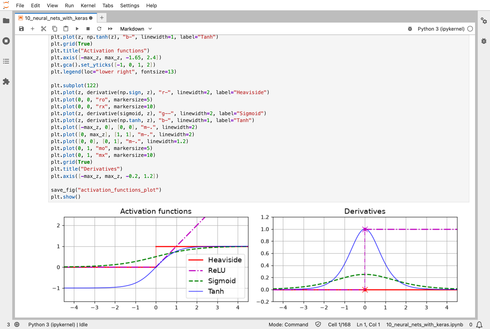
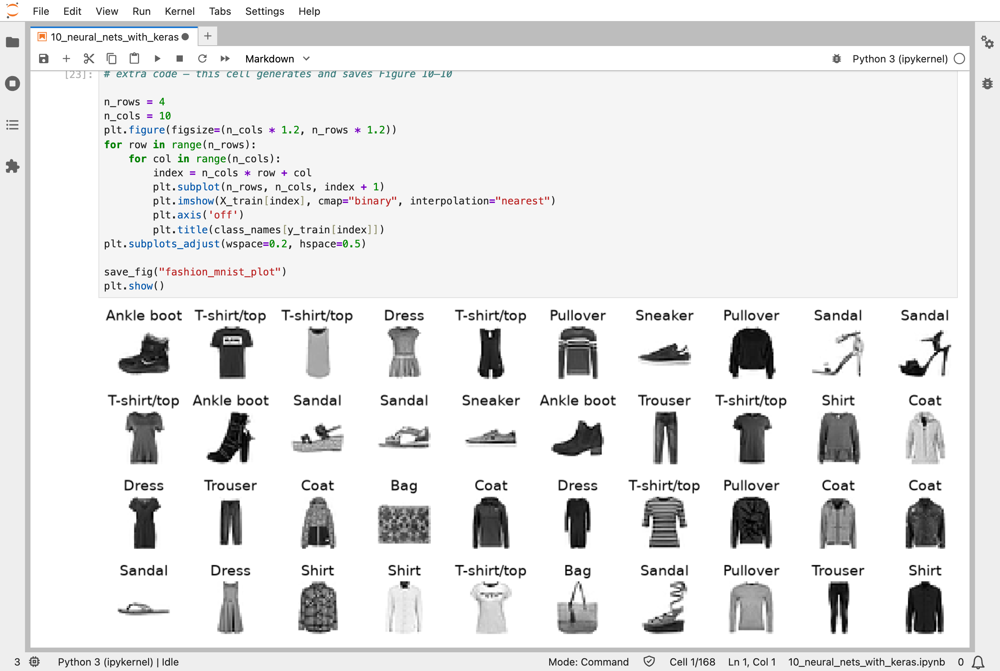
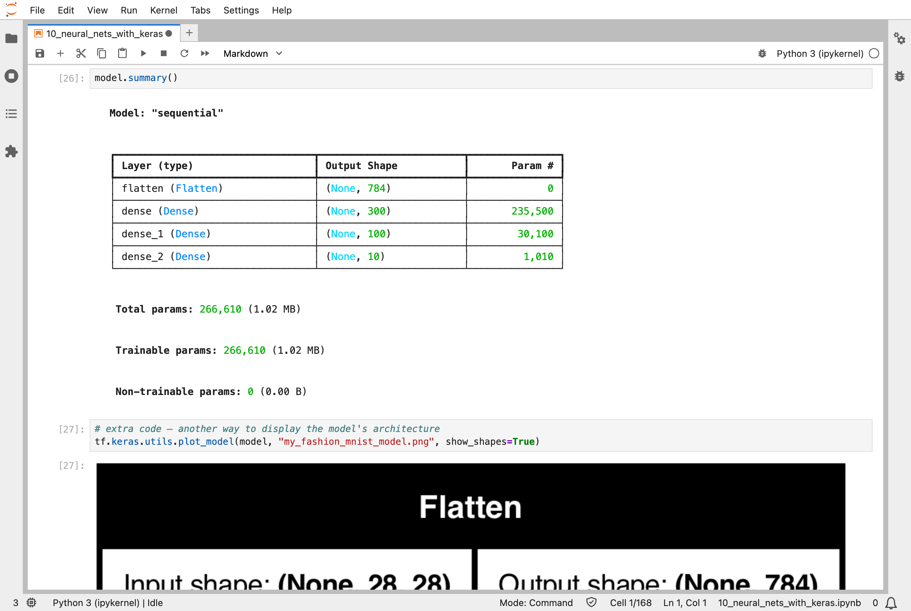
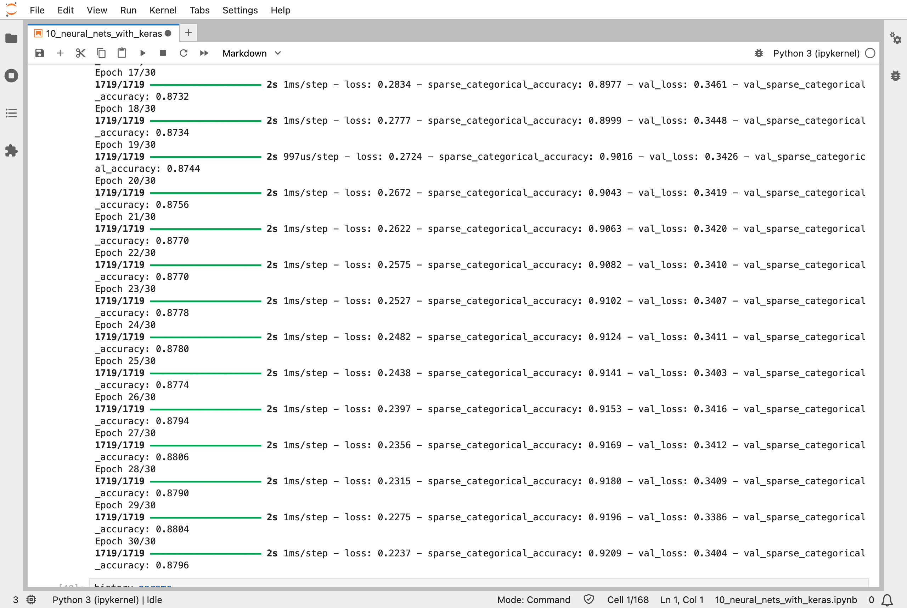
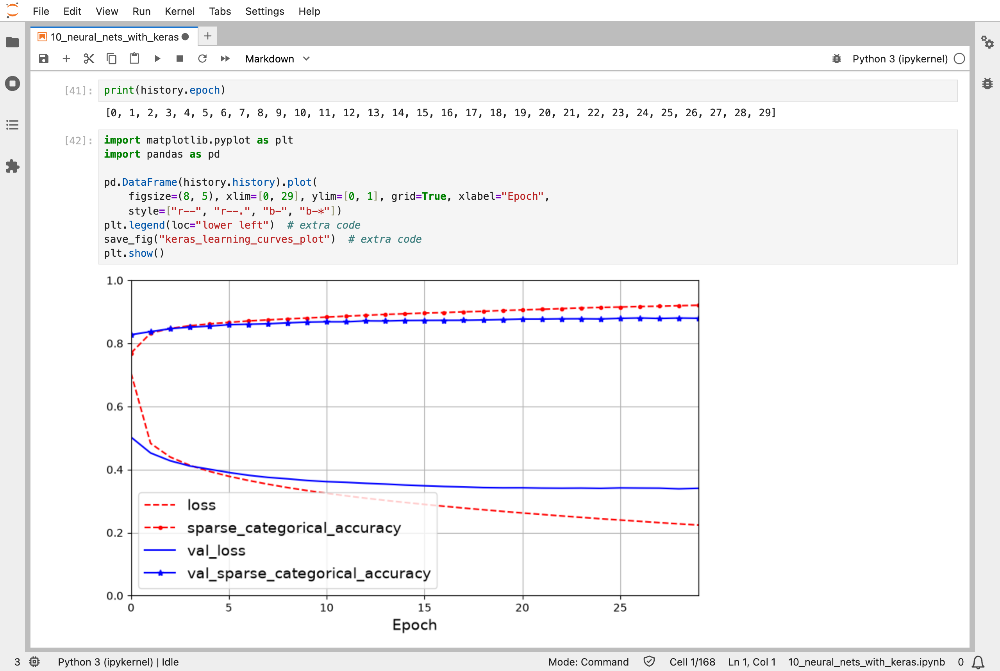
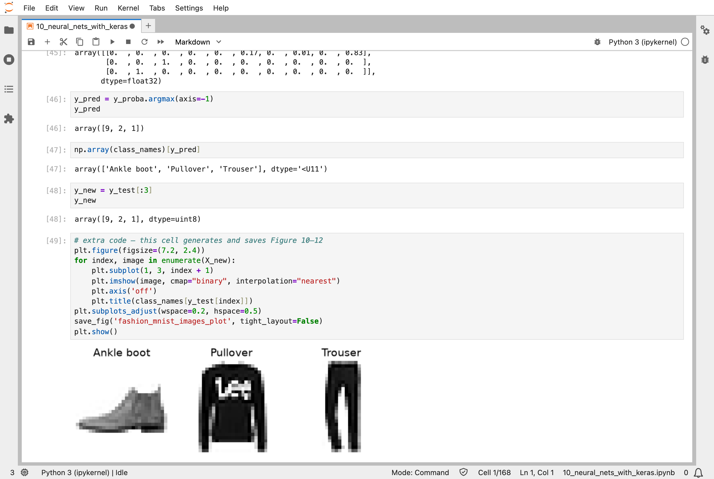
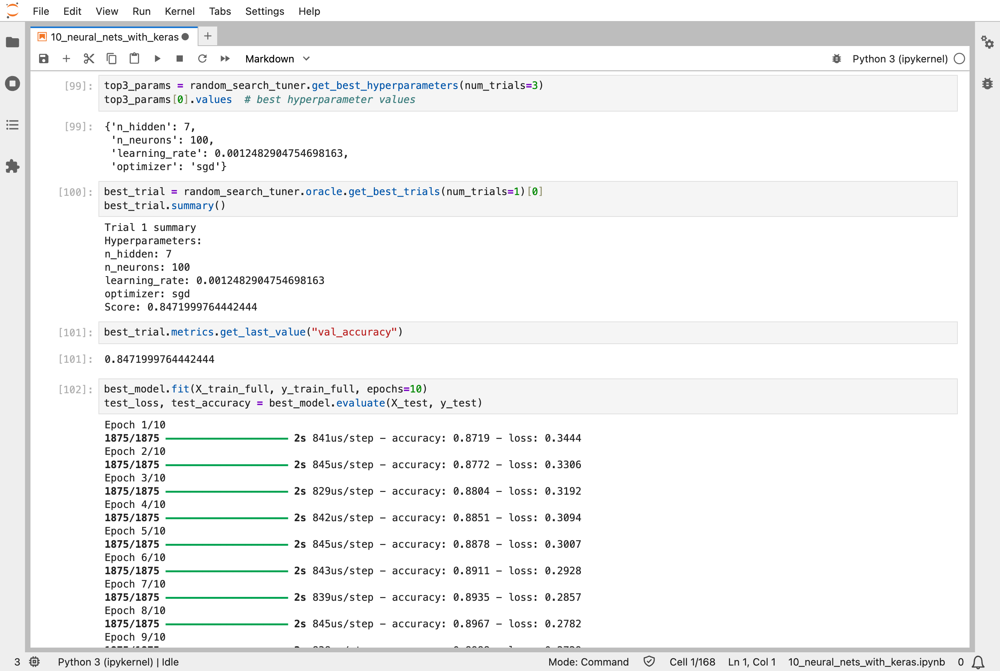

In [Part 9](/posts/sklearn9/), I found groups in data with no labels. This chapter of the Hands-On Machine Learning book starts the second half of the book, on neural networks, the models behind most of today's AI, including the large language models behind tools like ChatGPT. I build them with Keras, a library that sits on top of TensorFlow, and train them with *backpropagation*.

The task is real, if small: look at a 28 × 28 picture of an item of clothing, one of 70,000 in a set called Fashion MNIST, and say which of 10 kinds it is, from T-shirts to ankle boots. My network was right on 87.4% of 10,000 test pictures it had never seen. It had 266,610 numbers, and it learned all of them from the training pictures.

## Key Points

**The lesson:** a neural network is not a new kind of mathematics. It is layers of the weighted sums from earlier parts, with a simple bend between each layer, so that the network can learn curved patterns and not only straight ones. Its numbers start at random, and are nudged, a little at a time, in the direction that makes the answers less wrong. Backpropagation is how it works out that direction for every number in every layer at once.

**What I learned from it:**
- The bend between layers is a simple rule, such as "replace negative numbers with zero" (called ReLU, for rectified linear unit). Without it, a hundred layers would be no better than one.
- The settings that shape a network, such as how many layers, how many neurons in each, and how big each nudge is, are mostly found by trying them, not worked out. The notebook automates the trying.
- A network can be built as an ordered stack of layers, which is what I did, or in more flexible ways for networks with several inputs or outputs.

The chapter also covers the history of artificial neurons, saving a trained network, and stopping training early when it stops improving. I do not go into those here.

:::brain-power
The clothing classifier below has 266,610 numbers, all starting at random. Before reading on, guess how many times each of them is nudged during training.
:::

## Quick Example

A classifier for Fashion MNIST, 70,000 small images of clothing in 10 classes, from T-shirts to ankle boots. Each 28 × 28 image is flattened to 784 numbers, and passes through layers of 300, 100, and 10 neurons:

```python
import tensorflow as tf

model = tf.keras.Sequential([
    tf.keras.layers.Flatten(input_shape=[28, 28]),
    tf.keras.layers.Dense(300, activation="relu"),
    tf.keras.layers.Dense(100, activation="relu"),
    tf.keras.layers.Dense(10, activation="softmax")
])
model.compile(loss="sparse_categorical_crossentropy",
              optimizer="sgd",
              metrics=["accuracy"])
history = model.fit(X_train, y_train, epochs=30,
                    validation_data=(X_valid, y_valid))
```

Here is what the networks did when I ran the notebook:

| Network | Result |
|---|---|
| Clothing classifier, 266,610 numbers, after 30 passes through 55,000 images | 87.4% of the 10,000 test images right |
| Its first three test images | ankle boot, pullover, trouser: all three right |
| California house prices, Scikit-Learn's `MLPRegressor` | a typical error (RMSE, as in [Part 2](/posts/sklearn2/)) of 0.505, about $50,500 |
| California house prices, a Keras network | a typical error (RMSE) of 0.535, about $53,500 |
| Automatic search for the best network size and step size, 60 trials | best validation accuracy 86.6% |

:::watch-it A bigger library is not automatically better
On the [California house prices](/posts/sklearn2/), Scikit-Learn's simple `MLPRegressor` scored an error of 0.505, and the Keras network 0.535. Both are trained by backpropagation; the difference comes from settings such as the number of layers, the learning rate, and how long they train, which is why the chapter ends with a search for them.
:::

## What training means here

This is backpropagation, and it is the same recipe that trains my [MiniGPT](/posts/minigpt-grown/) model.

The clothing classifier's 266,610 numbers start at random (its biases start at zero). Each training step takes 32 images, runs them through the network, and scores how surprised the network was by the right answers: that is the `sparse_categorical_crossentropy` loss, the surprise score from MiniGPT. Then TensorFlow works backwards through every layer to find the slope for each of the 266,610 numbers, and plain gradient descent, `"sgd"`, nudges each one a little, with a learning rate of 0.01. One pass through the 55,000 training images is 1,719 such steps, and the network makes 30 passes: 51,570 nudges in all.

MiniGPT is the same machine at a different scale: 826,433 numbers, 3,000 steps of 32 snippets of text, AdamW instead of plain gradient descent, and attention layers between the dense ones. Scikit-Learn's `MLPRegressor`, the first network in this chapter, is trained by backpropagation too.

Here is how training has changed through this series:

| Parts | How the models learn |
|---|---|
| [1](/posts/sklearn1/), [2](/posts/sklearn2/) | worked out exactly (least squares), remembered (k-nearest neighbors), or grown one split at a time (trees and forests) |
| [3](/posts/sklearn3/), [4](/posts/sklearn4/) | nudged by gradient descent, with slopes from a formula, because the models have one layer |
| [5](/posts/sklearn5/) | solved directly by a specialised solver, or by gradient descent, which reaches almost the same answer |
| [6](/posts/sklearn6/), [7](/posts/sklearn7/) | trees grown greedily, and combined into ensembles; gradient boosting steps downhill by adding trees |
| [8](/posts/sklearn8/), [9](/posts/sklearn9/) | no labels: PCA (principal component analysis) is worked out, K-Means alternates between two exact steps, and t-SNE (t-distributed stochastic neighbor embedding) nudges points |
| 10 | many layers, so the slopes come from backpropagation, and every number is nudged |

:::no-dumb-questions
**Q: Why does a network need the bends between its layers?**

A: Without them, a stack of weighted sums is just one big weighted sum: a hundred layers would be no better than the linear models of [Part 4](/posts/sklearn4/). The bends, such as ReLU, are what let a network learn curved patterns.

**Q: What does the last layer, with its softmax, give?**

A: Ten chances, one for each kind of clothing, that add up to 1. The network's answer is the class with the biggest chance, and its surprise score is worked out from the chance it gave the right one.

**Q: How many nudges, then?**

A: Each number is nudged once per step: 1,719 steps per pass through the 55,000 training images, and 30 passes, 51,570 nudges in all.
:::

## Running the notebook in Jupyter

The chapter is in the notebook that goes with the book, [10_neural_nets_with_keras.ipynb](https://github.com/ageron/handson-ml3/blob/main/10_neural_nets_with_keras.ipynb). I ran everything before the exercise solutions, which took about 14 minutes on my Mac Studio, most of it in the three hyperparameter searches, and then looked through the results in JupyterLab. I could not open TensorBoard, the separate viewer for the training logs, so I have left that part out.


*Activation functions, the bends between layers: the step function of the original perceptron, ReLU, sigmoid, and tanh, with their slopes on the right*


*A sample of Fashion MNIST: 28 × 28 images of clothing, each labelled with one of 10 classes*


*The network's layers: 235,500 numbers in the first hidden layer, 30,100 in the second, and 1,010 in the output layer, 266,610 in all*


*The end of training: after 30 passes, about 92% of the training images and 88% of the validation images are right*


*The learning curves: the loss falls and the accuracy rises, epoch by epoch, and the training and validation curves slowly move apart*


*The network's predictions for the first three test images: an ankle boot, a pullover, and a trouser, all correct*


*Keras Tuner's random search: its best network had 7 hidden layers of 100 neurons, and 84.7% validation accuracy*

:::bullet-points Neural networks, in short
- A network is layers of weighted sums, with simple bends between them.
- Its numbers start at random; backpropagation finds every number's slope.
- Keras builds, trains, saves, and reloads networks in a few lines.
- The network's shape and learning rate are found by searching.
:::

Next, [Scikit-Learn (Part 11)](/posts/sklearn11/) works through chapter 11: training deep neural networks, and the tricks that make deep networks trainable.

## References

- [Aurélien Géron's chapter 10 notebook](https://github.com/ageron/handson-ml3/blob/main/10_neural_nets_with_keras.ipynb) - for Hands-On Machine Learning with Scikit-Learn, Keras, and TensorFlow (third edition)
- [Scikit-Learn (Part 9)](/posts/sklearn9/) - unsupervised learning
- [MiniGPT (Part 2)](/posts/minigpt-grown/) - the same training, at the scale of a small language model
- [Keras](https://keras.io/) - the deep learning library's documentation
