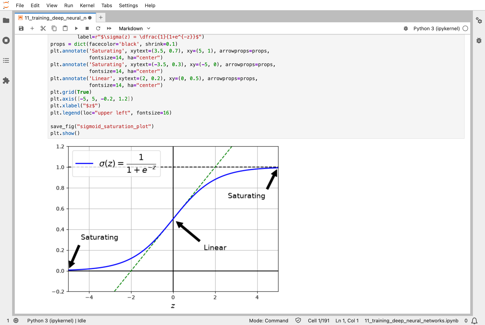
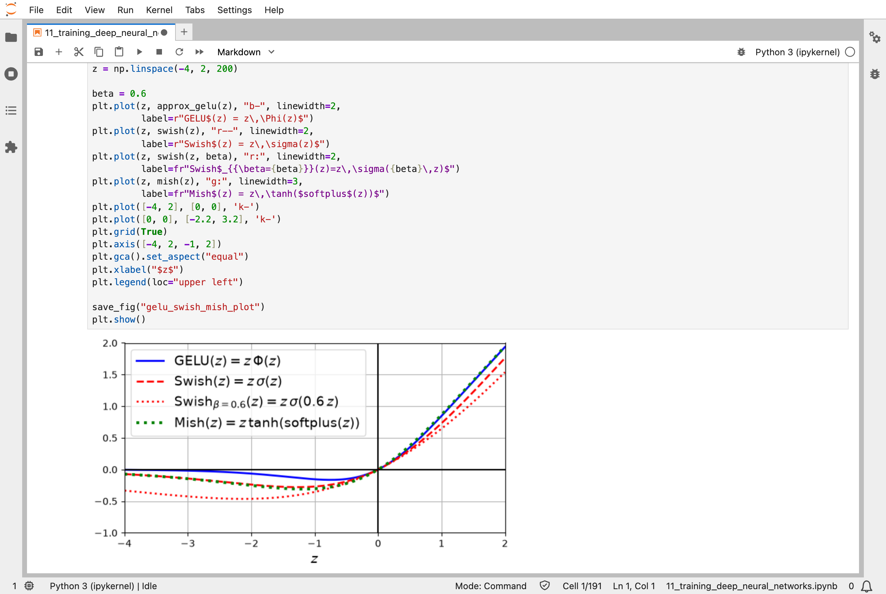
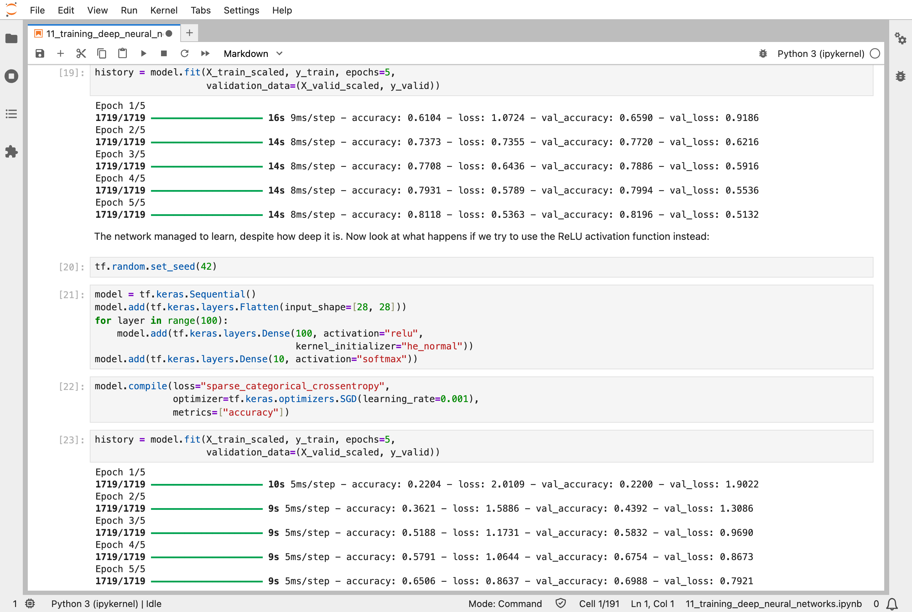
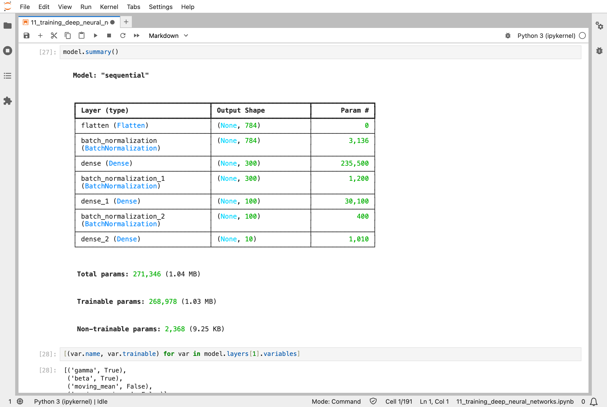
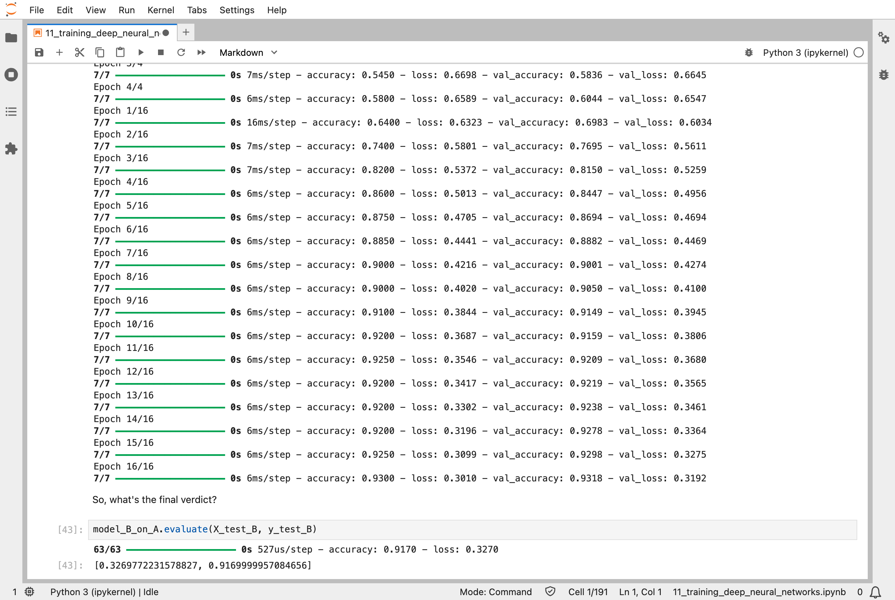
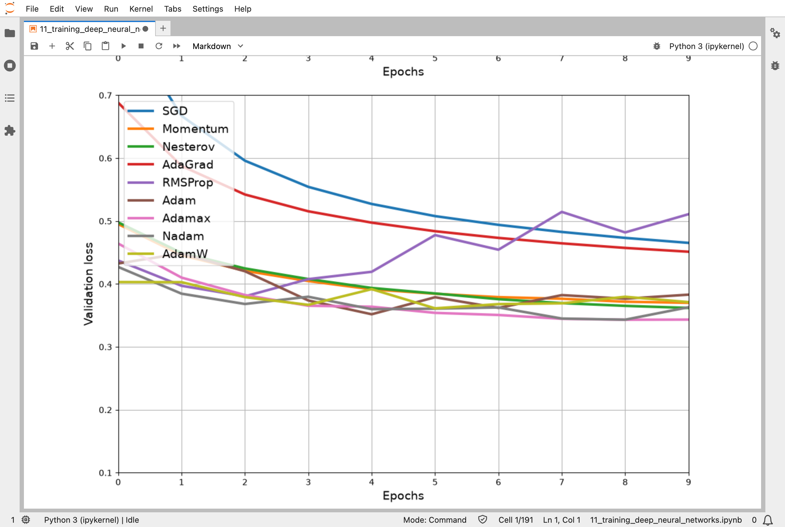
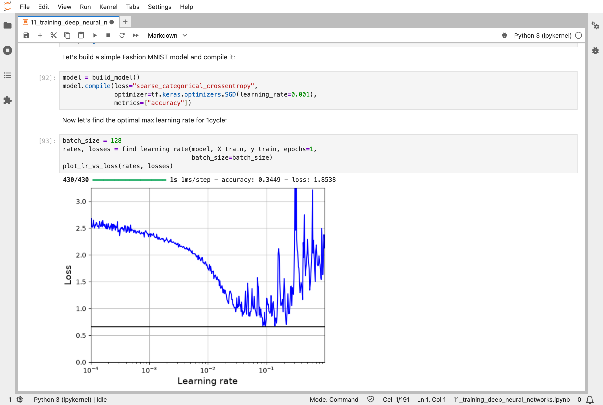
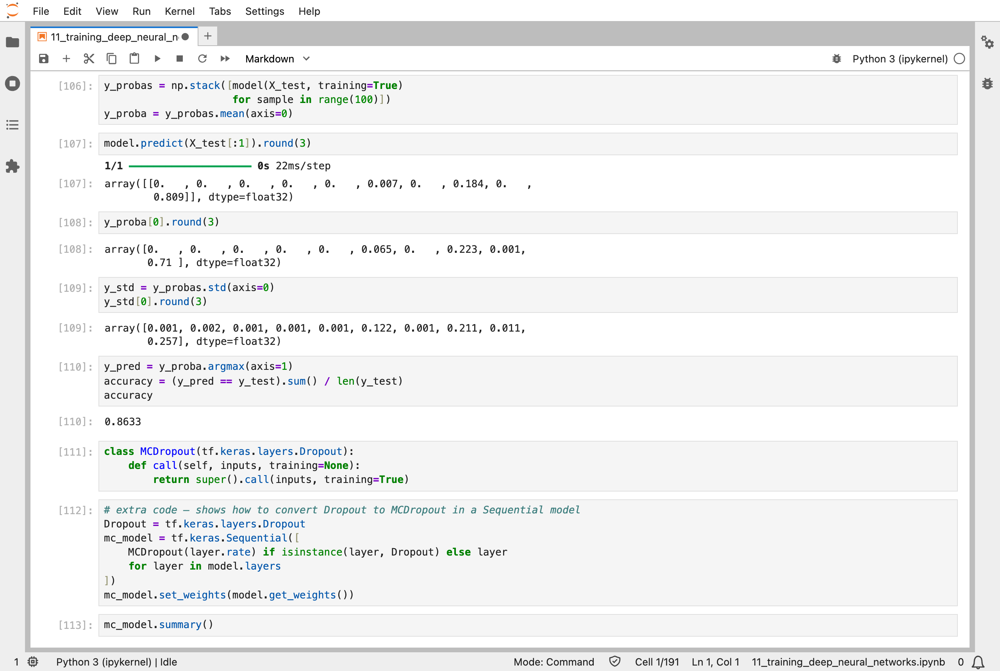

In [Part 10](/posts/sklearn10/), I trained a network with two hidden layers. The eleventh chapter of the Hands-On Machine Learning book asks what goes wrong when a network gets deep, with tens or hundreds of layers, and collects the tricks that make deep networks trainable: better starting numbers, better activation functions, batch normalization, reusing a trained network, faster optimizers, learning rate schedules, and dropout.

## Key Points

**What the chapter covers:**
1. **Vanishing and exploding gradients**: the slopes that backpropagation passes back can shrink, or grow, layer by layer, until the early layers barely learn
2. **Glorot and He initialization**: choosing the random starting numbers so that the signal keeps the same size as it passes through the layers
3. **Better activation functions**: leaky ReLU, ELU, SELU, GELU, Swish, and Mish, bends that do not go flat
4. **Batch normalization**: rescaling each layer's inputs during training, so that they stay a sensible size
5. **Reusing pretrained layers**: starting a new network from layers that another network has already learned
6. **Faster optimizers**: momentum, Nesterov, AdaGrad, RMSProp, Adam, and AdamW, which all decide how big each nudge should be
7. **Learning rate scheduling**: changing the size of the nudges during training
8. **Regularization**: L1 and L2 penalties (the ones behind Lasso and Ridge in [Part 4](/posts/sklearn4/)), dropout, Monte Carlo (MC) dropout, and max-norm, which stop a big network [memorising its training data](/posts/sklearn2/)

**What I learned from it:**
- A deep network does not fail because it cannot represent the answer; it fails because the slopes cannot get back through all the layers.
- Most of the tricks change *how* the network is nudged, not what the network is.
- The defaults in modern libraries, such as He initialization, ReLU, and Adam, already carry most of the chapter's lessons.

:::brain-power
In [Part 10](/posts/sklearn10/), two hidden layers recognised 87.4% of the clothing. If two layers are good, should a hundred be better? Before reading on, guess what happens when I train a network with 100 hidden layers for five passes through the data.
:::

## Quick Example

A network with 100 hidden layers of 100 neurons, built with the SELU activation function and the LeCun starting numbers that SELU needs:

```python
model = tf.keras.Sequential()
model.add(tf.keras.layers.Flatten(input_shape=[28, 28]))
for layer in range(100):
    model.add(tf.keras.layers.Dense(100, activation="selu",
                                    kernel_initializer="lecun_normal"))
model.add(tf.keras.layers.Dense(10, activation="softmax"))
model.compile(loss="sparse_categorical_crossentropy",
              optimizer=tf.keras.optimizers.SGD(learning_rate=0.001),
              metrics=["accuracy"])
```

Here is what the chapter's networks did when I ran the notebook. All of them learn Fashion MNIST from [Part 10](/posts/sklearn10/), and the percentages are of the 5,000 validation images unless I say otherwise:

| Network | Result |
|---|---|
| 100 layers, SELU, after 5 passes | 82.0% |
| The same 100 layers with ReLU | 69.9% |
| 2 hidden layers, batch normalization, after 2 passes | 86.7% |
| 200 images, network trained from scratch (test) | 90.5% |
| 200 images, reusing another network's layers (test) | 91.7% |
| 3 hidden layers, plain SGD, after 10 passes | 83.7% |
| The same network trained with AdamW | 87.9% |
| The same network, 1cycle schedule, 25 passes | 89.2% |
| 2 hidden layers with dropout (test) | 86.4% |

So the 100-layer network does learn, but only just, and only with the right activation function. With ReLU, the same depth gets less than 70% after five passes.

## Faster optimizers

The optimizer is the part of training that turns each slope into a nudge. I trained the same network, three hidden layers of 100 neurons, for 10 passes with each optimizer the chapter covers, all with a learning rate of 0.001:

| Optimizer | Validation accuracy |
|---|---|
| SGD | 83.7% |
| AdaGrad | 84.1% |
| RMSProp | 85.9% |
| Momentum | 86.1% |
| Nesterov | 86.4% |
| Adamax | 87.2% |
| Adam | 87.4% |
| Nadam | 87.5% |
| AdamW | 87.9% |

Every optimizer after [plain SGD](/posts/sklearn4/) keeps a running memory for each number. Momentum and Nesterov remember the average slope, so a number that keeps being pushed the same way speeds up. AdaGrad and RMSProp remember the average size of the slope, and give each number its own step size. Adam and its relatives keep both memories, and they did best in my run.

:::watch-it The notebook's text and my numbers disagree
Under the reuse example, the notebook says the accuracy "went up 2 percentage points, from 91.85% to 93.85%", and that the error rate "dropped by almost 25%". Those are the numbers from the book's own run, written into the notebook's text; they do not change when the code runs again. My run went from 90.45% to 91.70%: 9.55% of the test images wrong, down to 8.30%, which is about 13% fewer mistakes. The notebook itself warns that dense layers transfer poorly, because they can only reuse patterns found in the same place in the image; the convolutional layers of chapter 14 transfer much better. Reuse still helped, but by less than the text says.
:::

## What training means here

This is still backpropagation, the same recipe as [Part 10](/posts/sklearn10/): start from random numbers, score the surprise on a batch, find every number's slope by working backwards, and nudge. Every trick in this chapter fits somewhere in that loop:

| Trick | Where it fits in the loop |
|---|---|
| He and Glorot initialization | how the random starting numbers are chosen |
| ReLU, SELU, GELU, and the rest | the bends between layers, which decide whether slopes can get back |
| Batch normalization | extra layers that keep each layer's inputs a sensible size |
| Reusing pretrained layers | starting from numbers another network has already learned |
| Adam and AdamW | how each slope becomes a nudge |
| Learning rate schedules | how big the nudges are at each point in training |
| Dropout | switching neurons off at random, so that no neuron can rely on another |

Batch normalization also shows that not every number in a network is nudged. Its layers add 4,736 numbers to the network: half of them are learned by backpropagation, and the other half, 2,368 running averages of the inputs, are simply updated as training goes. Keras counts them as "non-trainable".

My [MiniGPT](/posts/minigpt-grown/) model uses several of these tricks. It starts its numbers small and random, trains with AdamW, normalizes inside every block with layer normalization, a close cousin of batch normalization, and trained with dropout. Its 826,433 numbers are nudged by the same loop as the networks in this chapter.

:::no-dumb-questions
**Q: If backpropagation is the same in Part 10 and Part 11, what actually changed?**

A: The network's arithmetic stayed the same; what changed is how well the slopes survive the trip back through the layers, and what the optimizer does with them. A slope that has shrunk to almost nothing gives almost no nudge, however many passes you make.

**Q: Why does ReLU do worse than SELU in the 100-layer network, when ReLU is the usual choice?**

A: SELU was designed so that, with the right starting numbers and scaled inputs, each layer's outputs keep roughly the same average and spread, even through 100 layers. ReLU has no such guarantee. Real deep networks usually add batch normalization or skip connections instead, and then ReLU works well.

**Q: Does dropout make the network worse at its job?**

A: During training, yes, a little, on purpose: 20% of the neurons are switched off at random on every step. When the network is used, every neuron is switched back on. My dropout network got 88.4% of the training images and 86.4% of the test images right, a small gap, which is what dropout is for.

**Q: What is MC dropout for?**

A: It leaves dropout switched on when the network is used, and asks the same question 100 times. The answers vary, and the spread shows how sure the network is. For the first test image, the plain network said ankle boot with 80.9% confidence; the average of 100 dropout runs said 71.0% ankle boot and 22.3% sneaker, with a lot of disagreement between the runs. It is right, but less sure than it first claimed.
:::

## Running the notebook in Jupyter

The chapter is in the notebook that goes with the book, [11_training_deep_neural_networks.ipynb](https://github.com/ageron/handson-ml3/blob/main/11_training_deep_neural_networks.ipynb). I ran everything before the exercise solutions, which took about 9 minutes on my Mac Studio, and then looked through the results in JupyterLab.


*The sigmoid function goes flat at both ends: there its slope is almost zero, so the slopes passed back through it almost vanish*


*GELU, Swish, and Mish: smooth bends that, like ReLU, keep a slope for positive inputs, but dip a little below zero*


*Two networks with 100 hidden layers: with SELU (top) it reached 82.0% validation accuracy in 5 passes, and with ReLU (bottom) only 69.9%*


*Batch normalization layers between the dense layers: 2,368 of the network's 271,346 numbers are running averages, not nudged by backpropagation*


*Reusing the layers of a network trained on eight other kinds of clothing: 91.7% of the test shirts and pullovers right, after training on only 200 images*


*The validation loss for every optimizer: plain SGD and AdaGrad fall slowly, and RMSProp wanders back up*


*Raising the learning rate step by step during one pass: the loss falls until about 0.1, and then the training falls apart*


*MC dropout: the average of 100 runs with dropout left on says 71% ankle boot for the first test image, where the plain network said 81%*

:::bullet-points Training deep networks, in short
- Deep networks are hard to train because slopes shrink or grow as they pass back through the layers.
- Good starting numbers, activation functions that do not go flat, and batch normalization keep the slopes alive.
- Optimizers with a memory of past slopes, such as Adam and AdamW, reach a better network in the same number of passes.
- Learning rate schedules, such as 1cycle, change the size of the nudges during training.
- Dropout switches neurons off at random during training, so that the network cannot memorise its training data.
:::

Next, [Scikit-Learn (Part 12)](/posts/sklearn12/) works through chapter 12: custom models and training with TensorFlow, where I write the training loop myself.

## References

- [Aurélien Géron's chapter 11 notebook](https://github.com/ageron/handson-ml3/blob/main/11_training_deep_neural_networks.ipynb) - for Hands-On Machine Learning with Scikit-Learn, Keras, and TensorFlow (third edition)
- [Scikit-Learn (Part 10)](/posts/sklearn10/) - neural networks with Keras
- [MiniGPT (Part 2)](/posts/minigpt-grown/) - AdamW, layer normalization, and dropout in a small language model
- [Keras optimizers](https://keras.io/api/optimizers/) - the library's documentation
