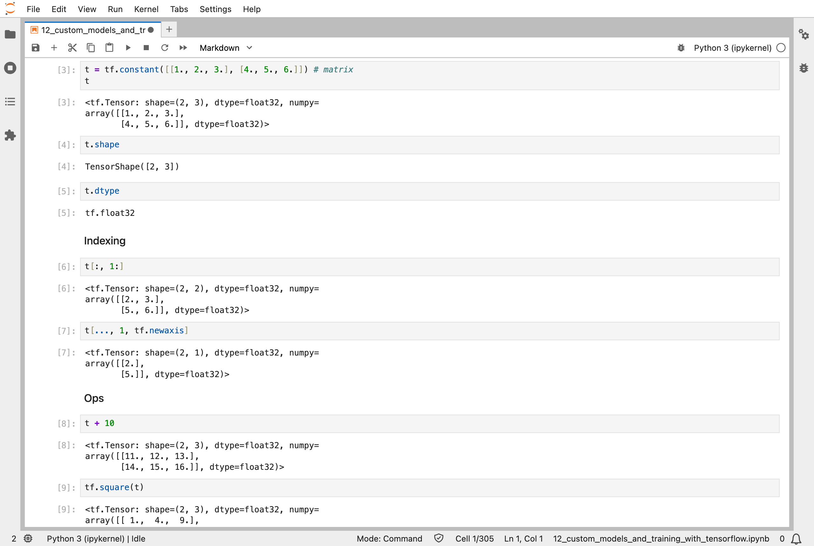
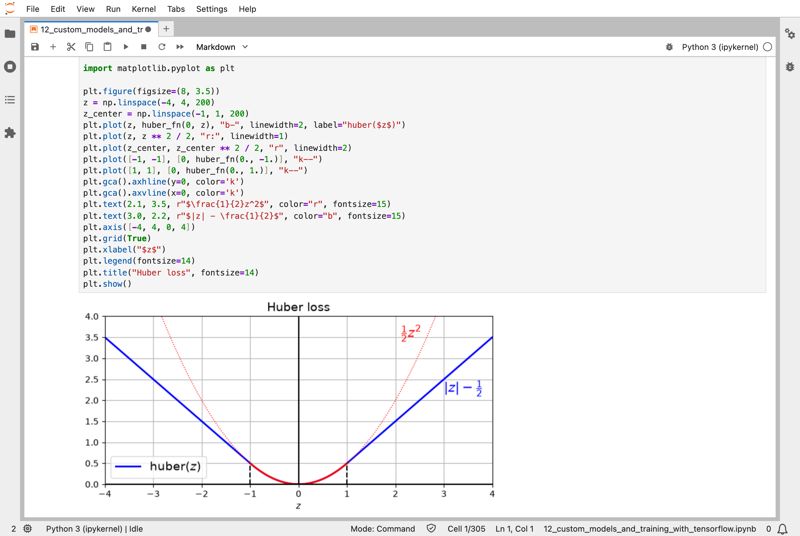
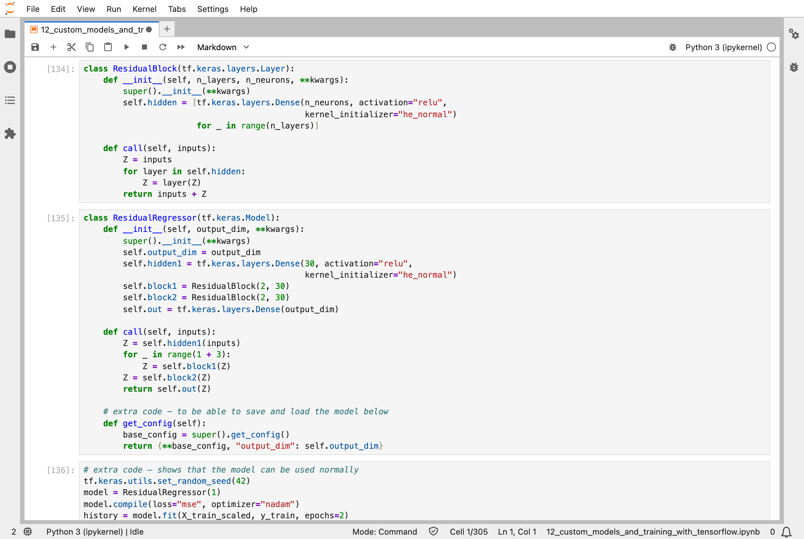
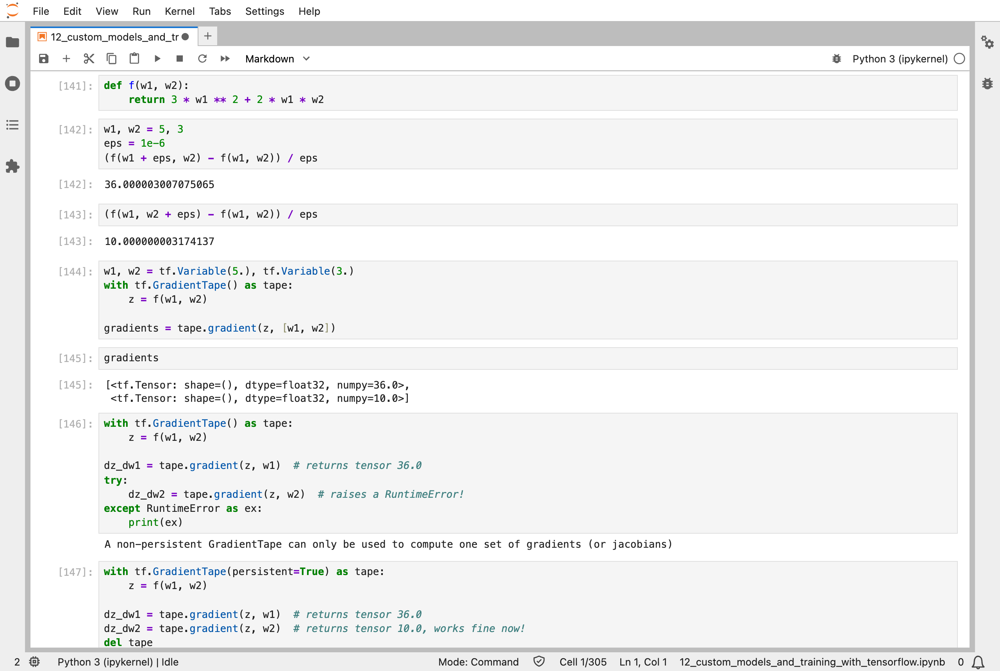
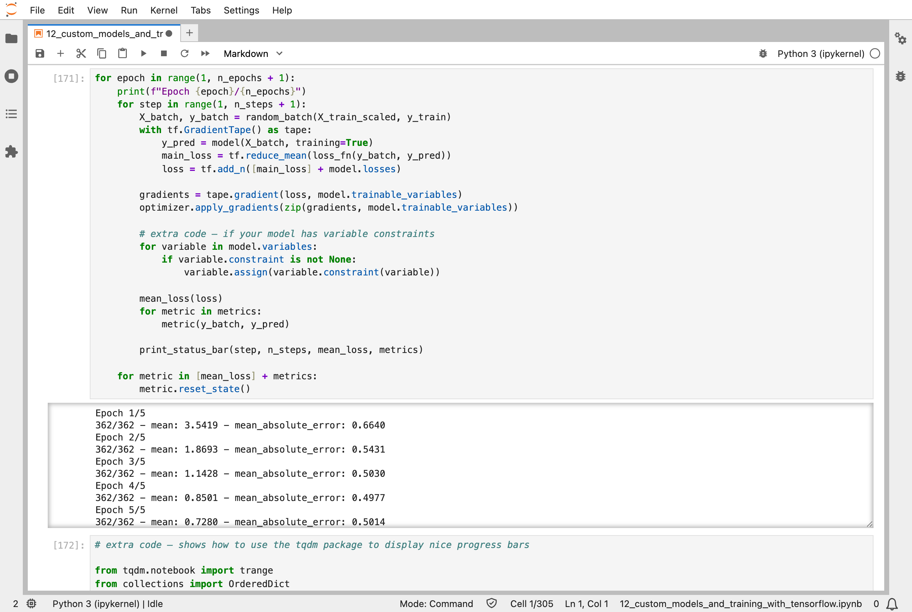
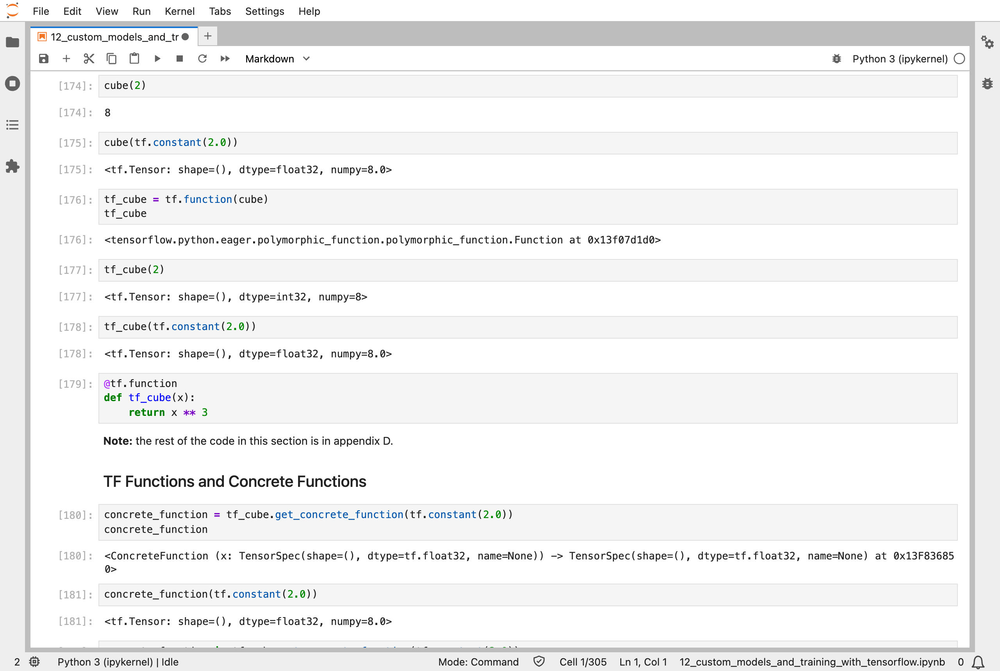
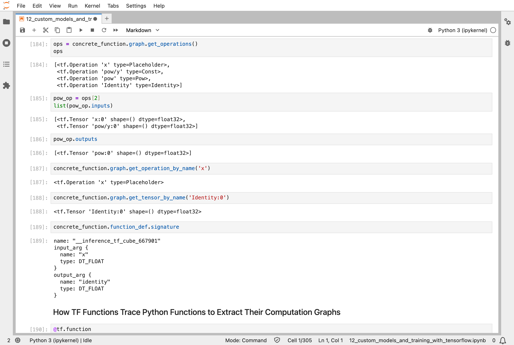

In [Part 11](/posts/sklearn11/), every network learned inside a single call to Keras's `fit()`. This chapter of the Hands-On Machine Learning book opens that call up. It goes below Keras to TensorFlow itself, and shows how to write the training loop by hand: pick some examples, measure how wrong the network is, work out each number's slope, and nudge. The task is the California house prices from [Part 2](/posts/sklearn2/), with a small network of 301 numbers. It is the real data and the real job, but a deliberately tiny network, so that the loop is easy to see.

In my run, the loop took the average error from 0.66 to 0.50 over five rounds, which is about $50,000 on a house price: about the same as the neural networks in [Part 10](/posts/sklearn10/) on this data.

## Key Points

**The lesson:** `fit()` is a short loop, and I can write it myself. About ten lines do the real work: pick a batch, run it through the model while TensorFlow records what it does, ask TensorFlow for every number's slope, and nudge. The recording is what makes slopes automatic: TensorFlow does not work them out from a formula, it replays the record backwards. Writing the loop by hand gives full control and makes it easy to get something subtly wrong, so the book recommends `fit()` unless the extra control is needed.

**What I learned from it:**
- Tensors, the arrays of numbers that TensorFlow works with, behave much like NumPy arrays.
- Losses, layers, and whole models can be written as ordinary Python functions and classes, such as the Huber loss, which is less upset by a few very wrong answers.
- A function that TensorFlow turns into a graph of operations runs faster, which Keras does to `fit()` automatically.

:::brain-power
Before reading on, try to write the training loop from memory, using the steps from [Part 10](/posts/sklearn10/) and [Part 11](/posts/sklearn11/). What has to happen on every step, and in what order?
:::

## Quick Example

The training loop, written by hand. It trains a small network, 8 inputs to 30 neurons to 1 output, 301 numbers in all, to predict [California house prices](/posts/sklearn2/):

```python
for epoch in range(1, n_epochs + 1):
    for step in range(1, n_steps + 1):
        X_batch, y_batch = random_batch(X_train_scaled, y_train)
        with tf.GradientTape() as tape:
            y_pred = model(X_batch, training=True)
            main_loss = tf.reduce_mean(loss_fn(y_batch, y_pred))
            loss = tf.add_n([main_loss] + model.losses)

        gradients = tape.gradient(loss, model.trainable_variables)
        optimizer.apply_gradients(zip(gradients, model.trainable_variables))
```

Each of the four steps from earlier parts is one or two lines: pick a batch of 32 houses, run them through the model while the tape records, find every number's slope with `tape.gradient`, and nudge with `apply_gradients`. Here is what it did over 5 epochs of 362 steps when I ran the notebook:

| Epoch | Average loss | Average error (mean absolute error, MAE) |
|---|---|---|
| 1 | 3.54 | 0.664 |
| 2 | 1.87 | 0.543 |
| 3 | 1.14 | 0.503 |
| 4 | 0.85 | 0.498 |
| 5 | 0.73 | 0.501 |

The prices are in units of $100,000, so an average error of 0.50 is about $50,000. The loss includes a penalty for large weights (called an L2 penalty), which keeps them small, so it can keep falling while the error stays level, as it does from epoch 3 on.

:::watch-it An "epoch" here is not a pass through the data
In `fit()`, one epoch shows the model every training example once. This loop's `random_batch` picks 32 houses at random on every step, so some houses come up twice in an epoch and others not at all. Here, "epoch" just means 362 steps. Small details like this are why the book suggests writing a custom loop only when `fit()` cannot do what you need.
:::

## What training means here

This chapter takes the lid off the training from [Part 10](/posts/sklearn10/) and [Part 11](/posts/sklearn11/). Nothing new happens; I can just see it all.

The slopes come from automatic differentiation. The notebook shows it on a tiny function, f(w1, w2) = 3w1² + 2w1w2, at w1 = 5 and w2 = 3. Nudging each input by a millionth and watching how much f changes gives slopes of 36.000003 and 10.000000003. `tf.GradientTape` gives exactly 36 and 10, from a single trip backwards through the recorded operations. Nudging each number by hand would need one extra calculation per number; the tape finds every slope in one trip backwards, which is what makes backpropagation possible for a network with millions of numbers.

My [MiniGPT](/posts/minigpt-grown/) model is trained by a loop with the same steps, written in PyTorch instead of TensorFlow. In [MiniGPT, grown in code you can read](/posts/minigpt8/), I wrote that loop out by hand too, and the two line up step for step:

```python
X_batch, y_batch = random_batch(...)       # MiniGPT: pick_snippets
main_loss = loss_fn(y_batch, y_pred)       # MiniGPT: surprise_score
gradients = tape.gradient(loss, ...)       # MiniGPT: .backward()
optimizer.apply_gradients(...)             # MiniGPT: nudge_every_number
```

The differences are in the details: this loop nudges with plain gradient descent, and MiniGPT with AdamW; PyTorch records the operations automatically, without a `with tf.GradientTape()` block.

:::no-dumb-questions
**Q: If `fit()` does all this already, why write the loop by hand?**

A: For training that does not fit `fit()`'s pattern. The book's example is a model with two parts that need different optimizers. Most of the time `fit()` is the better choice: it is shorter and has fewer places to make a mistake.

**Q: What does `tf.function` add?**

A: Speed. The first time a `tf.function` runs, TensorFlow traces the Python code and records it as a graph of operations, such as the four operations for `x ** 3` in the notebook. Later calls run the graph directly, without Python. Keras does this to `fit()`'s training step automatically.

**Q: Why the Huber loss?**

A: The usual loss for regression squares each error, so one house priced $300,000 wrong counts nine times as much as one priced $100,000 wrong. The Huber loss squares small errors but only counts large ones in proportion, so a few odd houses do not pull the whole model towards them.

**Q: Is writing a custom training loop in TensorFlow still worth learning?**

A: The ideas are: a forward pass, a loss, slopes from backpropagation, and a nudge. Every framework does exactly this. The TensorFlow details are less certain, because much of the field has moved to PyTorch, whose training loops are written by hand as a matter of course. I would treat this part as a clear view of what `fit()` does for you, rather than as something I would write often.
:::

## The same loop in PyTorch

My MiniGPT training loop is in PyTorch, so I wrote the housing loop from this chapter in PyTorch as well, to see the two side by side. It is the same network, 8 inputs to 30 neurons to 1 output, the same plain gradient descent with a step size of 0.01, the same batches of 32 chosen at random, and the same L2 penalty of 0.05 on the weights:

```python
for epoch in range(1, n_epochs + 1):
    for step in range(n_steps):
        idx = torch.randint(len(X), (batch_size,), device=device)   # random_batch
        X_batch, y_batch = X[idx], y[idx]
        y_pred = model(X_batch)                                      # forward pass
        main_loss = loss_fn(y_pred, y_batch)                         # loss
        loss = main_loss + 0.05 * sum((p ** 2).sum() for n, p in model.named_parameters() if n.endswith("weight"))
        optimizer.zero_grad()
        loss.backward()                                              # slopes
        optimizer.step()                                             # nudge
```

There is no tape: `loss.backward()` walks back through whatever PyTorch recorded while the forward pass ran, and leaves each number's slope in its `.grad`. Here is what it did over 5 epochs of 362 steps, on my Mac's processor, next to the TensorFlow loop above:

| Epoch | TensorFlow loss | PyTorch loss | TensorFlow error (MAE) | PyTorch error (MAE) |
|---|---|---|---|---|
| 1 | 3.54 | 2.84 | 0.664 | 0.655 |
| 2 | 1.87 | 1.49 | 0.543 | 0.517 |
| 3 | 1.14 | 1.18 | 0.503 | 0.521 |
| 4 | 0.85 | 0.80 | 0.498 | 0.494 |
| 5 | 0.73 | 0.70 | 0.501 | 0.495 |

The two runs draw different random batches and start from different random numbers, so they do not match digit for digit, but they tell the same story: the loss falls, and the error settles at about 0.50, around $50,000.

My Mac has a graphics processor, an Apple M1 Max, so I also ran the PyTorch loop on it, using PyTorch's Metal backend (called MPS). It gave a similar result, and it was slower: 4.0 seconds for the 5 epochs, against 0.3 seconds on the processor. The network is tiny, and each step does so little work that sending it to the graphics processor costs more than it saves. I found the same with TensorFlow. With the Metal plugin, one epoch of the convolutional GAN from [Part 17](/posts/sklearn17/) took 96 seconds for the whole notebook, against 70 seconds on the processor, and a two-epoch test of the diffusion model had still not finished on the graphics processor after 25 minutes, when I stopped it, though its epochs take only a minute or two on the processor. A graphics processor pays off with larger batches and bigger models, which is not what these small notebooks use.

## Running the notebook in Jupyter

The chapter is in the notebook that goes with the book, [12_custom_models_and_training_with_tensorflow.ipynb](https://github.com/ageron/handson-ml3/blob/main/12_custom_models_and_training_with_tensorflow.ipynb). I ran everything before the exercise solutions, which took less than a minute on my Mac Studio, because its models are small and train for only a few epochs. Then I looked through the results in JupyterLab.


*Tensors behave much like NumPy arrays: a 2 × 3 matrix, its shape and type, slices of it, and arithmetic on every element*


*The Huber loss: a curve for small errors, and straight lines for large ones, which grow more slowly than the squared error (dotted)*


*A custom model written as Python classes: a residual block adds its input back to its output, the skip connection that helps deep networks train*


*The same slopes found two ways: nudging each input by a millionth gives about 36 and 10, and the gradient tape gives exactly 36 and 10*


*The training loop written by hand, and its output: the loss falls from 3.54 to 0.73 over 5 epochs*


*A Python function, `cube`, turned into a TensorFlow function: it gives the same answers, and runs as a graph*


*Inside the graph for `x ** 3`: four operations, an input, the constant 3, the power, and the output*

:::bullet-points Custom training, in short
- TensorFlow works with tensors, NumPy-like arrays, and variables, the tensors a model nudges.
- Losses, metrics, layers, and whole models can be written as ordinary Python functions and classes.
- `tf.GradientTape` records a calculation and finds every slope in one trip backwards.
- A training loop is four steps, repeated: pick a batch, measure the loss, find the slopes, and nudge. It is the same in PyTorch, and gave the same result.
- `fit()` runs the same loop for you, and is usually the better choice.
:::

Next, [Scikit-Learn (Part 13)](/posts/sklearn13/) works through chapter 13: loading and preprocessing data with TensorFlow.

## References

- [Aurélien Géron's chapter 12 notebook](https://github.com/ageron/handson-ml3/blob/main/12_custom_models_and_training_with_tensorflow.ipynb) - for Hands-On Machine Learning with Scikit-Learn, Keras, and TensorFlow (third edition)
- [Scikit-Learn (Part 11)](/posts/sklearn11/) - training deep neural networks
- [MiniGPT, grown in code you can read](/posts/minigpt8/) - the same training loop, written by hand in PyTorch
- [TensorFlow](https://www.tensorflow.org/guide/autodiff) - the guide to automatic differentiation
