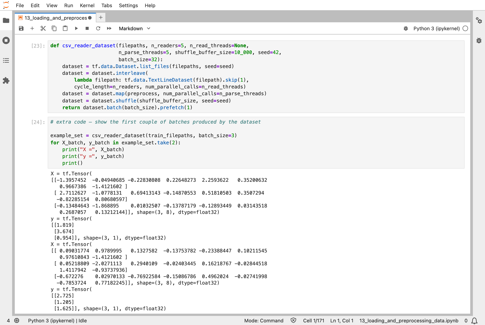
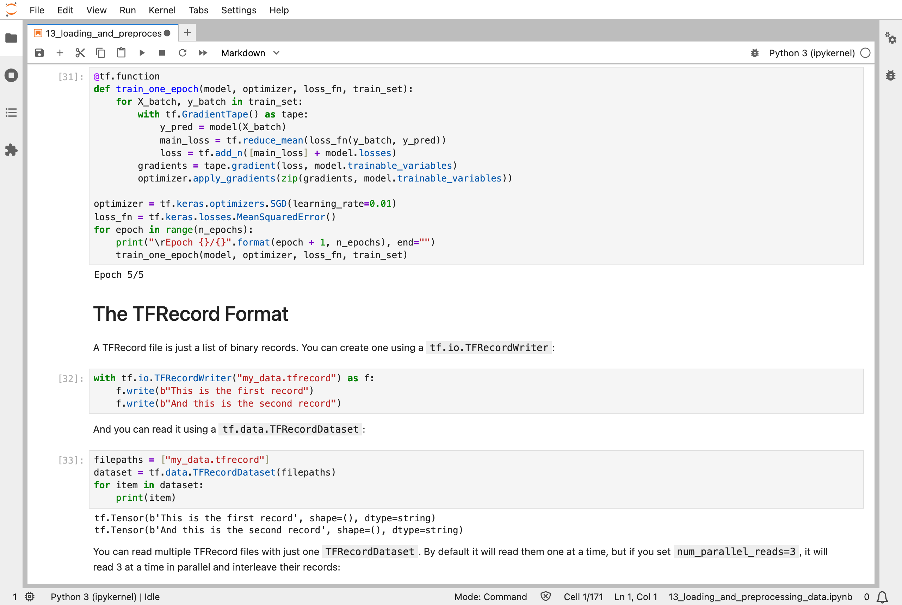
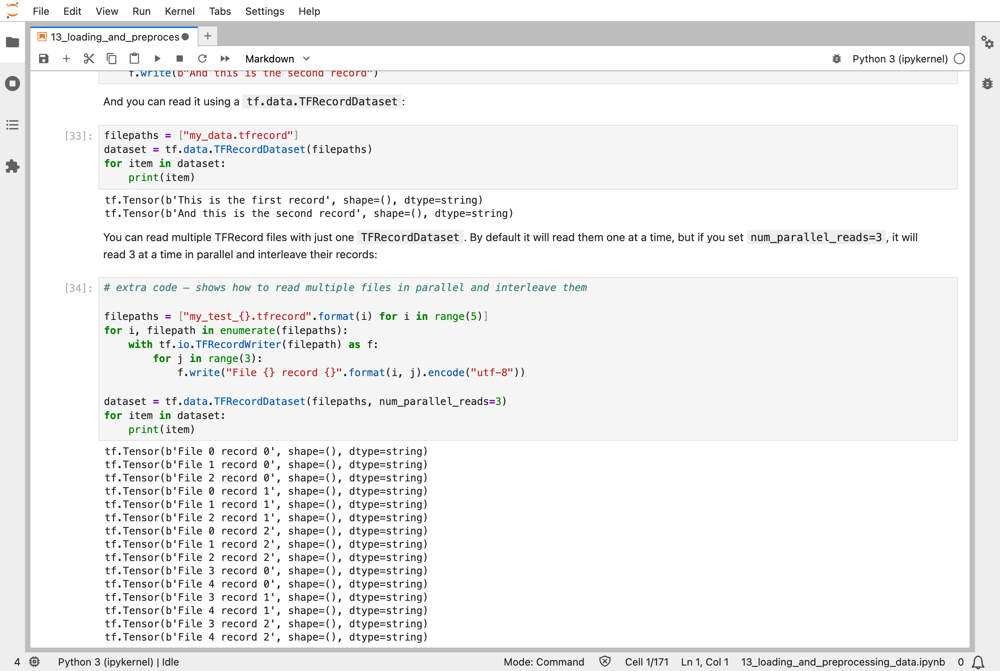
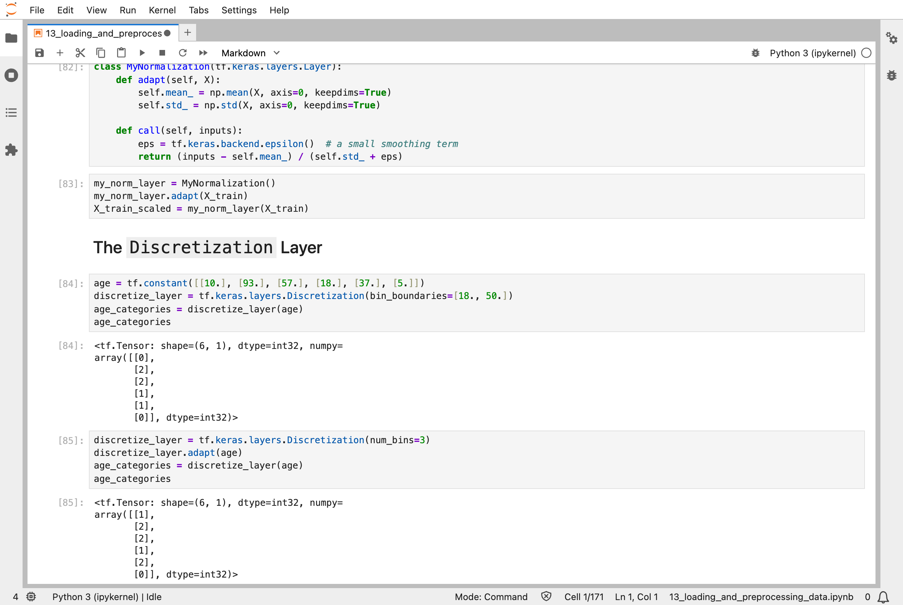
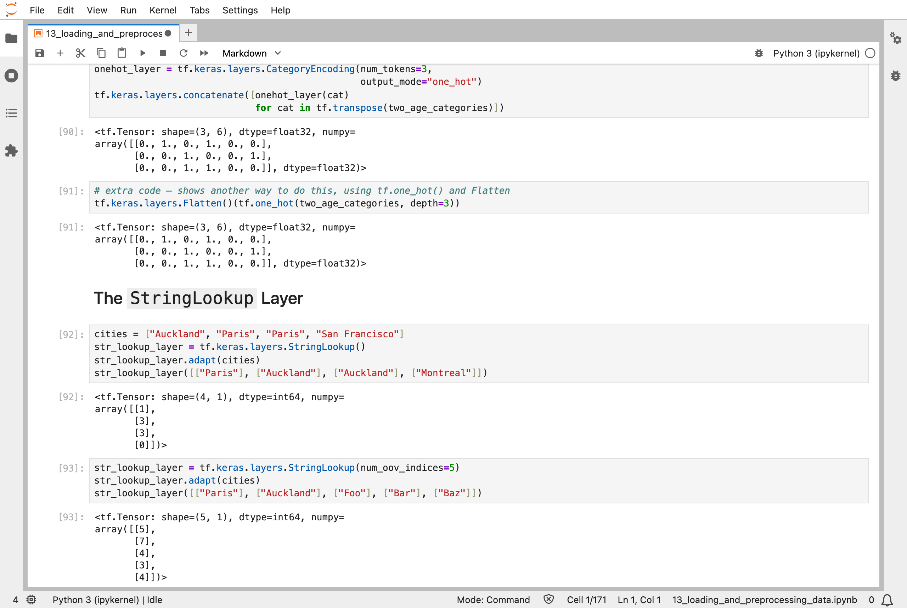
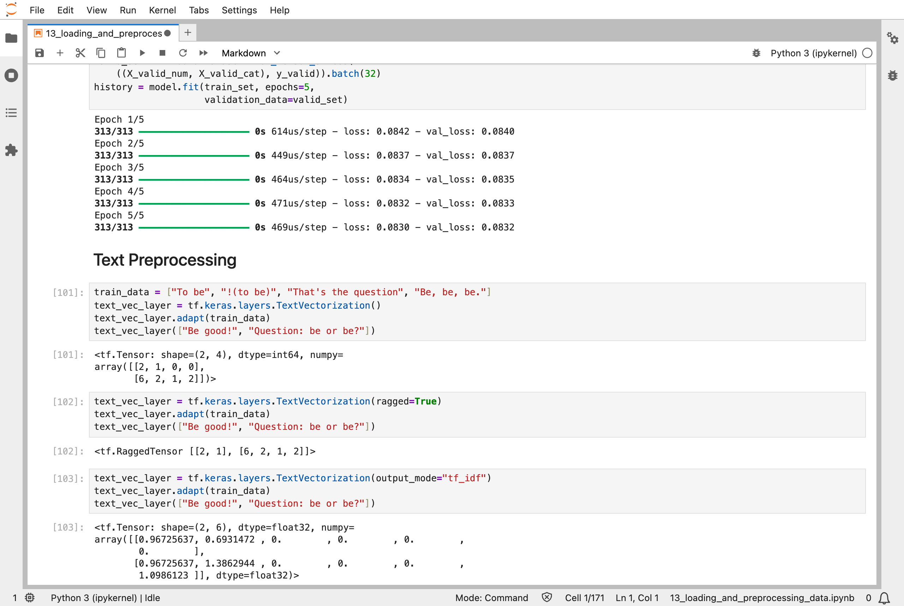
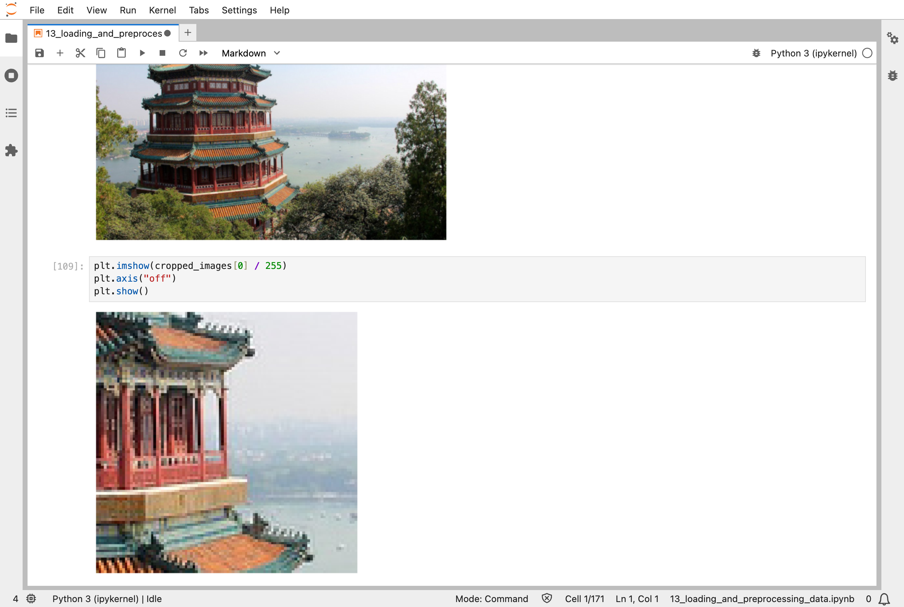

In [Part 12](/posts/sklearn12/), I wrote my own training loop, but the data always sat in memory as one array. This chapter of the Hands-On Machine Learning book is about the step before that loop: getting a large amount of data to the model efficiently, and turning raw things such as city names or sentences into numbers a model can use. The first example is made up. The California housing data is small, but the notebook splits it into 20 files, as if it were too big to fit in memory, and reads it back a piece at a time. The later examples, such as sentences and handwritten digits, are real.

The small network from [Part 10](/posts/sklearn10/) trained on data read this way, in batches of 32, and ended with a typical error of about $65,000 on districts that it had never seen. That is no better than before, and it is not meant to be: nothing about how the model learns changes in this chapter.

## Key Points

**The lesson:** a training loop only needs a stream of batches. TensorFlow's `tf.data` makes that stream from a recipe: read the files, turn each line into numbers, shuffle, group into batches, and prepare the next batch while the model is still busy with the current one. The recipe never needs all the data in memory at once. The conversion of raw things into numbers can also be built into the model as layers, so that exactly the same steps run on training data and on new data.

**What I learned from it:**
- Shuffling happens twice, on purpose: the files are shuffled, and so are the rows within a buffer, so that a batch is a fair sample and not a run of neighbours.
- A layer can turn ages into bands, city names into numbers, and sentences into word counts, and once it has looked at the training data, it never changes.
- For data that does not fit in a table, TensorFlow has its own binary file format, which I tried on a few records.

:::brain-power
The housing data in the notebook is split over 20 files. The pipeline shuffles the order of the files, and then shuffles individual rows again later. Before reading on, why would one shuffle not be enough?
:::

## Quick Example

The notebook splits the [California housing](/posts/sklearn2/) data into 20 CSV files (CSV is short for comma-separated values, a text file with one row per line), then builds a pipeline that reads them:

```python
def csv_reader_dataset(filepaths, n_readers=5, n_read_threads=None,
                       n_parse_threads=5, shuffle_buffer_size=10_000, seed=42,
                       batch_size=32):
    dataset = tf.data.Dataset.list_files(filepaths, seed=seed)
    dataset = dataset.interleave(
        lambda filepath: tf.data.TextLineDataset(filepath).skip(1),
        cycle_length=n_readers, num_parallel_calls=n_read_threads)
    dataset = dataset.map(preprocess, num_parallel_calls=n_parse_threads)
    dataset = dataset.shuffle(shuffle_buffer_size, seed=seed)
    return dataset.batch(batch_size).prefetch(1)
```

Each line is one step: list the files in a shuffled order, read 5 files at a time and interleave their lines (skipping each file's header row), turn each line of text into numbers, shuffle the rows, group them into batches of 32, and keep one batch ready ahead of time. When I trained the same small network from [Part 10](/posts/sklearn10/) on it, with 363 steps per epoch, this is what I got:

| Epoch | Training loss | Validation loss |
|---|---|---|
| 1 | 0.79 | 934.37 |
| 2 | 6.68 | 4.53 |
| 3 | 0.64 | 0.53 |
| 4 | 0.48 | 0.45 |
| 5 | 0.44 | 0.42 |

On the test set, the loss was 0.4248. The loss is the mean squared error, and the prices are in units of $100,000, so a loss of 0.42 is a typical error of about $65,000 (the square root of 0.42 is about 0.65).

:::watch-it The first epoch nearly blew up
The validation loss started at 934.37, thousands of times worse than where it ended. The pipeline was not at fault. The model trains with plain gradient descent at its default step size, and in the first epoch a step was too big. It then recovered and settled. This is the same trap as the learning rate in [Part 4](/posts/sklearn4/): when the loss jumps around at the start, it is usually the step size, not the data.
:::


*Two batches from the pipeline, each three rows of eight scaled numbers, with the three prices beside them*

## What training means here

Nothing about learning changes in this chapter. The model still starts from random numbers, and the loop from [Part 12](/posts/sklearn12/) still picks a batch, measures the loss, finds the slopes, and nudges. The notebook even trains with that hand-written loop, now fed by the pipeline instead of an array.

What the chapter changes is the first line of the loop, "pick a batch". With a small dataset in memory, picking a batch is one line of NumPy. With a dataset spread over many files, it is a pipeline: files are shuffled, rows are interleaved from several files so that neighbouring rows do not come from the same place, and the next batch is prepared while the current one is being used.

My [MiniGPT](/posts/minigpt-grown/) model has the same step: each training step starts by picking a batch of text snippets at random. Its training text is small enough to hold in memory, so its picking is a single function. A pipeline like this chapter's is what that single function turns into when the text is too big for memory.

The second half of the chapter is about preprocessing. Raw data is not numbers: it is a city name, an age, a sentence. The notebook turns each into numbers with a layer, and the layer's settings are learned from the training data once, with `adapt()`, and then fixed, much like the scaling in [Part 2](/posts/sklearn2/).

:::no-dumb-questions
**Q: Why shuffle the files and the rows?**

A: Shuffling the files changes which file each reader starts on. The interleave then mixes lines from 5 files at a time. The row shuffle afterwards mixes lines within a buffer of 10,000. Together they make each batch a fair sample, so the model does not see a long run of rows from one place and swing towards it.

**Q: What does `prefetch(1)` do?**

A: It prepares the next batch while the model works on the current one. Without it, the model would wait for the data after every step. With a larger dataset and a graphics processor (GPU), this is often the biggest speed-up in the pipeline.

**Q: Why use the TFRecord format instead of plain CSV files?**

A: TFRecord files are binary, so they read faster and store images and other structures that do not fit in a CSV row. The book's notebook writes records of text, then records holding a person's name, id, and email addresses, and reads them back. For small tables of numbers, CSV is fine.

**Q: Is all of this still how people load data?**

A: The ideas are: stream the data in batches, shuffle it, and prepare the next batch early. Every framework does these. The details here are specific to TensorFlow, and PyTorch has its own equivalent, called a `DataLoader`. For text, the preprocessing layers in this chapter have largely been replaced by dedicated tokenizers, like the one my MiniGPT model uses to turn letters into numbers.
:::

## Running the notebook in Jupyter

The chapter is in the notebook that goes with the book, [13_loading_and_preprocessing_data.ipynb](https://github.com/ageron/handson-ml3/blob/main/13_loading_and_preprocessing_data.ipynb). I ran everything before the exercise solutions, which took about 4 minutes on my Mac Studio, and then looked through the results in JupyterLab. The notebook needs the Protocol Buffers compiler, `protoc`, for its custom-protobuf section, and TensorFlow Datasets for the last section.


*A TFRecord file is a list of binary records: I wrote two, and read them back as tensors of bytes*


*Five files of three records each, read three at a time: the records come out interleaved, File 0, File 1, File 2, then the next round, before files 3 and 4 are read*


*A `Discretization` layer puts ages into bins: with boundaries at 18 and 50, ages 10, 93, 57, 18, 37, and 5 become 0, 2, 2, 1, 1, and 0; the same layer can also choose its own three bins from the data*


*A `StringLookup` layer turns city names into numbers: "Montreal", which it never saw, becomes 0; with five spare slots for unknown words, "Foo", "Bar", and "Baz" land in slots 4, 3, and 4*


*`TextVectorization` turns sentences into numbers: each word gets a number, and with `tf_idf` each sentence becomes a row of weights, where a word that appears twice, such as "be", counts for more, and a word that is common across all the sentences counts for less*


*A `CenterCrop` layer cuts a 100 × 100 square out of the middle of a sample photo: the pixels are large, because the picture has been cut, not stretched*

:::bullet-points Loading and preprocessing, in short
- A `tf.data` pipeline reads, transforms, shuffles, batches, and prefetches data a little at a time, so a dataset never has to fit in memory.
- Shuffling the files, interleaving their lines, and shuffling the rows together make each batch a fair sample.
- TFRecord is TensorFlow's binary format: a list of records, usually `tf.train.Example` protocol buffers.
- Keras preprocessing layers turn numbers, categories, words, and images into model inputs, and live inside the model.
- None of it changes how the model learns; it changes how well the batches are made and how fast they arrive.
:::

Next, [Scikit-Learn (Part 14)](/posts/sklearn14/) works through chapter 14: deep computer vision with convolutional neural networks.

## References

- [Aurélien Géron's chapter 13 notebook](https://github.com/ageron/handson-ml3/blob/main/13_loading_and_preprocessing_data.ipynb) - for Hands-On Machine Learning with Scikit-Learn, Keras, and TensorFlow (third edition)
- [Scikit-Learn (Part 12)](/posts/sklearn12/) - custom models and training with TensorFlow
- [tf.data](https://www.tensorflow.org/guide/data) - the TensorFlow guide to building input pipelines
- [TensorFlow Datasets](https://www.tensorflow.org/datasets) - ready-made datasets
