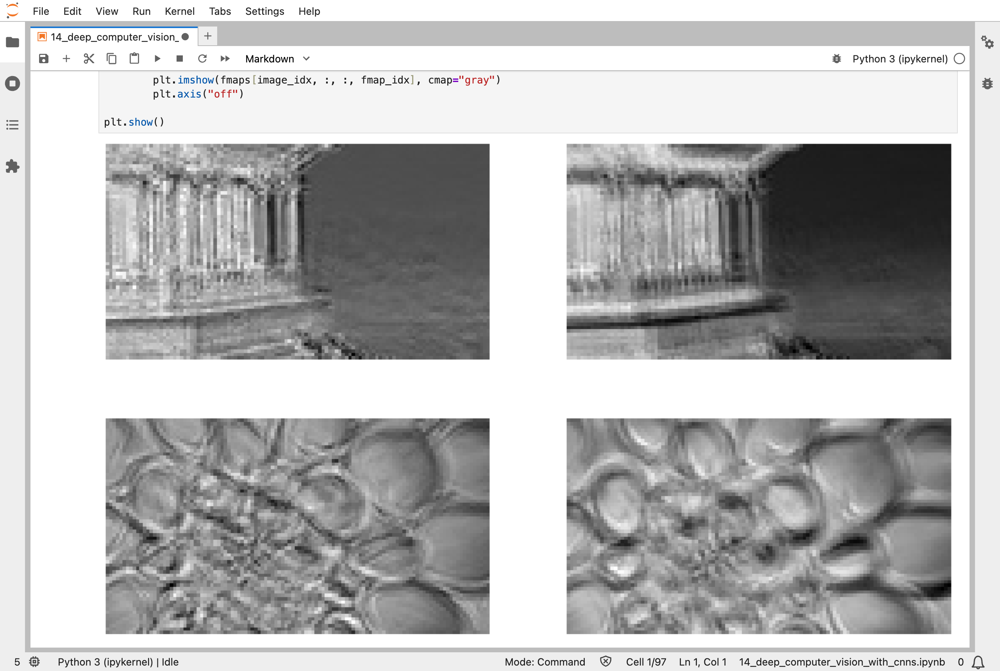
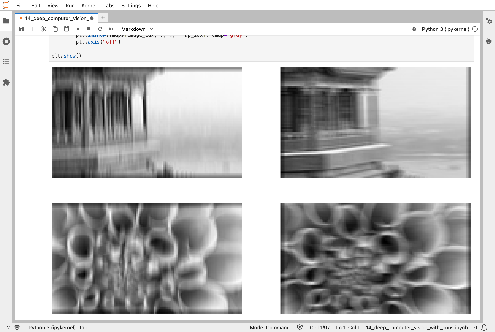
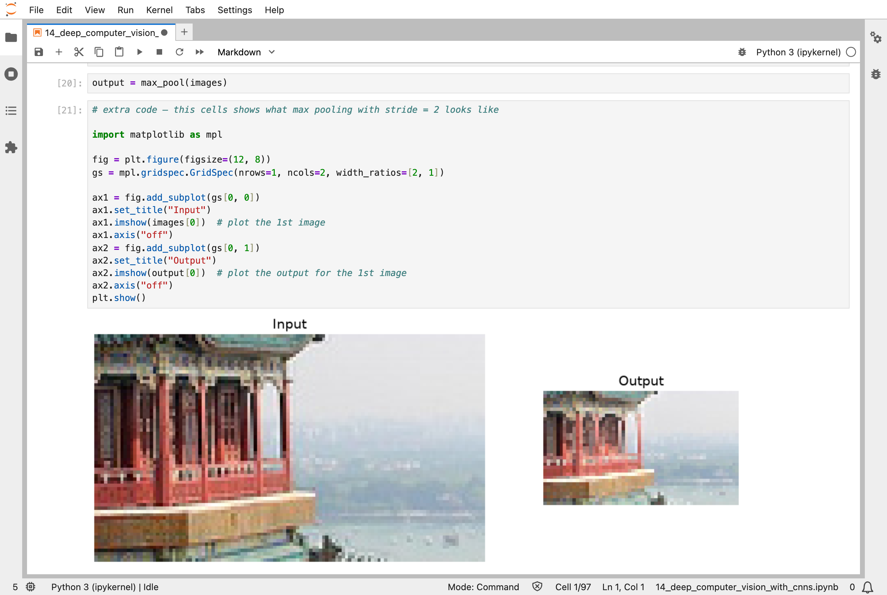
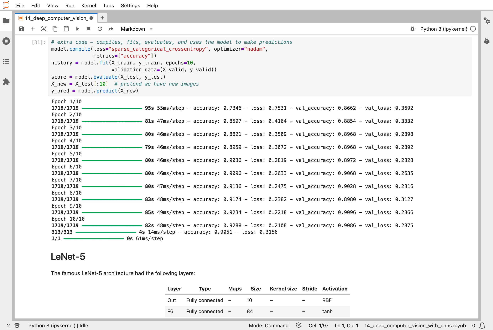
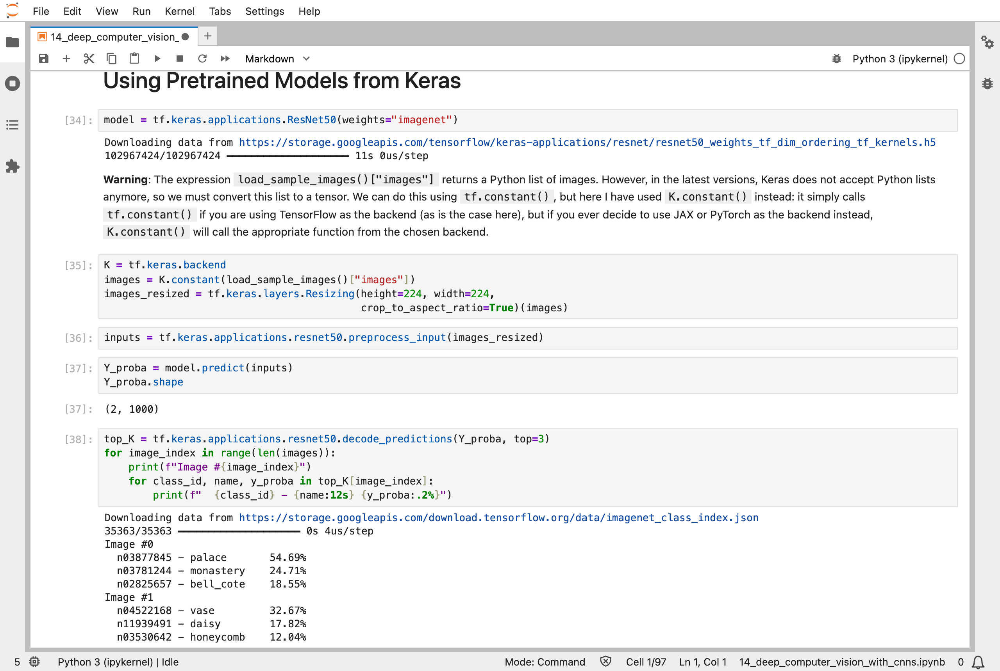
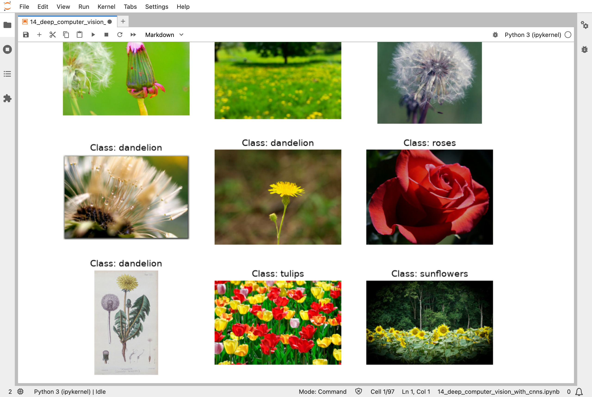
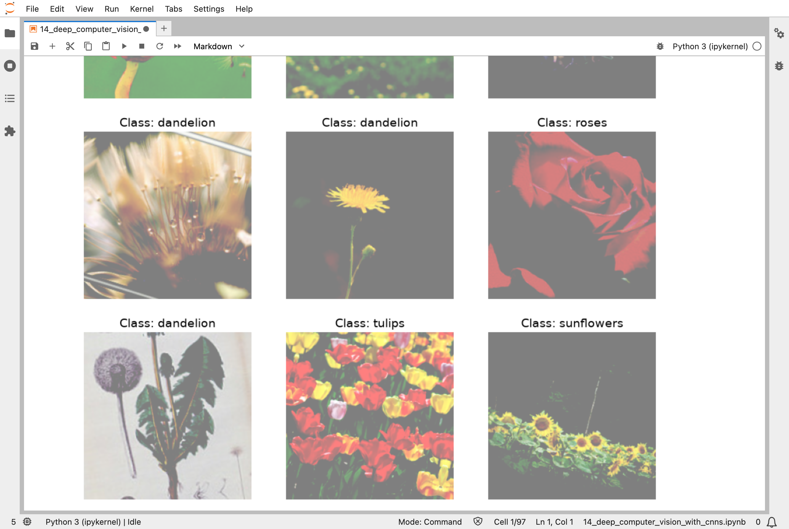
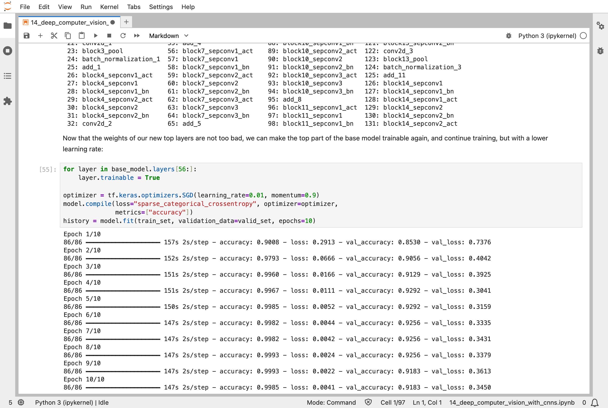

In [Part 13](/posts/sklearn13/), I built pipelines that feed data to a model, including images. This chapter of the Hands-On Machine Learning book is about the models that suit pictures best. Instead of looking at all the pixels at once, as the network in [Part 10](/posts/sklearn10/) did, they look at small patches, with the same few numbers reused across the whole picture. They are called convolutional neural networks (CNNs).

The tasks are real. A small CNN looked at the same clothing pictures as Part 10 and was right on 90.5% of the test pictures, about three points better than the earlier network. And an existing network, trained by someone else on a million pictures, was retrained a little to tell five kinds of flowers apart, reaching 91.8% on pictures that it had not seen, though it had memorised its training pictures almost perfectly (99.9%).

## Key Points

**The lesson:** a picture has the same patterns wherever they are, such as an edge or a corner. A convolutional layer slides a small grid of numbers, a filter, across the whole picture, so it finds a pattern wherever it appears and needs far fewer numbers than a layer connected to every pixel. Training nudges the filters: they start random, and become edge finders, then texture finders, then finders of parts of objects. And because someone else's network has already learned those, starting from it beats starting from nothing.

**What I learned from it:**
- Shrinking the picture between layers, by keeping only the strongest value in each small region, widens what each later layer sees.
- Reusing a trained network works in two steps: first train only the new top layers, then unfreeze part of the old network and keep training with a smaller step size.
- A network can learn its training pictures almost perfectly and still be worse on new ones, as the flower network shows.

The chapter also covers the famous network designs of the last 30 years, and finding where in a picture an object is. I do not go into those here.

:::brain-power
A clothing picture is 28 × 28 = 784 pixels. In [Part 10](/posts/sklearn10/), every neuron in the first layer looked at all 784 of them. What would that network miss about pictures? Think about a shirt that has shifted a few pixels to the left.
:::

## Quick Example

A small CNN for the same Fashion MNIST clothing pictures as [Part 10](/posts/sklearn10/): five convolutional layers with pooling between them, then three ordinary layers at the end.

```python
DefaultConv2D = partial(tf.keras.layers.Conv2D, kernel_size=3, padding="same",
                        activation="relu", kernel_initializer="he_normal")
model = tf.keras.Sequential([
    DefaultConv2D(filters=64, kernel_size=7, input_shape=[28, 28, 1]),
    tf.keras.layers.MaxPool2D(),
    DefaultConv2D(filters=128),
    DefaultConv2D(filters=128),
    tf.keras.layers.MaxPool2D(),
    DefaultConv2D(filters=256),
    DefaultConv2D(filters=256),
    tf.keras.layers.MaxPool2D(),
    tf.keras.layers.Flatten(),
    tf.keras.layers.Dense(units=128, activation="relu", kernel_initializer="he_normal"),
    tf.keras.layers.Dropout(0.5),
    tf.keras.layers.Dense(units=64, activation="relu", kernel_initializer="he_normal"),
    tf.keras.layers.Dropout(0.5),
    tf.keras.layers.Dense(units=10, activation="softmax")
])
```

Each `Conv2D` layer slides its filters across the picture, and each `MaxPool2D` halves its width and height. The network has 1,413,834 numbers, and these are the results from my run, after 10 passes through 55,000 pictures:

| Measure | Result |
|---|---|
| Training pictures right, in the last pass | 92.9% |
| Validation pictures right, in the last pass | 90.9% |
| Test pictures right | 90.5% |
| The dense network from [Part 10](/posts/sklearn10/): 266,610 numbers, after 30 passes | 87.4% of the test pictures right |

The CNN has more numbers than the network from Part 10, not fewer, because it is deeper and has a wide final layer. But it learned faster, after only 10 passes, and got about 3 percentage points more of the test pictures right. Each pass took about 80 seconds.

And here is what I got when I took a ResNet50 that someone else had trained on ImageNet, and asked it about the two sample photos that come with Scikit-Learn:

| Photo | Its three best guesses |
|---|---|
| A temple building by a lake | palace 54.69%, monastery 24.71%, bell cote 18.55% |
| A close-up of a flower | vase 32.67%, daisy 17.82%, honeycomb 12.04% |

The first answer is reasonable. The second is a reminder that the model has 1,000 categories to choose from, and none of them is the right one for a plain close-up of this flower.

:::watch-it The flower classifier memorized its training pictures
When I trained the flower classifier, the training accuracy reached 99.85% and the validation accuracy only 91.83%. The validation loss was lowest in epoch 4, at 0.3041, and then rose again to 0.3450 while the training loss kept falling. That gap is overfitting, as in [Part 4](/posts/sklearn4/): the network had started to remember its 2,752 training pictures instead of learning flowers. The notebook trains for 10 epochs regardless, so the last result is a little worse than an earlier one. It also shows data augmentation, random flips, rotations, and contrast changes that make more varied training pictures, but it does not use it in the training, so that would be one way for me to narrow the gap.
:::

## What training means here

Nothing about learning changes here either. The numbers in the filters are nudged exactly as in [Part 10](/posts/sklearn10/) and [Part 11](/posts/sklearn11/): a batch of pictures goes in, the loss is measured, backpropagation finds the slopes, and every number moves a little. A filter is not designed by a person. It starts random, and training makes it useful.

The notebook shows this by comparing two kinds of filter. First, two filters made by hand, one a vertical line of ones and one a horizontal line. Applied to a photo, the first keeps the vertical edges, such as the pillars of a building, and the second keeps the horizontal ones. Second, filters that start out random, with no training at all: even these act like edge detectors, which the book says is a useful starting point. Training then improves them, layer by layer, from edges to textures to parts of objects.

Transfer learning is the clearest case of the training thread so far. The pretrained Xception network already has millions of numbers worth keeping, trained on pictures far more varied than 3,670 flowers. The notebook first freezes all of them, and trains only the new top layers, with a large step size (a learning rate of 0.1) for 3 epochs: that gave 85.3% validation accuracy. Then it unfreezes the network from layer 56 on, and continues for 10 epochs with a step size ten times smaller (0.01): that gave 91.8% by the end. The smaller step size matters, because large nudges would wreck what the pretrained layers already know.

My [MiniGPT](/posts/minigpt-grown/) model has no convolutions. It looks across its text with attention, which [Part 16](/posts/sklearn16/) covers. But the idea of reusing the same small set of numbers at every position is shared: a filter is applied at every position in a picture, and MiniGPT's blocks are applied at every position in a text.

:::no-dumb-questions
**Q: What is a convolution, in plain words?**

A: A small grid of numbers, a filter, is placed over a patch of the picture. Each pixel in the patch is multiplied by the number above it, and the results are added up, giving one number. Then the filter moves one step along and does it again. The grid of results shows where in the picture the filter's pattern appears.

**Q: Why does pooling throw information away?**

A: To make the picture smaller, so the next layer sees a wider view with less work. Max pooling keeps only the strongest value in each small region. A feature that moves by a pixel or two still gives the same output, which is useful, because a cat is still a cat if it shifts slightly.

**Q: Why unfreeze only the layers from 56 on, and why use a smaller learning rate?**

A: The early layers of a pretrained network find simple things, such as edges, which are useful for any picture. The later layers are more specific to the original task, so they are the ones worth adjusting. A smaller step size changes them gently, instead of undoing what they learned.

**Q: Are CNNs still the way to handle pictures?**

A: They are still widely used, and the ideas behind them, such as skip connections and transfer learning, are everywhere. Models called vision transformers, which use attention instead of convolutions, are also common now, and for the very largest tasks they have taken over some of the top results. A pretrained CNN is still a sensible first thing to try for a small project, as this chapter shows.
:::

## Running the notebook in Jupyter

The chapter is in the notebook that goes with the book, [14_deep_computer_vision_with_cnns.ipynb](https://github.com/ageron/handson-ml3/blob/main/14_deep_computer_vision_with_cnns.ipynb). I ran everything before the exercise solutions. It took about 75 minutes on my Mac Studio, most of it training the flower classifier, and it downloaded the pretrained ResNet50 and Xception weights and the flower pictures. Then I looked through the results in JupyterLab.


*A convolutional layer with random filters, before any training: each filter gives a new grey picture of the same photo, and even these random ones pick out edges*


*Two filters made by hand: the first, a vertical line, keeps vertical edges such as the pillars; the second, a horizontal line, keeps horizontal ones*


*Max pooling: the output is half the width and half the height of the input, and the main shapes survive*


*Training the CNN on Fashion MNIST: after 10 passes, 92.9% of the training pictures and 90.9% of the validation pictures are right, and 90.5% of the test pictures*


*The pretrained ResNet50 on the two sample photos: it calls the building a palace, and the flower a vase*


*Pictures from the flower dataset, each labelled with its class: dandelions, a rose, tulips, and sunflowers*


*The same pictures after random flips, small rotations, and contrast changes: the notebook displays this data augmentation, but does not use it in the training that follows*


*Fine-tuning the pretrained Xception: with its top layers unfrozen, the training accuracy reaches 99.9% and the validation accuracy peaks at 92.9%, then slips back to 91.8%*

:::bullet-points Convolutional networks, in short
- A convolutional layer slides a small filter across the picture, with the same numbers at every position.
- Pooling shrinks the picture, keeping the strongest values.
- Filters start random and are nudged by training, from edges in the early layers to parts of objects later on.
- A pretrained network can be reused: train the new top layers first, then unfreeze some of the old ones, with a smaller step size.
- Training can overfit, as the flower classifier shows: 99.9% on its own pictures, 91.8% on new ones.
:::

Next, [Scikit-Learn (Part 15)](/posts/sklearn15/) works through chapter 15: processing sequences using recurrent neural networks (RNNs) and CNNs.

## References

- [Aurélien Géron's chapter 14 notebook](https://github.com/ageron/handson-ml3/blob/main/14_deep_computer_vision_with_cnns.ipynb) - for Hands-On Machine Learning with Scikit-Learn, Keras, and TensorFlow (third edition)
- [Scikit-Learn (Part 13)](/posts/sklearn13/) - loading and preprocessing data with TensorFlow
- [Scikit-Learn (Part 11)](/posts/sklearn11/) - training deep neural networks, including transfer learning
- [Keras Applications](https://keras.io/api/applications/) - the pretrained models used in this chapter
