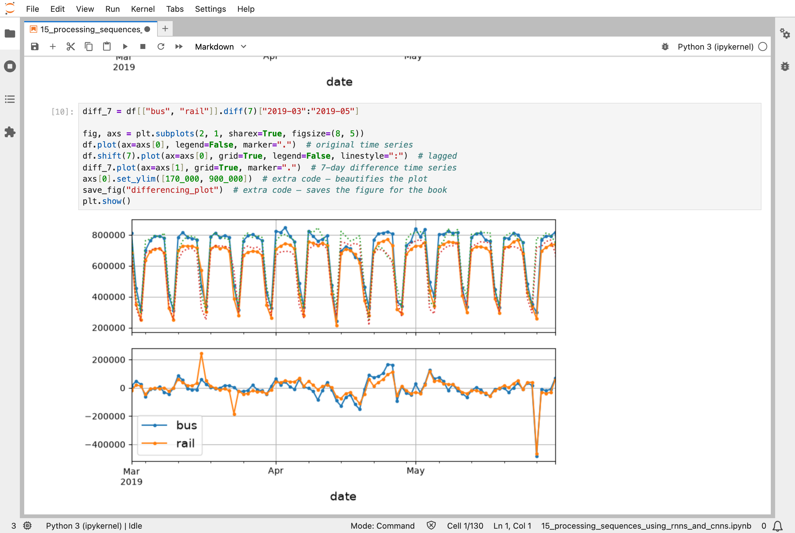
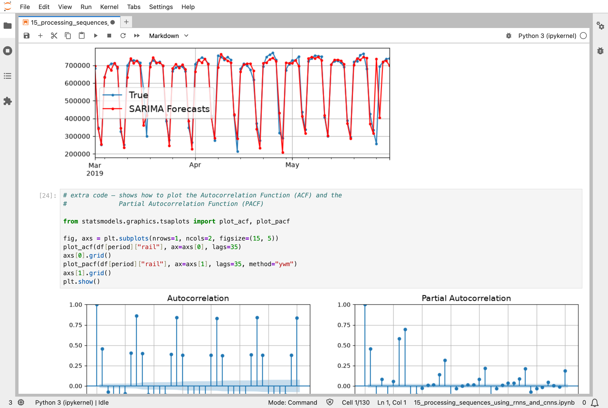
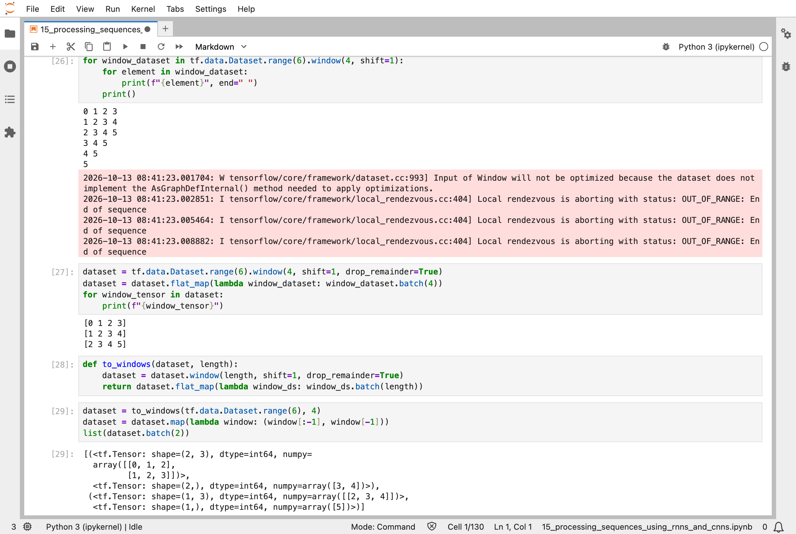
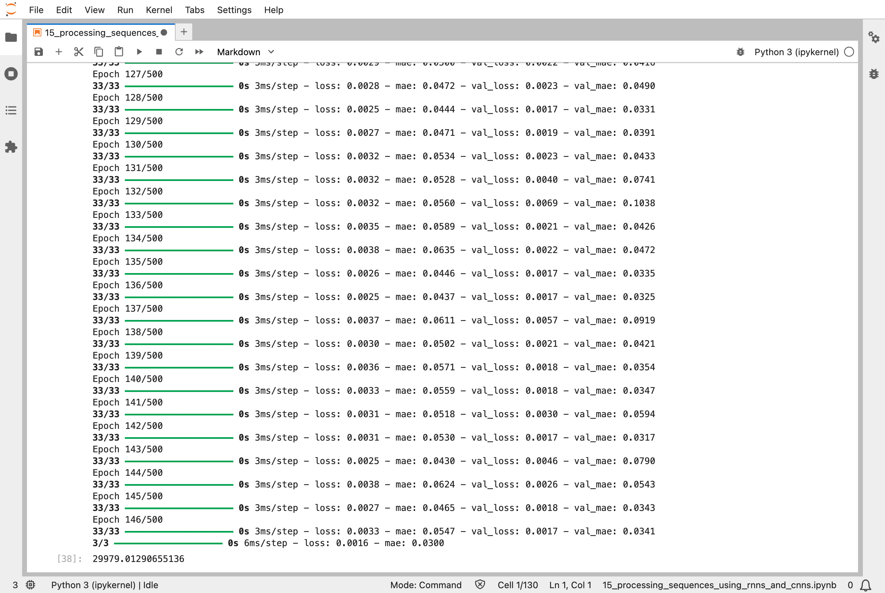
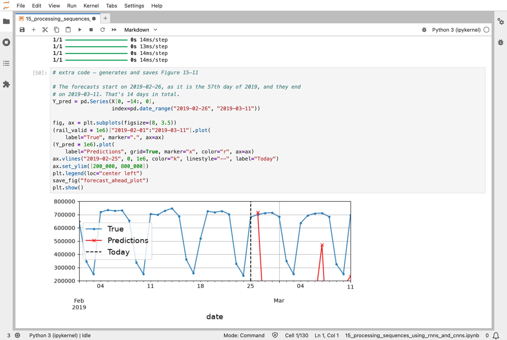
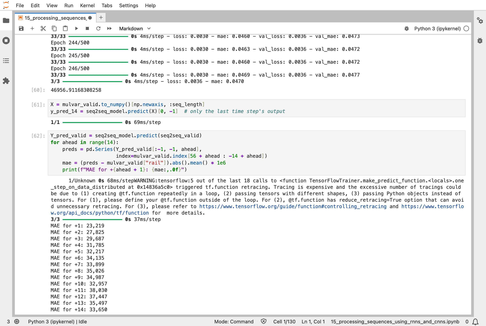

In [Part 14](/posts/sklearn14/), a convolutional network looked at a picture. The fifteenth chapter of the Hands-On Machine Learning book is about data in which the order matters: a sequence, such as a number for each day. It uses recurrent neural networks (RNNs), which read a sequence one step at a time and carry a memory from each step to the next, and it also shows that one-dimensional convolutions can handle sequences.

## Key Points

**What the chapter covers:**
1. **Forecasting a time series**: predicting the next value, or the next 14, from the values so far
2. **Baselines**: a naive forecast, and a statistical model called ARIMA (autoregressive integrated moving average) with a seasonal version, SARIMA (seasonal ARIMA)
3. **Preparing the data**: cutting a long series into overlapping windows of 56 days, each with a target
4. **Simple and deep RNNs**: a layer that reads a window one day at a time, and stacks of such layers
5. **Multivariate series and several steps ahead**: more than one input series, and forecasting 14 days at once
6. **Better memory cells**: layer normalization, LSTM (long short-term memory) cells, and GRU (gated recurrent unit) cells
7. **One-dimensional convolutions and WaveNet**: sliding filters along a sequence instead of an RNN

**What I learned from it:**
- Before building an RNN, work out what a simple guess scores. Here, "the same as last week" is hard to beat by much.
- An RNN reads a window one step at a time, and uses the same numbers at every step, like a convolutional filter in [Part 14](/posts/sklearn14/).
- Feeding a model its own forecasts to forecast further ahead makes its mistakes pile up.

:::brain-power
The notebook forecasts how many people board Chicago's trains each day. Before reading on, what is the simplest forecast you can make for next Tuesday, using nothing but the past data? How well do you think it would do?
:::

## Quick Example

The data is the Chicago Transit Authority's daily boarding totals, for buses and for trains, from 2001. The notebook trains on 2016 to 2018, and checks its models on January to May 2019. Every model gets a window of the last 56 days and forecasts the next day's train boardings. This is the first RNN model that worked well:

```python
univar_model = tf.keras.Sequential([
    tf.keras.layers.SimpleRNN(32, input_shape=[None, 1]),
    tf.keras.layers.Dense(1)
])
```

One `SimpleRNN` layer of 32 neurons reads the 56 days one at a time, and one ordinary neuron turns what it remembers into a forecast. The score is the mean absolute error (MAE): the average number of boardings by which the forecast is wrong, per day. Here is how each approach did when I ran the notebook:

| Forecast | Average error per day (boardings) |
|---|---|
| Naive: the same as one week earlier | 42,143 |
| SARIMA, retrained every day (statistical) | 32,041 |
| Linear model on the last 56 days | 37,674 |
| One `SimpleRNN` neuron | 102,752 |
| `SimpleRNN` with 32 neurons | 29,979 |
| Three stacked `SimpleRNN` layers of 32 | 30,425 |
| `SimpleRNN` with 5 inputs: bus, rail, and tomorrow's day type | 24,021 |

The naive and SARIMA figures are for March to May 2019, and the others for January to May 2019, so they are not exactly comparable, but they show the picture. Boardings are around 700,000 on a weekday, so an error of 24,000 is about 3% to 4%, and the naive forecast's 42,000 is about 6%. The 5-input model is the best: besides the rail history, it sees the bus history and the type of the next day, which tells it whether to expect a weekday or a weekend.

:::watch-it One neuron is not enough
A `SimpleRNN` with a single neuron scored 102,752, worse than doing nothing clever. It has too little memory to carry a week's pattern forward. The same layer with 32 neurons scored 29,979. When a recurrent model is much worse than the naive guess, this is the first thing I should check.
:::


*The naive forecast: the dotted line is the series moved forward by 7 days, and below it, the difference between the two lines is mostly small, apart from holidays such as Memorial Day at the end of May*

## What training means here

The RNN learns with the same loop as everything else in this series: a batch of windows goes in, the loss is measured, slopes are found by backpropagation, and every number is nudged. The new part is what the backward step has to cross. An RNN reads 56 days one at a time, using the same numbers at every step, so the slopes have to travel back through all 56 steps. The book calls this backpropagation through time. A long run of steps is also why RNNs are hard to train: the slopes can shrink to almost nothing or grow wildly, the problem from [Part 11](/posts/sklearn11/), and why the chapter introduces LSTM and GRU cells and layer normalization.

The data pipeline from [Part 13](/posts/sklearn13/) does the cutting. `timeseries_dataset_from_array` turns a series into overlapping windows, and the notebook shows how the same idea works step by step with a series of the numbers 0 to 5. Each window becomes one training example, with the next day as its target.

My [MiniGPT](/posts/minigpt-grown/) model is also trained to predict what comes next in a sequence, but it reads its letters with attention instead of a memory carried forward, and every position is looked at in the same step. [Part 16](/posts/sklearn16/) is about both ways of reading text.

:::no-dumb-questions
**Q: Why compare with a naive forecast at all?**

A: To know whether the model is worth having. If a clever model does no better than "the same as last week", the extra work buys nothing. Here the best RNN beat the naive forecast by roughly 40% (24,021 against 42,143), which is worth having. The 1-neuron RNN would not have been, and the baseline shows that.

**Q: What does "recurrent" mean?**

A: The layer's output at each step is fed back in, along with the next input, at the following step. So a day's forecast depends on that day's value and on a memory of all the days before it, which is kept in the layer's state.

**Q: What goes wrong when I forecast several days ahead?**

A: If the model forecasts one day, and I add that forecast to its input to forecast the next day, errors build up. The notebook does this for 14 days with the one-day model, and the forecasts quickly drift away from the true values. Training a model to predict all 14 days at once avoids that, and its error grows only gradually, from 23,219 for tomorrow to between 33,000 and 38,000 for days 11 to 14.

**Q: Are RNNs still the way to handle sequences?**

A: For language, the transformers in [Part 16](/posts/sklearn16/) have mostly replaced them. For small forecasting problems, a simple statistical model, or a plain linear model on a window like the one here, is often as good, and much cheaper. The notebook's results above show this: SARIMA scored 32,041, close to the RNN's 29,979.
:::

## Running the notebook in Jupyter

The chapter is in the notebook that goes with the book, [15_processing_sequences_using_rnns_and_cnns.ipynb](https://github.com/ageron/handson-ml3/blob/main/15_processing_sequences_using_rnns_and_cnns.ipynb). I ran everything before the exercise solutions, which took under 10 minutes on my Mac Studio, and then looked through the results in JupyterLab. The notebook trains most models for up to 500 epochs with early stopping, which stops when the validation error has not improved for 50 epochs. But for the LSTM, GRU, layer-normalization, convolutional, and WaveNet models it trains only 5 epochs, "to show that it works", as the notebook says, so their errors, between 96,000 and 145,000, are not a fair comparison with the others.


*SARIMA forecasts for the validation period, retrained every day: the red forecasts follow the blue true values closely, and the autocorrelation plots below show the strong weekly pattern*


*Windows of 4 over the numbers 0 to 5: each window moves one step along, and then each window is split into inputs, three numbers, and a target, the fourth*


*Training the 32-neuron `SimpleRNN`: it stopped at epoch 146, as the validation error stopped improving, with an average error of 29,979 boardings*


*Forecasting 14 days by feeding each forecast back in: the first forecast is fine, but the next ones fall far away from the true values, and the later ones drop off the bottom of the plot*


*A model that forecasts all 14 days at once: the error is 23,219 for tomorrow and grows slowly, to about 33,650 for the day 14 days ahead*

:::bullet-points Sequences, in short
- A forecast needs a baseline: "the same as last week" scored 42,143 boardings per day.
- An RNN reads a window one step at a time, with the same numbers at every step, and carries a memory forward.
- The slopes travel back through every step, which is why long sequences are hard to train, and why LSTM and GRU cells exist.
- Forecasting by feeding a model its own output makes errors pile up; predicting all the steps at once does not.
- Simple models, such as SARIMA, are often close to an RNN on a small forecasting problem.
:::

Next, [Scikit-Learn (Part 16)](/posts/sklearn16/) works through chapter 16: natural language processing with RNNs and attention.

## References

- [Aurélien Géron's chapter 15 notebook](https://github.com/ageron/handson-ml3/blob/main/15_processing_sequences_using_rnns_and_cnns.ipynb) - for Hands-On Machine Learning with Scikit-Learn, Keras, and TensorFlow (third edition)
- [Scikit-Learn (Part 14)](/posts/sklearn14/) - deep computer vision with convolutional neural networks
- [Chicago Data Portal](https://homl.info/ridership) - the source of the daily ridership data
- [Keras](https://keras.io/api/layers/recurrent_layers/) - the recurrent layers
