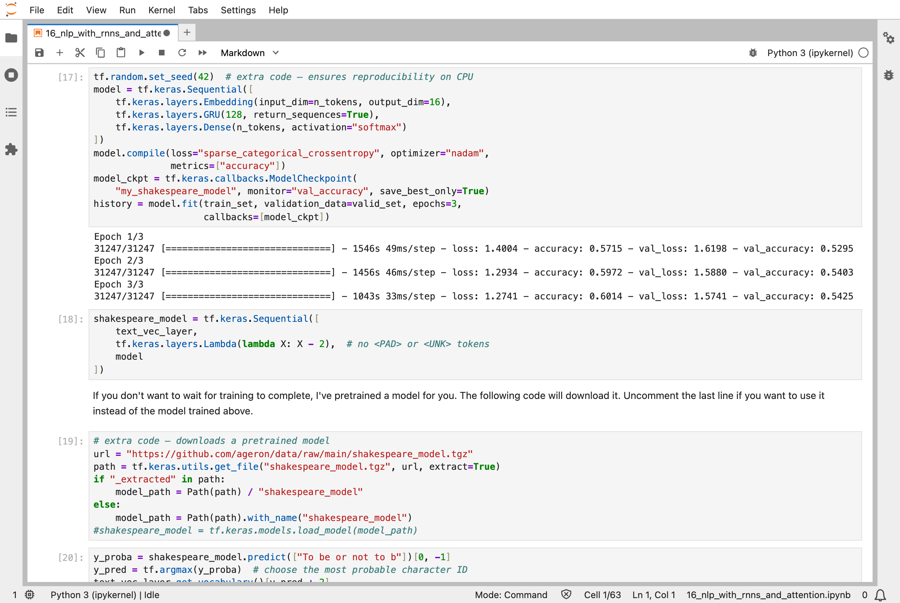
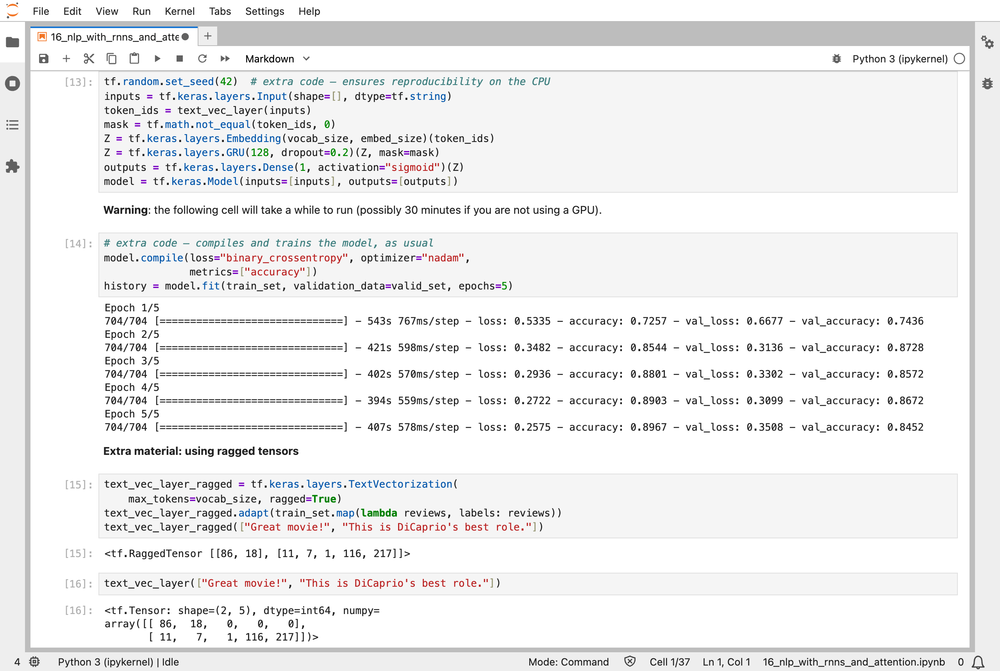
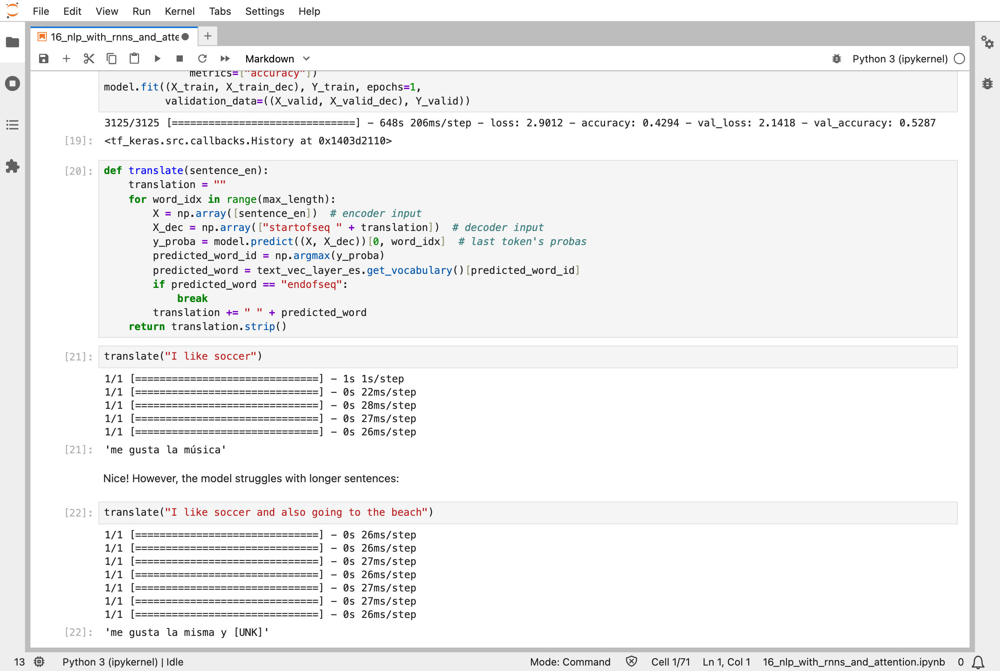
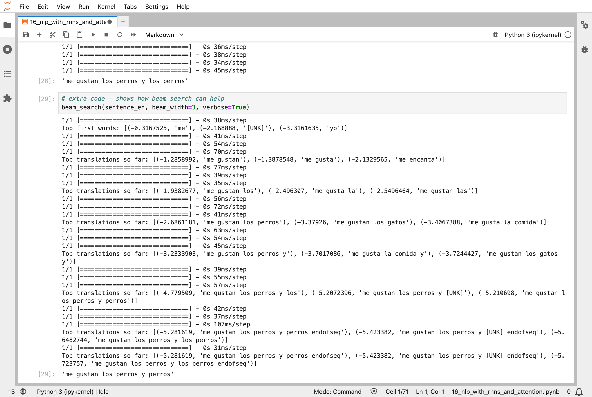
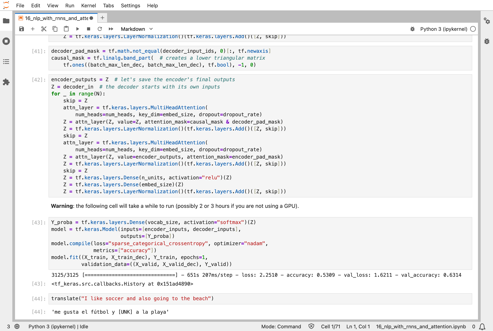
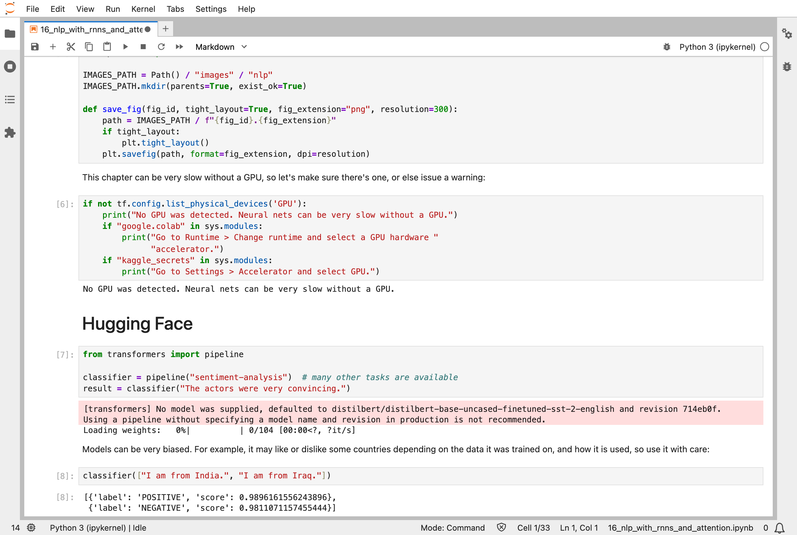

In [Part 15](/posts/sklearn15/), a recurrent network read a sequence of numbers one step at a time. The sixteenth chapter of the Hands-On Machine Learning book gives it text, and then shows why the field moved on from recurrent networks to attention. It is the chapter closest to my [MiniGPT](/posts/minigpt-grown/) model, and it ends with the Transformer, the design that MiniGPT is built on.

## Key Points

**What the chapter covers:**
1. **A character RNN**: a recurrent neural network (RNN) that reads Shakespeare one letter at a time and learns to predict the next letter, so that it can write more
2. **Sentiment analysis**: deciding whether a movie review is positive, using word embeddings and a recurrent layer, and masking so that padding is ignored
3. **Pretrained embeddings and language models**: reusing a sentence encoder trained by someone else
4. **An encoder-decoder network for translation**: one network reads English and another writes Spanish
5. **Bidirectional networks and beam search**: reading in both directions, and keeping several candidate translations instead of one
6. **Attention**: letting the decoder look back at every English word, instead of only a summary
7. **The Transformer**: dropping recurrence altogether and using only attention, with positional encodings to keep track of word order
8. **Hugging Face**: ready-made pretrained Transformers

**What I learned from it:**
- A language model is trained to predict what comes next, and then used to write by repeatedly sampling from its predictions.
- The same recipe, text in, probabilities out, covers writing, sentiment, and translation.
- Attention lets a word look directly at any other word, without waiting for a memory to carry the information along.
- Training on a CPU, the processor in my Mac, is slow. The notebook warns that the Transformer could take "2 or 3 hours" without a GPU, a graphics processing unit.

:::brain-power
A recurrent network reads a sentence one word at a time and keeps a memory. By the end of a 50-word sentence, what might have happened to the first word? And what could a model do instead, if it could look at any word at any moment?
:::

## Quick Example

The character model is small. It looks at 39 different characters (the letters in lower case, a few punctuation marks, and the new line), turns each into 16 numbers with an embedding, reads them with a gated recurrent unit (GRU) of 128 neurons, and predicts a probability for each of the 39 possible next characters:

```python
model = tf.keras.Sequential([
    tf.keras.layers.Embedding(input_dim=n_tokens, output_dim=16),
    tf.keras.layers.GRU(128, return_sequences=True),
    tf.keras.layers.Dense(n_tokens, activation="softmax")
])
```

It learns from 1,115,394 letters of Shakespeare, in windows of 100 letters, and it is trained exactly like MiniGPT: the target for each letter is the letter that follows. Here are the results I got in my version of the chapter's runs, where I cut the longest trainings short to save time (details below):

| Model | What I measured |
|---|---|
| Character GRU, 3 epochs | 60.1% of the next letters right in training, 54.3% on validation |
| Same, as a stateful RNN, 10 epochs | 57.8% in training, 54.1% on validation |
| Review sentiment with no masking, 2 epochs | 50.0% right on validation, chance |
| Same with masking of the padding, 5 epochs | 87.5% on validation at best (epoch 3), 85.4% at the end |
| Manual masking, 5 epochs | 87.3% at best (epoch 2), 84.5% at the end |
| Ragged tensors, 5 epochs | 85.5% at the end |
| A pretrained sentence encoder from Google, 10 epochs | 90.0% on validation in epoch 1, falling to 86.6% by epoch 10, while its training score rose to 99.7% |
| English to Spanish encoder-decoder, 1 epoch | 52.9% of Spanish words right on validation |
| Same with a bidirectional encoder, 1 epoch | 59.2% |
| Same with attention, 1 epoch | 61.9% |
| Transformer, 1 epoch | 63.1% |

The text that the character model wrote, after only 3 epochs, is not good. (The stateful version, after 10 epochs, wrote "to be or not to be good sorrow. / gremio: / and i have heard the great", better, with a speaker's name in the right place.) With a temperature of 0.01, which almost always picks the most likely next letter, it wrote "To be or not to be a strange / to see the duke of a strange for the se". With a temperature of 1, it wrote "To be or not to be gir? / hooks! why but beriversolvesf.". With 100 it wrote only noise. These are the same temperature settings as in my MiniGPT's demo.

:::watch-it Without masking, the sentiment model learned nothing
The first review model scored 50.0% on validation, as good as flipping a coin. Reviews have different lengths, so the shorter ones are padded with zeros, and the recurrent layer reads the padding as if it were words. Telling the layer to ignore the padding, with `mask_zero=True`, took the same model to 87.5% at best. A small fix to what the model is shown made all of the difference.
:::


*Training the character model: 54.3% of the validation letters right after 3 epochs, each epoch between 17 and 26 minutes on my Mac*

## What training means here

All of these models are trained as before: a loss, slopes by backpropagation, and a nudge. What is different is what the loss compares. For the character model it is the next letter, and for translation it is the next Spanish word, given the English sentence and the Spanish words so far. A model that is trained to predict the next word is a language model, and MiniGPT is one, with letters instead of words.

In a recurrent network, the information about the first word has to survive every step to the end of the sentence. Attention removes that problem. For each word, it computes a score against every other word, turns the scores into shares that sum to one, and takes a weighted mix of the other words' values. It is the same mechanism as the queries, keys, and values in my MiniGPT posts, and the Transformer in this chapter is the same design: layers of attention and small feed-forward networks, with layer normalization and skip connections from [Part 14](/posts/sklearn14/) around each. The only real difference is that MiniGPT has only a decoder, because it writes one text and does not translate. A Transformer for translation has an encoder for the English and a decoder for the Spanish.

The one new idea is the positional encoding. Attention looks at all the words at once, so by itself it cannot tell the order. The notebook adds a pattern of sine and cosine waves to each word, different for each position, so that word order is in the numbers. MiniGPT does the same job with its position embedding.

:::no-dumb-questions
**Q: Why did attention beat the memory-carrying encoder-decoder?**

A: A plain encoder-decoder squeezes the whole English sentence into one summary before writing any Spanish. Attention lets each Spanish word look at the English words it needs. On the long sentence "I like soccer and also going to the beach", the plain model wrote "me gusta la misma y [UNK]", while the attention model wrote "me gusta el fútbol y voy a la playa", which is correct Spanish.

**Q: What is beam search?**

A: Instead of keeping only the single most likely word at each step, it keeps the best three candidate sentences, and extends each. Greedy translation of "I love cats and dogs" gave "me gustan los perros y los perros", repeating itself. The beam search with 3 candidates gave "me gustan los perros y perros", a little better. The model translated "cats" as "perros", dogs, which beam search cannot fix.

**Q: What does `[UNK]` mean?**

A: An unknown word. The notebook gives its model only a 1,000-word vocabulary for each language, so any word outside it, such as "beach" in some answers, becomes `[UNK]`. A real translator uses a much larger vocabulary, or breaks words into pieces.

**Q: Why does the Hugging Face model say "I am from India" is positive and "I am from Iraq" is negative?**

A: Because models learn the biases of the text they are trained on. The notebook shows this on purpose, as a warning: the same sentence frame got POSITIVE with a score of 0.990 for India, and NEGATIVE with a score of 0.981 for Iraq. Nothing in the sentence is positive or negative. The model is repeating associations in its training data.
:::

## Running the notebook in Jupyter

The chapter is in the notebook that goes with the book, [16_nlp_with_rnns_and_attention.ipynb](https://github.com/ageron/handson-ml3/blob/main/16_nlp_with_rnns_and_attention.ipynb). This is the heaviest notebook in the series for my Mac. Its graphics processor, an Apple M1 Max, was no faster than its processor on small models like these, so I used the processor, and I shortened the training: the character model to 3 epochs instead of 10, and each translation model to 1 epoch instead of 10. I then ran the sentiment models and the pretrained sentence encoder again at the notebook's full length, 5 and 10 epochs. The translation results above come from the shortened runs, and the book's are better. I ran the five parts of the notebook at the same time, which took a few hours. I did not run the final fine-tuning cell with the Hugging Face `Trainer`, which failed to import here, and the notebook's stateful RNN, which keeps its memory from one window to the next, ran for the full 10 epochs.


*Manual masking over 5 epochs: the validation accuracy peaks at 87.3% in epoch 2 and ends at 84.5%, as the model starts to overfit; the same model without any masking stayed at 50%*


*The plain encoder-decoder after 1 epoch: "I like soccer" becomes "me gusta la música", and the longer sentence turns into "me gusta la misma y [UNK]"*


*Beam search keeping three candidate translations at each step, here for "I love cats and dogs": the best final candidate is "me gustan los perros y perros"*


*The Transformer after 1 epoch: "I like soccer and also going to the beach" becomes "me gusta el fútbol y [UNK] a la playa", close to correct*


*A pretrained sentiment model from Hugging Face, which scored "I am from India." POSITIVE and "I am from Iraq." NEGATIVE*

:::bullet-points Language models and attention, in short
- A language model is trained to predict what comes next; writing is repeated sampling from its predictions.
- Padding must be masked, or a recurrent model reads it as words: 50.0% became 87.5%.
- An encoder-decoder with attention can look at every input word, and beat one that squeezes the sentence into a summary.
- The Transformer uses only attention, with positional encodings to keep the word order.
- Pretrained models carry the biases of their training data.
:::

Next, [Scikit-Learn (Part 17)](/posts/sklearn17/) works through chapter 17: autoencoders, generative adversarial networks (GANs), and diffusion models.

## References

- [Aurélien Géron's chapter 16 notebook](https://github.com/ageron/handson-ml3/blob/main/16_nlp_with_rnns_and_attention.ipynb) - for Hands-On Machine Learning with Scikit-Learn, Keras, and TensorFlow (third edition)
- [Scikit-Learn (Part 15)](/posts/sklearn15/) - processing sequences with recurrent networks
- [Attention Is All You Need](https://arxiv.org/abs/1706.03762) - the paper that introduced the Transformer
- [Hugging Face](https://huggingface.co/docs/transformers) - pretrained Transformers
