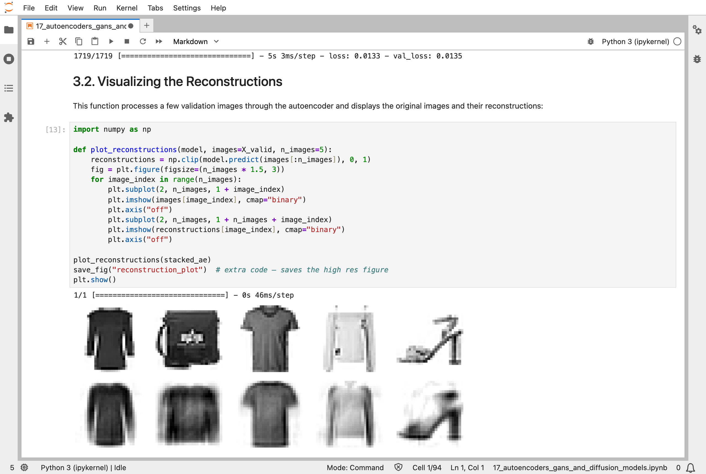
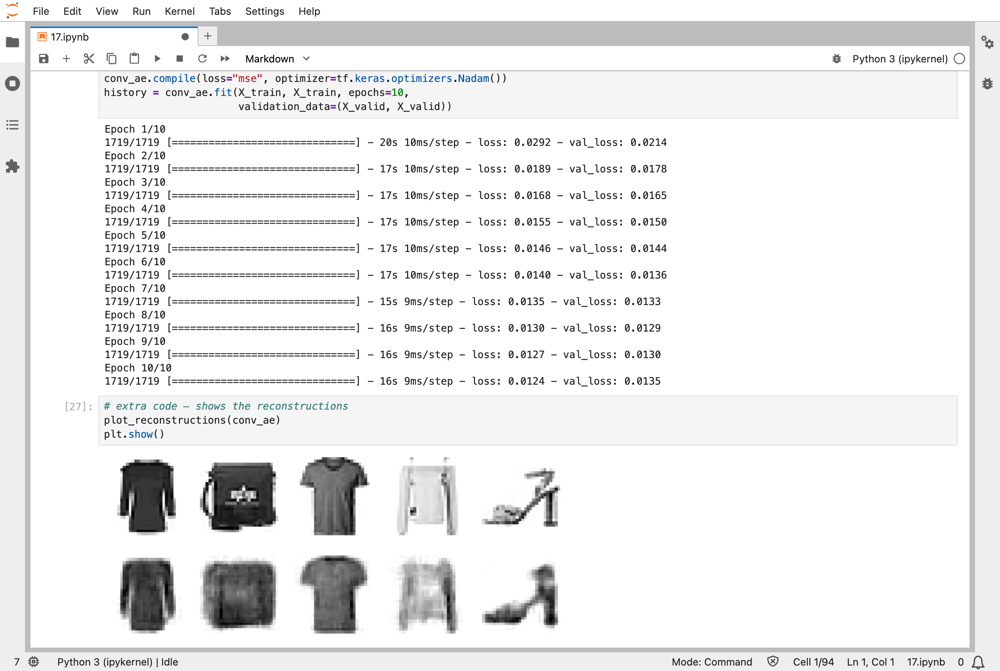
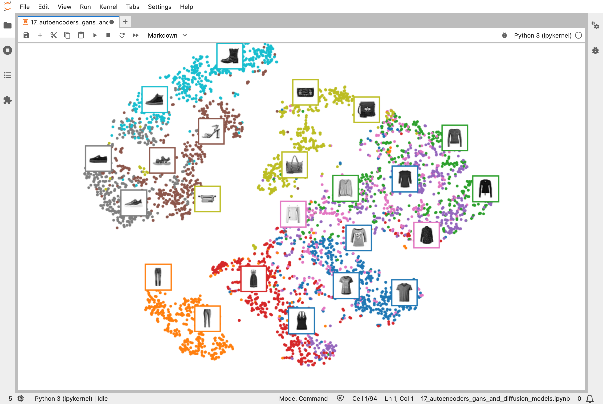
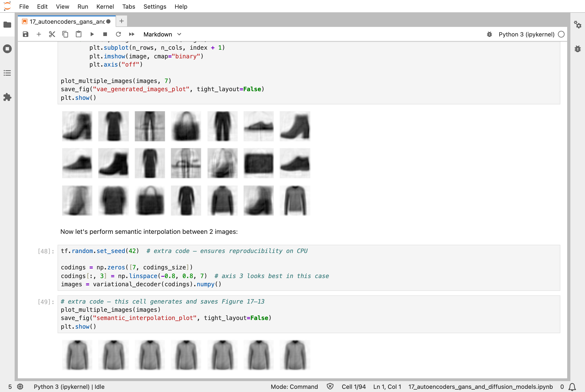
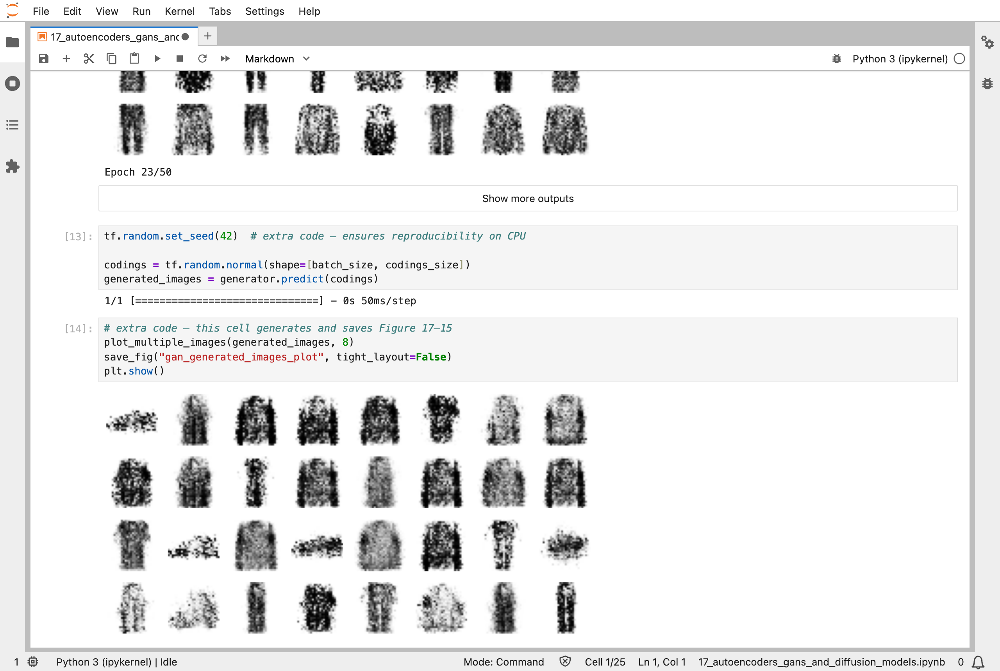
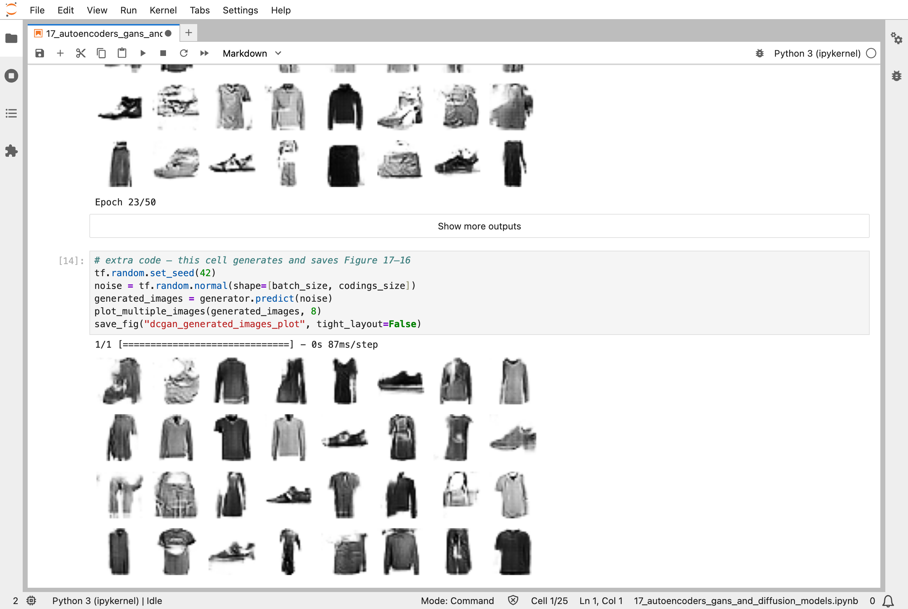
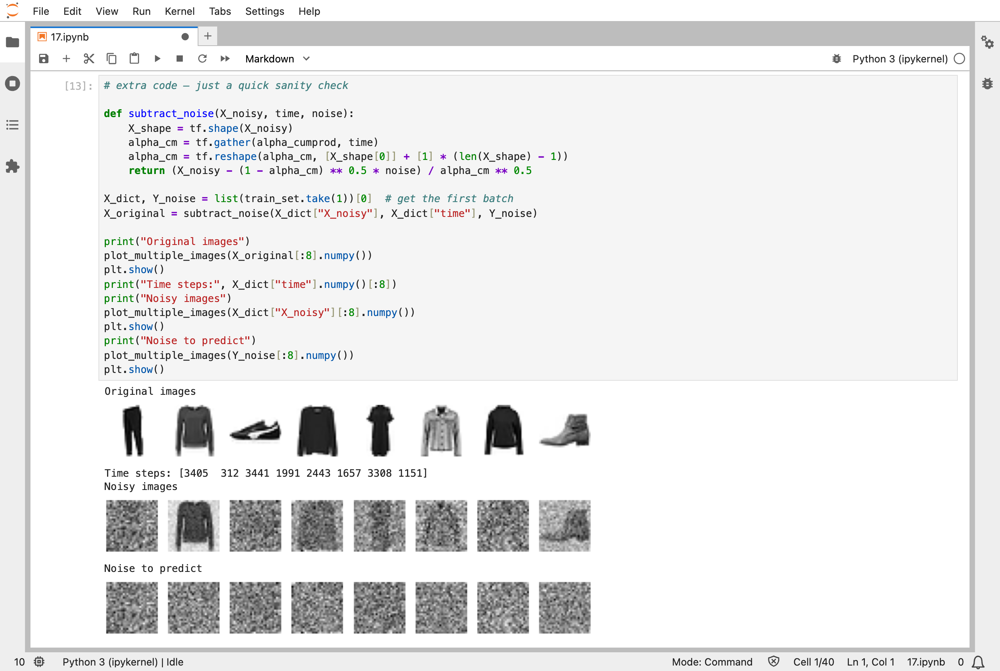
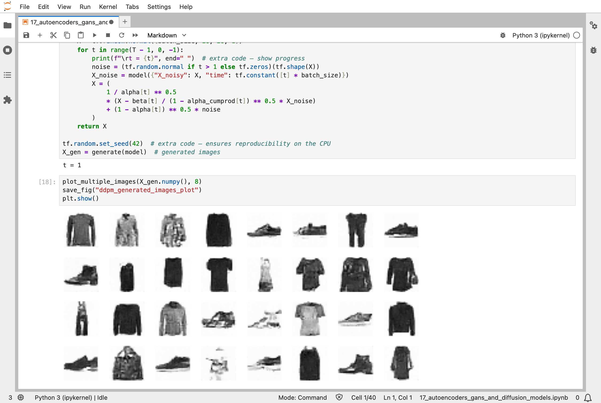

In [Part 16](/posts/sklearn16/), I read and generated text. The seventeenth chapter of the Hands-On Machine Learning book is about generating pictures. It starts with autoencoders, networks that learn to squeeze data down to a few numbers and rebuild it, and ends with generative adversarial networks (GANs) and diffusion models, the idea behind much of today's image generation.

## Key Points

**What the chapter covers:**
1. **Autoencoders**: a network that is trained to copy its input to its output, through a narrow middle layer, so that the middle layer has to find a compact summary
2. **Stacked and convolutional autoencoders**: more layers, and convolutions for images
3. **Variants**: denoising (adding noise or dropout to the input), sparse (keeping most middle neurons quiet), and recurrent autoencoders
4. **Variational autoencoders (VAEs)**: autoencoders whose middle layer is a probability distribution, so that random numbers fed to the second half produce new pictures
5. **Generative adversarial networks (GANs)**: a generator that invents pictures and a discriminator that tries to tell them from real ones, each making the other better
6. **Deep convolutional GANs (DCGANs)**: the same game with convolutional layers
7. **Diffusion models**: learn to remove a little noise from a picture, then start from pure noise and clean it up step by step into a new picture

**What I learned from it:**
- An autoencoder needs no labels: the input is also the target.
- The narrow middle layer is the point. A network that could copy everything through would learn nothing.
- A GAN is trained by two networks pulling against each other, and it is easy for that to go wrong.
- A diffusion model is trained on a simple task, predicting the noise that was added to a picture, and gets its power from repeating it many times.

:::brain-power
An autoencoder is trained so that its output matches its input. That sounds pointless: why not just return the input? Before reading on, what has to be true about the network in the middle for the training to be worth anything?
:::

## Quick Example

An autoencoder for the Fashion MNIST clothing pictures from [Part 10](/posts/sklearn10/). An encoder squeezes each 784-pixel picture down to 30 numbers, and a decoder rebuilds the picture from those 30:

```python
stacked_encoder = tf.keras.Sequential([
    tf.keras.layers.Flatten(),
    tf.keras.layers.Dense(100, activation="relu"),
    tf.keras.layers.Dense(30, activation="relu"),
])
stacked_decoder = tf.keras.Sequential([
    tf.keras.layers.Dense(100, activation="relu"),
    tf.keras.layers.Dense(28 * 28),
    tf.keras.layers.Reshape([28, 28])
])
stacked_ae = tf.keras.Sequential([stacked_encoder, stacked_decoder])
stacked_ae.compile(loss="mse", optimizer=tf.keras.optimizers.Nadam())
history = stacked_ae.fit(X_train, X_train, epochs=20, validation_data=(X_valid, X_valid))
```

The inputs and the targets are the same pictures, `X_train` twice. The score is the mean squared error between each picture and its rebuilt copy: smaller is better. These are the validation scores from my run of the chapter's different autoencoders:

| Autoencoder | Validation error |
|---|---|
| Stacked: 784, 100, 30, 100, 784, 20 passes | 0.0135 |
| Same, with the encoder's weights reused by the decoder (tied), 10 passes | 0.0135 |
| Same, trained one layer at a time and then fine-tuned, 5 passes | 0.0146 |
| Convolutional, 10 passes | 0.0135 |
| Recurrent (LSTM), 10 passes | 0.0106 |
| Denoising, with half of the inputs dropped out, 10 passes | 0.0176 |
| Sparse, with a penalty on active neurons (L1), 10 passes | 0.0114 |
| Sparse, with a penalty using the Kullback–Leibler divergence (KL), 10 passes | 0.0095 |

They are all close, which is the first surprise: the choice of design matters less than I expected, for this data. A picture compressed to 30 numbers, about 4% of its 784 pixels, comes back recognisable but blurred, and the pictures below show it.

:::watch-it My first plain GAN collapsed to a single picture
In my first run, which I cut to 10 epochs, the plain GAN, built from ordinary layers, produced the same black shirt shape for every one of the 32 random inputs I gave it. This is called mode collapse: the generator found one picture that fools the discriminator, and kept making it. When I ran the notebook's full 50 epochs, it did not collapse: its 32 pictures were different from each other, with shirts, trousers, and shoes, but speckled with noise. So the collapse was not permanent. A GAN can pass through bad stages, which is part of why they are hard to train.
:::


*An autoencoder at work: the top row is five original pictures, and the bottom row is what the decoder rebuilt from just 30 numbers each: close, but blurred*

## What training means here

An autoencoder is trained as in [Part 10](/posts/sklearn10/): the loss is measured, slopes are found by backpropagation, and the numbers are nudged. What is new is the target. There are no labels: the picture is its own target, so an autoencoder can learn from any pile of pictures. [Part 8](/posts/sklearn8/) squeezed the data with principal component analysis (PCA), which is worked out directly. A linear autoencoder with no activation functions learns the same thing as PCA, by nudging, and the notebook starts there, with a small three-dimensional dataset, before adding layers.

A GAN is trained by two networks at once. In each step the discriminator is nudged to tell real pictures from generated ones, and then the generator is nudged to fool it. There is no fixed target: each network's target moves as the other improves, which is why GANs are hard to train, and why mine collapsed. A diffusion model avoids that. Its training is ordinary: the notebook adds a known amount of noise to each picture, and trains a network to predict that noise. To generate a picture, it starts from pure noise and removes a little noise, over and over, 4,000 times. That is why generating takes much longer than training one step does, a point the notebook makes.

My [MiniGPT](/posts/minigpt-grown/) model is a generative model too: it writes text one letter at a time. A diffusion model writes a whole picture at once and sharpens it, where MiniGPT adds to its text letter by letter.

:::no-dumb-questions
**Q: If an autoencoder just copies its input, what is it good for?**

A: The 30 numbers in the middle. They are a compact description of each picture, and they can be used for other jobs: drawing the clothing pictures in 2D so similar items sit together, finding odd pictures that rebuild badly, or giving a classifier a smaller input. The notebook draws the 30 numbers in 2D with t-SNE (t-distributed stochastic neighbor embedding) from [Part 8](/posts/sklearn8/), and the clothing groups are visible.

**Q: What does a variational autoencoder add?**

A: Its middle layer gives a mean and a spread for each of 10 numbers, and a random sample is drawn from them. Training also pushes those distributions to look like a standard bell curve. Afterwards, I can throw away the encoder, draw 10 random numbers, give them to the decoder, and get a new picture. An ordinary autoencoder has no such guarantee that random middle numbers make sense.

**Q: How good are the diffusion model's pictures?**

A: After the notebook's full 100 epochs, much better than I expected from such a small network: recognisable shoes, boots, trousers, shirts, and jackets, a little blurred. After my first run of only 10 epochs, they were dark blurred shapes. The error went from 0.0710 in the first epoch to 0.0373 in the last, and 0.0371 at its best.

**Q: Are these still the way pictures are generated?**

A: Diffusion models, with larger networks and text prompts added, are behind much of today's image generation, and they have largely replaced GANs. Autoencoders, especially variational ones, are still used to compress pictures before a diffusion model works on them. The mechanism here is the same one, at a very small scale.
:::

## Running the notebook in Jupyter

The chapter is in the notebook that goes with the book, [17_autoencoders_gans_and_diffusion_models.ipynb](https://github.com/ageron/handson-ml3/blob/main/17_autoencoders_gans_and_diffusion_models.ipynb). I ran everything before the final extra section, but with the three most expensive trainings cut down at first. I then ran the two GANs again at the notebook's full 50 epochs, and the diffusion model at its full 100, which took several hours on the processor. Everything else, including the autoencoders, ran as written. I ran the parts at the same time, on my Mac Studio, which took under an hour. My first attempt hung. The notebook's setup imports scikit-learn before TensorFlow, which seemed to deadlock TensorFlow on my Mac; once I removed that import, the runs finished.


*A convolutional autoencoder after 10 passes: the validation error is 0.0135, and the rebuilt pictures, bottom row, are again blurred versions of the originals above*


*The 30 numbers for 5,000 pictures, drawn in 2D with t-SNE: shoes, bags, trousers, and tops form their own groups, though a network that never saw a label found them*


*A variational autoencoder: pictures from 21 random sets of 10 numbers, and below, one picture's numbers moved a little at a time along one axis*


*The plain GAN after 50 epochs: 32 different pictures, shirts, trousers, and shoes, but speckled with noise (after only 10 epochs it had produced the same shirt shape 32 times)*


*The convolutional GAN after 50 epochs: shoes, shirts, trousers, bags, and dresses, much cleaner than the plain GAN*


*How diffusion models are trained: original pictures, the same pictures with different amounts of noise added, and the noise the network must predict*


*Pictures generated by the diffusion model after 100 epochs: shoes, boots, trousers, shirts, and jackets, a little blurred (after only 10 epochs they were dark blurred shapes)*

:::bullet-points Autoencoders, GANs, and diffusion, in short
- An autoencoder learns to rebuild its input through a narrow middle, so the middle becomes a compact summary.
- The input is the target, so no labels are needed.
- A variational autoencoder makes the middle a probability distribution, so random numbers make new pictures.
- A GAN trains a generator and a discriminator against each other, and can collapse to one picture along the way.
- A diffusion model learns to predict noise, and generates by removing it step by step.
:::

Next, [Scikit-Learn (Part 18)](/posts/sklearn18/) works through chapter 18: reinforcement learning.

## References

- [Aurélien Géron's chapter 17 notebook](https://github.com/ageron/handson-ml3/blob/main/17_autoencoders_gans_and_diffusion_models.ipynb) - for Hands-On Machine Learning with Scikit-Learn, Keras, and TensorFlow (third edition)
- [Scikit-Learn (Part 16)](/posts/sklearn16/) - natural language processing with RNNs and attention
- [Scikit-Learn (Part 8)](/posts/sklearn8/) - dimensionality reduction, including t-SNE
- [Denoising Diffusion Probabilistic Models](https://arxiv.org/abs/2006.11239) - the paper behind the notebook's diffusion model
