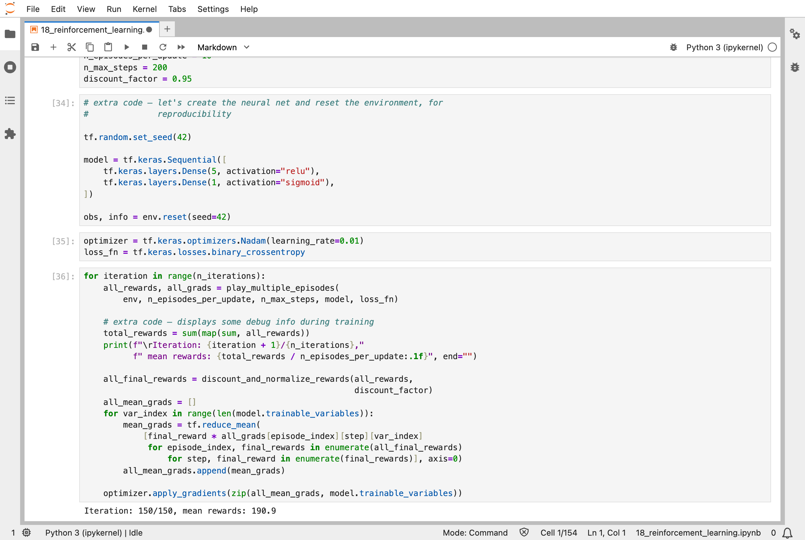
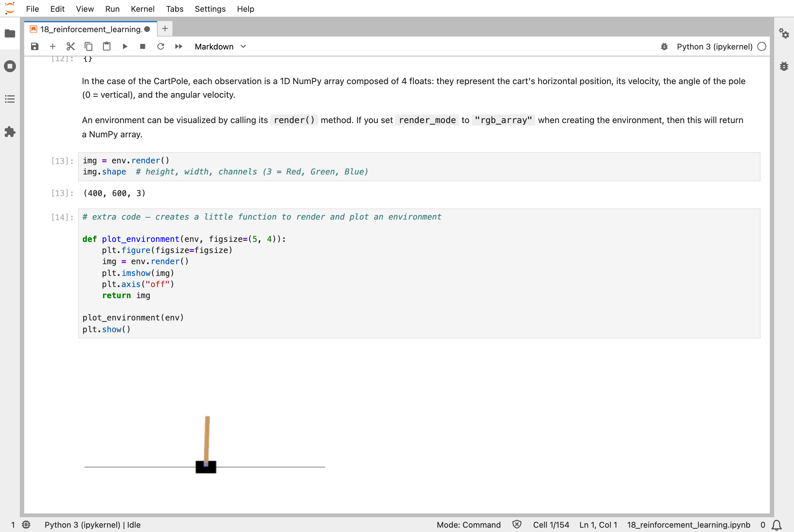
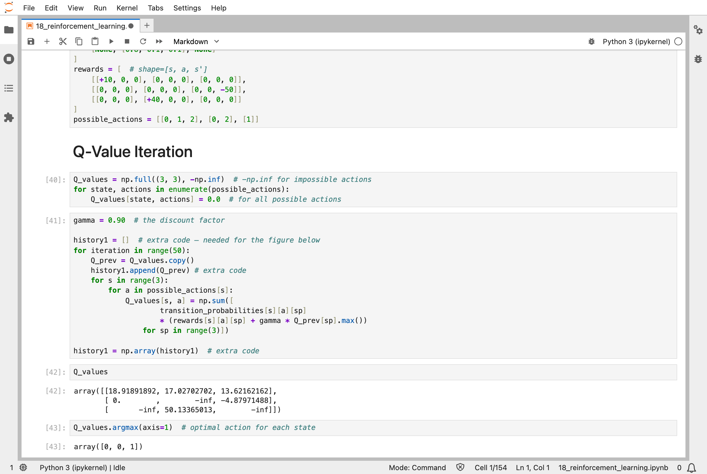
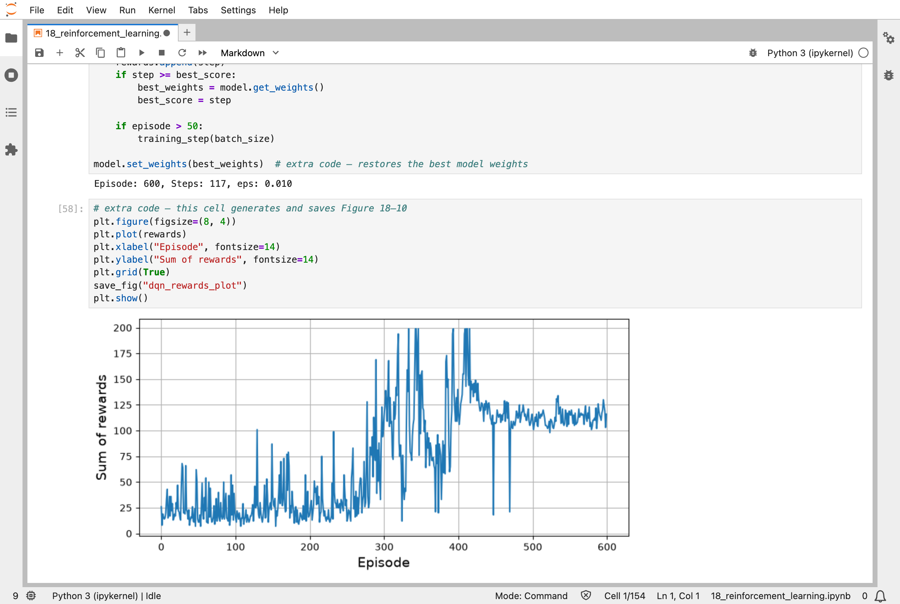
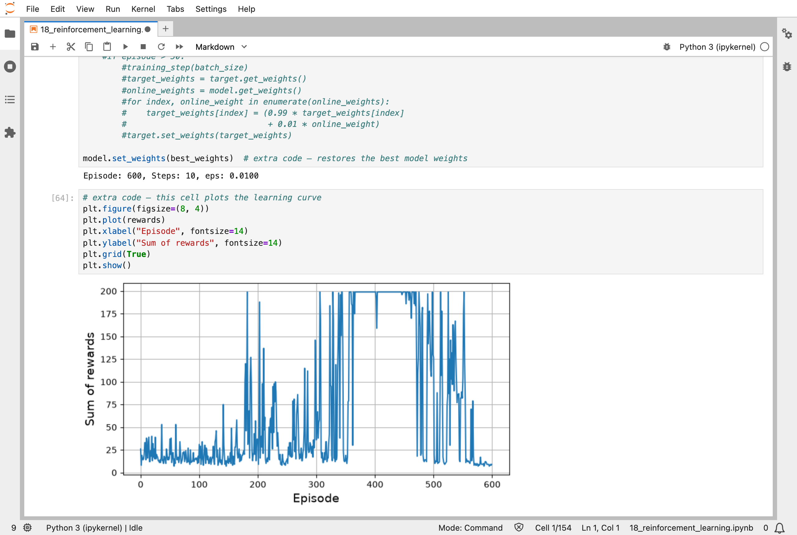
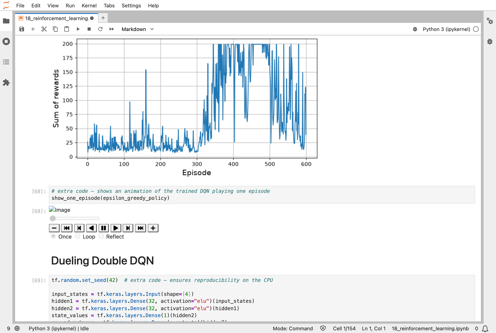
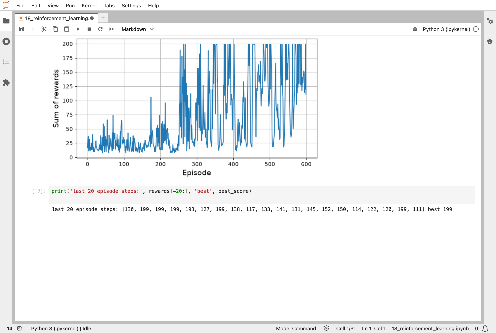

In [Part 17](/posts/sklearn17/), networks learned to make pictures. This chapter of the Hands-On Machine Learning book is about a different kind of learning altogether. There are no labelled examples and no picture to copy. An agent acts in a simulated world, gets rewards, and has to work out for itself which of its actions earned them. This is reinforcement learning (RL).

The world is a simulation called CartPole: a cart that can be pushed left or right, with a pole balanced on it. The task is deliberately simple, and made up, but it is the standard practice problem. The agent scores one point for each step the pole stays up, to a maximum of 200. A hard-coded rule, "push towards the side the pole is leaning", lasted 41.7 steps on average. A small network that learned from its rewards averaged 190.9 steps, close to the maximum.

## Key Points

**The lesson:** the agent is never told the right action. It is only told, afterwards, how well things went, and a reward may arrive many steps after the action that earned it. So training has to share the credit backwards, with later rewards counting for slightly less than near ones. It is the same loop of slopes and nudges as before, but the target is not fixed: it moves as the agent learns, which is why this kind of training is far less stable than the training in earlier parts. In my runs, several agents reached the top score and then fell away.

**What I learned from it:**
- The simplest method, which nudges the network towards actions that led to high rewards, was the steadiest in my runs, ending close to the maximum.
- The more elaborate methods, which learn the expected total reward of each action from a store of past steps, were much less stable: the plain version finished near 117 steps, after reaching 200, and one variant collapsed to about 10.
- Keeping a copy of the best weights, and restoring it at the end, is worth doing, because the final weights may be much worse than the best ones.

The chapter also solves a tiny made-up world exactly, and describes the formal framework for this kind of problem, which I do not go into.

:::brain-power
In CartPole, the agent gets a reward of 1 for every step that the pole stays up, and the game ends when it falls. Before reading on, why might a policy that looks only at the pole's angle, and pushes towards the side it is leaning, be a good first attempt? And how long do you think it would last?
:::

## Quick Example

The simplest policy in the notebook looks at the pole's angle and pushes the cart left if the pole leans left, and right if it leans right:

```python
def basic_policy(obs):
    angle = obs[2]
    return 0 if angle < 0 else 1
```

I played 500 games with it. The pole stayed up for 41.7 steps on average, with a standard deviation of 8.4, a best of 63, and a worst of 24. That is nowhere near the 200 steps the notebook treats as success. Then the notebook replaces the hard-coded rule with a network that learns. Here is how the learners did when I ran the notebook:

| Agent | What I saw |
|---|---|
| Hard-coded policy: push towards the lean | 41.7 steps on average over 500 games, best 63 |
| Policy gradients: a network of 5 hidden neurons, 150 updates of 10 games each | an average reward of 190.9 in the last update, out of a best of 200 |
| Deep Q-network, 600 episodes | reached 200 several times, but ended near 117 steps, falling from its peak |
| DQN with fixed Q-value targets | reached 200 for a long run, then collapsed to about 10 steps by the end |
| Double DQN | reached 200 for long runs, but ended at 40 steps |
| Dueling double DQN | kept returning to 199 or 200 right up to the end, and averaged about 150 over its last 20 games |

The policy-gradient agent learned fastest and most steadily, which is not what I expected: the DQN variants are meant to be the more advanced methods. Their curves are the lesson here. They are very unstable, and only the dueling double DQN, the last and most elaborate, was still near the top at the end.

:::watch-it The agent that was best did not stay best
Each deep Q-network (DQN) run kept a copy of its best weights and restored them at the end, because the learning curve falls off a cliff. The fixed-targets agent reached the top score of 200 steps for a long run, from about episode 360 to 480, and then slid to about 10 steps per game by episode 600, where it was no better than random. Training longer did not make it better. That is why the notebook saves the best weights.
:::


*The policy-gradient training loop: it plays 10 games per update, and the average reward after the last of 150 updates was 190.9*

## What training means here

Everything in this series so far had a target. In [Part 3](/posts/sklearn3/), it was the right digit, and in [Part 17](/posts/sklearn17/), the picture itself. Here there is none. The agent plays, and later learns how much reward it earned.

Policy gradients nudge the network's numbers directly. After a batch of games, each action is scored by the total reward that followed it, discounted so that near rewards count for more, and normalised, then the slopes of the action probabilities are multiplied by those scores and averaged. Actions that led to good outcomes become more likely, and the network is nudged in that direction. It is the same loop of slopes and nudges as in [Part 12](/posts/sklearn12/).

A DQN does something else. It learns Q-values: how much reward to expect, in total, from taking an action in a state. The network is trained with a target that it partly makes itself: the target is the reward just received, plus the discounted best Q-value of the next state, as the network itself estimates it. That is why it is unstable, because the target moves whenever the network does, and why the chapter's improvements, such as a separate target network that is updated only every 50 episodes, help.

The notebook also solves a tiny world with 3 states exactly, by repeating a calculation until the Q-values stop changing. No network is needed there: the answer is 18.9, 17.0, and 13.6 for the three actions available in state 0, and the best action in each state is 0, 0, and 1. That is the case in which nothing is nudged, like the models in [Part 1](/posts/sklearn1/).

My [MiniGPT](/posts/minigpt-grown/) model has a loss that compares its letters with the real next letters. Systems like ChatGPT add a second stage, in which people's ratings of its answers are the reward, and they use methods from this chapter's family. I have not done that.

:::no-dumb-questions
**Q: What is the discount factor for?**

A: It says how much to value a reward that comes later. With a factor of 0.95, a reward one step away counts as 0.95, two steps as 0.9025, and so on. In the notebook's example, discounting the rewards 10, 0, and −50 with a factor of 0.8 gives −22, −40, and −50: the early reward 10 is cancelled out by the penalty that follows it.

**Q: What is a replay buffer?**

A: A store of the agent's last 2,000 steps. The DQN trains on random batches from it, instead of on the most recent steps, because steps in a row are too alike, and training on them makes the network forget what it learned earlier.

**Q: Why is the agent allowed to try random moves?**

A: To find out whether they are better. The notebook starts with a probability of 1.0 of a random move, and lowers it each episode to a minimum of 0.01 by episode 500. This is called epsilon-greedy, and it is a trade-off between trying new moves and using what has been learned.

**Q: Is RL still useful?**

A: For problems with no examples to copy, such as games and robot control, yes. For most business problems that have labelled data, supervised learning is simpler and steadier. RL is also used to fine-tune large language models with human ratings.
:::

## Running the notebook in Jupyter

The chapter is in the notebook that goes with the book, [18_reinforcement_learning.ipynb](https://github.com/ageron/handson-ml3/blob/main/18_reinforcement_learning.ipynb). I ran everything before the exercise solutions, on my Mac Studio. It took a few hours, because each of the DQN agents plays 600 games, and the last agent had to be run again on its own after the first attempt hung. The animations in the notebook, which show the cart moving, did not display in my screenshots, so I have shown the learning curves instead.


*The CartPole environment: a cart on a rail, with a pole standing up on it*


*Q-value iteration on a world of three states: the Q-values settle, and the best action in each state is 0, 0, and 1*


*The deep Q-network's reward for each of 600 episodes: it climbs, reaches 200, and then falls back to about 115*


*With fixed Q-value targets: a long run at the top score of 200, and then a collapse, ending near zero*


*Double DQN: long runs at 200, interrupted by drops, and a poor finish*


*Dueling double DQN: it reaches 200 again and again through the last 350 episodes, with dips between, and ended the run at 111 steps*

:::bullet-points Reinforcement learning, in short
- An agent acts, gets rewards, and learns which actions earned them; it is never told the right action.
- Policy gradients nudge the policy towards actions that led to high rewards.
- Dueling double DQN, the most elaborate of the three DQN variants I ran, was the one still doing well at the end.
- A DQN learns the expected total reward for each action, from a replay buffer of past steps.
- RL training is unstable: my agents reached the maximum score and then fell away, so I kept the best weights.
- No labels means no fixed target, so the target moves as the agent learns.
:::

Next, [Scikit-Learn (Part 19)](/posts/sklearn19/) works through chapter 19: training and deploying models at scale.

## References

- [Aurélien Géron's chapter 18 notebook](https://github.com/ageron/handson-ml3/blob/main/18_reinforcement_learning.ipynb) - for Hands-On Machine Learning with Scikit-Learn, Keras, and TensorFlow (third edition)
- [Scikit-Learn (Part 17)](/posts/sklearn17/) - autoencoders, GANs, and diffusion models
- [Gymnasium](https://gymnasium.farama.org/) - the library of environments used in the notebook
