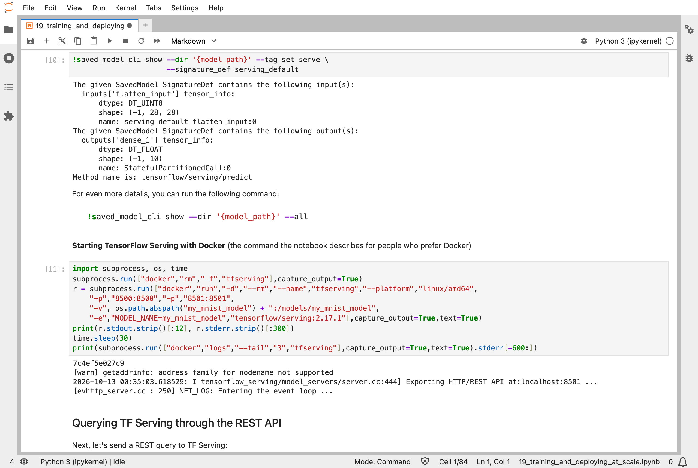
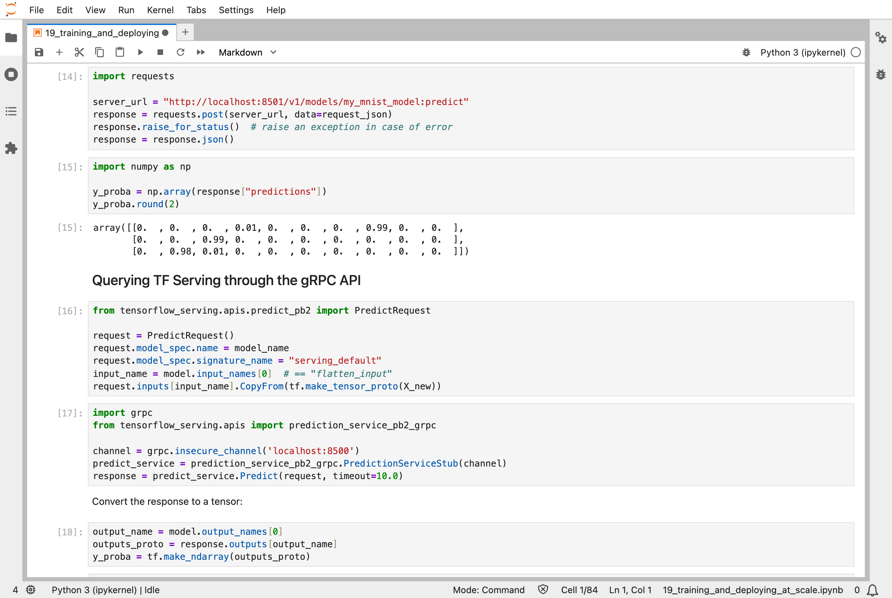
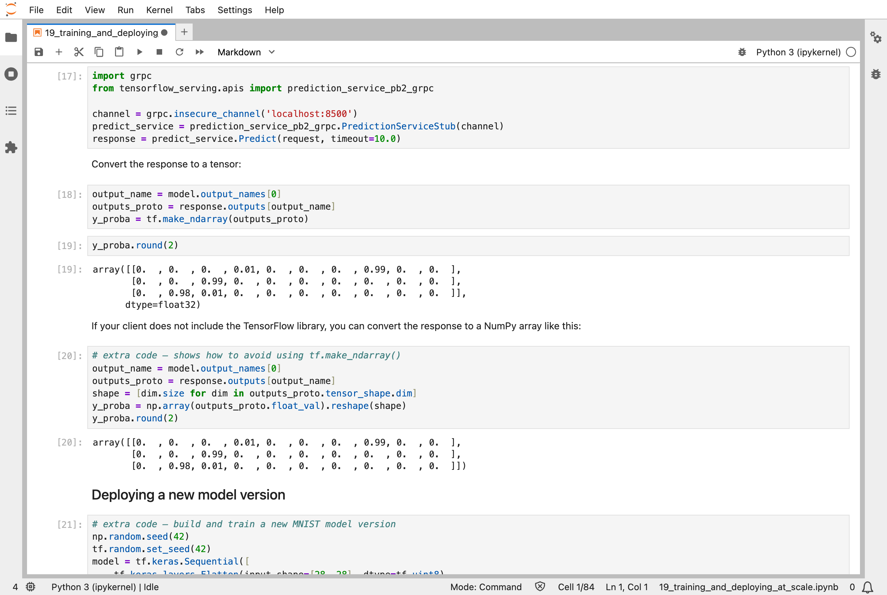
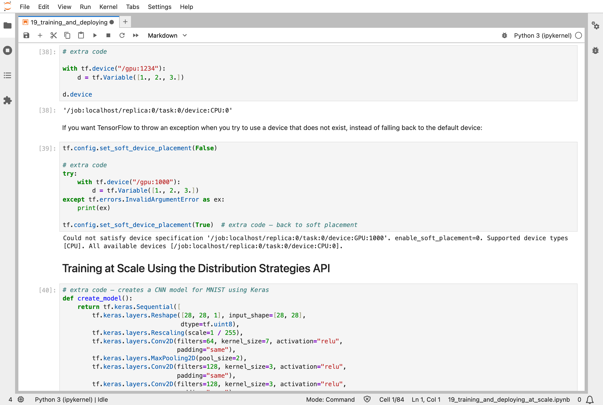
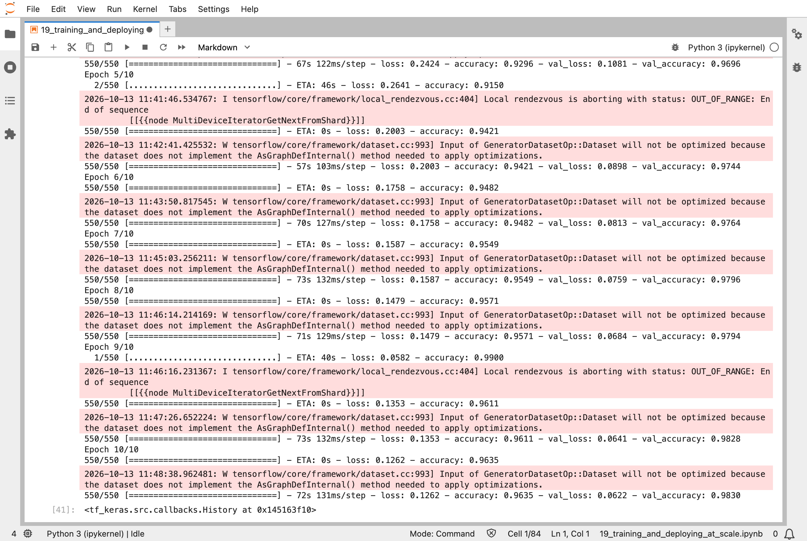

In [Part 18](/posts/sklearn18/), an agent learned by trial and error. The last chapter of the Hands-On Machine Learning book, chapter 19, is about what happens once a model has been trained: how to put it where people can use it, and how to train bigger models by spreading the work over several machines. Most of it is about Google's cloud, and about graphics processors (GPUs), which my Mac does not have, so I ran what I could and I say below what I could not.

## Key Points

**What the chapter covers:**
1. **Exporting a model**: saving it in TensorFlow's SavedModel format, with a named signature that says what goes in and what comes out
2. **TensorFlow Serving**: a server that loads the saved model and answers requests over REST (a web address) and gRPC (a faster binary protocol), and switches to a new version when it appears
3. **Vertex AI**: Google's cloud service for the same job, with a prediction service and batch prediction
4. **Models on phones and in web pages**: TensorFlow Lite for mobile and embedded devices, and TensorFlow.js for a browser
5. **GPUs**: managing their memory, and placing operations and variables on devices
6. **Distribution strategies**: training one model on several devices, with `MirroredStrategy` and others
7. **Clusters and the cloud**: training on a TensorFlow cluster or on Vertex AI, tuning hyperparameters in parallel, and AutoML

**What I learned from it:**
- A saved model is a folder that includes its own description of what it accepts, so a server can use it without any of my code.
- A new version of a model is just a new numbered folder. The server notices it, and starts answering with it.
- A model can be made several times smaller for a phone by storing its numbers with less precision.
- Spreading training over devices does not change what is learned: it changes how many examples are processed at once.

:::brain-power
A model that is 98% accurate on my laptop is not useful until someone else can ask it a question. Before reading on, what would a program on another machine need to know in order to send it a digit image and read the answer?
:::

## Quick Example

The notebook trains a small MNIST digit classifier, saves it as version `0001` in a folder named `my_mnist_model`, and serves it with the official TensorFlow Serving program. I ran the server with Docker, as the notebook describes, and mounted the model folder into it:

```python
subprocess.run(["docker", "run", "-d", "--rm", "--name", "tfserving",
    "-p", "8500:8500", "-p", "8501:8501",
    "-v", os.path.abspath("my_mnist_model") + ":/models/my_mnist_model",
    "-e", "MODEL_NAME=my_mnist_model", "tensorflow/serving:2.17.1"])
```

Then I sent the server three test images as JSON (JavaScript Object Notation, a text format for data), and it answered with the chance of each digit:

```python
request_json = json.dumps({"signature_name": "serving_default",
                           "instances": X_new.tolist()})
response = requests.post("http://localhost:8501/v1/models/my_mnist_model:predict",
                         data=request_json).json()
```

The server said 7, 2, and 1, with chances of 0.99, 0.99, and 0.98, which are the right digits. The same request over gRPC gave identical numbers. Here is everything I measured:

| Step | Result |
|---|---|
| Version 0001 (one layer of 100 neurons, 10 epochs) | 95.74% of the validation images right |
| Answers over REST and over gRPC for the first three test images | 7, 2, 1, identical |
| Version 0002 (two layers of 50 neurons, 10 epochs) | 95.92% of the validation images right |
| The same request a minute after saving version 0002 | the second digit's chance moved from 0.99 to 1.00: the server was now using version 0002 |
| The saved model converted for TensorFlow Lite | 171,748 bytes |
| The same model, converted with the default optimizations | 47,928 bytes |

Nothing was restarted when version 0002 appeared. I saved the new version into the folder, waited a minute, and sent the same request, and the numbers had changed.

:::watch-it The image I ran is not built for my Mac
My Mac has an Arm processor, and the official TensorFlow Serving image is built for Intel-style processors. Docker ran it anyway, through emulation, when I asked for the Intel version. It worked, but it is probably slower than a native image would be. A real deployment would run on a machine that matches the image.
:::

## What training means here

This chapter changes nothing about how a model learns. A model is still nudged by slopes on batches of examples. What changes is where the work is done. The book describes two ways to split it. In data parallelism, each device holds a copy of the model, each takes a share of the batch, and the slopes are averaged before every copy makes the same nudge. In model parallelism, one big model is cut into pieces, one per device.

`MirroredStrategy` is the first kind. On a machine with several GPUs it would copy the model to each one. My Mac has no GPU, so the notebook printed a warning that no GPU was detected, and `MirroredStrategy` used one device, the processor. The weights became `MirroredVariable` objects, special variables that keep copies in step, and the training ran as usual: 10 epochs of about 70 seconds each, ending at 96.35% training accuracy and 98.30% validation accuracy. It did not run faster, because there was nothing to spread the work over, but it is the same code that would.

My [MiniGPT](/posts/minigpt-grown/) model has 826,433 numbers, which is small enough that none of this is needed: one machine trains it. The same ideas apply to the models behind large language models, which are split over thousands of devices, but I have not done that.

:::no-dumb-questions
**Q: What is a "signature" in a saved model?**

A: A name for one way to call the model, along with the names, shapes, and types of its inputs and outputs. The notebook asks `saved_model_cli` for it and gets `serving_default`: input `flatten_input`, 28 × 28 whole numbers, and output `dense_1`, 10 numbers. A server can use the model from that description alone.

**Q: Why have both REST and gRPC?**

A: REST is simple: any program that can send text to a web address can use it. gRPC is faster, because it sends numbers in a compact binary form, but it needs a library on the client's side. They gave identical answers here.

**Q: How did the server know about version 0002?**

A: It watches the model folder. Each numbered subfolder is a version, and by default the server serves the highest number, so saving `0002` next to `0001` is enough.

**Q: Is TensorFlow Serving still how models are deployed?**

A: It is one way, and it is TensorFlow-specific. Many teams now use other servers, and for large language models, specialised ones. The ideas are general: export a model with a named interface, serve it behind an address, and version it. Nothing here needs TensorFlow to be true.
:::

## Running the notebook in Jupyter

The chapter is in the notebook that goes with the book, [19_training_and_deploying_at_scale.ipynb](https://github.com/ageron/handson-ml3/blob/main/19_training_and_deploying_at_scale.ipynb). I ran the parts I could on my own Mac: exporting the model, serving it with Docker, the REST and gRPC requests, the new version, the TensorFlow Lite conversion, the device checks, and `MirroredStrategy`. That took under half an hour. I started TensorFlow Serving with the Docker command that the notebook describes, instead of installing the Linux program that it uses by default. I did not run the sections on Vertex AI, which need a Google Cloud account; or the training on a TensorFlow cluster, the distributed hyperparameter tuning, or AutoML. I have no GPU, so what the notebook says about GPUs, I know only from reading it.


*A saved model describes itself: `saved_model_cli` lists its signature, what goes in and what comes out; below it, the Docker command that starts TensorFlow Serving, whose log says it is listening for REST requests on port 8501*


*A REST request to the server: three rows of ten chances, with the highest for the digits 7, 2, and 1*


*The same request over gRPC: the answer is the same, though it arrives as a tensor*


*No GPU here: asking for a GPU that does not exist falls back to the processor, and with soft placement switched off it raises an error instead*


*`MirroredStrategy` on one processor: 10 epochs, ending at 96.35% training accuracy and 98.30% validation accuracy*

:::bullet-points Deploying and scaling, in short
- A SavedModel carries its own signature, so a server can use it without my code.
- TensorFlow Serving answers REST and gRPC requests, and picks up a new numbered version by itself.
- Converting for a phone with TensorFlow Lite made the same model about 3.6 times smaller, 171,748 bytes to 47,928.
- A distribution strategy changes where the work is done, not what is learned.
- I ran the parts that work on one Mac, and I did not run the cloud, cluster, and GPU parts.
:::

This is the last part of the series. I started with [Part 1](/posts/sklearn1/), where nothing is nudged, and arrived at models that are served from a container.

## References

- [Aurélien Géron's chapter 19 notebook](https://github.com/ageron/handson-ml3/blob/main/19_training_and_deploying_at_scale.ipynb) - for Hands-On Machine Learning with Scikit-Learn, Keras, and TensorFlow (third edition)
- [Scikit-Learn (Part 18)](/posts/sklearn18/) - reinforcement learning
- [TensorFlow Serving](https://www.tensorflow.org/tfx/guide/serving) - the guide to serving models, including the Docker image
- [TensorFlow Lite](https://www.tensorflow.org/lite) - models for mobile and embedded devices
