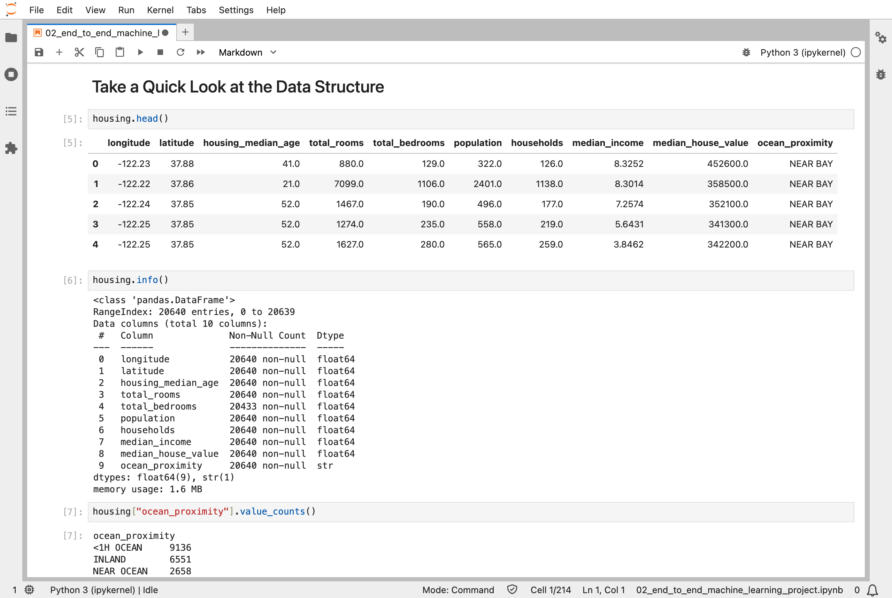
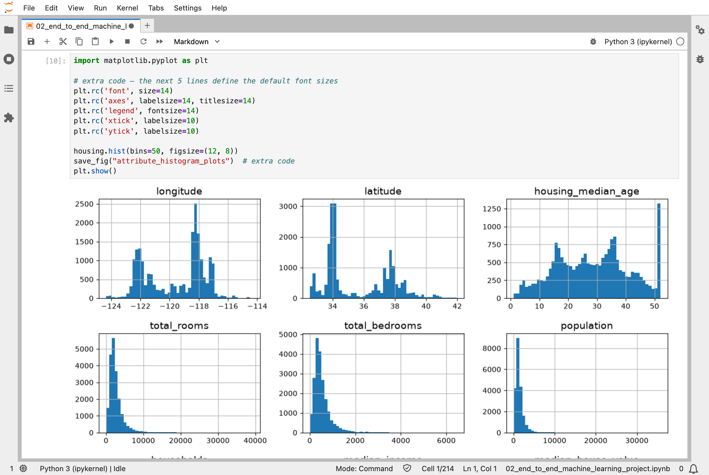
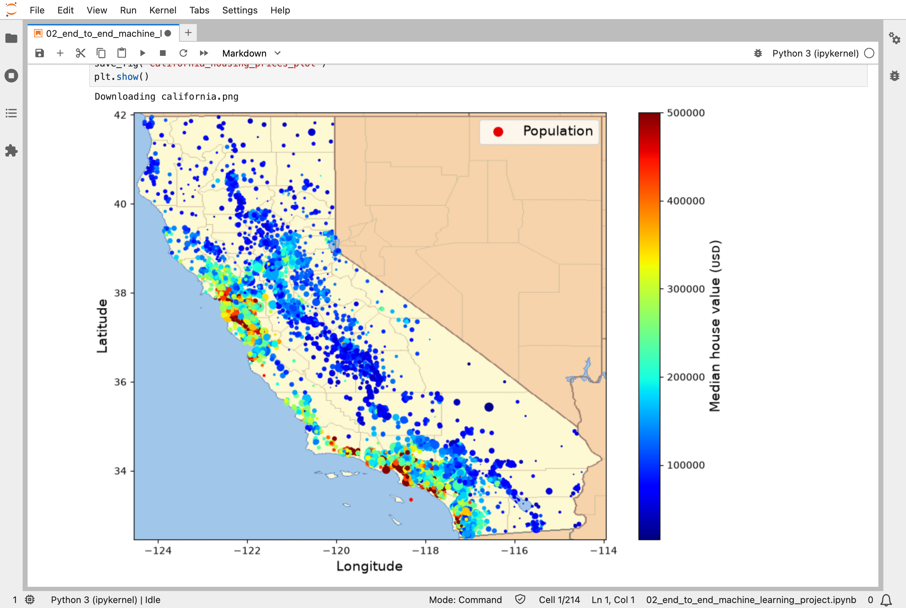
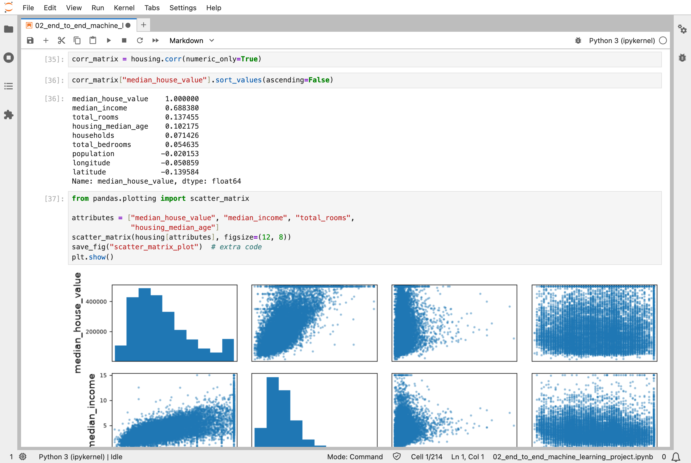
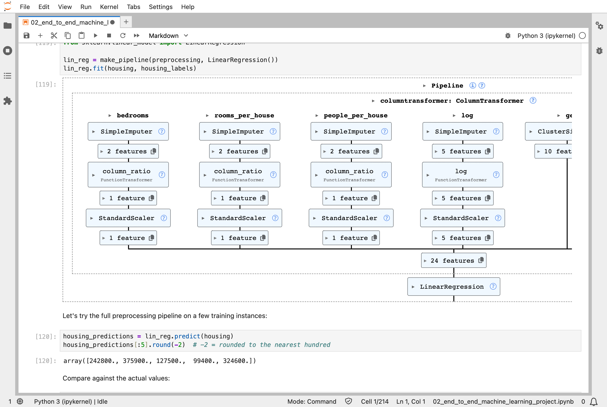
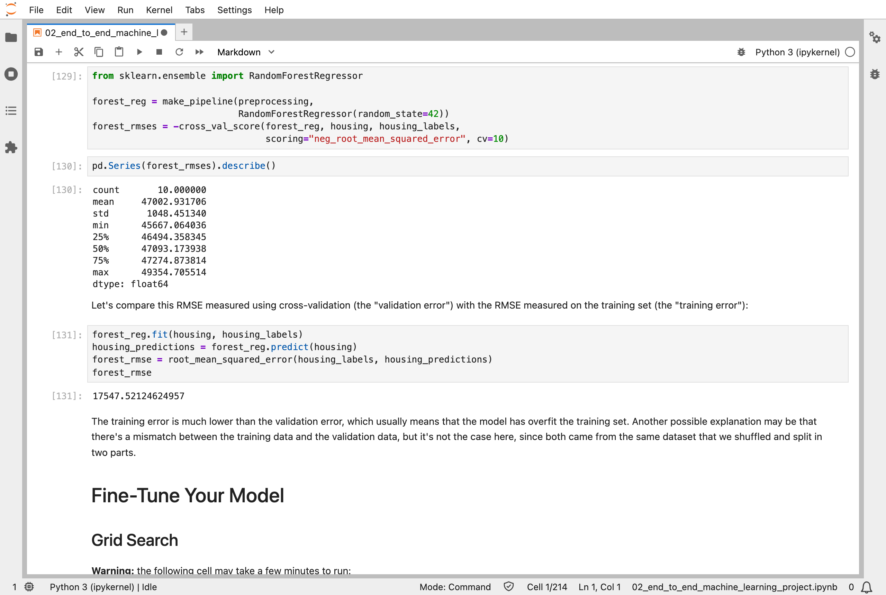
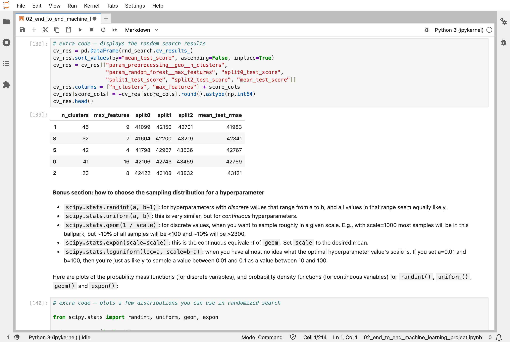
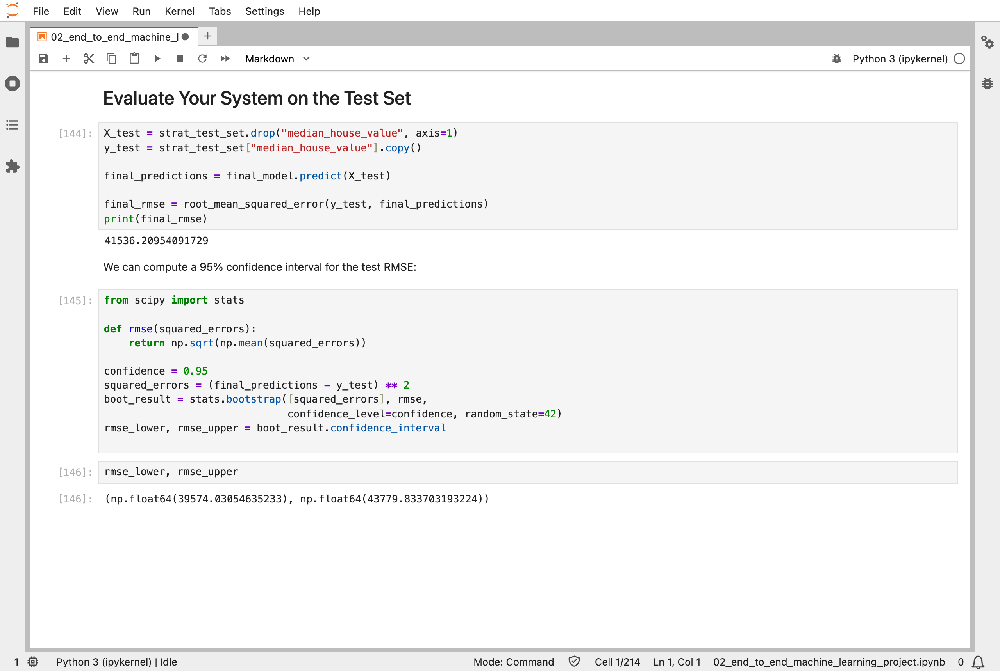

In [Part 1](/posts/sklearn1/), I ran the small example from the first chapter of the Hands-On Machine Learning book. The second chapter is a whole project, from raw data to a tested model: predicting the median house value of a California district, using data from the 1990 census.

## Key Points

**The eight steps of a machine learning project:**
1. **Look at the big picture**: what is the model for, and how will its errors be measured?
2. **Get the data**: 20,640 California districts, with 10 columns each
3. **Explore the data**: histograms, a map, and correlations
4. **Prepare the data**: fill in missing values, encode text, scale the numbers, all in one pipeline
5. **Select and train a model**: a linear model, a decision tree, then a random forest
6. **Fine-tune the model**: grid search and randomized search
7. **Present the solution**
8. **Launch, monitor, and maintain the system**

**What I learned from it:**
- The test set is set aside first, before looking at the data, so that it cannot influence any decision.
- A pipeline keeps every preparation step together, so the same steps run on the training data, the test data, and any new data.
- A model can look perfect on its own training data and still be poor: the decision tree scored an error of exactly 0 on the training set, and about 67,000 under cross-validation.

:::brain-power
In this project, a decision tree scores an error of exactly 0 on its training data. Before reading on, ask yourself: is it the best model here? What would you check before trusting it with new districts?
:::

## Quick Example

The heart of the project is a pipeline, the preparation steps followed by a model, scored with 10-fold cross-validation:

```python
from sklearn.ensemble import RandomForestRegressor
from sklearn.model_selection import cross_val_score
from sklearn.pipeline import make_pipeline

forest_reg = make_pipeline(preprocessing,
                           RandomForestRegressor(random_state=42))
forest_rmses = -cross_val_score(forest_reg, housing, housing_labels,
                                scoring="neg_root_mean_squared_error", cv=10)
```

Here is how each model did when I ran the notebook. The score is the RMSE (root mean squared error), the typical size of a prediction's error, in US dollars:

| Model | How it was measured | RMSE |
|---|---|---|
| Linear regression | on the training set | 68,648 |
| Decision tree | on the training set | 0 |
| Decision tree | 10-fold cross-validation | 67,153 |
| Random forest | 10-fold cross-validation | 47,003 |
| Random forest, grid search | 3-fold cross-validation, best | 43,954 |
| Random forest, randomized search | 3-fold cross-validation, best | 41,983 |
| **The final model** | **on the test set** | **41,536** |

:::watch-it A score on the training data flatters
The decision tree's error of 0 on its own training set became 67,153 under cross-validation. A model can memorise the data it was trained on, so only scores on data it has not seen say how it will do on new districts. That is why the test set is put aside first and used only once, at the very end.
:::

## What training means here

Every `.fit()` call trains a model, and this project trains about 110 of them, which is why it takes minutes rather than seconds:

| What | Models trained |
|---|---|
| Linear regression and a decision tree, once each | 2 |
| 10-fold cross-validation of the tree, the linear model and the random forest | 30 |
| One more random forest, on the whole training set | 1 |
| Grid search: 15 combinations × 3 folds, plus a final refit | 46 |
| Randomized search: 10 combinations × 3 folds, plus a final refit | 31 |

88 of those are random forests, each made of 100 decision trees, so the project grows about 8,800 trees in all. None of them trains the way a neural network does:

- **Linear regression** is worked out directly, in one calculation (least squares).
- **A decision tree** grows one split at a time, each time choosing the question that best divides the districts, until every leaf holds districts with the same value. That is why it scored exactly 0 on its own training data. [Part 6](/posts/sklearn6/) is a whole chapter on decision trees.
- **A random forest** grows 100 trees, each on a random sample of the districts, and averages their answers. One tree memorises its training data and changes a lot with small changes to the data, but 100 different trees make different mistakes, and averaging cancels many of them out. [Part 7](/posts/sklearn7/) covers random forests, and other ways of combining trees.

My [MiniGPT](/posts/minigpt-grown/) model starts from 826,433 random numbers and nudges every one of them thousands of times, using [backpropagation](/posts/sklearn10/) to find which way each should move. Nothing here is nudged: every model is either worked out exactly or grown one decision at a time. Scikit-Learn does have models that train by nudging, such as `SGDRegressor`, and small neural networks trained with backpropagation, such as `MLPRegressor`, but this project does not use them.

:::no-dumb-questions
**Q: What is a fold?**

A: One of the equal parts that cross-validation cuts the training set into. With 10-fold cross-validation, the districts are cut into 10 parts. The model is trained on 9 of them, and scored on the 1 part it has not seen. Then the next part is held out instead, and so on, until every part has been the held-out one. That is 10 trained models and 10 scores, and the RMSE in the table is their average. With 3 folds, as in the two searches, each model trains on two thirds of the training set and is scored on the other third.

**Q: Why train about 110 models just to pick one?**

A: Each cross-validation fold trains a fresh model, and each combination of settings in a search is cross-validated. The extra models are how the project measures, fairly, which choices work best.

**Q: Why grow 100 trees, when one tree can score 0?**

A: The single tree memorised its training data. A random forest trains each tree on a different random sample and averages their answers, so many of their mistakes cancel out: 47,003 under cross-validation, against the single tree's 67,153.

**Q: Is the final test score good news?**

A: Yes, mainly because it is close to the best cross-validation score: 41,536 on the test set, against 41,983. The estimate made during the project was honest.
:::

## Running the notebook in Jupyter

The project is in the chapter 2 notebook that goes with the book, [02_end_to_end_machine_learning_project.ipynb](https://github.com/ageron/handson-ml3/blob/main/02_end_to_end_machine_learning_project.ipynb). I ran the project part of it, everything up to the test set, and then looked through the results in JupyterLab. The whole run took about 6 minutes on my Mac Studio, most of it in the two searches.


*I loaded the data: 20,640 districts, one row each, with the median house value in the ninth column*


*I plotted a histogram of every column: housing_median_age is capped at 52, which shows as a tall spike on the right*


*I put the districts on a map of California: the most expensive, in red, are along the coast, around the Bay Area and Los Angeles*


*I looked for correlations: median_income is the column most closely related to house value, at 0.69*


*Scikit-Learn drew the preprocessing pipeline that feeds the linear regression: each kind of column gets its own steps, and 24 features come out*


*A random forest scored about 47,000 under cross-validation, but only 17,548 on its own training set, so it is still overfitting*


*Randomized search tried different numbers of geographic clusters and features: the best combination scored 41,983*


*Finally, I tested the model on the test set, which it had never seen: an RMSE of 41,536, with a 95% confidence interval from 39,574 to 43,780*

:::bullet-points An end-to-end project, in short
- Put the test set aside before looking at the data.
- Keep every preparation step in one pipeline, so the same steps run on all data.
- Judge models with cross-validation, never on their own training data.
- Search for the best settings, then test the final model once.
- Nothing in this project is nudged: models are worked out directly or grown one decision at a time.
:::

Next, [Scikit-Learn (Part 3)](/posts/sklearn3/) works through chapter 3: classification, with handwritten digits.

## References

- [Aurélien Géron's chapter 2 notebook](https://github.com/ageron/handson-ml3/blob/main/02_end_to_end_machine_learning_project.ipynb) - for Hands-On Machine Learning with Scikit-Learn, Keras, and TensorFlow (third edition)
- [Scikit-Learn (Part 1)](/posts/sklearn1/) - the first chapter's example
- [scikit-learn](https://scikit-learn.org/) - the library's documentation
