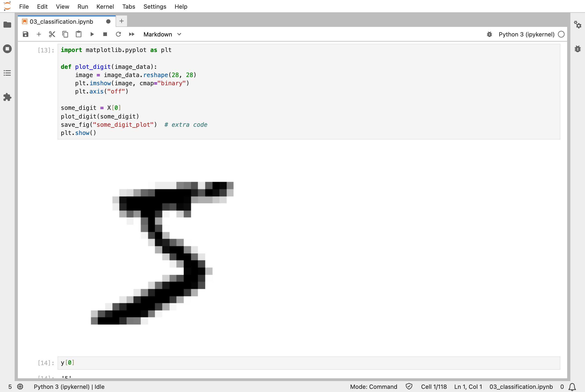
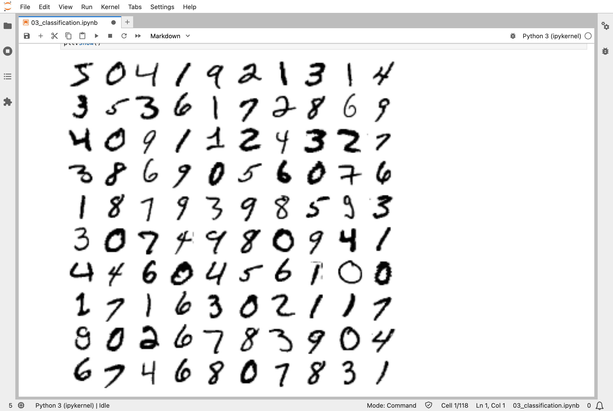
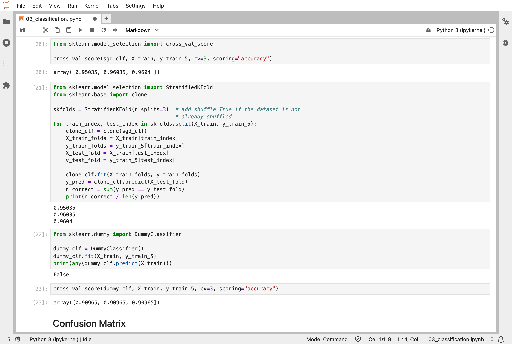
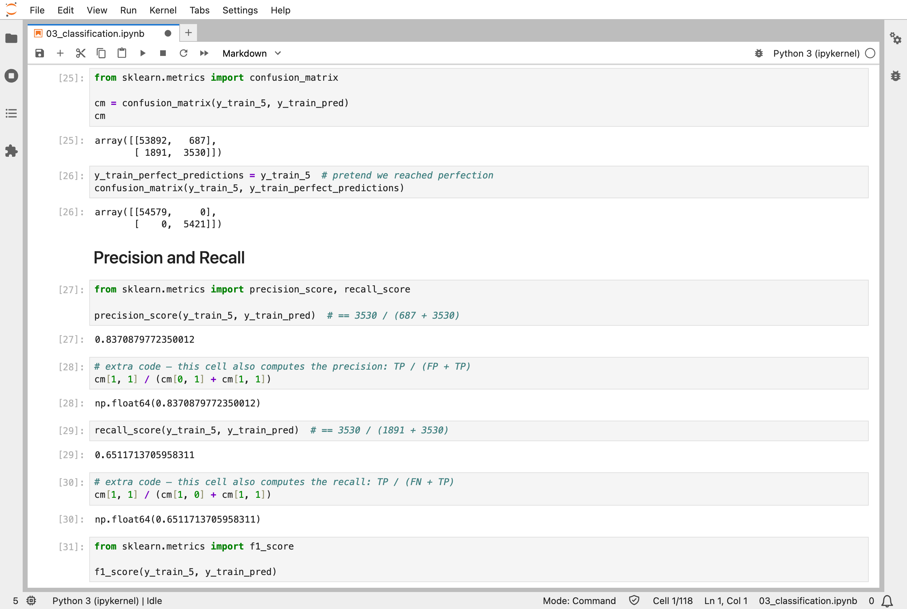
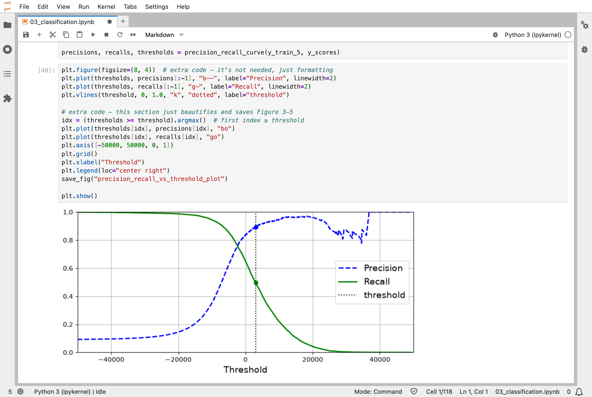
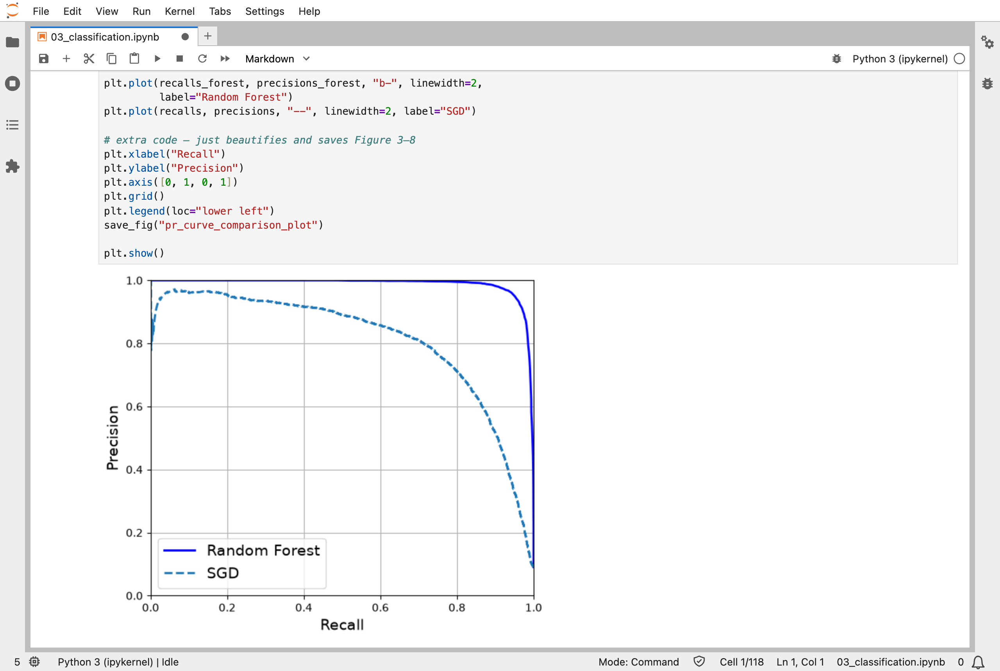
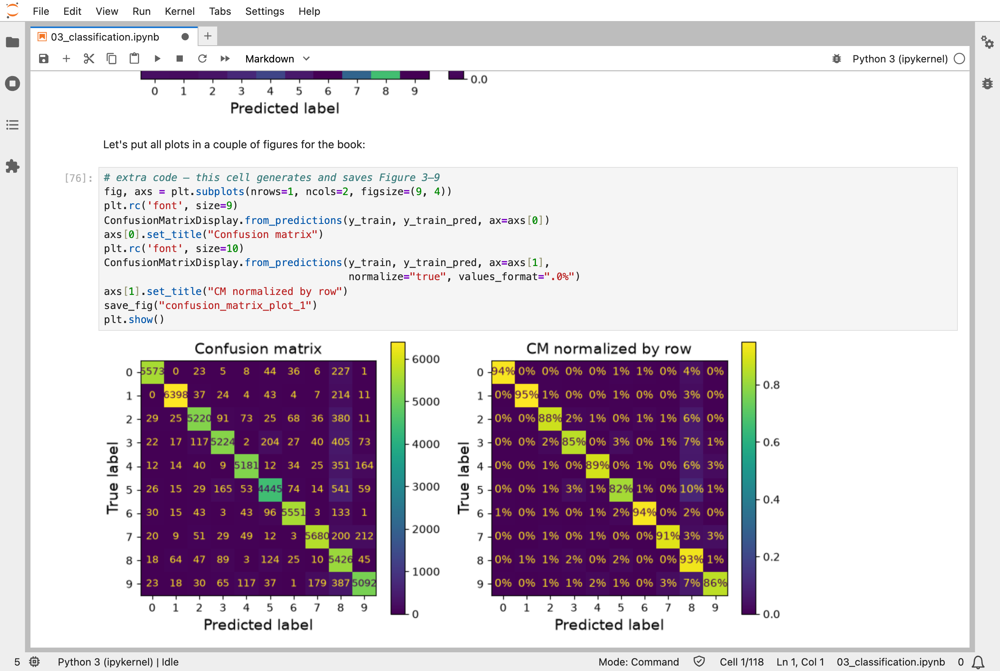

In [Part 2](/posts/sklearn2/), I predicted numbers: house prices. The third chapter of the Hands-On Machine Learning book predicts classes instead, using MNIST, a famous set of 70,000 small images of handwritten digits. It starts with a simpler question, "is this digit a 5?", and spends most of its time on how to tell whether a classifier is any good.

## Key Points

**What the chapter covers:**
1. **The MNIST data**: 70,000 images, each 28 × 28 = 784 pixels, with the digit it shows; the first 60,000 are for training and the last 10,000 for testing
2. **A binary classifier**: an `SGDClassifier` that answers one question, "is this a 5?"
3. **Accuracy can mislead**: only about 10% of the images are 5s, so a model that always says "not a 5" is already 91% accurate
4. **The confusion matrix**: a count of every kind of right and wrong answer
5. **Precision and recall**: of the images it calls 5s, how many really are; and of the real 5s, how many it finds
6. **The precision/recall trade-off**: raising the threshold makes the classifier more careful, but it then misses more 5s
7. **The ROC curve**: another way to compare classifiers across all thresholds
8. **Multiclass, multilabel, and multioutput classification**: all ten digits at once, several labels per image, and even a whole cleaned-up image as the output

**What I learned from it:**
- A high accuracy can mean very little when one class is rare. The confusion matrix shows what the model actually gets wrong.
- Precision and recall pull against each other; which matters more depends on what the model is for.
- Some classifiers, such as SVMs, decide between two classes at a time, so Scikit-Learn quietly trains several of them to handle ten digits.

:::brain-power
Only about one image in ten is a 5. A classifier answers "is this a 5?" and is right 95% of the time. Before reading on, decide: is that a good classifier? What else would you want to know about it?
:::

## Quick Example

The "is this a 5?" classifier, trained on the 60,000 training images:

```python
from sklearn.linear_model import SGDClassifier

y_train_5 = (y_train == '5')  # True for all 5s, False for all other digits

sgd_clf = SGDClassifier(random_state=42)
sgd_clf.fit(X_train, y_train_5)
```

Here is how it did when I ran the notebook, measured with 3-fold cross-validation on the training images, next to a random forest and a "classifier" that always says "not a 5":

| Model | Accuracy | Precision | Recall |
|---|---|---|---|
| Always "not a 5" | 0.91 | — | 0 |
| SGD | 0.95 to 0.96 | 0.837 | 0.651 |
| SGD, stricter | — | 0.900 | 0.480 |
| Random forest | — | 0.990 | 0.872 |

"SGD" is the `SGDClassifier`; "stricter" is the same model with its threshold raised until 90% of the images it calls 5s really are 5s.

The `SGDClassifier`'s confusion matrix tells the story behind its accuracy: it called 3,530 of the 5s correctly, missed 1,891, and wrongly called 687 other digits 5s.

:::watch-it High accuracy can mean very little
A "classifier" that always says "not a 5" is right 91% of the time, because 5s are rare. The 5-detector's 95% to 96% is only a little better than doing nothing. Precision and recall show what accuracy hides: the 5-detector found only 65% of the real 5s.
:::

## What training means here

The `SGDClassifier` is the first model in this series that learns by nudging. SGD stands for *stochastic gradient descent*. It starts with all its numbers at zero, one weight for each of the 784 pixels plus one more, and then goes through the training images one at a time, nudging the 785 numbers a little after each image in the direction that would have made it less wrong. It passes over the 60,000 images again and again, up to 1,000 times, until the nudges stop helping. When I trained it on all ten digits with scaled pixels, it warned that it had used up those 1,000 passes before settling down: a reminder that nudging can run out of steps.

[Part 4](/posts/sklearn4/) shows this kind of training in detail. It is the same kind of step my [MiniGPT](/posts/minigpt-grown/) model takes, but MiniGPT needs backpropagation to find its slopes, because it has many layers; a linear classifier like this one has only one, so its slope comes from a simple formula.

The chapter's other models learn as before: the random forest is grown split by split, the SVM is solved directly, and k-nearest neighbors just remembers all 60,000 images.

:::no-dumb-questions
**Q: What is the threshold?**

A: The `SGDClassifier` gives every image a score, and calls it a 5 when the score is above a threshold. Raising the threshold makes it more careful: its precision rose to 0.900, but its recall fell to 0.480, so it missed more than half of the 5s.

**Q: Which matters more, precision or recall?**

A: It depends on what the model is for. A filter that must never let a bad video through to children needs high precision about what it calls safe; a detector for shoplifters on camera can accept false alarms, if it catches most of them.

**Q: Why does the `SGDClassifier` start from zeros, when MiniGPT starts from random numbers?**

A: A linear model has one layer, so starting every weight at zero does no harm. In a network with many layers, neurons that start identical would get identical nudges and stay identical, so their starting numbers must be random.
:::

## Running the notebook in Jupyter

The chapter is in the notebook that goes with the book, [03_classification.ipynb](https://github.com/ageron/handson-ml3/blob/main/03_classification.ipynb). I ran everything before the exercise solutions, which took about 31 minutes on my Mac Studio, almost all of it in the cells that train on all 60,000 images three times over for cross-validation. Then I looked through the results in JupyterLab.


*The first image in MNIST: 784 pixels, drawn as a 28 × 28 grid, and labelled as a 5*


*The first 100 images: some digits are clear, and some would trouble a person*


*The 5-detector scored 0.95 to 0.96 accuracy, but a classifier that always says "not a 5" scored 0.91*


*The confusion matrix: 3,530 5s found, 1,891 missed, and 687 other digits wrongly called 5s, which gives a precision of 0.837 and a recall of 0.651*


*Moving the threshold trades precision against recall: as one goes up, the other comes down*


*The random forest's precision/recall curve stays near the top right corner, well above the SGDClassifier's*


*The confusion matrix for all ten digits: the bright diagonal is right answers, and the column for 8 collects many of the mistakes*

:::bullet-points Classification, in short
- Accuracy can mislead when one class is rare; compare against a classifier that always gives the same answer.
- The confusion matrix counts every kind of right and wrong answer.
- Precision and recall pull against each other, and the threshold sets the balance.
- The `SGDClassifier` is the first model in this series trained by nudging.
:::

Next, [Scikit-Learn (Part 4)](/posts/sklearn4/) works through chapter 4: how linear models are trained, including gradient descent.

## References

- [Aurélien Géron's chapter 3 notebook](https://github.com/ageron/handson-ml3/blob/main/03_classification.ipynb) - for Hands-On Machine Learning with Scikit-Learn, Keras, and TensorFlow (third edition)
- [Scikit-Learn (Part 2)](/posts/sklearn2/) - an end-to-end project
- [scikit-learn](https://scikit-learn.org/) - the library's documentation
