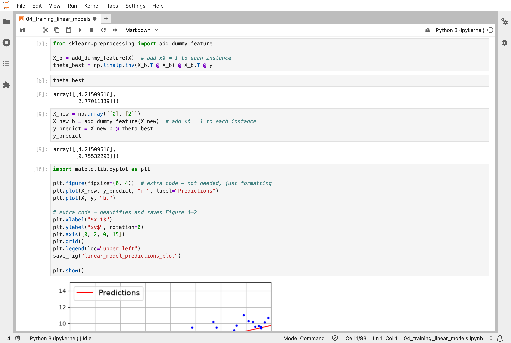
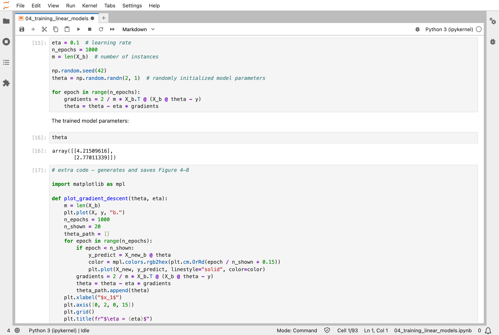
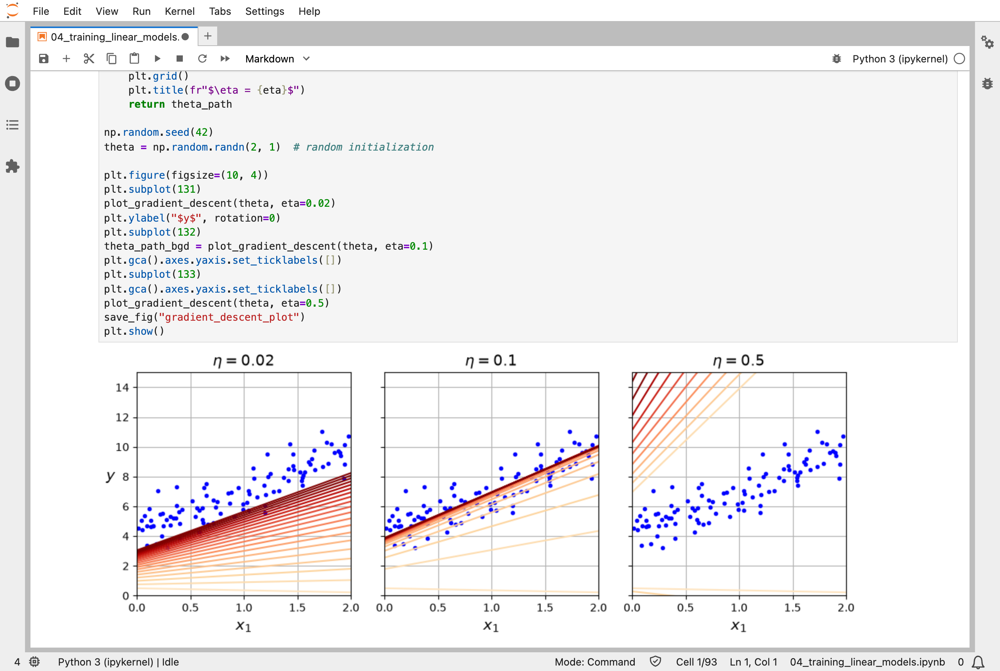
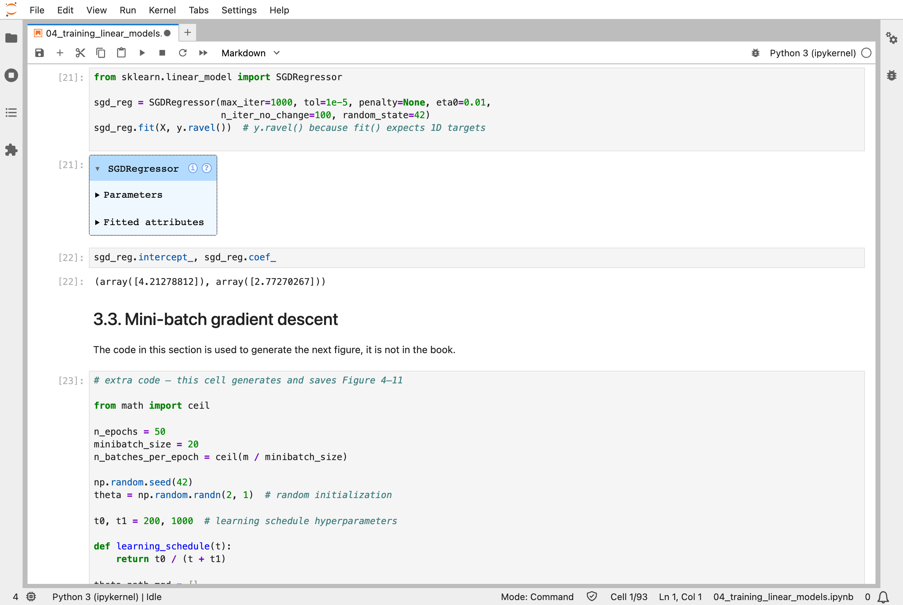
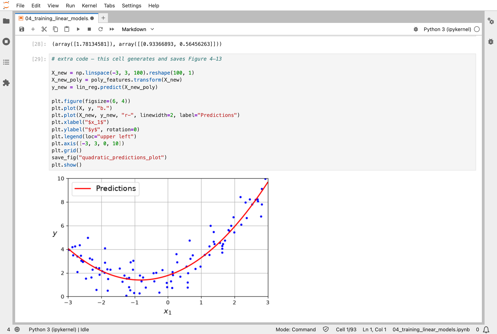
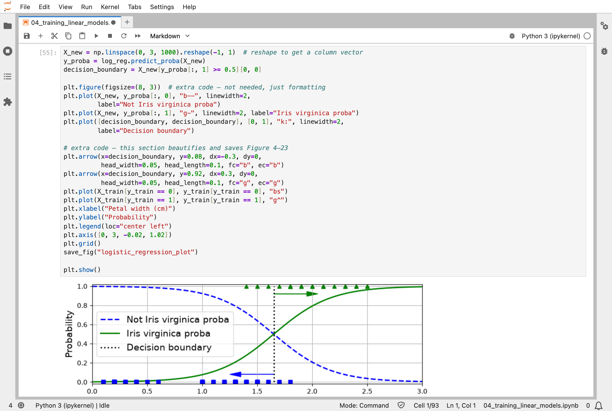

In [Part 3](/posts/sklearn3/), I trained classifiers without asking how they find their numbers. The fourth chapter of the Hands-On Machine Learning book opens up training itself. It fits the same straight line in two completely different ways, directly in one calculation and by nudging from random numbers, and shows that they agree.

## Key Points

**What the chapter covers:**
1. **The Normal Equation**: works out the best straight line directly, in one calculation
2. **Gradient descent**: starts from random numbers and steps downhill along the slope of the error, over and over
3. **Three kinds of gradient descent**: batch (all the data for every step), stochastic (one instance per step), and mini-batch (small groups)
4. **Polynomial regression**: adding powers of a feature, such as x², lets a linear model fit a curve
5. **Learning curves**: plotting the error as the training set grows, to spot underfitting and overfitting
6. **Regularization**: Ridge, Lasso, Elastic Net, and early stopping, which keep a model from fitting the noise
7. **Logistic and softmax regression**: linear models that output chances, for classification

**What I learned from it:**
- Gradient descent and the direct calculation reach the same answer; they are two routes to the same line.
- The learning rate, the size of each step, matters a lot: too small creeps, and too large jumps out of the valley altogether.
- A "linear" model can still fit a curve, as long as the curve is made of features it is given, such as x and x².

:::brain-power
The Normal Equation finds the best line in one calculation. Gradient descent starts from random numbers and takes 1,000 small steps to reach the same line. Before reading on, think: why would anyone choose the slow way?
:::

## Quick Example

The notebook makes 100 points from the line y = 4 + 3x, plus random noise, and then looks for that line. Batch gradient descent is only a few lines of NumPy:

```python
eta = 0.1  # learning rate
n_epochs = 1000
m = len(X_b)  # number of instances

np.random.seed(42)
theta = np.random.randn(2, 1)  # randomly initialized model parameters

for epoch in range(n_epochs):
    gradients = 2 / m * X_b.T @ (X_b @ theta - y)
    theta = theta - eta * gradients
```

Here is what each method found when I ran the notebook. The noise means that no method can recover exactly 4 and 3:

| Method | Intercept | Slope |
|---|---|---|
| The line used to make the data | 4 | 3 |
| The Normal Equation, in one calculation | 4.215 | 2.770 |
| Batch gradient descent, 1,000 steps from random numbers | 4.215 | 2.770 |
| Stochastic gradient descent, 50 passes through the data | 4.211 | 2.749 |
| Scikit-Learn's `SGDRegressor` | 4.213 | 2.773 |

:::watch-it The learning rate can make or break training
The learning rate, `eta`, sets the size of each step. The notebook shows all three cases: too small, and the line creeps towards the answer; about right, and it gets there quickly; too large, and every step overshoots, so the line jumps further and further from the answer.
:::

## What training means here

This is the chapter where nudging arrives. The loop above is the whole idea: start from two random numbers, work out which way the error slopes, take a small step downhill, and repeat. After 1,000 steps it lands on exactly the line that the Normal Equation works out in one go.

Two differences from my [MiniGPT](/posts/minigpt-grown/) model are worth seeing. The slope here comes from a formula worked out by hand once, `2 / m * X_b.T @ (X_b @ theta - y)`, because a linear model has only one layer; MiniGPT has many layers, so PyTorch has to work its slopes out by backpropagation. And here there are 2 numbers to nudge, where MiniGPT has 826,433. The step itself is the same: a number minus the learning rate times its slope.

The `SGDClassifier` in Part 3 trains in exactly this way, and so does a neural network. The rest of the models in this series so far are either worked out directly, like the Normal Equation, or grown one decision at a time, like decision trees.

:::no-dumb-questions
**Q: Why use gradient descent, when the Normal Equation gives the answer directly?**

A: The Normal Equation gets very slow as the number of features grows, and needs all the data in memory at once. Gradient descent works on any size of data, a batch at a time. And for most models, such as neural networks, there is no direct calculation at all, so nudging is the only way.

**Q: What is an epoch?**

A: One pass through the training data. Batch gradient descent uses all 100 points for every step, so its 1,000 epochs are 1,000 steps. Stochastic gradient descent takes one step per point, so its 50 epochs are 5,000 smaller, noisier steps.

**Q: Why did the different methods not all find exactly 4 and 3?**

A: The points have random noise added, so the best line through these 100 points is not quite y = 4 + 3x. The Normal Equation and batch gradient descent both found that best line, 4.215 and 2.770; the stochastic methods finished close to it.
:::

## Running the notebook in Jupyter

The chapter is in the notebook that goes with the book, [04_training_linear_models.ipynb](https://github.com/ageron/handson-ml3/blob/main/04_training_linear_models.ipynb). I ran everything before the exercise solutions, which took a few seconds on my Mac Studio, and then looked through the results in JupyterLab.


*I worked out the best line directly, with the Normal Equation: an intercept of 4.215 and a slope of 2.770, close to the 4 and 3 used to make the data*


*Batch gradient descent started from random numbers, took 1,000 steps downhill, and arrived at exactly the same 4.215 and 2.770*


*The first 20 steps with three learning rates: 0.02 creeps towards the line, 0.1 gets there, and 0.5 overshoots and flies away*


*Scikit-Learn's SGDRegressor does the same nudging, one instance at a time, and found 4.213 and 2.773*


*Adding x² as a second feature lets a linear model fit a curve: 1.78 + 0.93x + 0.56x², close to the 2 + x + 0.5x² used to make the data*


*Logistic regression on iris petals: above a petal width of about 1.65 cm, it says Iris virginica is more likely than not*

:::bullet-points Training linear models, in short
- The Normal Equation works out the best line directly.
- Gradient descent reaches the same line by stepping downhill from random numbers.
- Each step is a number minus the learning rate times its slope, the same step MiniGPT takes.
- Regularization keeps a model from fitting the noise.
:::

Next, [Scikit-Learn (Part 5)](/posts/sklearn5/) works through chapter 5: support vector machines.

## References

- [Aurélien Géron's chapter 4 notebook](https://github.com/ageron/handson-ml3/blob/main/04_training_linear_models.ipynb) - for Hands-On Machine Learning with Scikit-Learn, Keras, and TensorFlow (third edition)
- [Scikit-Learn (Part 3)](/posts/sklearn3/) - classification
- [scikit-learn](https://scikit-learn.org/) - the library's documentation
