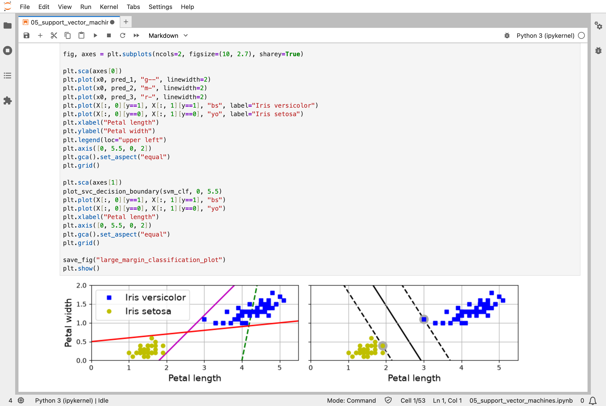
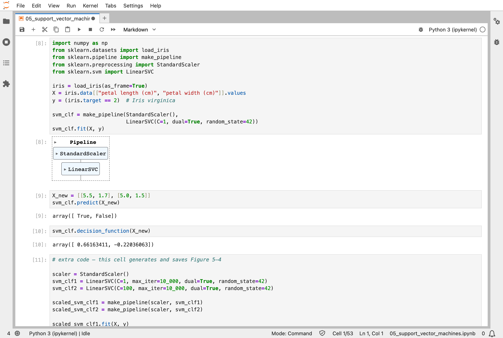
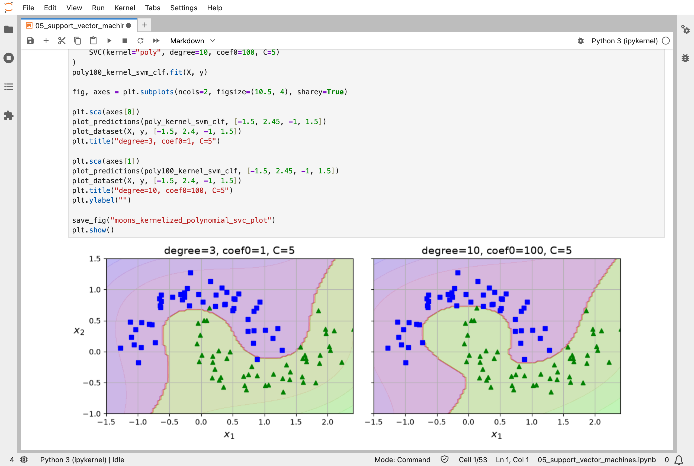
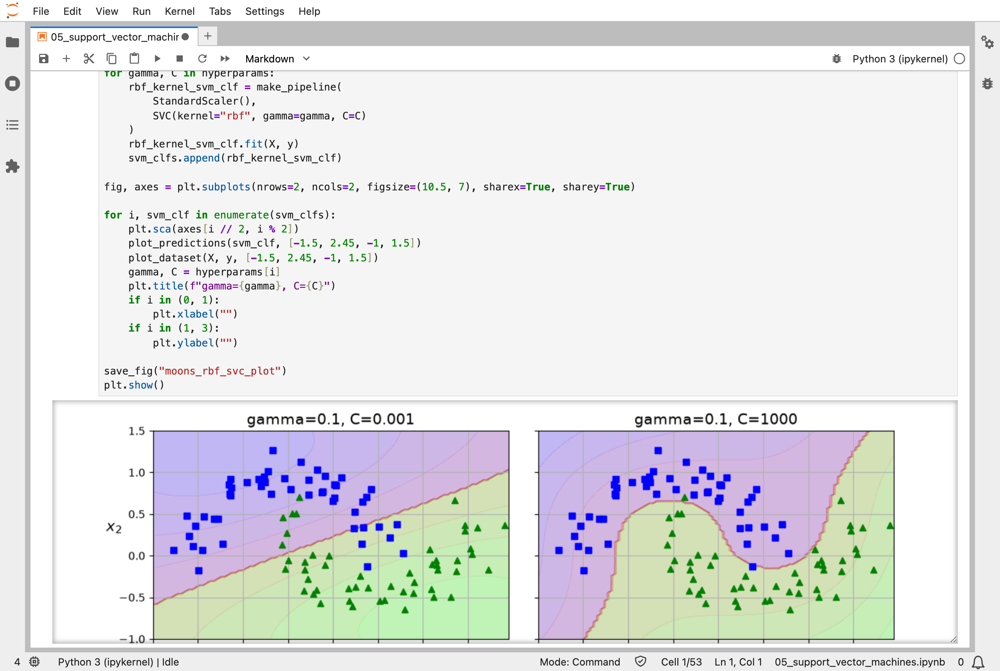
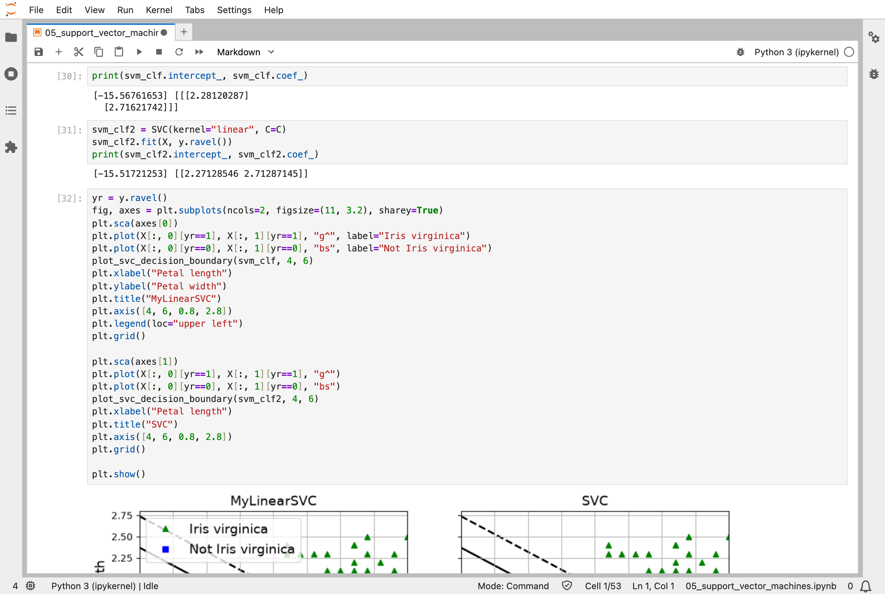

In [Part 4](/posts/sklearn4/), I fitted lines both directly and by gradient descent. The fifth chapter of the Hands-On Machine Learning book is about support vector machines (SVMs): models that separate two classes with the widest possible gap between them.

## Key Points

**What the chapter covers:**
1. **Large margin classification**: of all the lines that separate two classes, an SVM picks the one with the widest "street" between them
2. **Support vectors**: only the instances on the edges of the street decide where it goes; the rest could move without changing anything
3. **Soft margins**: the hyperparameter `C` trades a wide street against a few instances on the wrong side of it
4. **Feature scaling**: SVMs are sensitive to the scale of each feature, so the data is scaled first
5. **Kernels**: the polynomial and Gaussian RBF kernels let an SVM draw curved boundaries, without actually adding the extra features
6. **SVM regression**: turn the idea around, and fit as many instances as possible inside the street

**What I learned from it:**
- An SVM does not care about most of its training data; only the support vectors matter.
- The kernel trick gives an SVM the curved boundary that thousands of extra features would, without the cost of computing them.
- `C` and `gamma` are the knobs to turn: small values give smooth, cautious boundaries, and large values give tight, wiggly ones.

## Quick Example

A linear SVM that decides whether an iris is an Iris virginica, from its petal length and width:

```python
import numpy as np
from sklearn.datasets import load_iris
from sklearn.pipeline import make_pipeline
from sklearn.preprocessing import StandardScaler
from sklearn.svm import LinearSVC

iris = load_iris(as_frame=True)
X = iris.data[["petal length (cm)", "petal width (cm)"]].values
y = (iris.target == 2)  # Iris virginica

svm_clf = make_pipeline(StandardScaler(),
                        LinearSVC(C=1, dual=True, random_state=42))
svm_clf.fit(X, y)
```

When I ran it, a flower with petals 5.5 cm long and 1.7 cm wide came out as an Iris virginica, and one with petals 5.0 cm by 1.5 cm did not. Their scores, positive on the Iris virginica side of the boundary and negative on the other, were 0.66 and −0.22.

The chapter's extra material trains the same kind of model in two ways, on the same flowers, and compares them:

| How it was trained | Intercept | Petal length weight | Petal width weight |
|---|---|---|---|
| Scikit-Learn's `SVC`, solved directly | −15.517 | 2.271 | 2.713 |
| The notebook's `MyLinearSVC`: random start, 60,000 steps of gradient descent | −15.568 | 2.281 | 2.716 |

## What training means here

Scikit-Learn's `SVC` does not nudge. Finding the widest street is a well-understood mathematical problem, and `SVC` hands it to a specialised solver, LIBSVM, which works on it two numbers at a time, solving each small piece exactly, rather than taking small steps along a slope.

The chapter's extra material then trains the same model by gradient descent, exactly like Part 4: start from random weights, work out which way the error slopes, step downhill, and repeat, 60,000 times. It lands within about 0.05 of the direct answer. So an SVM can be trained either way, like the straight line in Part 4.

My [MiniGPT](/posts/minigpt-grown/) model can only be trained the nudging way: no one knows a direct calculation that finds its 826,433 numbers.

## Running the notebook in Jupyter

The chapter is in the notebook that goes with the book, [05_support_vector_machines.ipynb](https://github.com/ageron/handson-ml3/blob/main/05_support_vector_machines.ipynb). I ran everything before the exercise solutions, which took about 10 seconds on my Mac Studio, and then looked through the results in JupyterLab.


*On the left, three lines that separate the flowers badly or barely; on the right, the SVM's widest street, with its support vectors circled*


*I trained a linear SVM to spot Iris virginica, and it classified two new flowers: one yes, one no*


*A polynomial kernel lets the SVM curve its boundary around the two moons*


*The Gaussian RBF kernel with different settings: a small C gives a smooth boundary, and a large C follows the training data closely*


*The same SVM trained by gradient descent and by Scikit-Learn's SVC: the two answers agree to within about 0.05*

Next, [Scikit-Learn (Part 6)](/posts/sklearn6/) works through chapter 6: decision trees.

## References

- [Aurélien Géron's chapter 5 notebook](https://github.com/ageron/handson-ml3/blob/main/05_support_vector_machines.ipynb) - for Hands-On Machine Learning with Scikit-Learn, Keras, and TensorFlow (third edition)
- [Scikit-Learn (Part 4)](/posts/sklearn4/) - training linear models
- [scikit-learn](https://scikit-learn.org/) - the library's documentation
