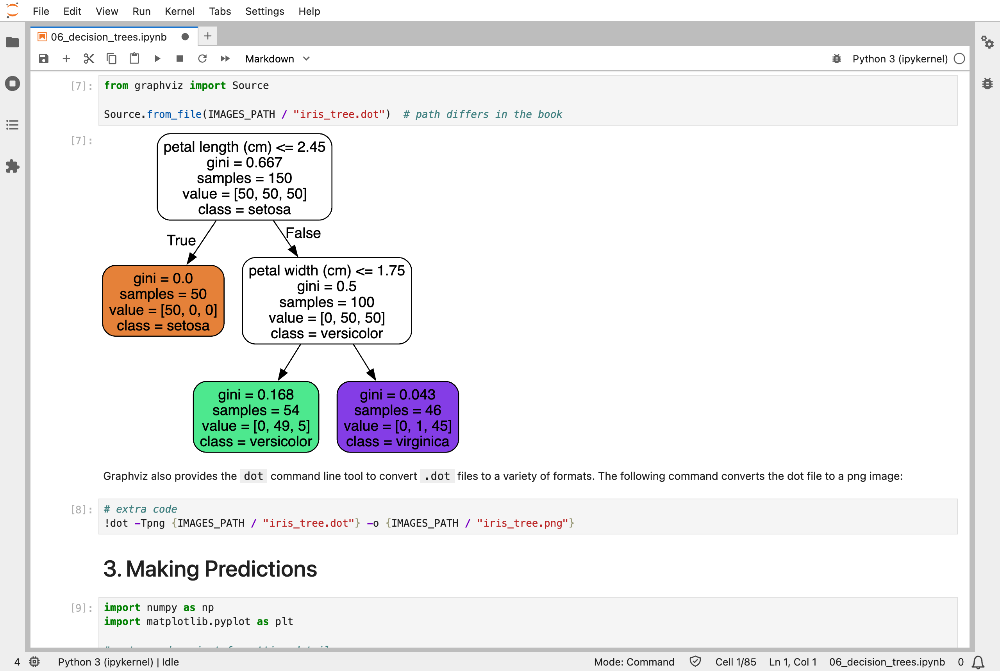
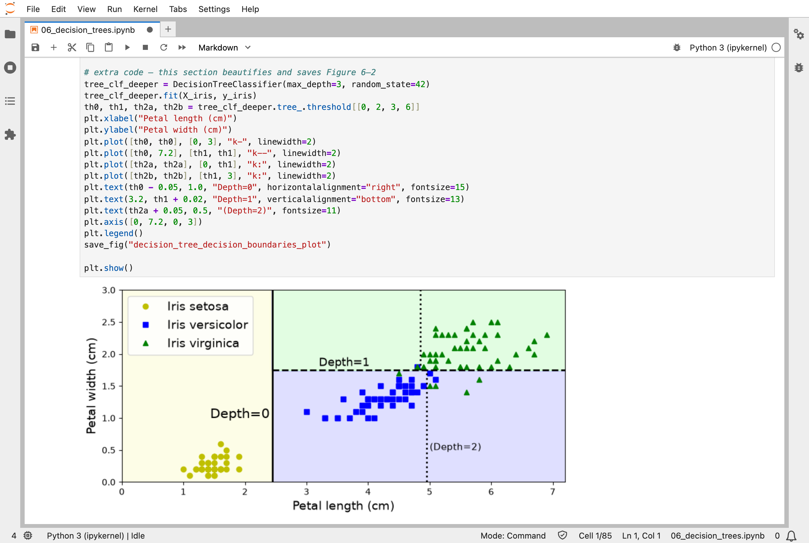
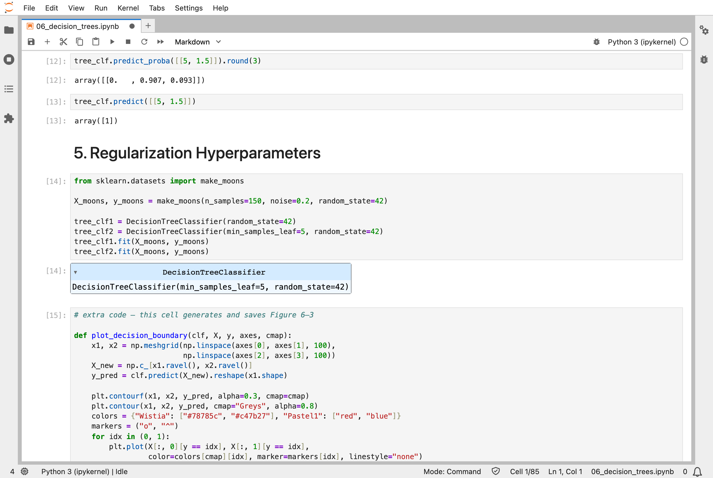
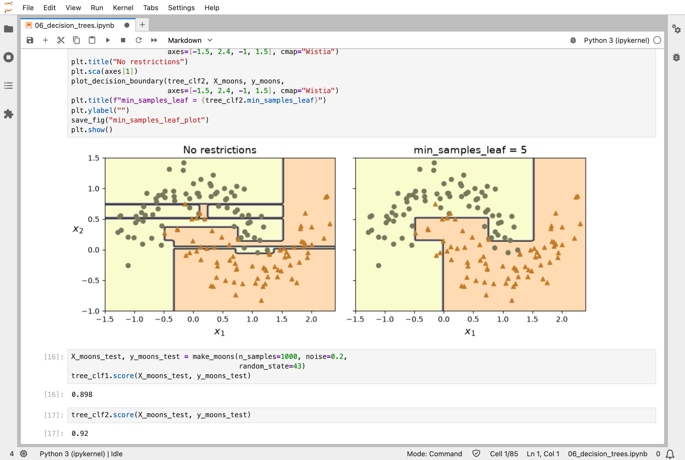
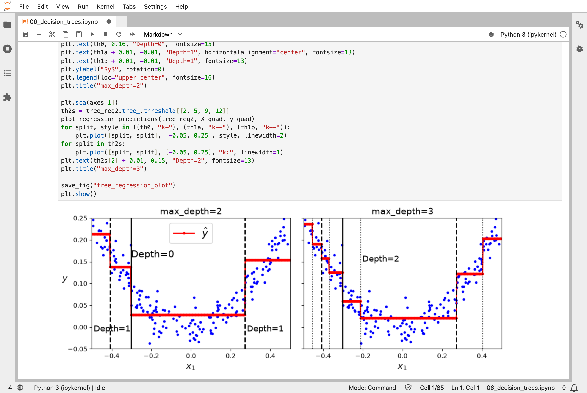

In [Part 5](/posts/sklearn5/), I separated classes with the widest possible street. The sixth chapter of the Hands-On Machine Learning book is about decision trees: models that classify by asking one yes-or-no question after another, and that can be read like a flowchart.

## Key Points

**What the chapter covers:**
1. **Training and drawing a tree**: Graphviz draws the tree's questions, so the model can be read
2. **Making predictions**: a new instance follows the questions from the top of the tree down to a leaf
3. **Class probabilities**: a leaf's chances are the share of each class among the training instances that ended up there
4. **The CART algorithm**: how Scikit-Learn grows a tree, one best split at a time
5. **Regularization**: limits such as `max_depth` and `min_samples_leaf` stop a tree from carving out a region for every training point, much as Ridge and Lasso hold back a linear model in [Part 4](/posts/sklearn4/)
6. **Regression trees**: the same idea predicting numbers, with each leaf predicting an average
7. **Weaknesses**: trees only cut parallel to the axes, and small changes to the data can grow a very different tree

**What I learned from it:**
- A decision tree is the easiest model in the series so far to explain: anyone can follow its questions.
- Left alone, a tree keeps splitting until it has memorised the training data, which is why the tree in [Part 2](/posts/sklearn2/) scored an error of exactly 0 on its own training set.
- Trees are unstable: training on slightly different data can change every question.

:::brain-power
Before reading on, imagine sorting the 150 iris flowers into their three species with yes-or-no questions about their petals. Which single question would you ask first, and why?
:::

## Quick Example

A tree, two questions deep, trained on the petal length and width of all 150 iris flowers:

```python
from sklearn.datasets import load_iris
from sklearn.tree import DecisionTreeClassifier

iris = load_iris(as_frame=True)
X_iris = iris.data[["petal length (cm)", "petal width (cm)"]].values
y_iris = iris.target

tree_clf = DecisionTreeClassifier(max_depth=2, random_state=42)
tree_clf.fit(X_iris, y_iris)
```

When I ran it, the tree learned two questions:

| Question | If yes | If no |
|---|---|---|
| Is the petal length 2.45 cm or less? | Iris setosa: all 50 setosas, and nothing else | Ask the next question |
| Is the petal width 1.75 cm or less? | Iris versicolor: 49 versicolors and 5 virginicas | Iris virginica: 45 virginicas and 1 versicolor |

For a flower with petals 5 cm long and 1.5 cm wide, it answers "no", then "yes", and says Iris versicolor, with a chance of 90.7%: 49 of the 54 training flowers in that leaf.

:::watch-it Trees are unstable
Grow a tree on slightly different data, or with a different random seed, and even its first question can change. Each question is chosen greedily, and the questions below depend on it, so one small change can ripple through the whole tree. Ensembles of many trees, in [Part 7](/posts/sklearn7/), are the usual cure.
:::

## What training means here

Nothing is nudged, and nothing is worked out in one calculation either. Scikit-Learn grows the tree with the CART algorithm. At the top, it tries every feature and every possible threshold, and picks the question that splits the flowers into the purest groups. Then it does the same inside each group, and so on, until it reaches the depth limit or the groups are pure. It never goes back to change an earlier question.

That greedy, one-decision-at-a-time growth is quick, but it does not guarantee the best possible tree, and it is why a small change in the data can change the very first question. My [MiniGPT](/posts/minigpt-grown/) model works the opposite way: every one of its numbers is adjusted a little on every step, and nothing is ever fixed for good.

:::no-dumb-questions
**Q: Where does the 90.7% come from?**

A: From the leaf the flower lands in. 54 training flowers ended up there, 49 of them versicolors, and 49 ÷ 54 is 90.7%. A tree's chances are just shares of the training flowers in each leaf.

**Q: Do trees need the features to be scaled, like SVMs?**

A: No. Each question compares one feature with a threshold, so changing that feature's units moves the threshold, and the questions still split the flowers the same way.

**Q: If a tree can memorise its training data, why limit it?**

A: Memorising is the problem. A tree that carves out a region for every training flower follows the noise, and does worse on new flowers. Limits such as `max_depth` stop it early.
:::

## Running the notebook in Jupyter

The chapter is in the notebook that goes with the book, [06_decision_trees.ipynb](https://github.com/ageron/handson-ml3/blob/main/06_decision_trees.ipynb). I ran everything before the exercise solutions, which took a few seconds on my Mac Studio, and then looked through the results in JupyterLab.


*Graphviz drew the tree: the first question, petal length 2.45 cm or less, sets apart all 50 setosas, and the second asks about petal width*


*Each question cuts the petal plane with a straight line parallel to an axis: depth 0, then depth 1, and the dotted lines a deeper tree would add*


*For petals 5 cm long and 1.5 cm wide, the tree says 90.7% Iris versicolor and 9.3% Iris virginica*


*With no restrictions, the tree carves out tiny regions around single points; with min_samples_leaf = 5 it is smoother, and it scored 0.92 on new data instead of 0.898*


*A regression tree predicts the average value in each region, so its predictions are steps, and a deeper tree has more of them*

:::bullet-points Decision trees, in short
- A tree classifies by asking one yes-or-no question after another, and can be read like a flowchart.
- CART grows the tree greedily, one best split at a time, and never goes back.
- Left alone, a tree memorises its training data, so its depth is limited.
- Trees are unstable, which is why they are usually grown in ensembles.
:::

Next, [Scikit-Learn (Part 7)](/posts/sklearn7/) works through chapter 7: ensemble learning and random forests, which combine many trees.

## References

- [Aurélien Géron's chapter 6 notebook](https://github.com/ageron/handson-ml3/blob/main/06_decision_trees.ipynb) - for Hands-On Machine Learning with Scikit-Learn, Keras, and TensorFlow (third edition)
- [Scikit-Learn (Part 5)](/posts/sklearn5/) - support vector machines
- [scikit-learn](https://scikit-learn.org/) - the library's documentation
