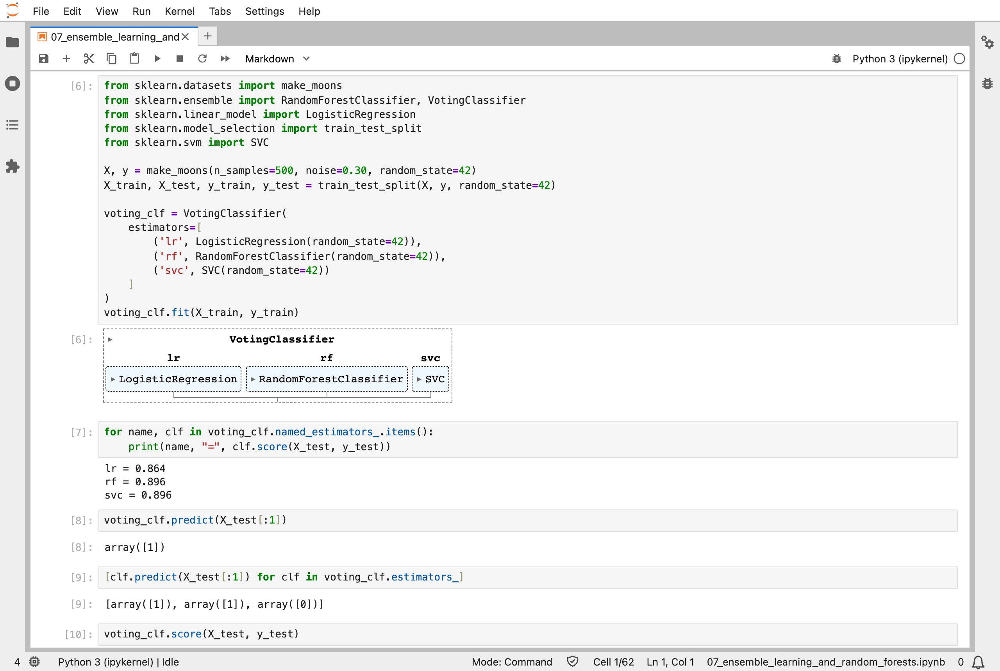
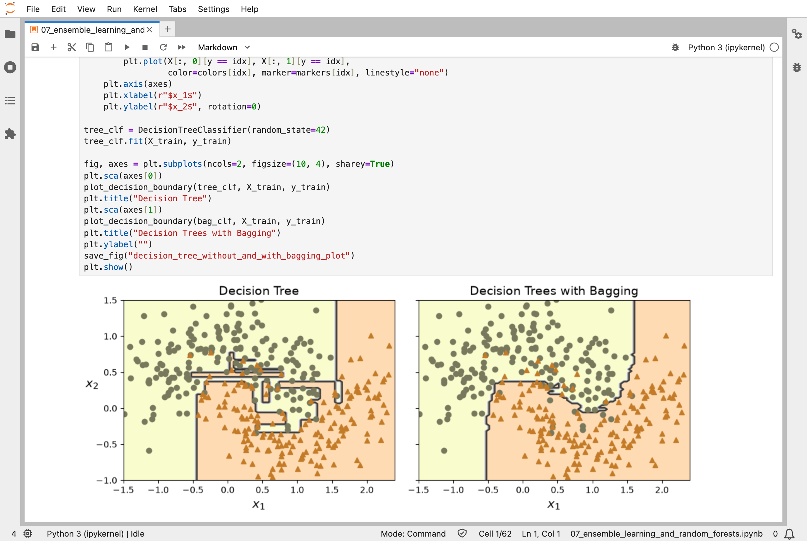
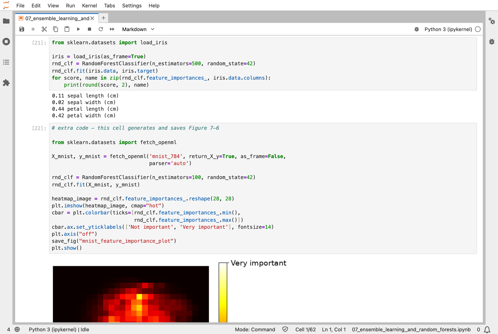
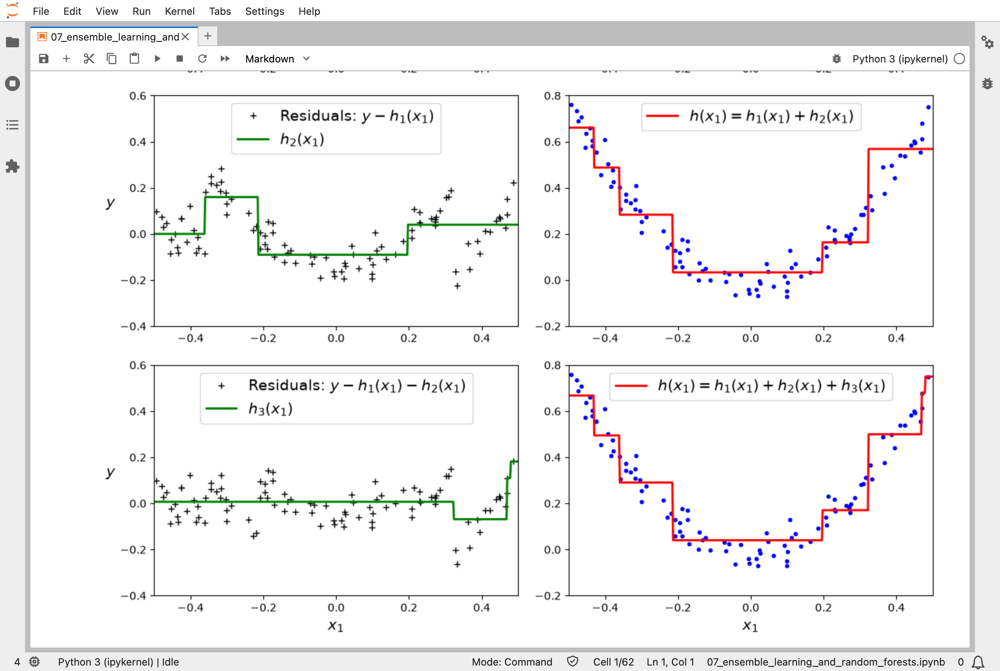
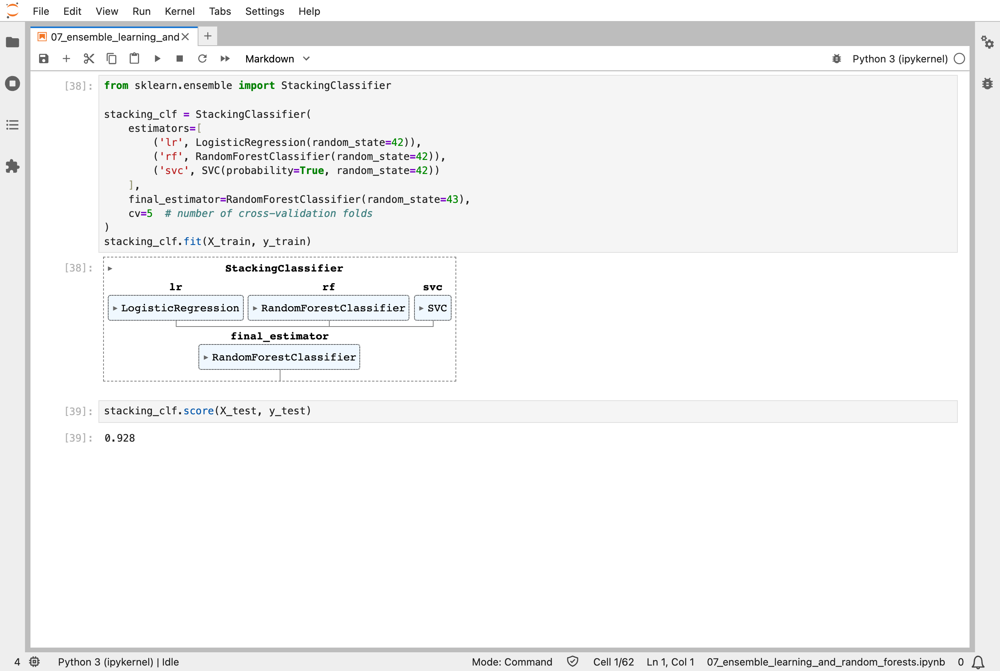

In [Part 6](/posts/sklearn6/), I grew a single decision tree, and saw how unstable one tree can be. The seventh chapter of the Hands-On Machine Learning book combines many models into one: an *ensemble*. A random forest, the model that did best in Part 2, is an ensemble of decision trees.

## Key Points

**What the chapter covers:**
1. **Voting classifiers**: several different models each predict, and the majority wins
2. **Bagging and pasting**: many copies of the same kind of model, each trained on a different random sample of the data
3. **Out-of-bag evaluation**: each bagged model can be tested on the instances it never saw, so no separate validation set is needed
4. **Random forests**: bagged decision trees, with extra randomness in which features each split considers
5. **Feature importance**: a forest can measure how much each feature helps
6. **Boosting**: models trained one after another, each one correcting the mistakes of those before it (AdaBoost and gradient boosting)
7. **Stacking**: a final model that learns how best to combine the other models' predictions

**What I learned from it:**
- A group of different models, each only fairly good, can beat every one of its members.
- Randomness helps: trees trained on different samples make different mistakes, and averaging cancels many of them out.
- Boosting builds its ensemble in order, so it cannot be trained in parallel, but it often gives the best results.

:::brain-power
Three classifiers each get between 86% and 90% of the test points right. Before reading on, guess: can a vote among the three beat all of them? When would a vote not help at all?
:::

## Quick Example

Three different classifiers, voting on the moons dataset, 500 points in two interleaved half-circles:

```python
from sklearn.datasets import make_moons
from sklearn.ensemble import RandomForestClassifier, VotingClassifier
from sklearn.linear_model import LogisticRegression
from sklearn.model_selection import train_test_split
from sklearn.svm import SVC

X, y = make_moons(n_samples=500, noise=0.30, random_state=42)
X_train, X_test, y_train, y_test = train_test_split(X, y, random_state=42)

voting_clf = VotingClassifier(
    estimators=[
        ('lr', LogisticRegression(random_state=42)),
        ('rf', RandomForestClassifier(random_state=42)),
        ('svc', SVC(random_state=42))
    ]
)
voting_clf.fit(X_train, y_train)
```

Here is how each model did on the test set when I ran the notebook. The score is the share of test points classified correctly:

| Model | Test accuracy |
|---|---|
| Logistic regression, on its own | 0.864 |
| Random forest, on its own | 0.896 |
| SVM, on its own | 0.896 |
| The three voting: the majority wins | 0.912 |
| The three voting: their chances are averaged | 0.92 |
| 500 bagged decision trees, each trained on its own random sample of the training set | 0.92 |
| Stacking: a random forest that learns from the three models' predictions | 0.928 |

:::watch-it A vote only helps if the voters disagree
Three copies of the same model would make the same mistakes, and outvote nothing. The three voters here are different kinds of model, a straight boundary, a forest, and an SVM, so they make different mistakes. Bagging gets the same effect from one kind of model by training each copy on a different random sample.
:::

## What training means here

An ensemble does not bring a new way of training; it trains many models in the ways earlier parts have shown, and combines them. Bagging grows 500 decision trees, each on its own random sample of the training points, one split at a time. Voting trains three different models side by side, and stacking then trains one more on their predictions.

Gradient boosting comes closest to nudging. It starts with one small tree, then trains each new tree on the errors the trees before it left behind, and adds a fraction of that tree's answer to the total: a step downhill on the error, which is where the "gradient" in the name comes from. But it steps by adding whole trees, each grown split by split, rather than by adjusting numbers, the way my [MiniGPT](/posts/minigpt-grown/) model does.

:::no-dumb-questions
**Q: What is the difference between the two kinds of voting?**

A: In hard voting, each model gives its answer and the majority wins: 0.912. In soft voting, each model gives its chances, and the averages decide: 0.92. Soft voting counts a confident model more than an unsure one.

**Q: Why can boosting not be trained in parallel?**

A: Each new model is trained on the mistakes of the ones before it, so it cannot start until they have finished. Bagging's trees do not depend on each other, so they can all be grown at once.

**Q: Is a random forest just bagging?**

A: Almost. It is bagged decision trees, with extra randomness: each split considers only a random subset of the features, which makes the trees even more different from each other.
:::

## Running the notebook in Jupyter

The chapter is in the notebook that goes with the book, [07_ensemble_learning_and_random_forests.ipynb](https://github.com/ageron/handson-ml3/blob/main/07_ensemble_learning_and_random_forests.ipynb). I ran everything before the exercise solutions, which took about a minute on my Mac Studio, and then looked through the results in JupyterLab.


*I trained three different classifiers on the moons: on their own they score 0.864, 0.896 and 0.896*


*One decision tree carves an overfitted boundary; 500 trees, each trained on a random 100 points and voting together, draw a smoother one*


*A random forest measures how much each feature helps: petal length 0.44 and petal width 0.42, while the sepals hardly matter*


*Gradient boosting: each new tree is trained on the errors the earlier trees left behind, and adding the trees together fits the data better and better*


*Stacking trains a final random forest on the three classifiers' predictions, and scored 0.928, the best in the chapter*

:::bullet-points Ensembles, in short
- An ensemble of fairly good models can beat each of its members.
- Bagging trains copies of a model on different random samples; a random forest is bagged trees.
- Boosting trains models one after another, each correcting the last.
- Stacking trains one more model to combine the others' predictions.
- No new kind of training: ensembles combine models trained in earlier ways.
:::

Next, [Scikit-Learn (Part 8)](/posts/sklearn8/) works through chapter 8: dimensionality reduction, making data smaller while keeping what matters.

## References

- [Aurélien Géron's chapter 7 notebook](https://github.com/ageron/handson-ml3/blob/main/07_ensemble_learning_and_random_forests.ipynb) - for Hands-On Machine Learning with Scikit-Learn, Keras, and TensorFlow (third edition)
- [Scikit-Learn (Part 6)](/posts/sklearn6/) - decision trees
- [scikit-learn](https://scikit-learn.org/) - the library's documentation
