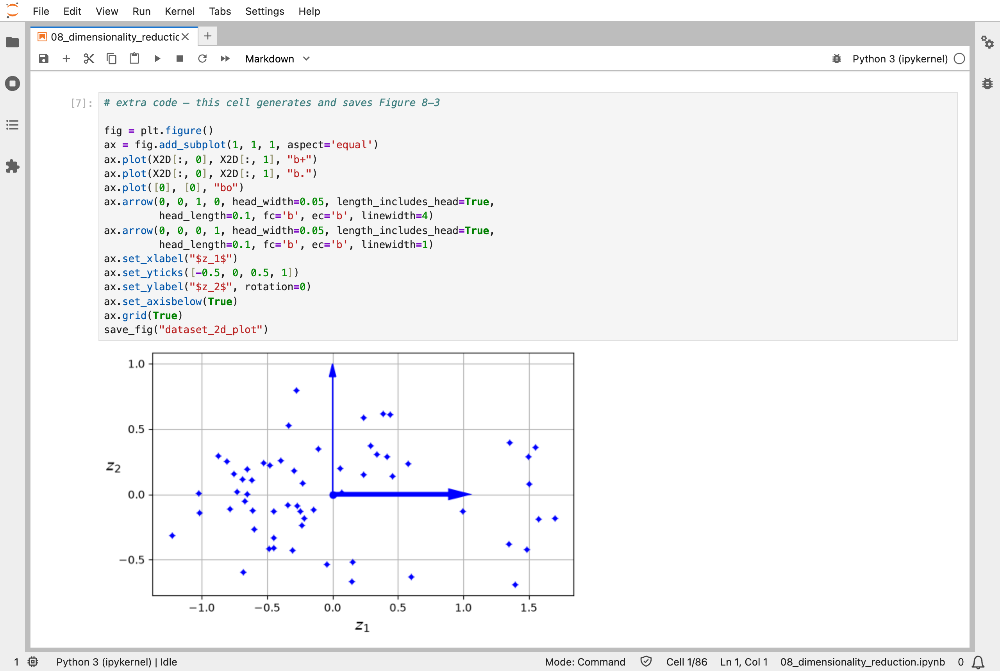
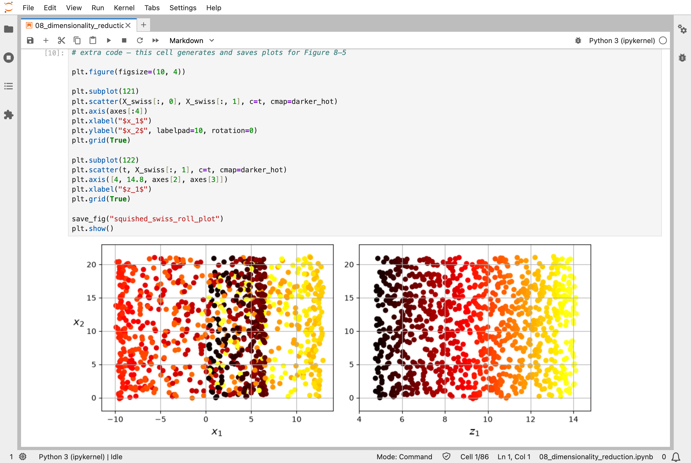
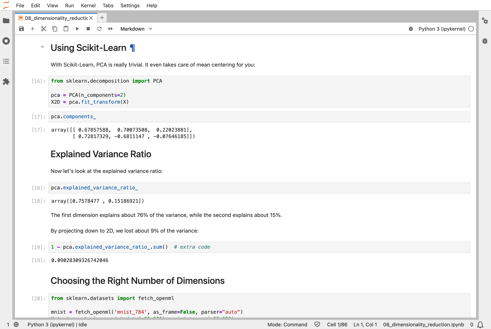
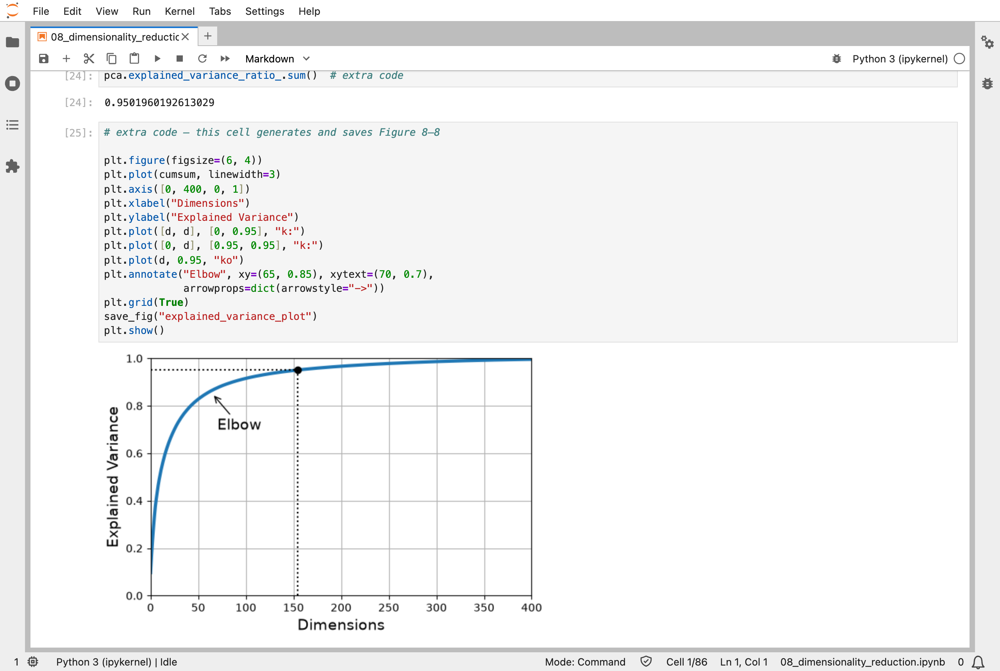
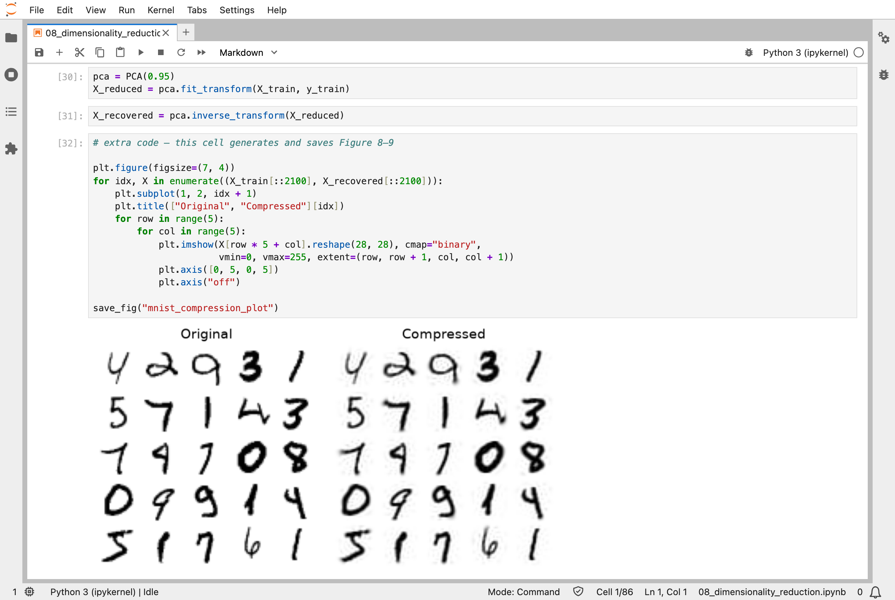
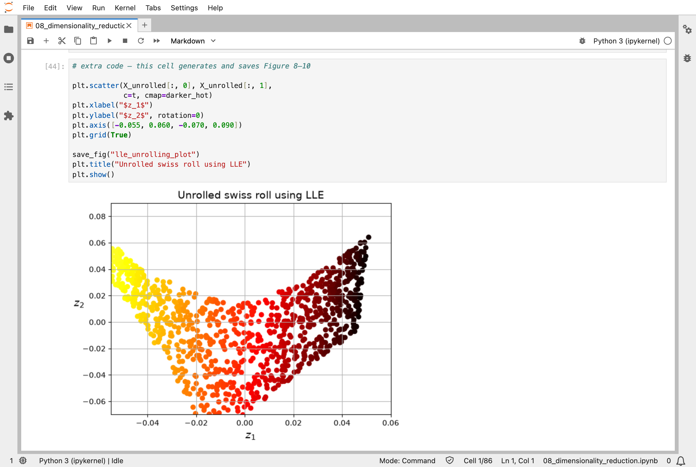
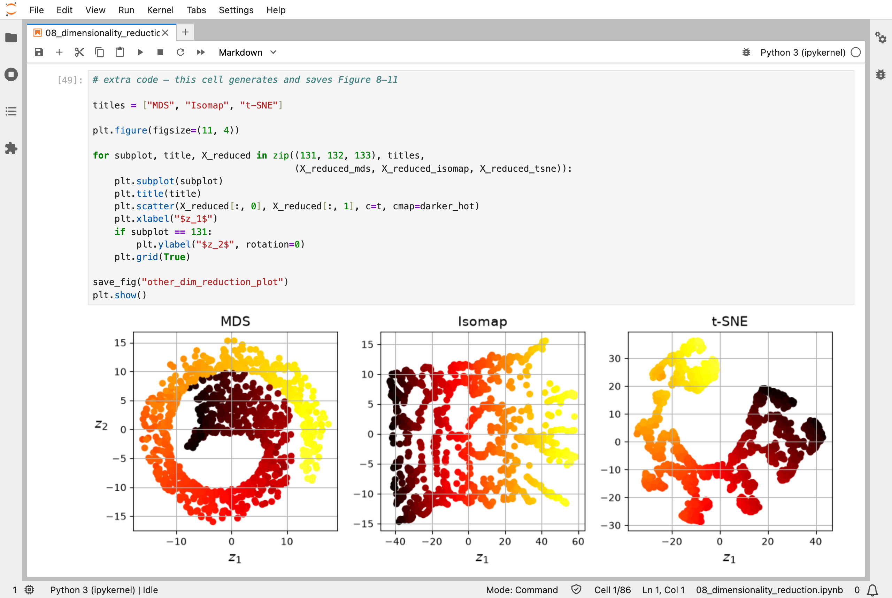

In [Part 7](/posts/sklearn7/), I combined many models into one. This chapter of the Hands-On Machine Learning book goes the other way and shrinks the data. Each handwritten digit from [Part 3](/posts/sklearn3/) is 784 numbers, one for each pixel, but most of them tell a model very little: the pixels in the corners are almost always blank. The problem is real, and the digits are the same real ones. The question is how few numbers can still describe an image.

The answer was 154. A method called principal component analysis (PCA) finds the directions in which the images differ most, and keeps only those. With 154 numbers for each image instead of 784, I kept 95% of the variation between images, and could rebuild a recognisable digit from them, a little blurred.

## Key Points

**The lesson:** most of a picture's numbers are redundant, and a few well-chosen ones keep nearly everything. Squeezing the data like this throws some information away, so it is there to make training faster, or to let a person see the data, and not to make a model better.

**What I learned from it:**
- 154 well-chosen numbers keep 95% of the variation in an image's 784.
- Flattening data that lies along a curve mixes up points that were far apart. Methods for curved data, such as t-SNE, unroll it instead, so that neighbours stay together. t-SNE lays out many-numbered data in 2D so that I can see it.
- PCA is worked out directly, in one calculation. t-SNE is the one in this chapter that nudges.

The chapter also covers faster versions of PCA for very big data, and several other ways to unroll curved data, which I mention only in a screenshot.

:::brain-power
Each MNIST image has 784 pixels, but the ones around the edge are blank in almost every image. Before reading on, guess how many numbers per image you need to keep 95% of the variation.
:::

## Quick Example

PCA on the 60,000 MNIST training images, keeping just enough directions for 95% of the variance:

```python
from sklearn.decomposition import PCA

pca = PCA(n_components=0.95)
X_reduced = pca.fit_transform(X_train)
```

Here is what PCA found when I ran the notebook:

| Data | Before | After | Variance kept |
|---|---|---|---|
| Small 3D dataset | 3 | 2 | 91% |
| MNIST digits | 784 | 154 | 95% |

"Before" and "After" are the number of dimensions. For the 3D dataset, the first direction keeps 76% of the variance and the second 15%.

The chapter also searches for the best number of dimensions to feed a classifier, on 1,000 of the images: 23 for a random forest, and 67 for an `SGDClassifier`.

:::watch-it Smaller data is not better data
Reducing dimensions always throws information away: the digits rebuilt from 154 numbers are a little blurred. It is worth doing to speed up training, or to draw the data so a person can see it, but it rarely makes a model more accurate on its own.
:::

## What training means here

PCA does not nudge, and it does not need to. Its directions come from a direct calculation, a standard piece of linear algebra called the singular value decomposition, so `fit` simply works them out, much like the straight line in [Part 1](/posts/sklearn1/). Randomized PCA gets close to the same answer faster, and incremental PCA works through the data a batch at a time, for datasets too big to fit in memory.

Random projection learns nothing at all. It multiplies the data by a random table of numbers; the only decision is how many dimensions to keep. For 5,000 instances, keeping distances within 10% of the original needs 7,300 dimensions, and that number comes from a formula, not from the data.

t-SNE is the one that nudges. It starts by placing every point at random in 2D, then repeatedly moves them by [gradient descent](/posts/sklearn4/), so that points that were neighbours in the original space end up near each other. Unlike every model so far, what it nudges is not a set of model numbers but the positions of the points themselves. My [MiniGPT](/posts/minigpt-grown/) model nudges its 826,433 numbers the same way, with slopes found by [backpropagation](/posts/sklearn10/).

:::no-dumb-questions
**Q: What does "variance kept" mean?**

A: How much of the way the images differ from each other survives the squeeze. Keeping 95% means the 154 directions capture almost all of what makes one image different from another; the 5% dropped is mostly fine detail and noise.

**Q: Is PCA trained like the other models?**

A: It is fitted with `fit`, like every Scikit-Learn model, but it is worked out directly, with no nudging, like the straight line in [Part 1](/posts/sklearn1/).

**Q: When should I use t-SNE instead of PCA?**

A: To look at the data. t-SNE lays high-dimensional data out in 2D so that neighbours stay together, which makes groups easy to see; PCA is the usual choice to make data smaller before training a model.

**Q: Are all of these methods still used?**

A: PCA is, constantly: for making data smaller, removing noise, and drawing a first picture of a dataset. t-SNE is still used to look at data, but never to prepare it for a model, and a newer method called UMAP (uniform manifold approximation and projection) has largely taken its place for pictures. LLE, MDS, and Isomap are mostly of historical interest: they explain the idea of unrolling curved data, but I would not expect to meet them in a real project.
:::

## Running the notebook in Jupyter

The chapter is in the notebook that goes with the book, [08_dimensionality_reduction.ipynb](https://github.com/ageron/handson-ml3/blob/main/08_dimensionality_reduction.ipynb). I ran everything before the exercise solutions, which took about 7 minutes on my Mac Studio, and then looked through the results in JupyterLab.


*A small 3D dataset projected onto the flat surface it lies closest to: two numbers per point instead of three*


*The Swiss roll: squashing it flat (left) mixes up the colours, while unrolling it (right) keeps them in order*


*I ran PCA in two lines: the first direction keeps about 76% of the variance and the second about 15%, so going from 3D to 2D loses about 9%*


*The variance kept against the number of dimensions for MNIST: it climbs fast, and 154 dimensions keep 95% of it*


*Digits rebuilt from 154 numbers instead of 784 are a little blurred, but still easy to read*


*LLE unrolled the Swiss roll: the colours now run smoothly from one end to the other*


*Three other methods laying the Swiss roll out in 2D: MDS (multidimensional scaling), Isomap (isometric mapping), and t-SNE, which keeps neighbours together but breaks the roll into pieces*

:::bullet-points Dimensionality reduction, in short
- Most of an image's 784 numbers are redundant; 154 directions keep 95% of the variation.
- Projection flattens data onto a surface; manifold learning unrolls curved data.
- PCA is worked out directly; random projection learns nothing; t-SNE nudges point positions.
- Reduce dimensions to speed things up or to see the data, not to improve accuracy.
:::

Next, [Scikit-Learn (Part 9)](/posts/sklearn9/) works through chapter 9: unsupervised learning, finding groups in data with no labels at all.

## References

- [Aurélien Géron's chapter 8 notebook](https://github.com/ageron/handson-ml3/blob/main/08_dimensionality_reduction.ipynb) - for Hands-On Machine Learning with Scikit-Learn, Keras, and TensorFlow (third edition)
- [Scikit-Learn (Part 7)](/posts/sklearn7/) - ensemble learning and random forests
- [scikit-learn](https://scikit-learn.org/) - the library's documentation
