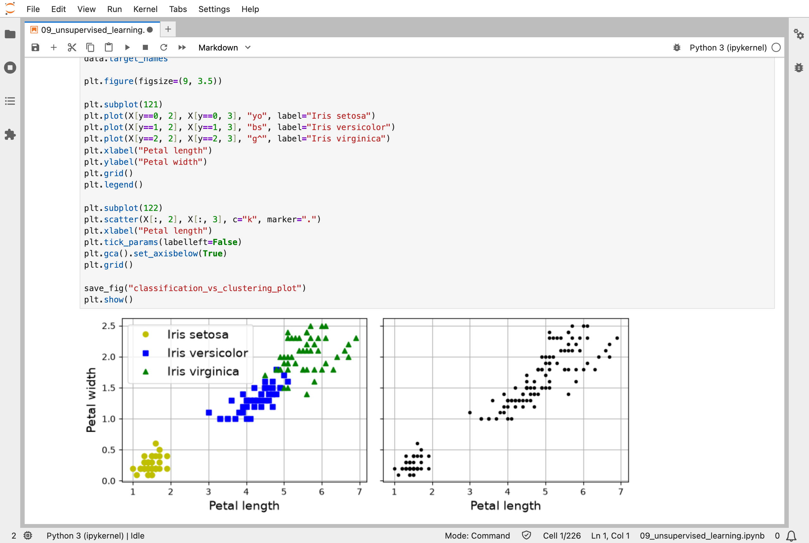
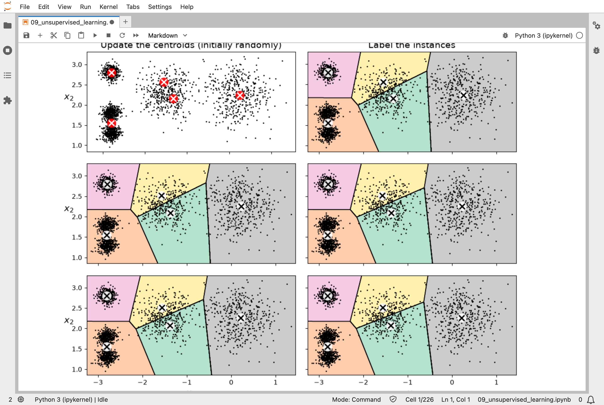
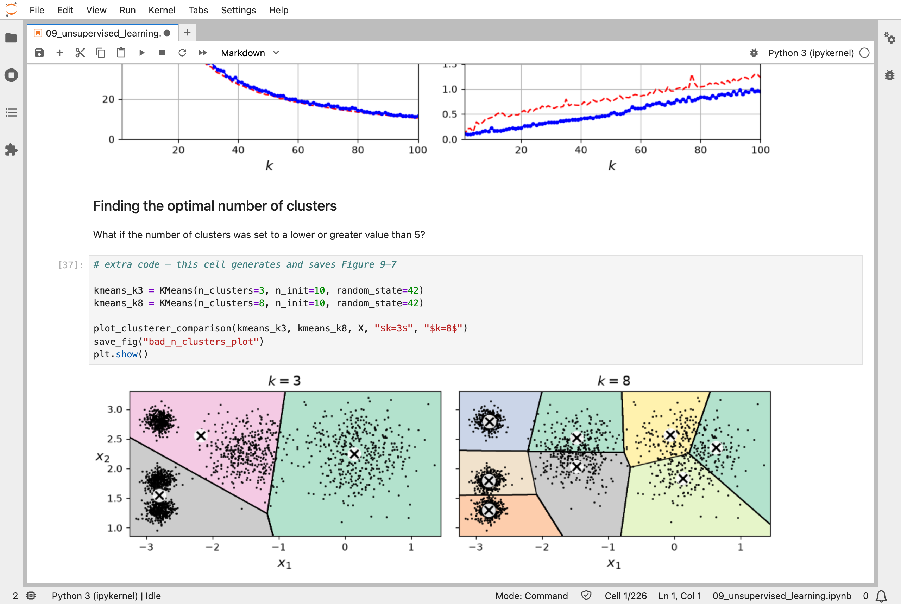
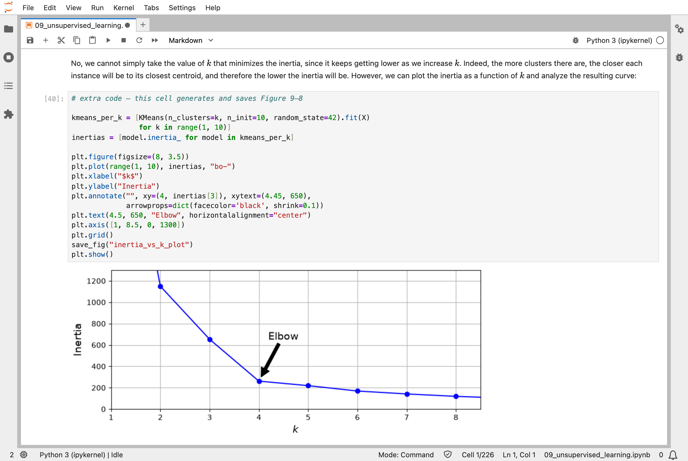
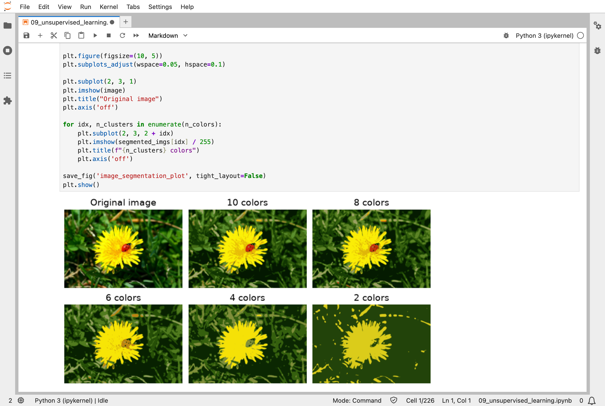
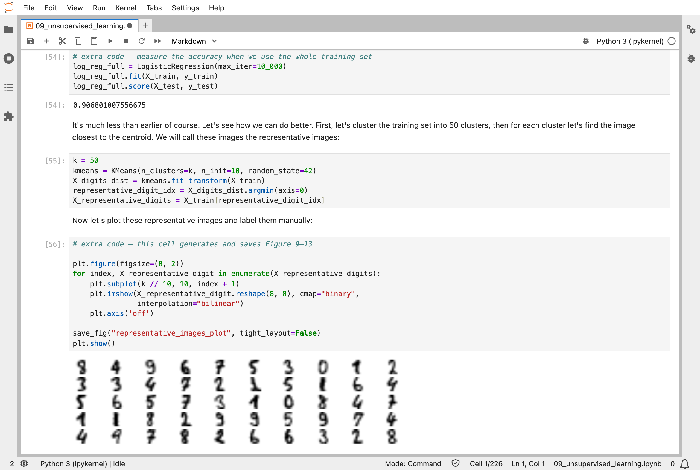
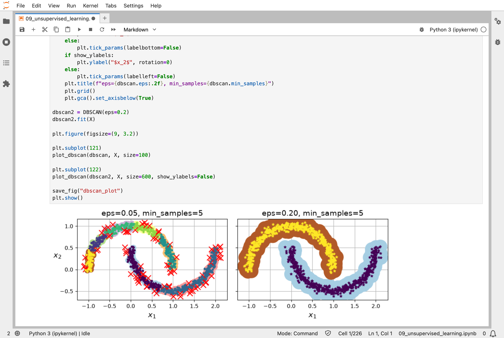
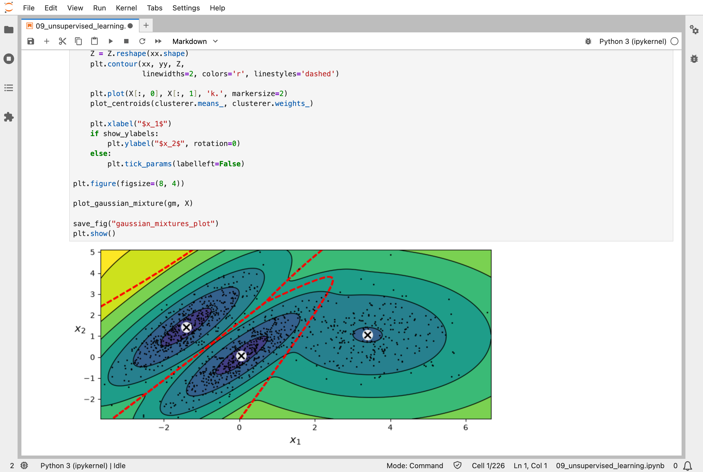

In [Part 8](/posts/sklearn8/), I made data smaller. Nearly every model so far learned from labelled examples: a house and its price, an image and its digit. This chapter of the Hands-On Machine Learning book takes the labels away and asks what a model can find in the data alone. The most common answer is groups of similar items, called *clusters*.

The examples are partly made up and partly real. The first is 2,000 invented points in five blobs, so that I know how many groups there are. The real one is 1,797 small images of handwritten digits, and the question is how far labels can go when there are very few of them. With only 50 labelled digits, picked at random, a classifier was right on 74.8% of the test images. When I used clustering to pick which 50 to label, and shared each label with every image in its cluster, it was right on 86.4%. All 1,400 labels would have given 90.7%.

## Key Points

**The lesson:** without labels, a model can still find structure, and that structure can make a few labels go much further. K-Means, the main method, places a chosen number of centres, gives every point to its nearest centre, moves each centre to the middle of its points, and repeats until nothing changes. There is no single right answer: the number of clusters is a choice, and different methods find different groups.

**What I learned from it:**
- K-Means works well for round, similar-sized groups, and poorly for other shapes, which is why other methods exist.
- It places its first centres at random, and can settle on a poor answer, so I run it several times and keep the best.
- Labelling 50 well-chosen images beat labelling 50 random ones by a wide margin.

The chapter also covers other clustering methods (DBSCAN and Gaussian mixtures), ways to choose the number of clusters, clustering the colours in a picture, and flagging unusual points. I do not go into those here.

:::brain-power
Imagine a scatter of points with no labels at all. Before reading on, think: how would you decide how many groups it holds, and which point belongs to which group?
:::

## Quick Example

K-Means on 2,000 points in five blobs:

```python
from sklearn.cluster import KMeans
from sklearn.datasets import make_blobs

blob_centers = np.array([[ 0.2,  2.3], [-1.5 ,  2.3], [-2.8,  1.8],
                         [-2.8,  2.8], [-2.8,  1.3]])
blob_std = np.array([0.4, 0.3, 0.1, 0.1, 0.1])
X, y = make_blobs(n_samples=2000, centers=blob_centers, cluster_std=blob_std,
                  random_state=7)

k = 5
kmeans = KMeans(n_clusters=k, n_init=10, random_state=42)
y_pred = kmeans.fit_predict(X)
```

The chapter's best result is semi-supervised: a classifier for small 8 × 8 images of digits, trained with only 50 labels. Here is how each approach did on the 397 test images when I ran the notebook:

| Labels used | Test accuracy |
|---|---|
| 50 random training images | 74.8% |
| 50 representative images: the one nearest each of 50 cluster centres | 84.1% |
| Those 50 labels copied to every image in their cluster | 86.4% |
| All 1,400 training images, labelled | 90.7% |

Copying the labels to whole clusters is not perfect: 95.5% of the copied labels were right, when the 1% of each cluster furthest from its centre was left out.

:::watch-it K-Means depends on where it starts
K-Means places its first centres at random, and can settle on a poor answer. In my run, one random start ended with an inertia of 219.6, and the best of 10 starts reached 211.6. That is why the code asks for `n_init=10` and keeps the best.
:::

## What training means here

There are no right answers to learn from, so training means finding structure, and each method finds it in its own way.

K-Means does not nudge. It starts with its centres at random, then repeats two steps: give every point to its nearest centre, then move each centre to the middle of its points. When nothing changes, it stops. Each step is a jump to an exact answer, not a small step down a slope, but the result depends on where the centres started: one random start ended with an inertia of 219.6, where the best of 10 starts reached 211.6. That is why the notebook asks for 10 starts, `n_init=10`, and keeps the best. Mini-batch K-Means, for big datasets, does move its centres a little at a time, using small batches of points, which makes it a close cousin of the nudging in [Part 4](/posts/sklearn4/).

A Gaussian mixture is fitted in a similar back-and-forth, called Expectation–Maximization; on the chapter's data it settled in just 4 rounds. DBSCAN does not iterate at all: it grows each cluster outwards from dense points, once. My [MiniGPT](/posts/minigpt-grown/) model, by contrast, has a right answer for every letter, and nudges its 826,433 numbers towards it.

:::no-dumb-questions
**Q: Why did 50 representative images beat 50 random ones?**

A: Each representative image is the one nearest the middle of its cluster, so between them they cover every kind of digit. Fifty random images can miss some kinds entirely and repeat others.

**Q: What is inertia?**

A: The sum of the squared distances from each point to its nearest centre. Lower is tighter, but it always falls as clusters are added, so it cannot choose the number of clusters by itself: look for the elbow.

**Q: Is clustering the same as classification without labels?**

A: Not quite. Clustering finds groups, but it does not know what they mean, and its groups need not match the classes a person would choose.
:::

## Running the notebook in Jupyter

The chapter is in the notebook that goes with the book, [09_unsupervised_learning.ipynb](https://github.com/ageron/handson-ml3/blob/main/09_unsupervised_learning.ipynb). I ran everything before the exercise solutions, which took about 4 minutes on my Mac Studio, and then looked through the results in JupyterLab.


*The iris flowers with their species labels (left) and without them (right): without labels, a clustering algorithm has to find the groups itself*


*K-Means at work: the centres start at random, then each round gives every point to its nearest centre and moves the centres to the middle of their points*


*The wrong number of clusters: with 3, blobs are merged; with 8, blobs are split*


*Inertia falls as clusters are added; the bend, the "elbow", suggests a good number*


*Clustering the ladybug photo's colours: with 10 colours it looks almost unchanged, and with 2 the ladybug disappears into the flower*


*The 50 representative digits, one per cluster: labelling these 50 gave 84.1% accuracy, against 74.8% for 50 random ones*


*DBSCAN on two moons: with a small neighbourhood it finds many small clusters and marks a lot of noise; with a larger one it finds the two moons*


*A Gaussian mixture's three bell-shaped groups, with contours showing how densely each region is expected to hold points*

:::bullet-points Unsupervised learning, in short
- Clustering finds groups in data with no labels; there is no single right answer.
- K-Means works best for round, similar-sized groups, so start it several times.
- DBSCAN follows dense regions and finds groups of any shape; Gaussian mixtures give each point a chance of belonging to each group.
- A few well-chosen labels, spread with clustering, go a long way.
:::

Next, [Scikit-Learn (Part 10)](/posts/sklearn10/) works through chapter 10: neural networks with Keras, where backpropagation finally arrives.

## References

- [Aurélien Géron's chapter 9 notebook](https://github.com/ageron/handson-ml3/blob/main/09_unsupervised_learning.ipynb) - for Hands-On Machine Learning with Scikit-Learn, Keras, and TensorFlow (third edition)
- [Scikit-Learn (Part 8)](/posts/sklearn8/) - dimensionality reduction
- [scikit-learn](https://scikit-learn.org/) - the library's documentation
