I created a Spring Boot application using Spring Data JPA, which provides high-level, repository-style interfaces for data access and reduces boilerplate code.

:::brain-power Before you read on
Think about the last time you wrote code to save a record in a database. How many lines were about your data, and how many were plumbing? What would you hope a framework could write for you?
:::

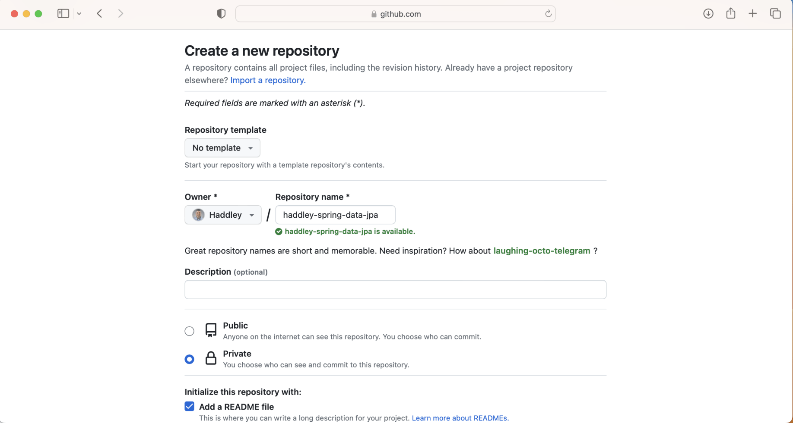
*I created a new GitHub repository haddley-spring-data-jpa*

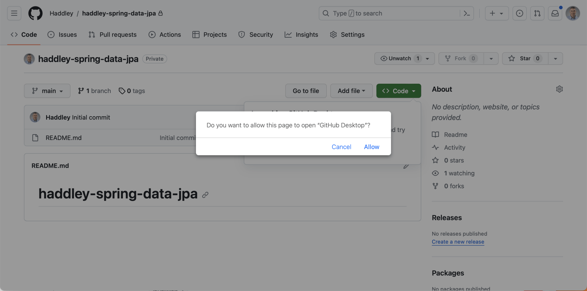
*I opened the repository using GitHub Desktop*

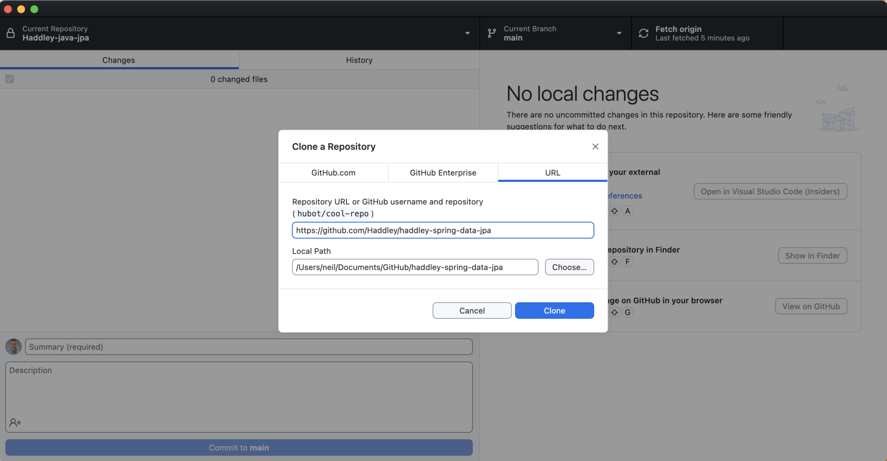
*I cloned the GitHub repository*

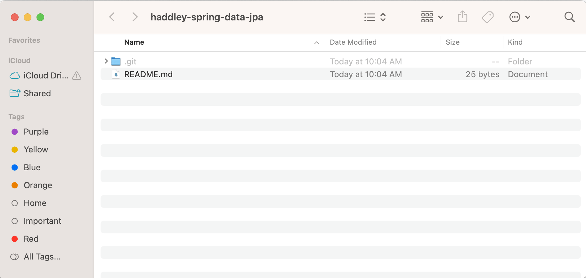
*GitHub repository folder*

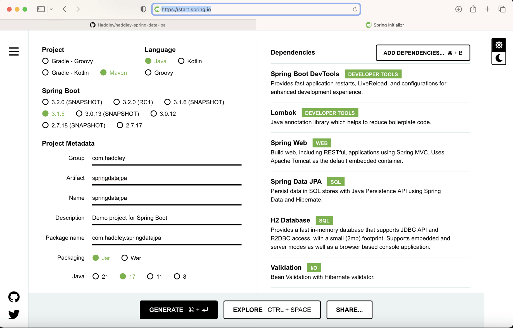
*I created a new spring boot application springdatajpa*

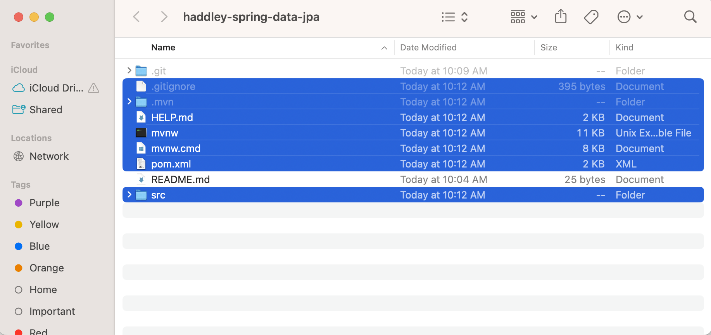
*I copied the generated files to the GitHub repository folder*

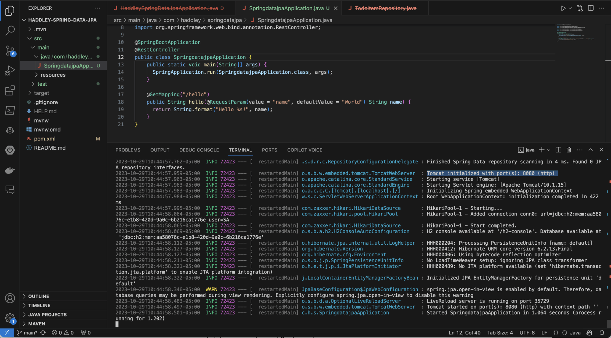
*I updated SpringdatajpaApplication.java so that it would respond to http://localhost/hello requests*

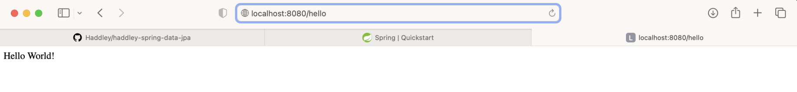
*I accessed http://localhost/hello using my web browser*

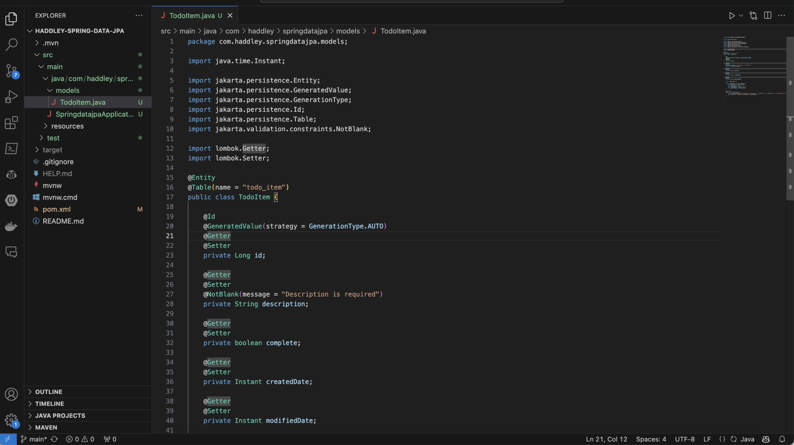
*I created a TodoItem Java class*

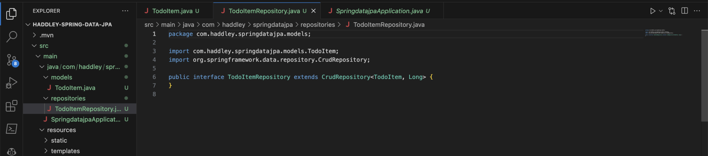
*I created a Spring Data JPA repository interface (based on the TodoItem class)*

:::no-dumb-questions
**Q: What is Spring Data JPA?**

A: A layer that lets me describe my data with a Java class and an interface, and then writes the database code for me. I wrote a TodoItem class and a TodoItemRepository interface that extends CrudRepository, and I did not write any SQL.

**Q: What does @Entity do?**

A: It tells JPA that TodoItem is a class whose objects are stored in a table. The @Table annotation names the table todo_item, and @Id with @GeneratedValue makes the id column the primary key that the database fills in.

**Q: Where did the findAll and count methods come from?**

A: From CrudRepository. The interface has no methods of its own, but it inherits ones such as findAll, findById, save, delete and count, and Spring supplies the implementation when the application starts.
:::

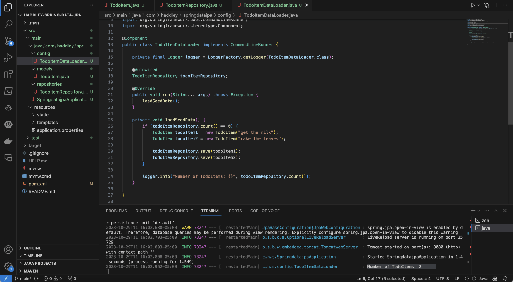
*I created a TodoItemDataLoader to ensure that if the repository was empty two new TodoItems would be added as the application started*

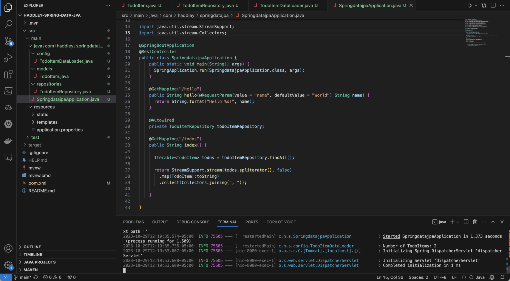
*I updated SpringdatajpaApplication.java to return all of the TodoItems in response to http://localhost/hello requests*

:::under-the-hood How the seed data gets loaded
TodoItemDataLoader is a component that implements CommandLineRunner, so Spring calls its run method once, as the application starts. The method asks the repository for a count, and only when the count is zero does it save the two items, get the milk and rake the leaves. It then logs how many items there are. That is why the todos list is never empty when I open /todos.
:::

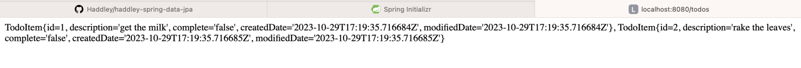
*I accessed http://localhost/todos using my web browser*

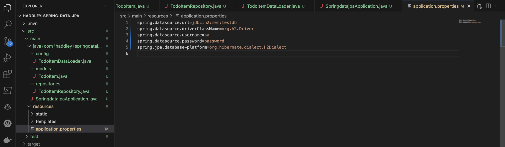
*I added text to applications.properties*

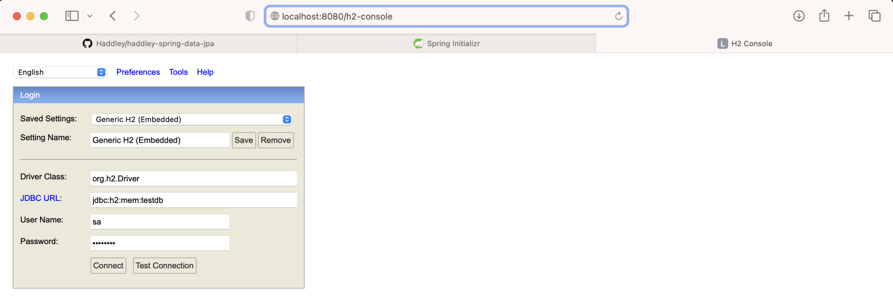
*I accessed the h2 console (using values jdbc:h2:mem:testdb, sa and password)*

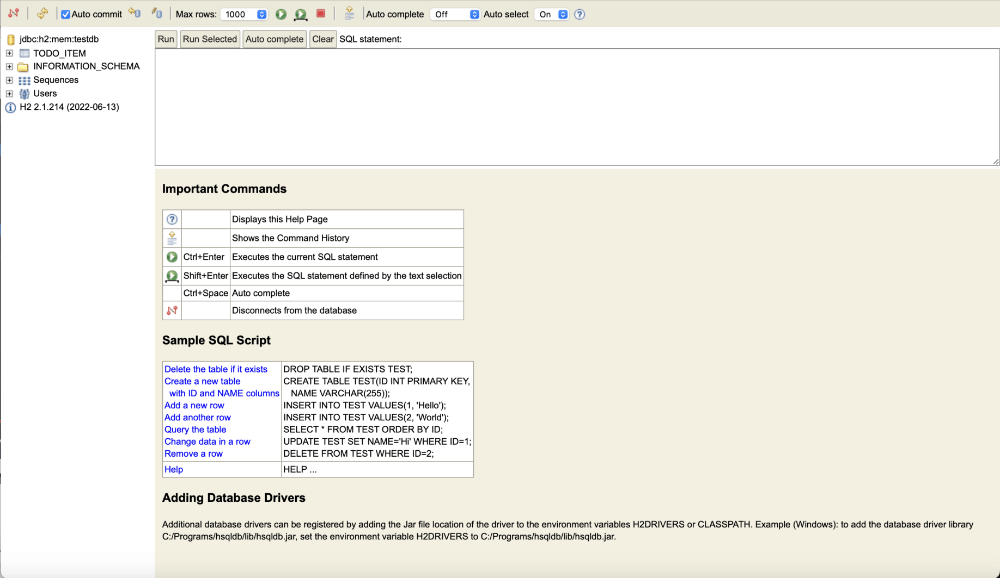
*I clicked on the TODO_ITEM table*

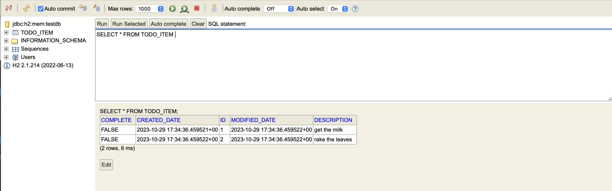
*I clicked Run to execute the select query*

:::watch-it The H2 database lives in memory
The application.properties file uses jdbc:h2:mem:testdb, which is a database held in memory. Everything in it disappears when the application stops, and the data loader puts the two items back on the next start. That suits a demonstration, but a real application would point at a database that keeps its data.
:::

:::pencil Predict the count
The loader only saves the two items when the repository is empty. If I restart the application with this in-memory database, how many TodoItems will the log report, and why? What would change if the database kept its data between runs?

:::answer
It reports 2 each time, because the database starts empty and the loader adds the two items. With a database that kept its data, the count would already be 2 on the second run, so the loader would skip the saving step and still report 2. The zero check is what stops it adding duplicates.
:::
:::

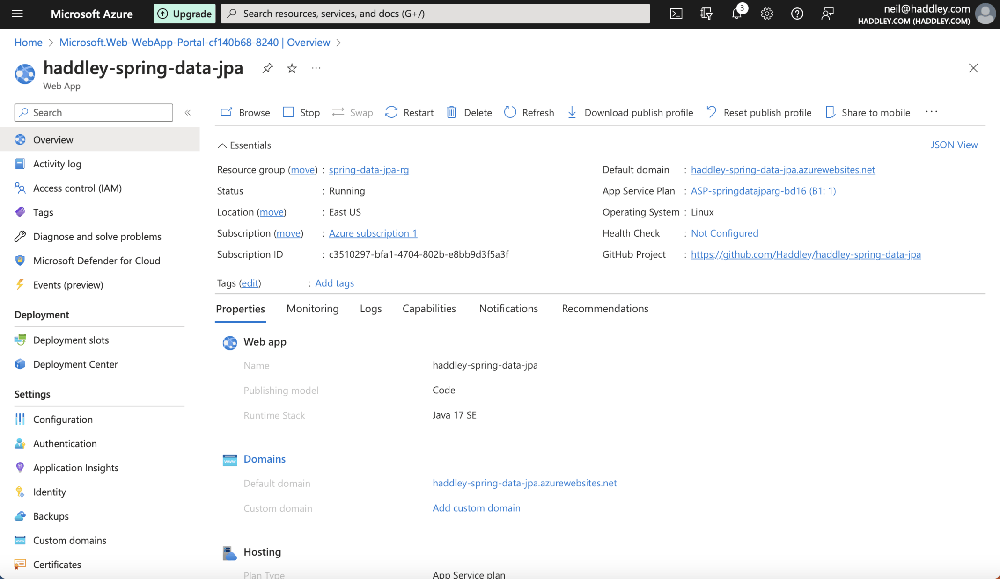
*I deployed the haddley-spring-data-jpa application to Azure*

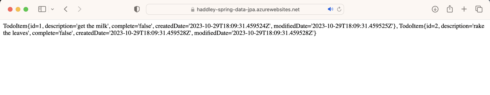
*I accessed the haddley-spring-data-jpa application hosted in Azure*

:::test-drive Try it yourself
1. Run the application, and open http://localhost:8080/todos to see the two items.
2. Open the H2 console, sign in with the values in application.properties, and run SELECT * FROM TODO_ITEM.
3. Add a third item to the data loader, restart, and see how the table and the list change.
:::


```java
package com.haddley.springdatajpa;

import org.springframework.boot.SpringApplication;
import org.springframework.boot.autoconfigure.SpringBootApplication;

import org.springframework.web.bind.annotation.GetMapping;
import org.springframework.web.bind.annotation.RequestParam;
import org.springframework.web.bind.annotation.RestController;

@SpringBootApplication
@RestController
public class SpringdatajpaApplication {
    public static void main(String[] args) {
        SpringApplication.run(SpringdatajpaApplication.class, args);
    }

    @GetMapping("/hello")
    public String hello(@RequestParam(value = "name", defaultValue = "World") String name) {
        return String.format("Hello %s!", name);
    }
}
```

## TodoItem.java

```java
package com.haddley.springdatajpa.models;

import java.time.Instant;

import jakarta.persistence.Entity;
import jakarta.persistence.GeneratedValue;
import jakarta.persistence.GenerationType;
import jakarta.persistence.Id;
import jakarta.persistence.Table;
import jakarta.validation.constraints.NotBlank;

import lombok.Getter;
import lombok.Setter;

@Entity
@Table(name = "todo_item")
public class TodoItem {

    @Id
    @GeneratedValue(strategy = GenerationType.AUTO)
    @Getter
    @Setter
    private Long id;

    @Getter
    @Setter
    @NotBlank(message = "Description is required")
    private String description;

    @Getter
    @Setter
    private boolean complete;

    @Getter
    @Setter
    private Instant createdDate;

    @Getter
    @Setter
    private Instant modifiedDate;

    public TodoItem() {}

    public TodoItem(String description) {
        this.description = description;
        this.complete = false;
        this.createdDate = Instant.now();
        this.modifiedDate = Instant.now();
    }

    @Override
    public String toString() {
        return String.format("TodoItem{id=%d, description='%s', complete='%s', createdDate='%s', modifiedDate='%s'}", id, description, complete, createdDate, modifiedDate);
    }


}
```

## TodoItemRepository.java

```java
package com.haddley.springdatajpa.models;

import com.haddley.springdatajpa.models.TodoItem;
import org.springframework.data.repository.CrudRepository;

public interface TodoItemRepository extends CrudRepository {
}
```

## TodoItemDataLoader.java

```java
package com.haddley.springdatajpa.config;

import com.haddley.springdatajpa.models.TodoItem;
import com.haddley.springdatajpa.repositories.TodoItemRepository;

import org.slf4j.Logger;
import org.slf4j.LoggerFactory;
import org.springframework.beans.factory.annotation.Autowired;
import org.springframework.boot.CommandLineRunner;
import org.springframework.stereotype.Component;

@Component
public class TodoItemDataLoader implements CommandLineRunner {

    private final Logger logger = LoggerFactory.getLogger(TodoItemDataLoader.class);

    @Autowired
    TodoItemRepository todoItemRepository;

    @Override
    public void run(String... args) throws Exception {
        loadSeedData();
    }

    private void loadSeedData() {
        if (todoItemRepository.count() == 0) {
            TodoItem todoItem1 = new TodoItem("get the milk");
            TodoItem todoItem2 = new TodoItem("rake the leaves");

            todoItemRepository.save(todoItem1);
            todoItemRepository.save(todoItem2); 
        }

        logger.info("Number of TodoItems: {}", todoItemRepository.count());
    }

}
```

## SpringdatajpaApplication.java updated

```java
package com.haddley.springdatajpa;

import org.springframework.boot.SpringApplication;
import org.springframework.boot.autoconfigure.SpringBootApplication;

import org.springframework.web.bind.annotation.GetMapping;
import org.springframework.web.bind.annotation.RequestParam;
import org.springframework.web.bind.annotation.RestController;

import com.haddley.springdatajpa.models.TodoItem;
import com.haddley.springdatajpa.repositories.TodoItemRepository;
import org.springframework.beans.factory.annotation.Autowired;

import java.util.stream.StreamSupport;
import java.util.stream.Collectors;

@SpringBootApplication
@RestController
public class SpringdatajpaApplication {
    public static void main(String[] args) {
        SpringApplication.run(SpringdatajpaApplication.class, args);
    }

    @GetMapping("/hello")
    public String hello(@RequestParam(value = "name", defaultValue = "World") String name) {
        return String.format("Hello %s!", name);
    }

    @Autowired
    private TodoItemRepository todoItemRepository;

    @GetMapping("/todos")
    public String index() {

        Iterable todos = todoItemRepository.findAll();

        return StreamSupport.stream(todos.spliterator(), false)
            .map(TodoItem::toString) 
            .collect(Collectors.joining(", ")); 

    }

}
```

## application.properties

```text
spring.datasource.url=jdbc:h2:mem:testdb
spring.datasource.driverClassName=org.h2.Driver
spring.datasource.username=sa
spring.datasource.password=password
spring.jpa.database-platform=org.hibernate.dialect.H2Dialect
```

:::bullet-points Recap
- Spring Data JPA lets me store a TodoItem with a Java class and a repository interface, with no SQL.
- @Entity, @Table, @Id and @GeneratedValue describe the table, and CrudRepository supplies the methods.
- A CommandLineRunner loaded two items when the repository was empty.
- The H2 database in this post is held in memory, so its data is lost when the application stops.
:::

## References

- [Spring Data JPA: What is it? And Why Should You Use It?](https://www.youtube.com/watch?v=x67yiTHxn00)
- [90 Minutes to a Complete Java Spring Boot TODO App](https://www.youtube.com/watch?v=Hvuij8SOW8Q)