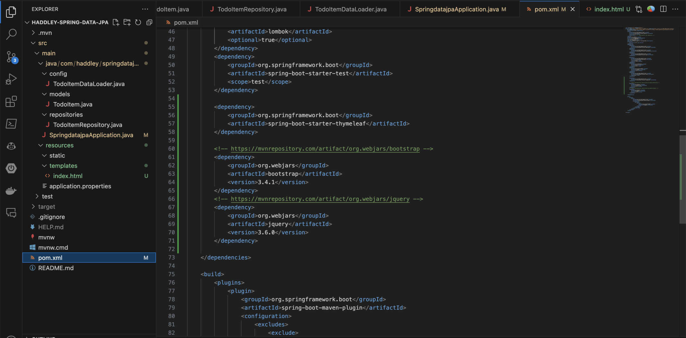
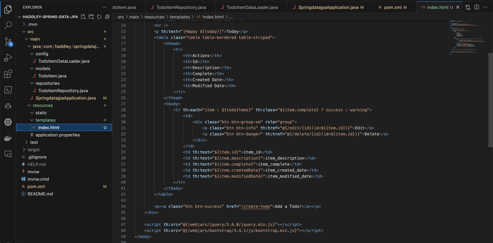
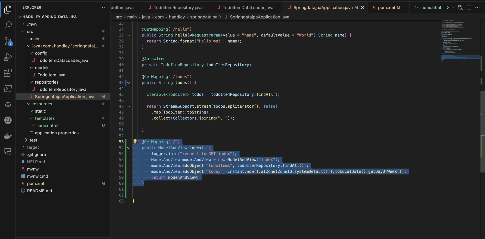
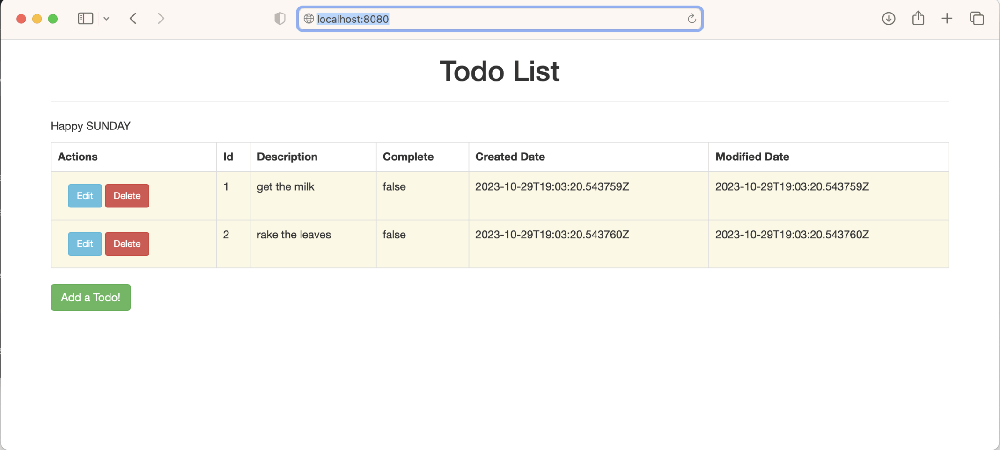
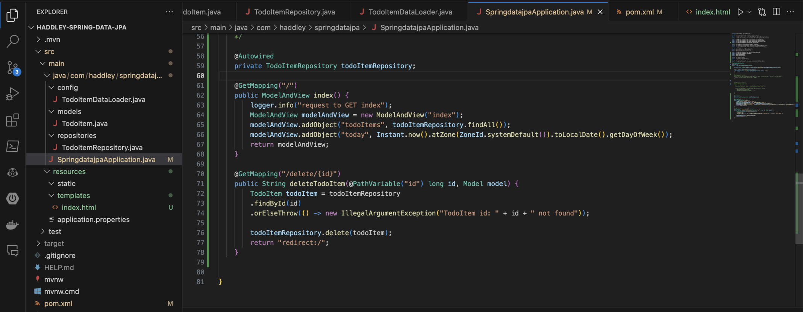
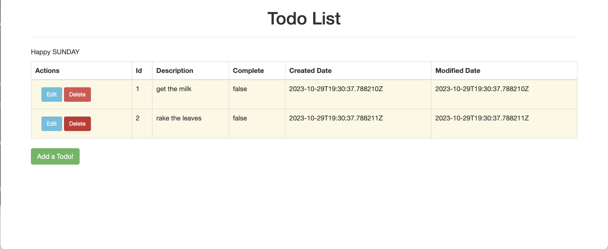
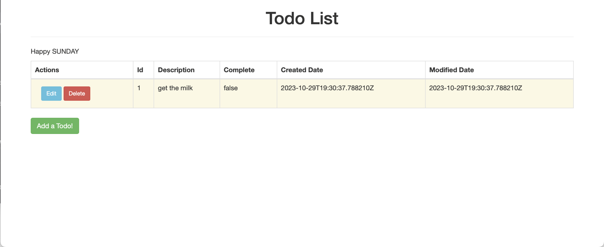

I used Spring MVC's ModelAndView class to pass model data to a Thymeleaf view template for rendering, adding a CRUD interface for the TodoItem application.

:::brain-power Before you read on
In Part 3 the application returned its todo items as plain text. If you wanted a proper web page instead, who should decide what the page looks like, the Java code or something else? What would the Java code still need to hand over?
:::


*I added thymeleaf, bootstrap and jquery as dependencies*


*I added a thymeleaf page (as an alternative to JSP)*


*I updated the controller to populate the fetch the todo items and to pass them and the current day of the week to the thymeleaf view.*

:::no-dumb-questions
**Q: What is a ModelAndView?**

A: It carries two things from a controller to the page: the name of the view, and the model, which is the data that the view needs. In this post the view is called index, and the model holds the todoItems and today.

**Q: What does Thymeleaf do?**

A: It is a template engine. I write an HTML page with placeholders, and Thymeleaf fills them in with the model data before the browser sees the page. I used it here as an alternative to JSP.

**Q: Why are Bootstrap and jQuery dependencies?**

A: They supply the styling and the scripts for the page, and I added them to the project as dependencies, as the first screenshot shows.
:::


*The new home page displays the todo items*


*I updated the controller to handle a delete request*


*I clicked the Delete button on the second todo item*


*The second todo item was deleted*

:::watch-it A delete link is a GET request
The delete button sends a GET request to /delete/{id}, and the controller deletes the item. A GET request is meant for reading, and a browser, a link checker or a prefetching tool may follow a link without anyone clicking it. This is fine for a demonstration, but a real application should delete with a POST or DELETE request, and protect it against forged requests.
:::

:::pencil Where does the redirect go?
Look at deleteTodoItem in SpringdatajpaApplication.java. It returns the string redirect:/ after it deletes the item. Why does it redirect to the home page, and what would the browser show if the method returned the view name index instead?

:::answer
The redirect sends the browser back to / , and that request runs the index method, which loads the todo items again, so the page shows the list without the deleted item. If the method returned index directly, the page would have no todoItems in its model, because the delete method does not add any.
:::
:::

:::test-drive Try it yourself
1. Run the application and open http://localhost:8080 to see the list and the day of the week.
2. Click Delete on one item, and watch the address bar as the page reloads.
3. Restart the application and see the item come back, because the H2 database is in memory.
:::


## pom.xml

```xml
<?xml version="1.0" encoding="UTF-8"?>
<project xmlns="http://maven.apache.org/POM/4.0.0" xmlns:xsi="http://www.w3.org/2001/XMLSchema-instance"
	xsi:schemaLocation="http://maven.apache.org/POM/4.0.0 https://maven.apache.org/xsd/maven-4.0.0.xsd">
	<modelVersion>4.0.0</modelVersion>
	<parent>
		<groupId>org.springframework.boot</groupId>
		<artifactId>spring-boot-starter-parent</artifactId>
		<version>3.1.5</version>
		<relativePath/> <!-- lookup parent from repository -->
	</parent>
	<groupId>com.haddley</groupId>
	<artifactId>springdatajpa</artifactId>
	<version>0.0.1-SNAPSHOT</version>
	<name>springdatajpa</name>
	<description>Demo project for Spring Boot</description>
	<properties>
		<java.version>17</java.version>
	</properties>
	<dependencies>
		<dependency>
			<groupId>org.springframework.boot</groupId>
			<artifactId>spring-boot-starter-data-jpa</artifactId>
		</dependency>
		<dependency>
			<groupId>org.springframework.boot</groupId>
			<artifactId>spring-boot-starter-validation</artifactId>
		</dependency>
		<dependency>
			<groupId>org.springframework.boot</groupId>
			<artifactId>spring-boot-starter-web</artifactId>
		</dependency>

		<dependency>
			<groupId>org.springframework.boot</groupId>
			<artifactId>spring-boot-devtools</artifactId>
			<scope>runtime</scope>
			<optional>true</optional>
		</dependency>
		<dependency>
			<groupId>com.h2database</groupId>
			<artifactId>h2</artifactId>
			<scope>runtime</scope>
		</dependency>
		<dependency>
			<groupId>org.projectlombok</groupId>
			<artifactId>lombok</artifactId>
			<optional>true</optional>
		</dependency>
		<dependency>
			<groupId>org.springframework.boot</groupId>
			<artifactId>spring-boot-starter-test</artifactId>
			<scope>test</scope>
		</dependency>

		<dependency>
			<groupId>org.springframework.boot</groupId>
			<artifactId>spring-boot-starter-thymeleaf</artifactId>
		</dependency>

		<!-- https://mvnrepository.com/artifact/org.webjars/bootstrap -->
		<dependency>
			<groupId>org.webjars</groupId>
			<artifactId>bootstrap</artifactId>
			<version>3.4.1</version>
		</dependency>
		<!-- https://mvnrepository.com/artifact/org.webjars/jquery -->
		<dependency>
			<groupId>org.webjars</groupId>
			<artifactId>jquery</artifactId>
			<version>3.6.0</version>
		</dependency>

	</dependencies>

	<build>
		<plugins>
			<plugin>
				<groupId>org.springframework.boot</groupId>
				<artifactId>spring-boot-maven-plugin</artifactId>
				<configuration>
					<excludes>
						<exclude>
							<groupId>org.projectlombok</groupId>
							<artifactId>lombok</artifactId>
						</exclude>
					</excludes>
				</configuration>
			</plugin>
		</plugins>
	</build>

</project>
```

## SpringdatajpaApplication.java

```java
package com.haddley.springdatajpa;

import org.springframework.boot.SpringApplication;
import org.springframework.boot.autoconfigure.SpringBootApplication;

import org.springframework.web.bind.annotation.GetMapping;
import org.springframework.web.bind.annotation.RequestParam;
import org.springframework.web.bind.annotation.RestController;
import org.springframework.stereotype.Controller;

import com.haddley.springdatajpa.models.TodoItem;
import com.haddley.springdatajpa.repositories.TodoItemRepository;
import org.springframework.beans.factory.annotation.Autowired;

import java.util.stream.StreamSupport;
import java.util.stream.Collectors;

import org.springframework.web.servlet.ModelAndView;
import org.springframework.ui.Model;
import java.time.ZoneId;
import java.time.Instant;

import org.slf4j.Logger;
import org.slf4j.LoggerFactory;

import org.springframework.web.bind.annotation.PathVariable;

@SpringBootApplication
@Controller
public class SpringdatajpaApplication {

    private final Logger logger = LoggerFactory.getLogger(SpringdatajpaApplication.class);

    public static void main(String[] args) {
      SpringApplication.run(SpringdatajpaApplication.class, args);
    }

    @Autowired
    private TodoItemRepository todoItemRepository;
    
    @GetMapping("/")
    public ModelAndView index() {
        logger.info("request to GET index");
        ModelAndView modelAndView = new ModelAndView("index");
        modelAndView.addObject("todoItems", todoItemRepository.findAll());
        modelAndView.addObject("today", Instant.now().atZone(ZoneId.systemDefault()).toLocalDate().getDayOfWeek());
        return modelAndView;
    }

    @GetMapping("/delete/{id}")
    public String deleteTodoItem(@PathVariable("id") long id, Model model) {
        TodoItem todoItem = todoItemRepository
        .findById(id)
        .orElseThrow(() -> new IllegalArgumentException("TodoItem id: " + id + " not found"));
    
        todoItemRepository.delete(todoItem);
        return "redirect:/";
    }


}
```

:::bullet-points Recap
- A ModelAndView holds the name of a view and the data that the view needs.
- Thymeleaf fills an HTML template with that data, as an alternative to JSP.
- The delete button calls a controller method that deletes the item and redirects to the home page.
- A delete that uses GET is acceptable for a demonstration, but not for a real application.
:::

## References

- [Spring Web MVC | 05 | The Model object](https://www.youtube.com/watch?v=lHucuG4jyU0&list=PLdW9lrB9HDw23SG-j-iOlQFGvdM7xU1fR&index=5)