I built a [GraphQL](/posts/graphql/) application using Spring for GraphQL and GraphQL Java.

:::brain-power Before you read on
A REST API usually has one URL for each kind of thing. If a client wants a book, the names of its authors, and nothing else, how many requests would that take, and how much extra data would come back?
:::

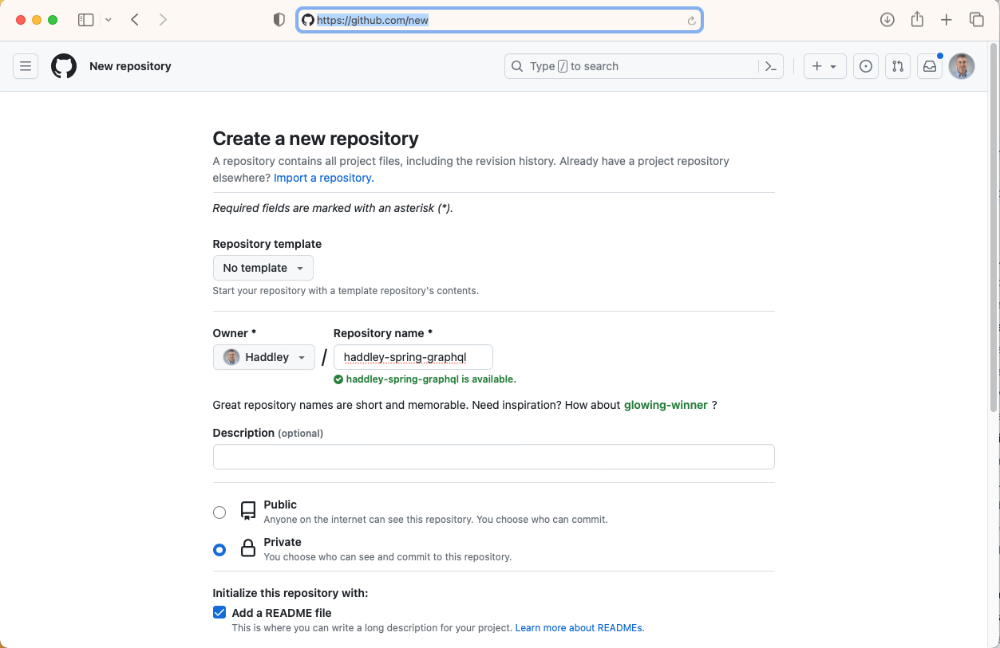
*I created a new GitHub repository*

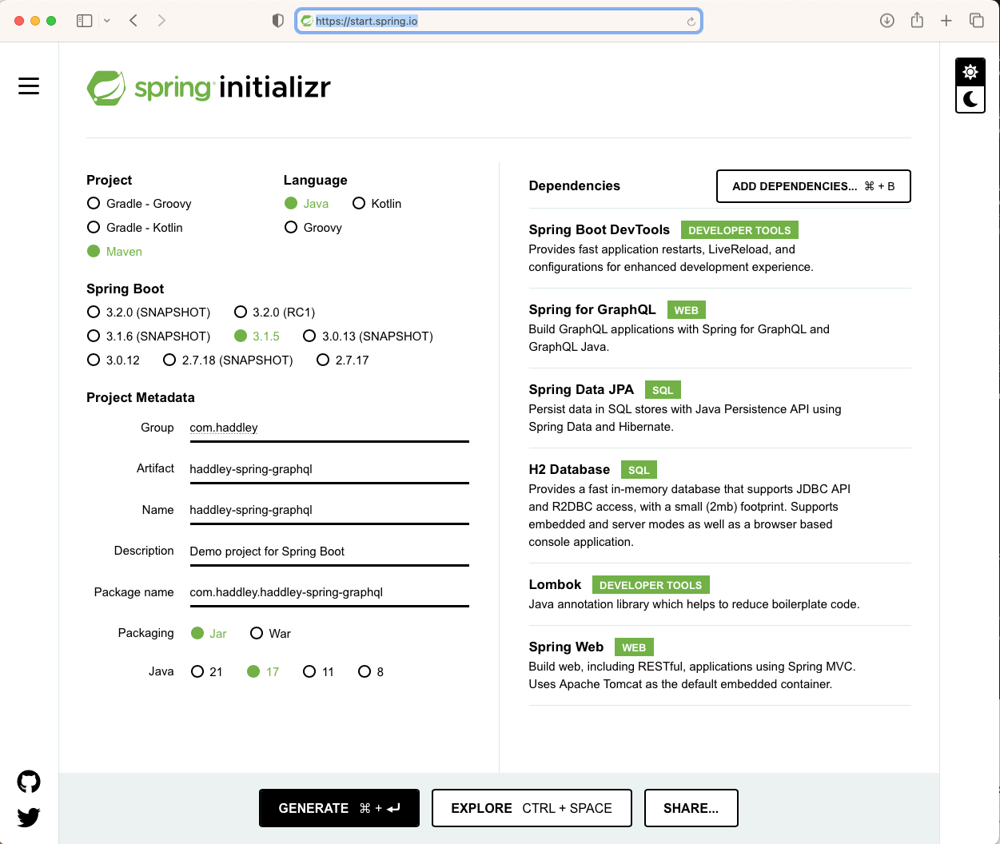
*I used spring initializr to create a new project*


## The finished project

I used http://localhost:8080/graphiql to demonstrate the finished code (in line with my [node GraphQL](/posts/graphql/) implementation)

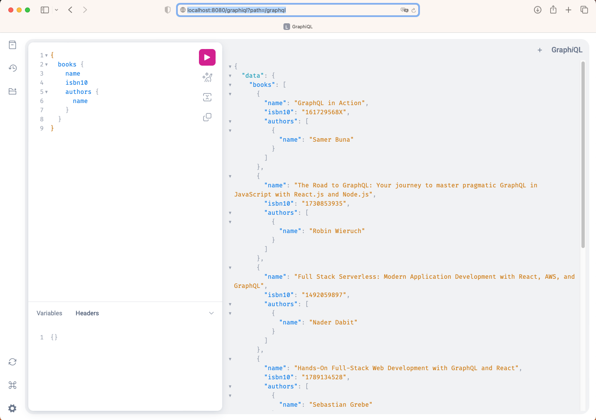
*books*

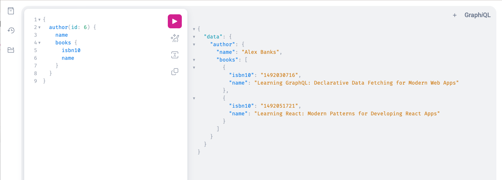
*author(id: 6)*

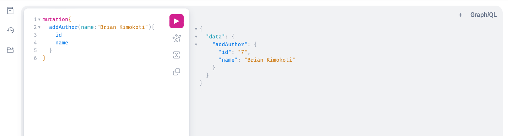
*addAuthor*

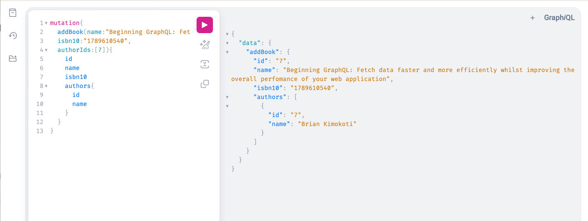
*addBook*

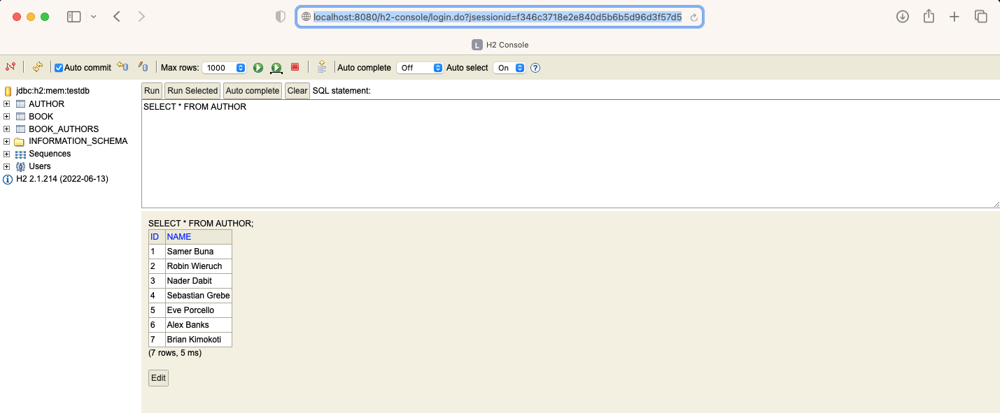
*SELECT * FROM AUTHOR*

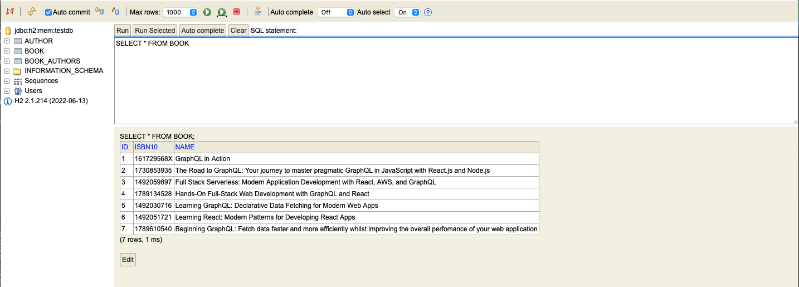
*SELECT * FROM BOOK*

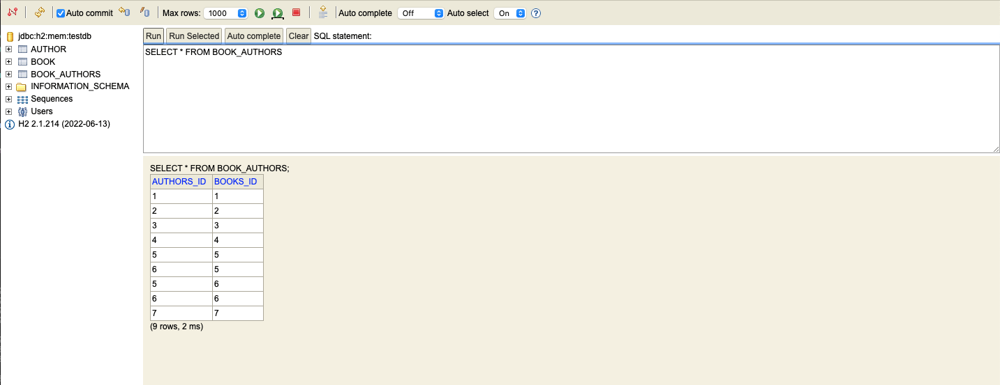
*SELECT * FROM BOOK_AUTHORS*

:::pencil Why is there a BOOK_AUTHORS table?
The schema says that a Book has a list of authors and an Author has a list of books. Look at the @ManyToMany annotations in Author.java and Book.java below. Why would the database need a third table, and what would it hold?

:::answer
One book can have several authors, and one author can write several books, so neither table can hold the link in a single column. A join table, here BOOK_AUTHORS, holds one row for each pairing of a book and an author. The last screenshot shows its rows.
:::
:::


## Implementation

I reviewed the Java implementation details below.

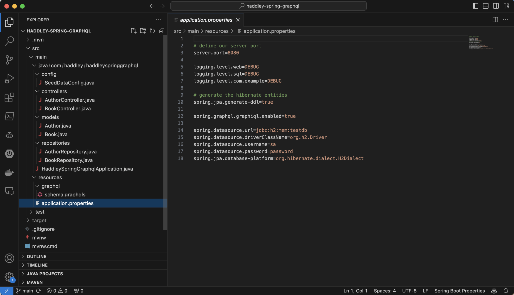
*application.properties*

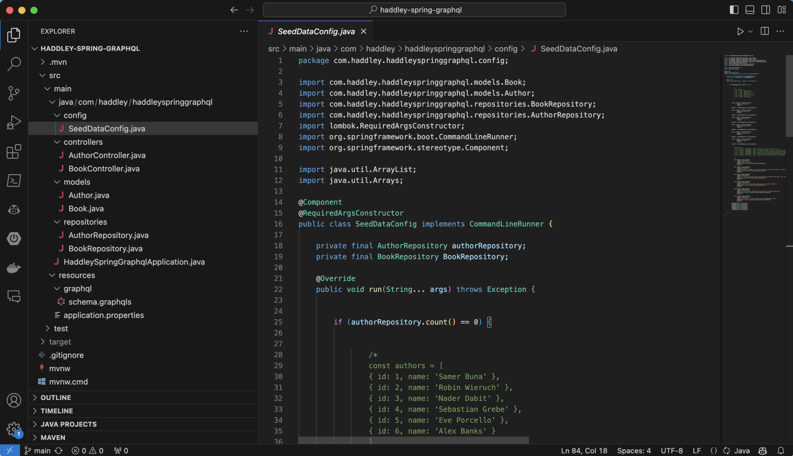
*SeedDataConfig.java*

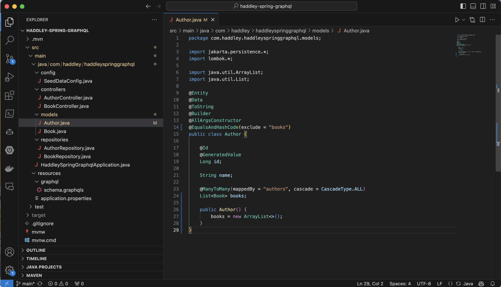
*Author.java*

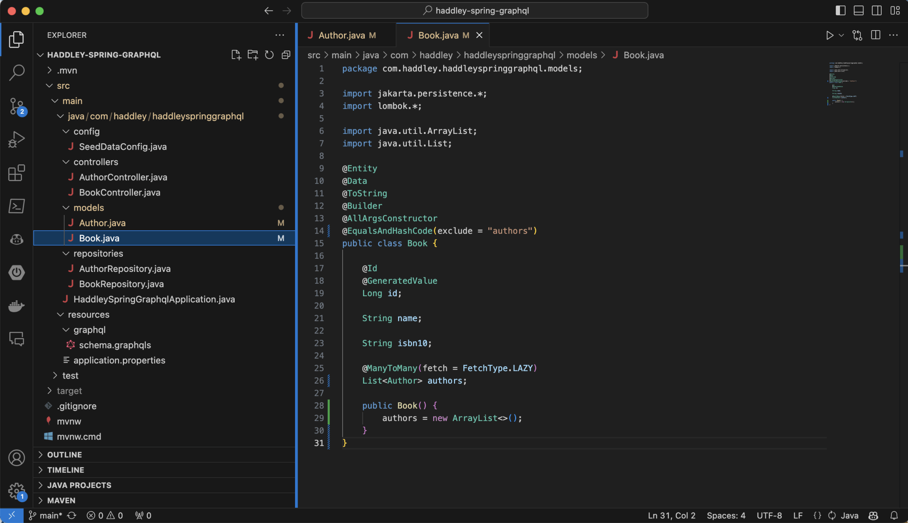
*Book.java*

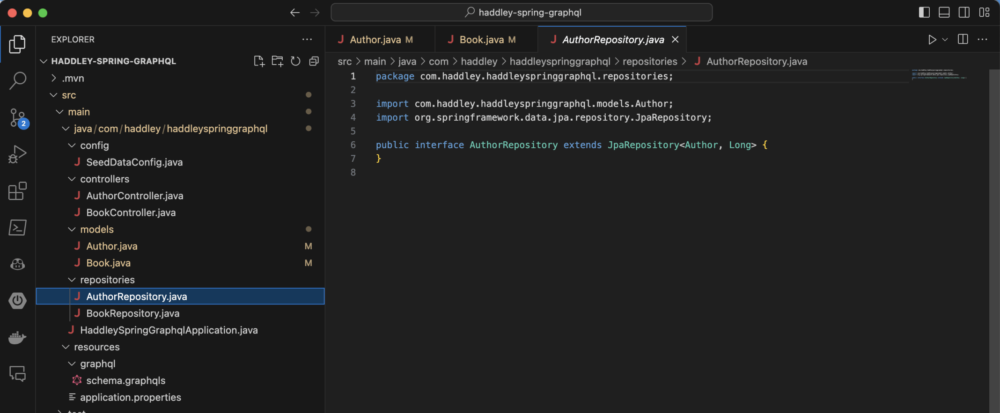
*AuthorRepository.java*

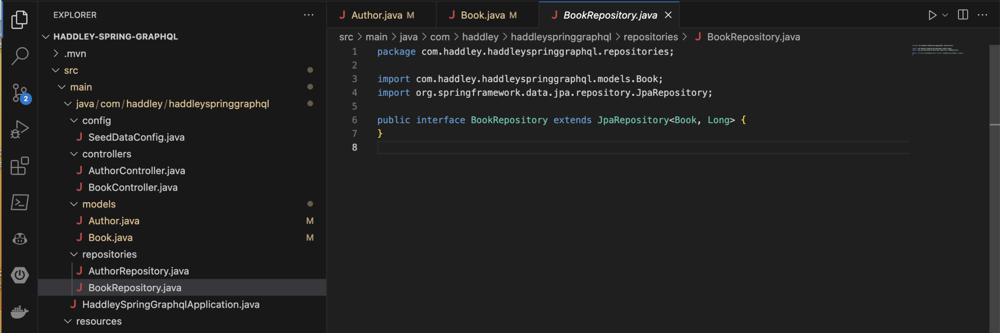
*BookRepository.java*

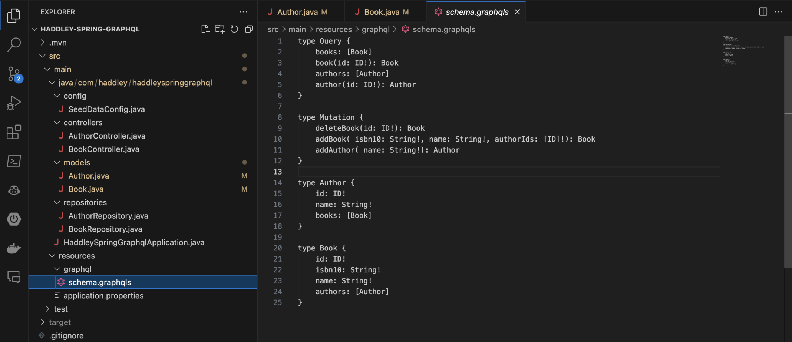
*schema.graphqls*

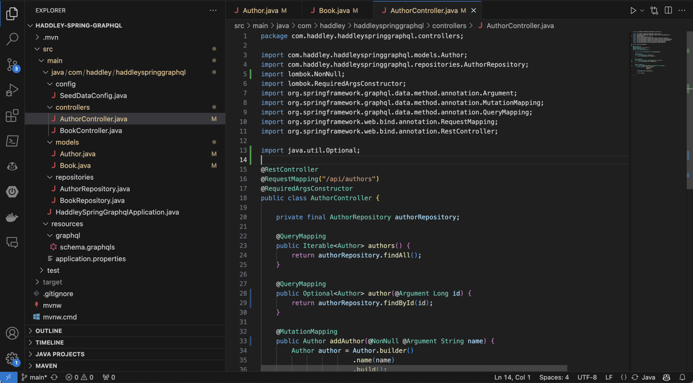
*AuthorController.java*

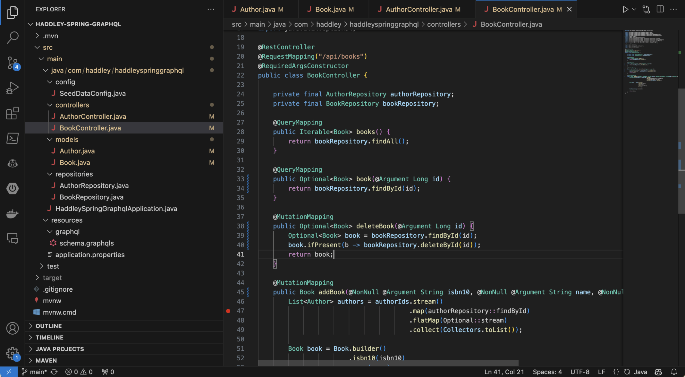
*BookController.java*

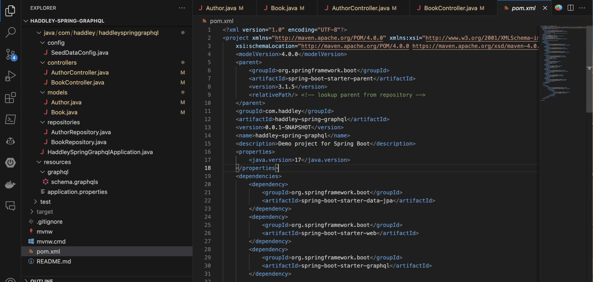
*pom.xml*

:::no-dumb-questions
**Q: What is schema.graphqls?**

A: The contract between the client and the server. It lists the types, such as Book and Author, and the entry points, which are the Query fields books, book, authors and author, and the Mutation fields deleteBook, addBook and addAuthor.

**Q: What is the difference between a Query and a Mutation?**

A: A query reads data and a mutation changes it. In this post, books and author(id: 6) are queries, and addAuthor and addBook are mutations.

**Q: What is GraphiQL?**

A: A page in the browser where I can type a query and see the answer. Setting spring.graphql.graphiql.enabled=true in application.properties switched it on, and I used it at http://localhost:8080/graphiql.
:::

:::under-the-hood How the Java code finds the schema
Spring for GraphQL matches names. A method marked @QueryMapping is connected to the Query field with the same name, so authors() answers the authors field, and book(@Argument Long id) answers book(id: ID!). In the same way, a method marked @MutationMapping, such as addAuthor, answers the Mutation field of that name. The @Argument annotation passes the value that the client sent.
:::

:::watch-it The data lives in memory
The application.properties file points at jdbc:h2:mem:testdb, so the tables are created in memory when the application starts, and SeedDataConfig loads the authors and books at that point. Anything that addAuthor or addBook creates is lost when the application stops.
:::

:::test-drive Try it yourself
1. Run the application and open http://localhost:8080/graphiql.
2. Ask for books, and then ask for only the name of each book.
3. Add an author with addAuthor, and then ask for that author by id.
4. Open the H2 console and run SELECT * FROM AUTHOR to see the new row.
:::

:::bullet-points Recap
- Spring for GraphQL connects Java methods to the fields in a schema file by name.
- @QueryMapping methods read data, and @MutationMapping methods change it.
- GraphiQL gave me a page to try queries and mutations in the browser.
- Books and authors are linked many-to-many, which the database stores in a join table.
- The H2 database is in memory, so my changes are lost when the application stops.
:::


## application.properties

```text
server.port=8080

logging.level.web=DEBUG
logging.level.sql=DEBUG
logging.level.com.example=DEBUG

# generate the hibernate entities
spring.jpa.generate-ddl=true

spring.graphql.graphiql.enabled=true

spring.datasource.url=jdbc:h2:mem:testdb
spring.datasource.driverClassName=org.h2.Driver
spring.datasource.username=sa
spring.datasource.password=password
spring.jpa.database-platform=org.hibernate.dialect.H2Dialect
```

## SeedDataConfig.java

```java
package com.haddley.haddleyspringgraphql.config;

import com.haddley.haddleyspringgraphql.models.Book;
import com.haddley.haddleyspringgraphql.models.Author;
import com.haddley.haddleyspringgraphql.repositories.BookRepository;
import com.haddley.haddleyspringgraphql.repositories.AuthorRepository;
import lombok.RequiredArgsConstructor;
import org.springframework.boot.CommandLineRunner;
import org.springframework.stereotype.Component;

import java.util.ArrayList;
import java.util.Arrays;

@Component
@RequiredArgsConstructor
public class SeedDataConfig implements CommandLineRunner {

    private final AuthorRepository authorRepository;
    private final BookRepository BookRepository;

    @Override
    public void run(String... args) throws Exception {


        if (authorRepository.count() == 0) {


                /* 
                const authors = [
                { id: 1, name: 'Samer Buna' },
                { id: 2, name: 'Robin Wieruch' },
                { id: 3, name: 'Nader Dabit' },
                { id: 4, name: 'Sebastian Grebe' },
                { id: 5, name: 'Eve Porcello' },
                { id: 6, name: 'Alex Banks' }
                ]
                */


            Author author1 = Author.builder()
                    .name("Samer Buna")
                    .build();

            author1 = authorRepository.save(author1);

            Author author2 = Author.builder()
                    .name("Robin Wieruch")
                    .build();

            author2 = authorRepository.save(author2);

            Author author3 = Author.builder()
                    .name("Nader Dabit")
                    .build();

            author3 = authorRepository.save(author3);

            Author author4 = Author.builder()
                    .name("Sebastian Grebe")
                    .build();

            author4 = authorRepository.save(author4);
            
            Author author5 = Author.builder()
                    .name("Eve Porcello")
                    .build();

            author5 = authorRepository.save(author5);

            Author author6 = Author.builder()
                    .name("Alex Banks")
                    .build();

            author6 = authorRepository.save(author6);

                /* 
                const books = [
                { id: 1, isbn10: '161729568X', name: 'GraphQL in Action', authorIds: [1] },
                { id: 2, isbn10: '1730853935', name: 'The Road to GraphQL: Your journey to master pragmatic GraphQL in JavaScript with React.js and Node.js', authorIds: [2] },
                { id: 3, isbn10: '1492059897', name: 'Full Stack Serverless: Modern Application Development with React, AWS, and GraphQL', authorIds: [3] },
                { id: 4, isbn10: '1789134528', name: 'Hands-On Full-Stack Web Development with GraphQL and React', authorIds: [4] },
                { id: 5, isbn10: '1492030716', name: 'Learning GraphQL: Declarative Data Fetching for Modern Web Apps', authorIds: [5, 6] },
                { id: 6, isbn10: '1492051721', name: 'Learning React: Modern Patterns for Developing React Apps', authorIds: [5, 6] },
                ]
                */

                Book book1 = Book.builder()
                    .isbn10("161729568X")
                    .name("GraphQL in Action")
                    .authors(new ArrayList<>(Arrays.asList(author1)))
                    .build();

                Book book2 = Book.builder()
                    .isbn10("1730853935")
                    .name("The Road to GraphQL: Your journey to master pragmatic GraphQL in JavaScript with React.js and Node.js")
                    .authors(new ArrayList<>(Arrays.asList(author2)))
                    .build();

                Book book3 = Book.builder()
                    .isbn10("1492059897")
                    .name("Full Stack Serverless: Modern Application Development with React, AWS, and GraphQL")
                    .authors(new ArrayList<>(Arrays.asList(author3)))
                    .build();

                Book book4 = Book.builder()
                    .isbn10("1789134528")
                    .name("Hands-On Full-Stack Web Development with GraphQL and React")
                    .authors(new ArrayList<>(Arrays.asList(author4)))
                    .build();

                Book book5 = Book.builder()
                    .isbn10("1492030716")
                    .name("Learning GraphQL: Declarative Data Fetching for Modern Web Apps")
                    .authors(new ArrayList<>(Arrays.asList(author5,author6)))
                    .build();

                Book book6 = Book.builder()
                    .isbn10("1492051721")
                    .name("Learning React: Modern Patterns for Developing React Apps")
                    .authors(new ArrayList<>(Arrays.asList(author5,author6)))
                    .build();

            BookRepository.save(book1);
            BookRepository.save(book2);
            BookRepository.save(book3);
            BookRepository.save(book4);
            BookRepository.save(book5);
            BookRepository.save(book6);

        }
    }

}
```

## Author.java

```javascript
package com.haddley.haddleyspringgraphql.models;

import jakarta.persistence.*;
import lombok.*;

import java.util.ArrayList;
import java.util.List;

@Entity
@Data
@ToString
@Builder
@AllArgsConstructor
@EqualsAndHashCode(exclude = "books")
public class Author {

    @Id
    @GeneratedValue
    Long id;

    String name;

    @ManyToMany(mappedBy = "authors", cascade = CascadeType.ALL)
    List<Book> books;

    public Author() {
        books = new ArrayList<>();
    }
}
```

## Book.java

```java
package com.haddley.haddleyspringgraphql.models;

import jakarta.persistence.*;
import lombok.*;

import java.util.ArrayList;
import java.util.List;

@Entity
@Data
@ToString
@Builder
@AllArgsConstructor
@EqualsAndHashCode(exclude = "authors")
public class Book {

    @Id
    @GeneratedValue
    Long id;

    String name;

    String isbn10;

    @ManyToMany(fetch = FetchType.LAZY)
    List<Author> authors;

    public Book() {
        authors = new ArrayList<>();
    }
}
```

## AuthorRepository.java

```java
package com.haddley.haddleyspringgraphql.repositories;

import com.haddley.haddleyspringgraphql.models.Author;
import org.springframework.data.jpa.repository.JpaRepository;

public interface AuthorRepository extends JpaRepository<Author, Long> {
}
```

## BookRepository.java

```java
package com.haddley.haddleyspringgraphql.repositories;

import com.haddley.haddleyspringgraphql.models.Book;
import org.springframework.data.jpa.repository.JpaRepository;

public interface BookRepository extends JpaRepository<Book, Long> {
}
```

## schema.graphqls

```sdl
type Query {
    books: [Book]
    book(id: ID!): Book
    authors: [Author]
    author(id: ID!): Author
}

type Mutation {
    deleteBook(id: ID!): Book
    addBook( isbn10: String!, name: String!, authorIds: [ID]!): Book
    addAuthor( name: String!): Author
}

type Author {
    id: ID!
    name: String!
    books: [Book]
}

type Book {
    id: ID!
    isbn10: String!
    name: String!
    authors: [Author]
}
```

## AuthorController.java

```java
package com.haddley.haddleyspringgraphql.controllers;

import com.haddley.haddleyspringgraphql.models.Author;
import com.haddley.haddleyspringgraphql.repositories.AuthorRepository;
import lombok.NonNull;
import lombok.RequiredArgsConstructor;
import org.springframework.graphql.data.method.annotation.Argument;
import org.springframework.graphql.data.method.annotation.MutationMapping;
import org.springframework.graphql.data.method.annotation.QueryMapping;
import org.springframework.web.bind.annotation.RequestMapping;
import org.springframework.web.bind.annotation.RestController;

import java.util.Optional;

@RestController
@RequestMapping("/api/authors")
@RequiredArgsConstructor
public class AuthorController {

    private final AuthorRepository authorRepository;

    @QueryMapping
    public Iterable<Author> authors() {
        return authorRepository.findAll();
    }

    @QueryMapping
    public Optional<Author> author(@Argument Long id) {
        return authorRepository.findById(id);
    }

    @MutationMapping
    public Author addAuthor(@NonNull @Argument String name) {
        Author author = Author.builder()
                        .name(name)
                        .build();

        authorRepository.save(author);

        return author;
    }
}
```

## BookController.java

```java
package com.haddley.haddleyspringgraphql.controllers;

import com.haddley.haddleyspringgraphql.models.Book;
import com.haddley.haddleyspringgraphql.models.Author;
import com.haddley.haddleyspringgraphql.repositories.BookRepository;
import com.haddley.haddleyspringgraphql.repositories.AuthorRepository;
import lombok.NonNull;
import lombok.RequiredArgsConstructor;
import org.springframework.graphql.data.method.annotation.Argument;
import org.springframework.graphql.data.method.annotation.MutationMapping;
import org.springframework.graphql.data.method.annotation.QueryMapping;
import org.springframework.web.bind.annotation.RequestMapping;
import org.springframework.web.bind.annotation.RestController;

import java.util.List;
import java.util.stream.Collectors;
import java.util.Optional;

@RestController
@RequestMapping("/api/books")
@RequiredArgsConstructor
public class BookController {

    private final AuthorRepository authorRepository;
    private final BookRepository bookRepository;

    @QueryMapping
    public Iterable<Book> books() {
        return bookRepository.findAll();
    }

    @QueryMapping
    public Optional<Book> book(@Argument Long id) {
        return bookRepository.findById(id);
    }

    @MutationMapping
    public Optional<Book> deleteBook(@Argument Long id) {
        Optional<Book> book = bookRepository.findById(id);
        book.ifPresent(b -> bookRepository.deleteById(id));
        return book;
    }

    @MutationMapping
    public Book addBook(@NonNull @Argument String isbn10, @NonNull @Argument String name, @NonNull @Argument List<Long> authorIds) {
        List<Author> authors = authorIds.stream()
                                        .map(authorRepository::findById)
                                        .flatMap(Optional::stream)
                                        .collect(Collectors.toList());

        Book book = Book.builder()
                        .isbn10(isbn10)
                        .name(name)
                        .authors(authors)
                        .build();

        bookRepository.save(book);

        return book;
    }
}
```

## pom.xml

```xml
<?xml version="1.0" encoding="UTF-8"?>
<project xmlns="http://maven.apache.org/POM/4.0.0" xmlns:xsi="http://www.w3.org/2001/XMLSchema-instance"
	xsi:schemaLocation="http://maven.apache.org/POM/4.0.0 https://maven.apache.org/xsd/maven-4.0.0.xsd">
	<modelVersion>4.0.0</modelVersion>
	<parent>
		<groupId>org.springframework.boot</groupId>
		<artifactId>spring-boot-starter-parent</artifactId>
		<version>3.1.5</version>
		<relativePath/> <!-- lookup parent from repository -->
	</parent>
	<groupId>com.haddley</groupId>
	<artifactId>haddley-spring-graphql</artifactId>
	<version>0.0.1-SNAPSHOT</version>
	<name>haddley-spring-graphql</name>
	<description>Demo project for Spring Boot</description>
	<properties>
		<java.version>17</java.version>
	</properties>
	<dependencies>
		<dependency>
			<groupId>org.springframework.boot</groupId>
			<artifactId>spring-boot-starter-data-jpa</artifactId>
		</dependency>
		<dependency>
			<groupId>org.springframework.boot</groupId>
			<artifactId>spring-boot-starter-web</artifactId>
		</dependency>
		<dependency>
			<groupId>org.springframework.boot</groupId>
			<artifactId>spring-boot-starter-graphql</artifactId>
		</dependency>

		<dependency>
			<groupId>org.springframework.boot</groupId>
			<artifactId>spring-boot-devtools</artifactId>
			<scope>runtime</scope>
			<optional>true</optional>
		</dependency>
		<dependency>
			<groupId>com.h2database</groupId>
			<artifactId>h2</artifactId>
			<scope>runtime</scope>
		</dependency>
		<dependency>
			<groupId>org.projectlombok</groupId>
			<artifactId>lombok</artifactId>
			<optional>true</optional>
		</dependency>
		<dependency>
			<groupId>org.springframework.boot</groupId>
			<artifactId>spring-boot-starter-test</artifactId>
			<scope>test</scope>
		</dependency>
		<dependency>
			<groupId>org.springframework</groupId>
			<artifactId>spring-webflux</artifactId>
			<scope>test</scope>
		</dependency>
		<dependency>
			<groupId>org.springframework.graphql</groupId>
			<artifactId>spring-graphql-test</artifactId>
			<scope>test</scope>
		</dependency>
	</dependencies>

	<build>
		<plugins>
			<plugin>
				<groupId>org.springframework.boot</groupId>
				<artifactId>spring-boot-maven-plugin</artifactId>
				<configuration>
					<excludes>
						<exclude>
							<groupId>org.projectlombok</groupId>
							<artifactId>lombok</artifactId>
						</exclude>
					</excludes>
				</configuration>
			</plugin>
		</plugins>
	</build>

</project>
```
## References

- [Unleash the Power of GraphQL in Spring Boot](https://www.youtube.com/watch?v=8Hp-DMeqHAk&t=1717s)