I used **Azure Spring Apps** to host a Java Web Application in Microsoft Azure

:::brain-power Before you read on
If you had to put a Java web application on the internet without looking after a server yourself, what would you still have to decide? Write down your list, and then see which items Azure Spring Apps asks you for.
:::

## What the video says

[The Microsoft Build session](https://www.youtube.com/watch?v=64AWFTbDwHg), with Adib Saikali and Asir Selvasingh, describes what the Azure Spring Apps service does for me:

- **It is fully managed, and it runs on Kubernetes.** Each service instance has two dedicated Kubernetes clusters that Azure Spring Apps manages and hides from me. One cluster runs the service components, and the other runs my applications.
- **There are three steps.** I create a service instance, I create an app inside it, and I deploy the application binaries.
- **Monitoring and security come with it.** Logs and metrics go to Azure Monitor, and an application can use a managed identity to reach other Azure services without a password.
- **Operating it is simple.** The video shows scaling up, scaling out, and zero-downtime deployments, and says that Microsoft and VMware jointly operate and support the service.
- **The demo uses the Enterprise tier.** I chose the entry level, so some of what the presenters show, such as application accelerators, is not in my screenshots.

:::watch-it Azure Spring Apps is being retired
Microsoft's [retirement announcement](https://learn.microsoft.com/en-us/azure/spring-apps/basic-standard/retirement-announcement) says that all Azure Spring Apps plans, Basic, Standard and Enterprise, entered a three-year retirement period on March 17, 2025, and will be retired on March 31, 2028. The service has not accepted new customers since March 17, 2025, and Microsoft recommends Azure Container Apps and Azure Kubernetes Service as the replacements.

I wrote this walkthrough from screenshots that I took in October 2023, so please read it as a record of how the service worked, and not as a way to start a new project. The same announcement says that App Accelerator, which the video demonstrates, was one of three Tanzu components that would go out of support after August 2025.
:::

:::no-dumb-questions
**Q: Why is Azure Spring Apps being retired?**

A: The announcement does not give a detailed reason, and I have not found one elsewhere. It says that the service was jointly built by Microsoft and VMware by Broadcom, and that after careful consideration and analysis, Microsoft and Broadcom made the difficult decision to retire it. I will not guess at more than that.

**Q: What else does the announcement say that helps to explain it?**

A: Three things. First, Microsoft says it will not build any new features in Azure Spring Apps and will put its new features and improvements into Azure Container Apps instead. Second, the announcement says that three of the Tanzu components in the Enterprise plan, App Live View, App Accelerator and App Configuration Service, were reaching the end of Broadcom's product lifecycle. Third, Microsoft says that the decision concerns this one product, and that it is increasing its investment in Azure Container Apps and in its Java tooling.

**Q: Is Java on Azure going away?**

A: No, according to the announcement. It says that retiring Azure Spring Apps does not change Microsoft's overall commitment to Java on Azure, and it describes Azure Container Apps as offering enhanced Java features for managing, monitoring and troubleshooting Java apps at scale.
:::

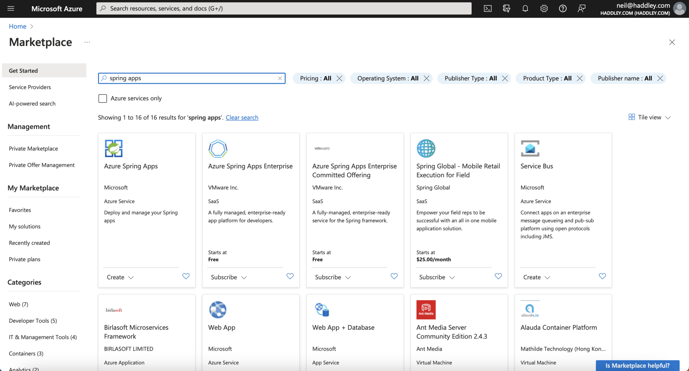
*I clicked the Azure Spring Apps Create button*

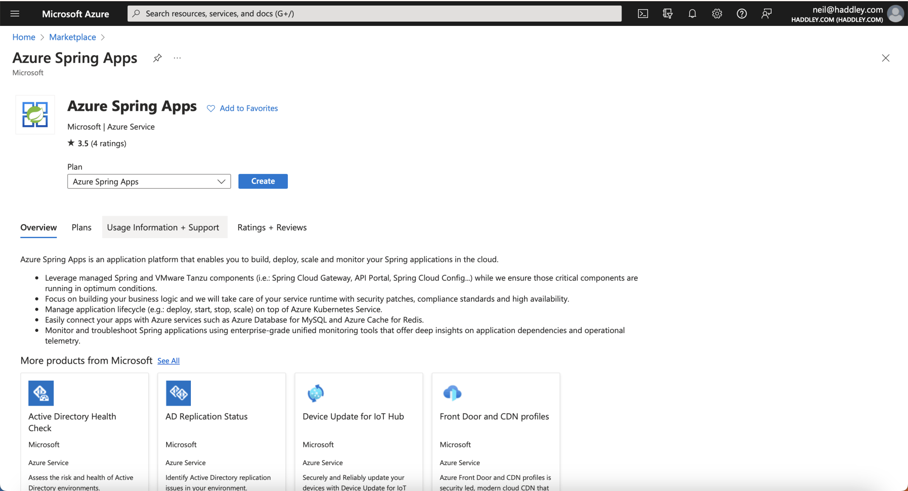
*I reviewed the overview and clicked the Create button*

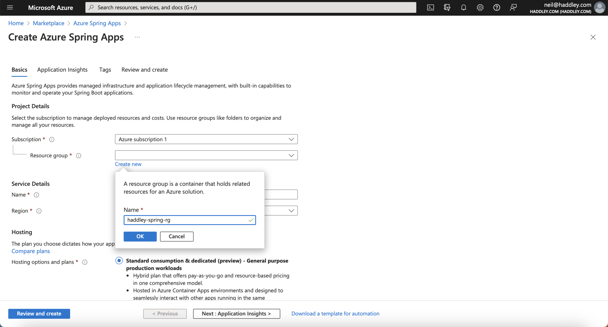
*I specified a resource group name (haddley-spring-rg)*

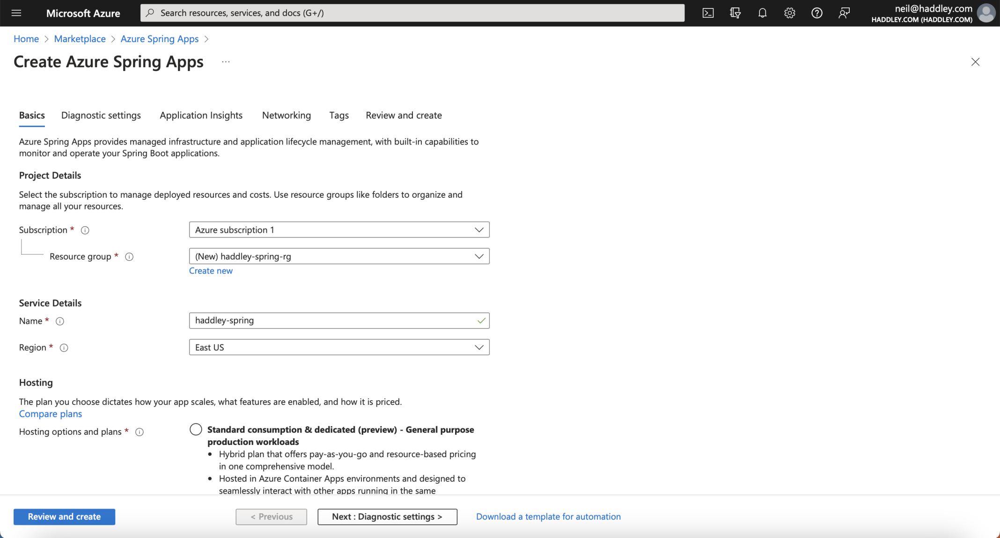
*I specified a service details name (haddley-spring)*

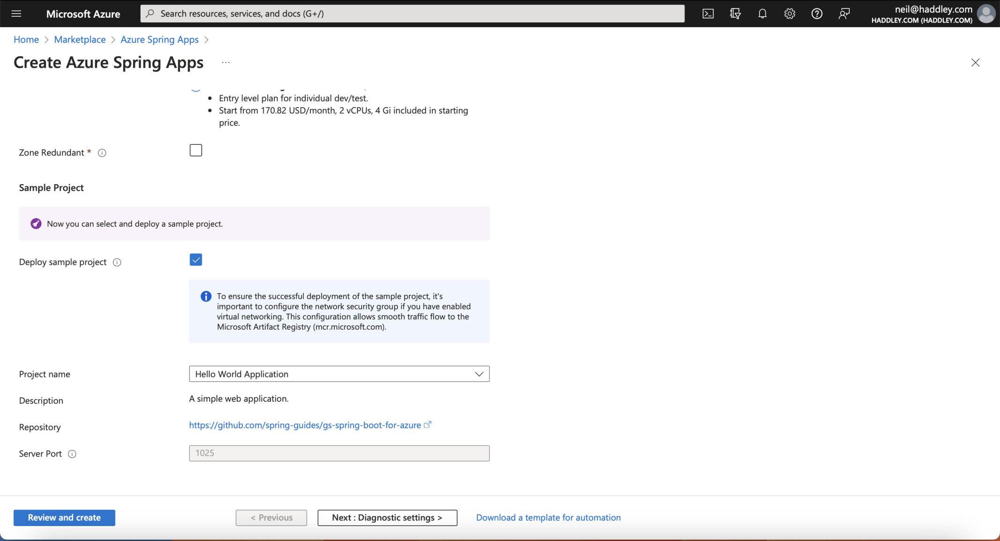
*I selected the entry level and clicked the Deploy sample project option*

:::no-dumb-questions
**Q: What is Azure Spring Apps?**

A: A managed service in Azure for hosting Spring Boot applications. I created a service called haddley-spring, and Azure ran the application for me, so I did not set up a server. The video says the service is built on Kubernetes, so I get the benefits of containers without having to learn or manage Kubernetes.

**Q: What does Deploy sample project do?**

A: It puts a ready-made application on the new service. In my run the project was called Hello World Application, and it comes from the gs-spring-boot-for-azure repository in the spring-guides organisation on GitHub. It became an app called hello-world-app, which I could open from the Apps page and see running.

**Q: How long does it take to create a service?**

A: The video says to wait about 10 minutes. In my run, the deployment started at 11:59 AM, and the hello-world-app shows a create time of 12:03 PM, so it took about 4 to 5 minutes. I took the deployment complete screenshot later, at 12:51 PM, after I came back to it.
:::

## Deploy the sample and look around

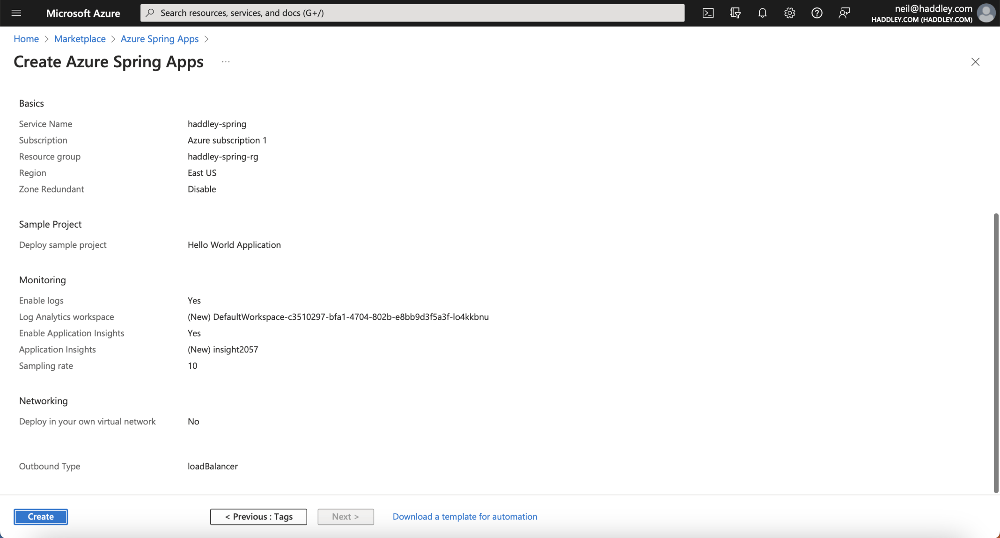
*I clicked the Create button*

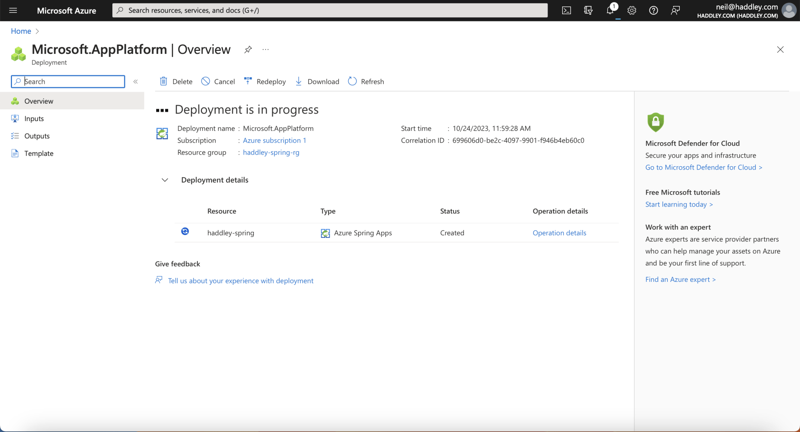
*Deployment in progress*

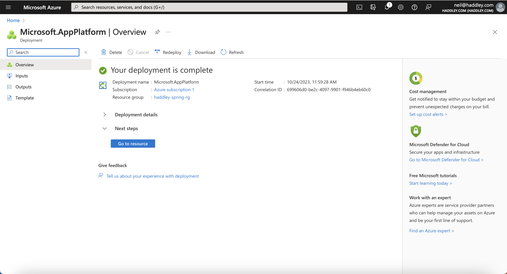
*Deployment is complete*

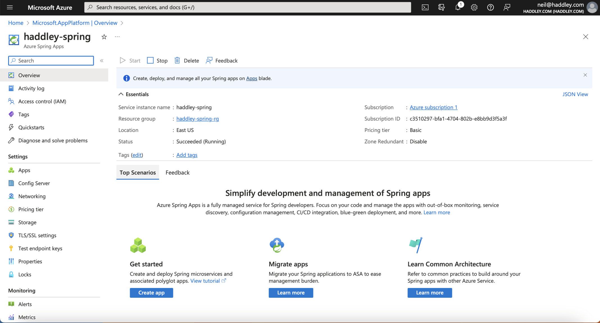
*The haddley-spring overview: Succeeded (Running), the Basic pricing tier, in East US*

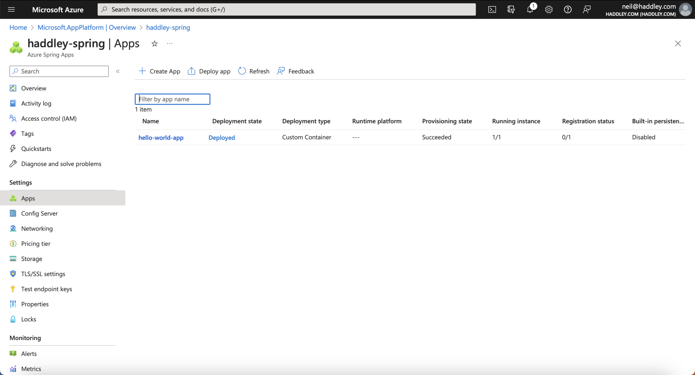
*The Apps page lists hello-world-app as Deployed, with 1 of 1 instances running*

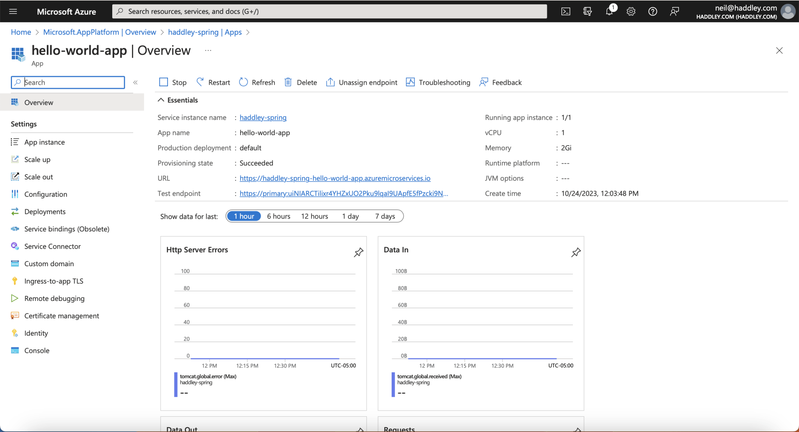
*The hello-world-app overview, with its public URL, 1 vCPU and 2 GiB of memory*

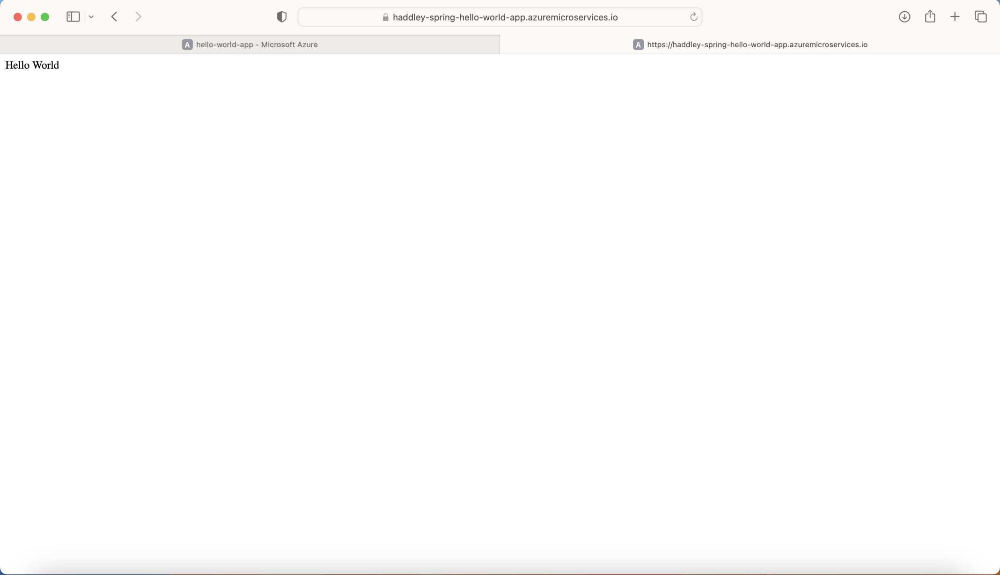
*The sample at its public URL, answering with Hello World*

:::under-the-hood What the video does from the command line
Instead of the portal, the presenter uses the Azure CLI. The az spring app create command makes the app. It takes the amount of CPU and memory, an assign-endpoint flag that gives the app a public URL, and a system-assigned flag that gives it a managed identity. The az spring app deploy command takes the app name and the path of the compiled jar file. In the Enterprise plan demo, the presenter does not write a Dockerfile, because the service builds the container from the code.

The presenter says that a production deployment would normally turn the public endpoint off and send requests to the app from a load balancer, over a private URL.
:::

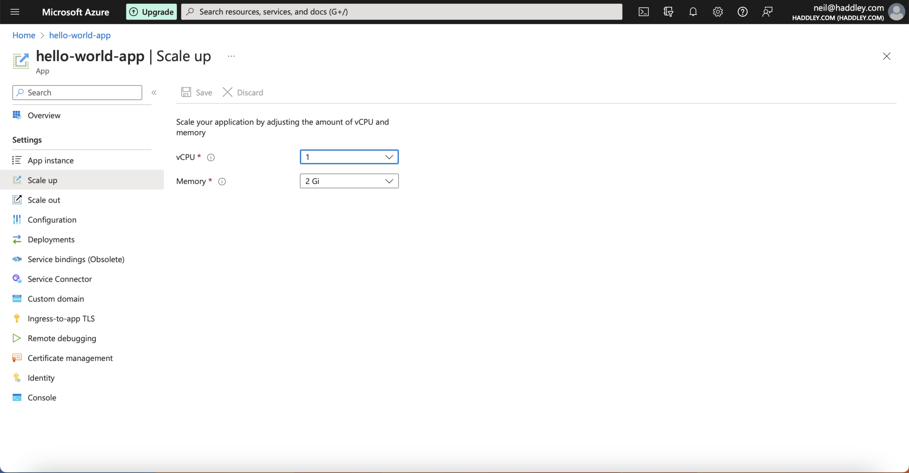
*Scale up: the app has 1 vCPU and 2 GiB of memory*

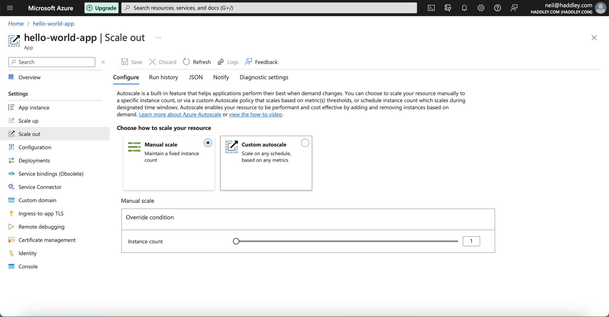
*Scale out: manual scale with an instance count of 1, or a custom autoscale*

:::pencil Scale up or scale out?
The Scale up page changes how big each instance is, and the Scale out page changes how many instances run. Your application answers one request quickly, but it slows down when many people visit at once. Which would you try first, and why?

:::answer
Scale out is the usual first choice for many visitors at once, because more instances share the requests. Scale up helps when a single request needs more memory or processing power. The video also shows an autoscaler that can add instances based on CPU use, memory use or the number of HTTP requests. I only looked at both pages in this run and did not load test either, so treat this as a rule of thumb.
:::
:::

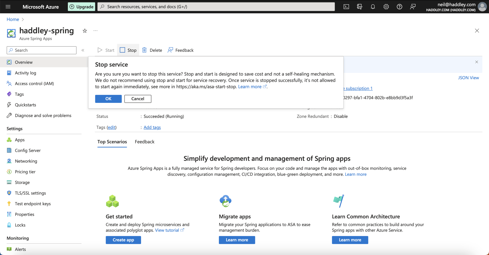
*I clicked Stop, and Azure asked me to confirm. It warns that stop and start is designed to save cost and is not a way to recover a service*

:::watch-it A running service can keep costing money
I stopped the service after I had looked around. The create page described the entry-level plan as starting from 170.82 USD a month, so check what your plan charges while the service is running, and stop or delete the resources when you have finished.
:::

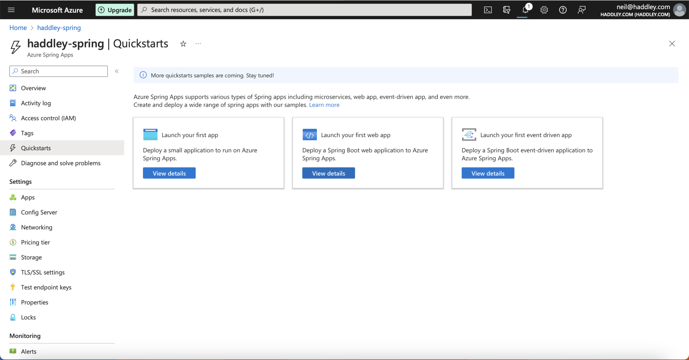
*The Quickstarts page offers a first app, a first web app and a first event-driven app*

## GreetingController.java

The sample application is small. Its GreetingController is a Spring MVC controller with one method that answers requests to / with the text Hello World. I ran the same sample on my own machine, from the project's complete folder.

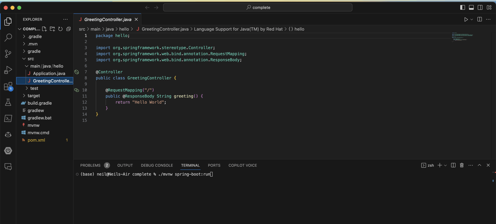
*GreetingController.java in Visual Studio Code, and the ./mvnw spring-boot:run command in the terminal*

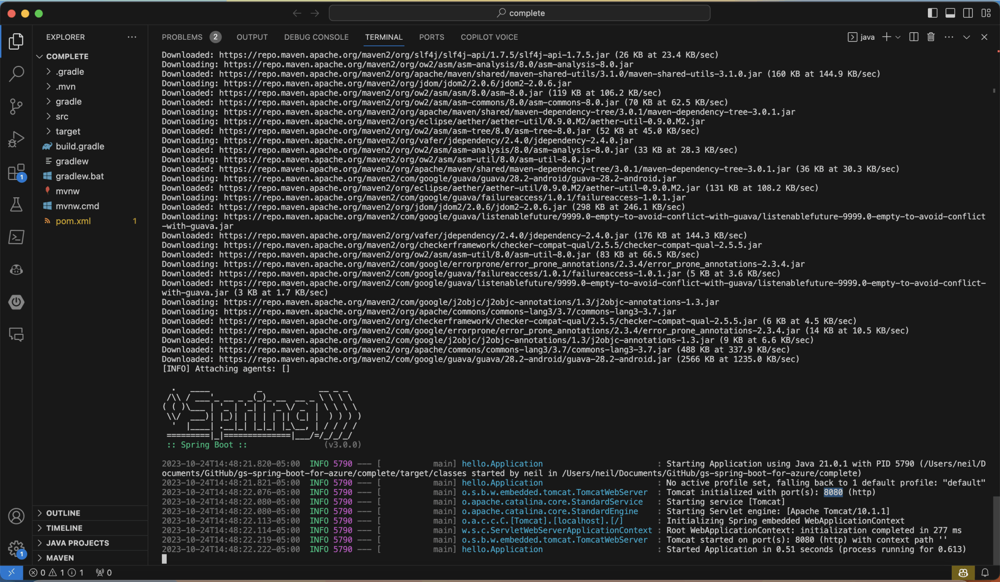
*The Spring Boot log: Tomcat initialized with port 8080 (http), and the application started in about half a second*

:::under-the-hood What ./mvnw spring-boot:run does
The mvnw script is the Maven wrapper that comes with a Spring Boot project, so I do not need to install Maven first. The spring-boot:run goal compiles the application and starts it with an embedded Tomcat server. That is why the log says Tomcat initialized with port 8080: the application brings its own web server, and nothing else needs to be installed to run it.
:::

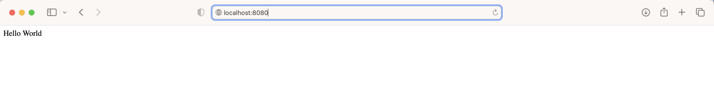
*The same Hello World at localhost:8080*

:::test-drive Try it yourself
1. In the project folder, run ./mvnw spring-boot:run.
2. When the log says Tomcat initialized with port 8080, open http://localhost:8080 in a browser.
3. You should see the same Hello World that the deployed app shows at its public URL. Change the text in GreetingController.java, run it again, and see what changes.
:::

:::bullet-points Recap
- Azure Spring Apps runs a Spring Boot application for me, so I do not manage a server. The video says it is built on Kubernetes, which I do not have to manage.
- The video describes three steps: create a service instance, create an app, and deploy the binaries.
- I created a resource group and a service, and used Deploy sample project to get a running hello-world-app.
- Scale up makes each instance bigger, and scale out runs more instances.
- A running service can keep costing money, so I stopped mine when I had finished.
- ./mvnw spring-boot:run runs the same kind of application on my own machine, with an embedded Tomcat on port 8080.
:::

## References

- [Azure Spring Apps retirement announcement](https://learn.microsoft.com/en-us/azure/spring-apps/basic-standard/retirement-announcement)
- [Azure Spring Apps: The easy way to run your apps | ODFP207](https://www.youtube.com/watch?v=64AWFTbDwHg)

