I used Business Central sub-ledgers to manage business operations.

Sub-ledgers include:

Item Ledger
Vendor Ledger
Detailed Vendor Ledger
Customer Ledger; and
Detailed Customer Ledger

## Posting Groups

I used Posting Groups to build a bridge between Business Central sub-ledgers and the general ledger accounts.

I used a Vendor Posting Group to define which accounts payable general ledger account to use when purchasing goods from a Vendor.

I maintained Vendor Posting Groups using the Vendor Posting Groups page.

:::brain-power Before you read on
Business Central keeps a ledger for items, vendors and customers as well as the general ledger. How should an entry in a vendor's ledger be tied to an account in the general ledger?
:::

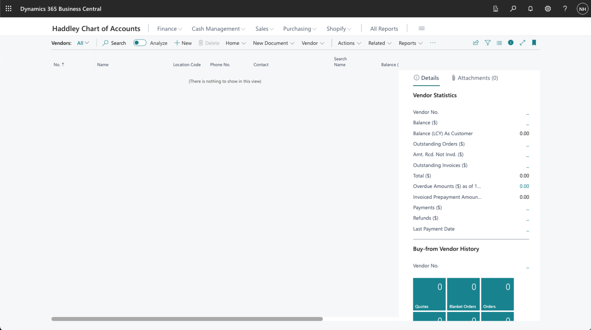
*I used search to navigate to the Vendors page. I used + New to create a new Vendor*

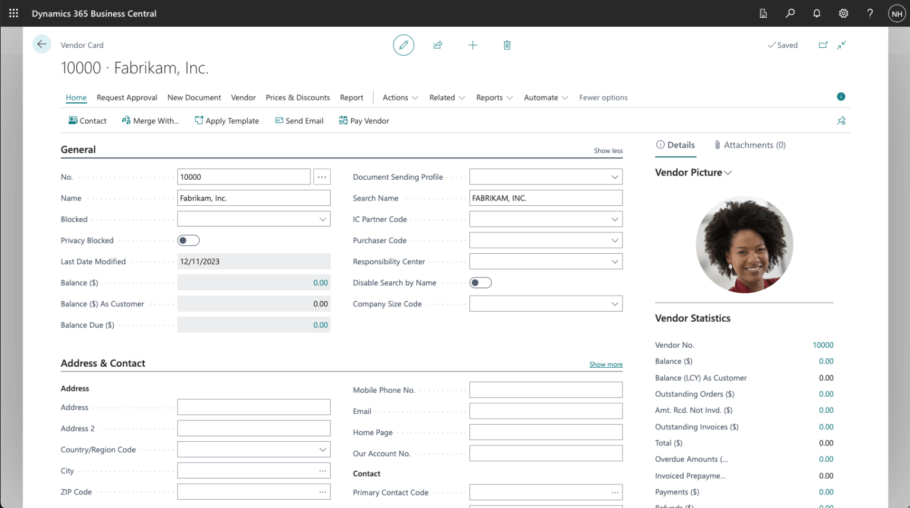
*I entered Vendor details*

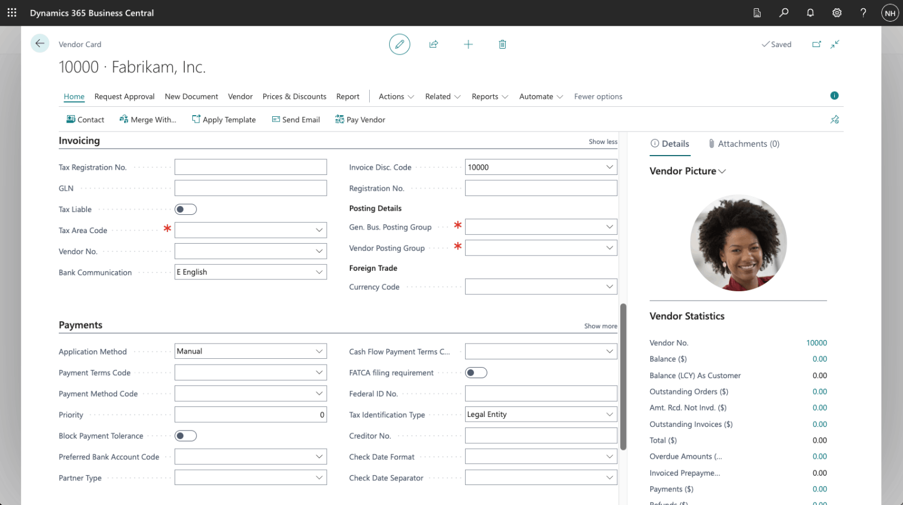
*I reviewed the Invoicing tab for the new Vendor*

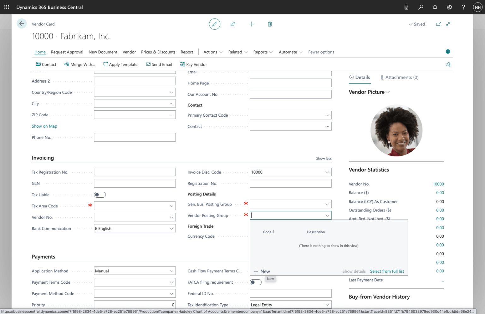
*I clicked the + New link*

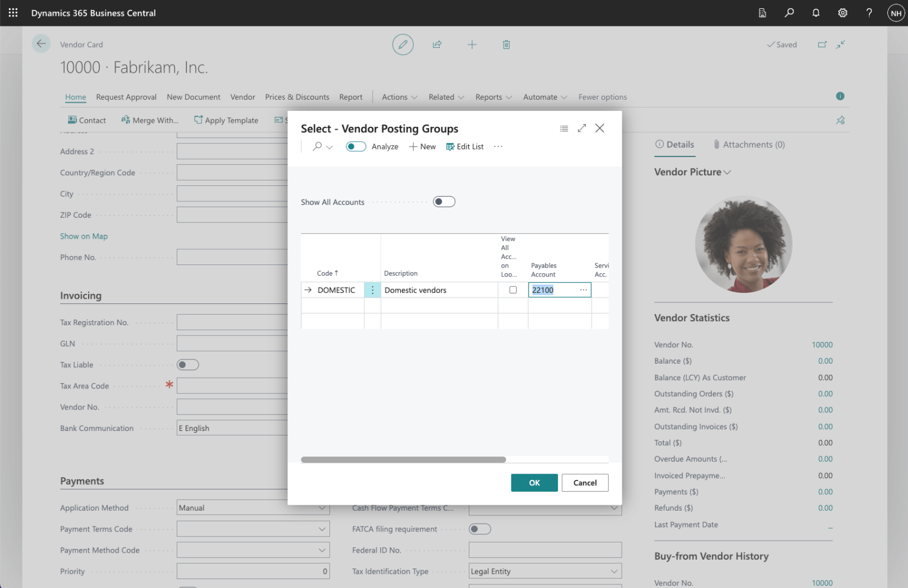
*I added code DOMESTIC and set Payables Account to 22100 (Account Payable, Domestic)*

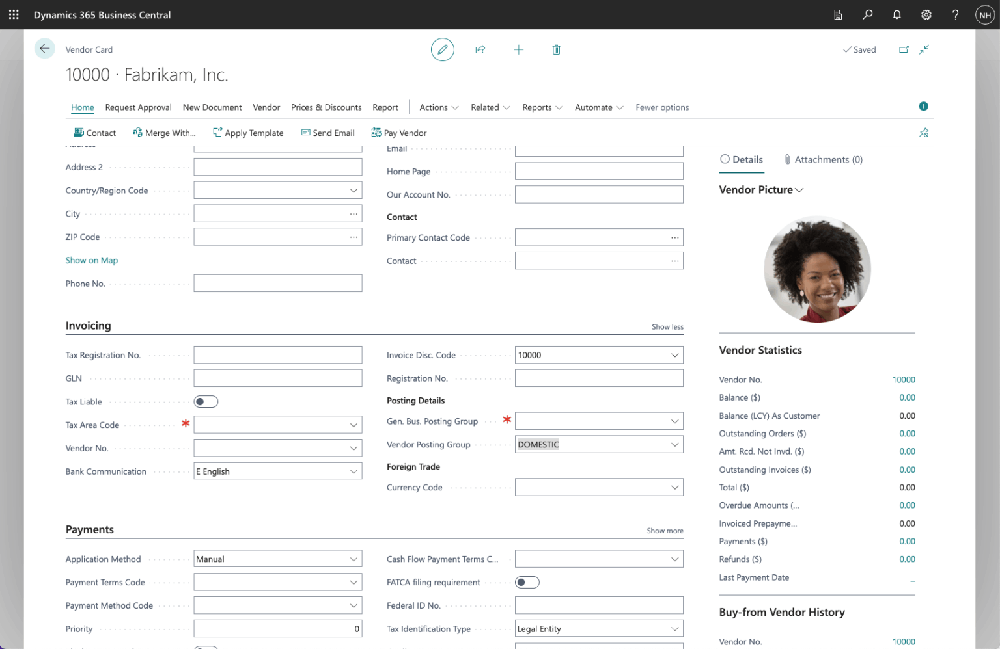
*I set the Vendor Posting Group to DOMESTIC*

:::no-dumb-questions
**Q: What is a sub-ledger?**

A: A ledger that holds the detail behind part of the business. The post lists five: the Item Ledger, the Vendor Ledger, the Detailed Vendor Ledger, the Customer Ledger and the Detailed Customer Ledger.

**Q: What does a posting group do?**

A: It is the bridge between the sub-ledgers and the general ledger accounts. My DOMESTIC Vendor Posting Group says that purchases from a vendor use 22100 Account Payable, Domestic as the payables account.
:::

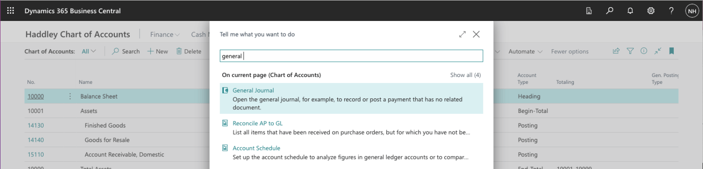
*I used search to navigate to the General Journal page*

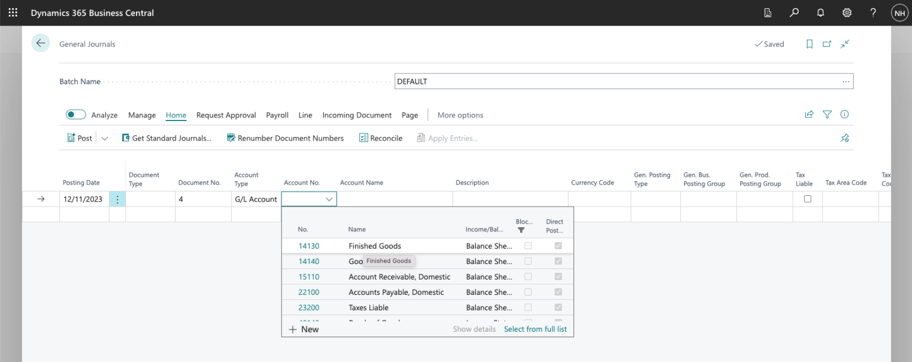
*I created a Journal entry debiting the Finished Goods account*

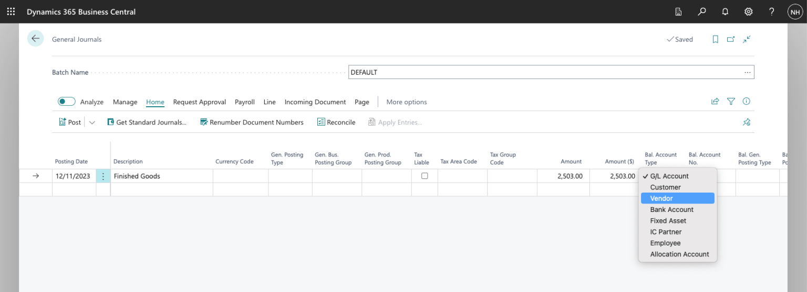
*I set the Amount to $2,503 and the balancing Account Type to Vendor*

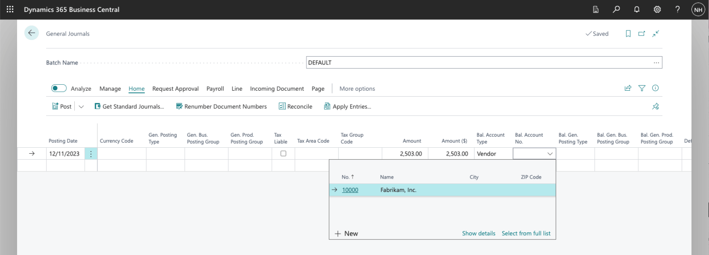
*I selected Vendor Fabrikam, Inc.*

*I clicked the Preview Posting button*

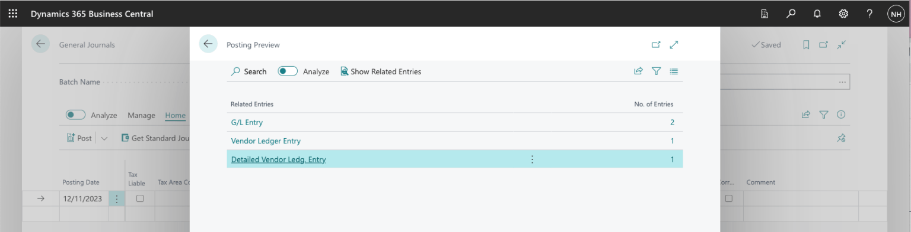
*The preview showed 2 General Ledger entries, 1 Vendor Ledger entry and 1 Detailed Vendor Ledger entry*

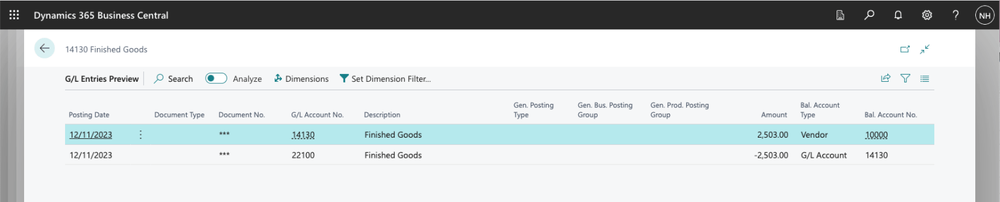
*The first general ledger entry relates to General Ledger account 14130 Finished Goods. The second general ledger entry relates to General Ledger account 22100 Accounts Payable, Domestic (per the DOMESTIC Vendor Posting Group).*

:::pencil Which two accounts?
I created a journal entry that debits the Finished Goods account for $2,503, with Vendor Fabrikam, Inc. as the balancing account. The vendor has the DOMESTIC Vendor Posting Group. Which two general ledger accounts would you expect the preview to show?

:::answer
The first general ledger entry is on 14130 Finished Goods, which I debited. The second is on 22100 Accounts Payable, Domestic, which comes from the vendor's DOMESTIC posting group. The preview also showed one vendor ledger entry and one detailed vendor ledger entry.
:::
:::

:::test-drive Try it yourself
1. Create a Vendor Posting Group with a payables account of your own.
2. Assign it to a new vendor.
3. Use Preview Posting on a journal entry for that vendor, and check the account.
:::

:::bullet-points Recap
- Sub-ledgers hold the detail for items, vendors and customers.
- Posting groups bridge the sub-ledgers and the general ledger.
- The vendor's posting group chose 22100 as the payables account in the preview.
:::
